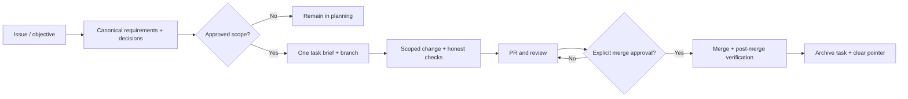

<div align="center">

# 🤖 TIO WORKSPACE · AI CONTEXT

**Fast orientation. Reliable handoffs. One source of truth.**

[🏠 Project](../README.md) · [📜 Agent policy](../AGENTS.md) · [🧭 Current state](current.md) · [📚 Documentation](../docs/00-INDEX.md)

</div>

| Document field | Value |
|---|---|
| **Document status** | Active operational guide — **not** a product/architecture approval |
| **Last verified** | 2026-11-13 — against repository documents and AI context structure |
| **Owner** | Repository maintainers / AI governance (role, not an assigned person) |
| **Truth boundary** | Entry point for AI session orientation and task continuity; `AGENTS.md`, canonical specs/ADRs, real source/config and live GitHub state retain their own authority |
| **Project stage** | **Phase 0 · Documentation only** — no runnable mobile app or deployed backend |

> [!IMPORTANT]
> This folder helps AI assistants and contributors **resume authorized work** without reading everything. It is not an alternative product specification, user-workout data store, approval ledger or implementation permission. The layout is inspired by [Tio Ledger's context system](https://github.com/im-tnyx/Tio-Ledger/tree/main/.ai), adapted to **Tio Workspace's React Native / Expo plan**. Never carry over Ledger-specific Kotlin or finance rules.

## 🚀 Start here — minimal loading

Read in this exact order:

1. **[Root agent instructions](../AGENTS.md)** — what an agent is and is not allowed to change.
2. **[Current task pointer](current.md)** — whether a bounded objective is active. Check live GitHub state; the pointer may be stale.
3. **One task brief** — only when `Active Task` is not `none`, open that exact file under [`tasks/`](tasks/README.md).
4. **Only required context** — load the specific [`core/`](core/README.md) summaries and canonical docs referenced by that task.
5. **Verify before acting** — inspect actual branch/worktree, PR status, owner approval, source, dependencies and relevant checks. Never use a prior conversation or cached SHA as proof.

**Do not preload** all of `core/`, scan `tasks/` or browse `archive/` at session start. If `current.md` says idle, there is no active implementation assignment.

## 🧭 What should I open?

| Need | Open first | Authority / follow-up |
|---|---|---|
| Resume current work | [Current state](current.md) | Live issue, PR and branch |
| Understand product boundaries | [Product rules](core/product-rules.md) | [Product requirements](../docs/01-PRODUCT-REQUIREMENTS.md) |
| Plan module or database boundaries | [Architecture summary](core/architecture.md) | [Architecture spec](../docs/02-SYSTEM-ARCHITECTURE.md) |
| Review auth, local data, backup or AI privacy | [Security rules](core/security-rules.md) | [Auth/security](../docs/04-AUTH-AND-SECURITY.md) and [threat model](../docs/14-THREAT-MODEL.md) |
| Design an app screen or documentation | [UI rules](core/ui-rules.md) | [Design system](../DESIGN.md), [MVP UX](../docs/20-MVP-UX-FLOWS.md) |
| Plan coding work (**after approval**) | [Coding rules](core/coding-rules.md) | [Readiness gate](../docs/21-PHASE-1-READINESS.md) |
| Open or review a PR | [Workflow rules](core/workflow-rules.md) | [PR process](../docs/11-PR-REVIEW-WORKFLOW.md) |
| Hand off a bounded task | [Task guide](tasks/README.md) and [template](tasks/TEMPLATE.md) | [Post-merge playbook](../docs/12-POST-MERGE-PLAYBOOK.md) |
| View completed context | [Archive policy](archive/README.md) | Live Git history; do not preload archives |

## 🏋️ Product direction and current reality

**Planned product:** an iOS and Android workout logger using React Native, Expo and local-first SQLite, with required Supabase Auth for initial identity. Already-initialized users should be able to work offline. Local workout records remain on-device by default. AI plan generation, encrypted personal Google Drive/iCloud backup and separately opt-in cloud sync are later, separately gated work.

**Actually implemented as of this verification:** project governance, product/design/architecture documents and this `.ai/` context layer. No app shell, runtime database, working auth integration, AI deployment, production backup or tested synchronization.

Read the [roadmap](../docs/06-ROADMAP.md), [Phase 0 decision pack](../docs/17-PHASE-0-DECISION-PACK.md) and [Phase 1 readiness checklist](../docs/21-PHASE-1-READINESS.md) before interpreting a future plan as approved work.

## 🗂 Folder map

```text
.ai/
├── README.md                   # Orientation and file routing
├── current.md                  # One current objective, or none
├── core/
│   ├── README.md               # Summary index
│   ├── architecture.md
│   ├── coding-rules.md
│   ├── product-rules.md
│   ├── security-rules.md
│   ├── ui-rules.md
│   └── workflow-rules.md
├── tasks/
│   ├── README.md               # Bounded-task lifecycle
│   └── TEMPLATE.md             # Handoff template, not an active task
└── archive/
    └── README.md               # Completed-task retention policy
```

Create `tasks/<scope>/` or `archive/<year>/` only when an actual approved task or completed record exists. Do not copy other repositories' histories.

## 🏷 Status language — prevent false progress

| Term | Meaning |
|---|---|
| **Documented / Proposed** | Requirement, design or option written down; neither built nor necessarily approved |
| **Approved** | Owner authorization explicitly recorded for that exact scope |
| **Scaffolded** | Initial project/config files exist; feature behavior is not proven |
| **Implemented** | Real behavior exists in source; validation may still be outstanding |
| **Validated** | Tests and evidence support the stated behavior on the relevant platform/build |
| **Deployed / Released** | Confirmed working environment or distributed artifact; never inferred from merged docs |

Record high-risk choices in the [canonical decisions register](../docs/09-DECISIONS.md). This `.ai/` folder does **not** maintain a second decision register or a duplicate implementation-status database.

## 🔐 Documentation authority and working memory

- **Live GitHub state and runtime source/config** establish what actually exists; inspect them instead of trusting cached status.
- **[`AGENTS.md`](../AGENTS.md)** governs agent authorization. [Canonical docs](../docs/00-INDEX.md), [`DESIGN.md`](../DESIGN.md) and accepted decisions govern requirements and design.
- **[`current.md`](current.md)** identifies one primary task and the next safe action; [`tasks/`](tasks/README.md) keeps concise briefs, while [`archive/`](archive/README.md) keeps verified completed handoffs.
- **[`core/`](core/README.md)** holds short pointers, not copied specifications. If a summary contradicts authoritative information, reconcile the summary; never silently override the source.

> [!CAUTION]
> Do not store API keys, auth tokens, recovery codes, personal/workout data, secrets, private paths, chat transcripts, raw tool dumps or unverified test claims in `.ai/`.

## 🔁 Feature and task lifecycle



**Maintenance rules:** keep `current.md` short and free of hardcoded mutable HEAD claims; keep task briefs concise (target ~150 lines); update a pointer when scope materially changes; keep original review evidence in GitHub rather than copying it. A merged documentation PR does **not** approve implementation, architecture recommendations or deployment.

---

[🧭 Current state](current.md) · [🛠 Task template](tasks/TEMPLATE.md) · [🔐 Workflow](core/workflow-rules.md) · [🚦 Pending owner decisions](../docs/17-PHASE-0-DECISION-PACK.md)
