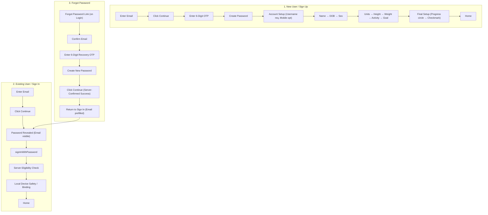
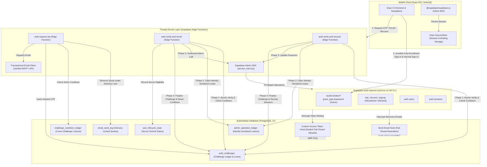

# Phase 1.2 Task 06I-A — Strict Auth Architecture & Server-Side Enforcement Decision

| Field | Value |
|---|---|
| **Task ID** | Task 06I-A (Revision R3 — Independent Review Findings Closure) |
| **Status** | **ARCHITECTURE PROPOSED — OWNER DECISION REQUIRED** |
| **Objective** | Resolve all eight `im-tio` CHANGES_REQUESTED review findings (P1-1 to P1-6, P2-7, P2-8): explicit fail-closed token hook allowlist, database-enforced email quota serialization, cross-challenge lockout ledger, indeterminate failure handling for Admin password updates, identity-level enrollment serialization with fencing tokens, post-enrollment password session establishment before cloud-profile setup, and consistent generic HTTP 400 cooldown responses |
| **Execution Mode** | OFFLINE RESEARCH + DOCUMENTATION-ONLY SECURITY HARDENING (No app code, migrations, or hosted mutations) |
| **Authorization** | Owner instruction: follow `AGENTS.md`, `.ai/current.md`, Supabase skill; production project `bsfwzvgynwriswapxpsp` strictly READ-ONLY |
| **Implementation Owner** | Security Architecture & Research Agent |
| **Baseline Main Commit** | `317b4d4793368e6a9a2907d504044e876acfaab0` (PR #33 merged) |
| **Worktree Branch** | `docs/task06i-a-strict-auth-architecture` |
| **Security Invariants** | AUTH-12/17/22 **BLOCKED** on native GoTrue; Managed Supabase Auth **NOT VERIFIED**; Production Auth **NO-GO** |
| **Primary Reference** | [AGENTS.md](../../../AGENTS.md), [docs/04-AUTH-AND-SECURITY.md](../../../docs/04-AUTH-AND-SECURITY.md), [docs/27-OTP-FIRST-AUTH-LIFECYCLE.md](../../../docs/27-OTP-FIRST-AUTH-LIFECYCLE.md) |

---

## 1. Executive Summary & Core Decision

Task 06H-E definitively confirmed through controlled runtime integration testing that upstream Supabase Auth (GoTrue v2.197.0) cannot satisfy Tio-Workspace's non-negotiable security requirements out-of-the-box:
1. **AUTH-12 (Atomic Single-Use):** Failed under concurrent load — parallel redemption of a single OTP issued multiple distinct authenticated sessions (`session_id_claim_comparison=different`).
2. **AUTH-17 (Password Mutation Protection):** Failed — direct `PUT /auth/v1/user` by an OTP-authenticated session mutated the account password without supplying the current password, bypassing `security_update_password_require_current_password`.
3. **AUTH-22 (Five-Wrong Cooldown):** Failed — five consecutive invalid OTP submissions failed to trigger a 15-minute lockout; entering the valid code immediately afterwards succeeded.
4. **Purpose Isolation:** Failed — recovery OTP tokens crossed boundaries and successfully authenticated as `type: 'email'` and `type: 'magiclink'`.

### The Core Architectural Dilemma
Because Supabase GoTrue operates as a monolithic, public-facing Go daemon exposing standard endpoints (`/otp`, `/verify`, `/recover`, `/signup`, `/user`), and lacks native hooks for failed verification attempts, password updates, or transactional challenge locking, **client-side hiding, RLS policies, and basic provider flags cannot enforce strict security against direct API attacks**.

### Evidence Classification Framework
To maintain absolute evidence integrity, all claims in this document adhere to the following taxonomy:
- **`VERIFIED`:** Empirically proven in this repository with reproducible automated test runs (e.g. PR #33 baseline, Task 06H loopback binding, Task 06H-E GoTrue v2.197.0 failure reproductions).
- **`HISTORICAL LOCAL EVIDENCE`:** Executed in earlier bounded tasks against isolated local stacks (e.g. Task 06D Clone 1/2 provider flags, Task 06F session deletion on GoTrue v2.197.0, Task 06D Admin create/password update subflows).
- **`PROPOSED DESIGN — NOT TESTED`:** Architectural specifications, SQL patterns, and state-machine algorithms that are conceptually designed but have not yet been executed in an automated test harness in this repository (e.g. `auth_challenges` table, PostgreSQL row locking, sliding-window rate limit ledger, Admin reconciliation state machine, exclusive reverse proxy gateway).
- **`REQUIRES EXPERIMENT`:** Documented or prospective managed cloud capabilities whose availability, persistence, and bypass resistance require empirical proof on an isolated hosted instance (e.g. `EXTERNAL_EMAIL_MAGIC_LINK_DISABLED` on Supabase Cloud, Send Email Hook failure modes, Custom Access Token Hook cold-start behavior, PostgREST non-Auth JWT acceptance).

### Architecture Recommendation
- **Primary Recommendation: Option B (Managed Supabase Auth + Server-Owned Purpose-Bound OTP Gateway via Edge Functions & PostgreSQL Transactional Challenge Store)**.
  - *Status:* **PROPOSED EXPERIMENTAL CANDIDATE (NOT PROVEN)**.
  - Native public OTP and Magic Link issuance is targeted for disablement at the provider level (`EXTERNAL_EMAIL_MAGIC_LINK_DISABLED = true` / `disable_signup = true`).
  - Native password recovery emails are intercepted via a Send Email Hook, and native token issuance for recovery/OTP/non-password methods is blocked via a Custom Access Token Hook with an explicit fail-closed allowlist.
  - All OTP generation, rate limiting, and verification are moved into trusted, server-owned Supabase Edge Functions backed by a transactional PostgreSQL schema (`auth_challenges`, `challenge_cooldown_ledger`, `email_send_log`) utilizing atomic conditional updates, transactional advisory locks, and row-level locks.
  - Supabase Auth is utilized strictly as a **Password Identity Provider** (`signInWithPassword`) and Admin API target (`admin.createUser`, `admin.updateUserById`).
  - *GoTrue Idempotency & Reconciliation Verdict:* GoTrue source review (`supabase/auth`) confirms GoTrue Admin API does NOT implement an `Idempotency-Key` header. Safe execution requires a server-owned, durable operation ledger (`admin_operation_ledger`) in PostgreSQL with identity-level unique serialization (`target_user_id`, `operation_type`), worker lease claims, monotonic fencing tokens, and pre-flight state reconciliation. If GoTrue call outcome is ambiguous, the system enters an explicit fail-closed state (`failed_indeterminate`) without blind retries.
  - *Multi-Consumer JWT Cutover Nuance:* Deleting sessions in `auth.sessions` immediately invalidates Auth `/user` (403 on local GoTrue; hosted NOT VERIFIED), but stateless non-Auth JWT consumers (PostgREST Data API, Storage) will accept signed JWTs until their `exp` timestamp. Cutover must account for this lingering window or rotate signing secrets.
- **Contingency Fallback: Option D1 (Self-Hosted Supabase GoTrue Behind an Exclusive Reverse Proxy / API Gateway)**.
  - *Status:* **PROPOSED FALLBACK (NOT TESTED)**.
  - If managed Supabase controls fail to close native GoTrue public routes on a disposable hosted instance, GoTrue must be self-hosted in a private network where native `/otp`, `/verify`, `/recover`, `/signup`, and direct `/user` are physically unreachable from the public internet.

**Final Verdict:** Production Auth remains **NO-GO**. A tightly bounded two-stage proof-of-concept on a disposable managed project (**Task 06I-B1 / 06I-B2**) is required before any implementation or production activation. Stage 06I-B1 failure triggers an owner decision on Option D1, not automatic self-hosted deployment.

---

## 2. Reconciliation of Canonical Evidence & Empirical Baseline

| Task & Date | Scope & Method | Observed Evidence / Outcome | Status of Requirements | Contradiction / Conflict Resolved |
|---|---|---|---|---|
| **Task 06A** (2026-11-17) | Local GoTrue v2.197.0 via CLI | Sequential replay rejected; direct `PUT /user` overwritten; 5 wrong codes did not lock | AUTH-12 Sequential PASS; AUTH-17 FAIL; AUTH-22 FAIL | Proved GoTrue treats OTP sessions as recovery-capable. |
| **Task 06B** (2026-11-17) | GoTrue source review & isolated testing | Verified `security_update_password_require_current_password = true` exempts `session.IsRecovery()`; AMR classifies OTP/magiclink as recovery | AUTH-17 Confirmed FAIL in GoTrue engine design | Proved RLS and client flags cannot intercept GoTrue user update. |
| **Task 06C** (2026-11-17) | Architecture review (read-only) | Proposed server-owned challenge store; highlighted direct API bypass risks | Production Auth BLOCKED | Rejected client-only UX or RLS as an Auth boundary. |
| **Task 06D** (2026-11-17) | Isolated multi-container GoTrue testing | `MagicLinkEnabled=false` disabled `/otp` (422); Custom Access Token Hook blocked verify/refresh JWTs; preexisting access JWT still mutated password | AUTH-17 BLOCKED; Managed feasibility INCONCLUSIVE | Established that denying new JWT issuance does not revoke preexisting access tokens. |
| **Task 06F** (2026-11-17) | Session revocation hypothesis | Voluntary `POST /logout` or Admin password reset deleted session, causing `GET/PUT /user` to return `403/session_not_found` | LOCAL ONLY PASS for session invalidation; Hosted NOT VERIFIED | Highlighted that voluntary logout is insufficient; server-side session revocation is required. |
| **Task 06H-D** (2026-11-19) | Loopback Compose prototype | Kong + GoTrue + DB + Mailpit bound strictly to `127.0.0.1` | Infrastructure PASS (zero `0.0.0.0` bindings) | Resolved Windows Docker binding vulnerability without daemon modification. |
| **Task 06H-E** (2026-11-19) | Controlled runtime integration testing | Pinned GoTrue v2.197.0; 14 synthetic cases in Mailpit; Mode A (5/hr) & Mode B (30/hr) | **AUTH-12 FAIL (Concurrency)**<br>**AUTH-17 FAIL (Mutation)**<br>**AUTH-22 FAIL (Cooldown)**<br>**Purpose Crossover Observed** | **Empirically demonstrated race condition (2 sessions for 1 OTP) and purpose crossover (`recovery` accepted as `email` and `magiclink`).** |

---

## 3. Preservation of Owner-Approved Auth UX

The architectural recommendations strictly adhere to the owner-approved UI/UX design specifications in [`docs/27-OTP-FIRST-AUTH-LIFECYCLE.md`](../../../docs/27-OTP-FIRST-AUTH-LIFECYCLE.md) and [`DESIGN.md`](../../../DESIGN.md). **Zero changes to Expo screens, visual layout, typography, keyboard focus, error timing, or navigation are introduced.**



### Detailed UX & Lifecycle Invariants
1. **Sign Up Flow:**
   - Sequential presentation: Email → OTP → Password.
   - **Provisional UUID Reuse:** If an unverified or password-pending provisional UUID already exists for the normalized email in `user_lifecycle_state` (`EMAIL_VERIFIED_PASSWORD_PENDING`), the server-owned challenge records `user_id = provisional_uuid`. Upon successful OTP verification, initial password enrollment updates that existing provisional UUID via `admin.updateUserById(provisional_uuid, { password })` rather than minting duplicate identities.
   - **Password-Complete Accounts:** If `user_lifecycle_state` indicates an already established account (`PASSWORD_COMPLETE_PROFILE_PENDING` or `SERVER_ELIGIBLE`), Sign Up verification strictly rejects initial password enrollment and returns a generic anti-enumeration response directing the user to Sign In or Forgot Password. An existing password can never be overwritten through the Sign Up route.
   - **Post-Enrollment Authenticated Session Before Cloud Profile (P1-6):**
     - Step 4 (Create Password) submits password to `/auth-verify-and-enroll`. Upon server-side enrollment success (`200 OK { success: true, user_id: UUID }`), the mobile client immediately and invisibly performs a standard `supabase.auth.signInWithPassword({ email, password })` using the password currently in client memory.
     - The client verifies:
       1. The authenticated session `user.id` strictly matches the enrolled provisional `user_id`.
       2. The server lifecycle state is `PASSWORD_COMPLETE_PROFILE_PENDING`.
       3. The session holds server-trusted `amr: ['password']` (satisfying the Custom Access Token Hook allowlist).
     - The client seamlessly advances to Step 5 (Account Setup: Username required, Mobile optional) possessing a valid authenticated session under which private profile writes are permitted by `auth.uid() = id` RLS.
     - Local device fitness storage and Home readiness remain strictly locked until Cloud Profile is complete, server eligibility transitions to `SERVER_ELIGIBLE`, and local device binding checks pass.
     - If `signInWithPassword` fails (e.g. transient network interruption), no duplicate account creation or OTP replay is attempted; the user is routed to Sign In with Email prefilled to log in with their newly enrolled password.
2. **Sign In Flow:**
   - Normal login never sends an OTP and never modifies the stored password.
   - Email remains visible when Password is revealed after Continue.
   - No public account-existence query; no automatic mode switching between Sign Up and Sign In.
   - Direct `PUT /auth/v1/user` password mutation by normal login sessions is strictly prevented because normal sessions bear `amr: ['password']`, enforcing `security_update_password_require_current_password = true`.
3. **Forgot Password Flow:**
   - Initiated explicitly from the Login screen: Confirm Email → 6-Digit Recovery OTP → New Password.
   - Recovery verification grants **zero ambient session** and never routes to Home.
   - Upon successful server-side password reset via Admin API (`admin.updateUserById(user_id, { password: new_password })`), all active user sessions are deleted from `auth.sessions`.
   - The client is redirected to Sign In with Email prefilled to perform an explicit `signInWithPassword` using the new password.
   - Local device storage remains locked until authenticated with the same bound UUID.

---

## 4. Core Security Architecture Enforcement

### 4.1. AUTH-12 — Atomic OTP Single-Use & Concurrency Serialization
Task 06H-E proved that GoTrue v2.197.0 suffers from a concurrency race condition: parallel requests with the same valid OTP both succeeded and minted two independent sessions.

#### PostgreSQL Atomic Verification Pattern & Data-Type Safety
To guarantee that exactly one redemption succeeds across concurrent threads, the challenge store must enforce row-level locking or atomic conditional updates. Note that PostgreSQL's `hmac(data, key, type)` function from `pgcrypto` returns `bytea`. If the column `code_hash` is defined as `TEXT`, it must be explicitly encoded (e.g. `encode(hmac(...), 'hex')`) to prevent `operator does not exist: text = bytea` runtime syntax errors:

```sql
-- Atomic Single-Use Verification Query (Draft Specification)
WITH candidate AS (
    SELECT c.id, c.challenge_id, c.user_id, c.normalized_email, c.purpose, c.code_hash, c.expires_at
    FROM private_auth.auth_challenges c
    JOIN private_auth.challenge_cooldown_ledger l
      ON l.normalized_email = c.normalized_email AND l.purpose = c.purpose
    WHERE c.challenge_id = $1
      AND c.normalized_email = $2
      AND c.purpose = $3
      AND c.status = 'issued'
      AND c.consumed_at IS NULL
      AND (l.cooldown_until IS NULL OR l.cooldown_until <= clock_timestamp())
      AND c.expires_at >= clock_timestamp()
    FOR UPDATE OF c
)
UPDATE private_auth.auth_challenges c
SET status = 'pending_provisioning',
    verified_at = clock_timestamp(),
    provisioning_grant_id = gen_random_uuid(),
    grant_expires_at = clock_timestamp() + INTERVAL '5 minutes'
FROM candidate
WHERE c.id = candidate.id
  AND candidate.code_hash = encode(hmac($4::bytea, $server_pepper::bytea, 'sha256'), 'hex')
RETURNING c.id, c.user_id, c.provisioning_grant_id, c.grant_expires_at;
```

#### Concurrency Evaluation
- **Pessimistic Row Lock (`SELECT ... FOR UPDATE`):**
  - When Request A and Request B arrive concurrently with identical tokens, Request A obtains the row lock on `private_auth.auth_challenges`.
  - Request B blocks until Request A commits.
  - In PostgreSQL `READ COMMITTED` isolation, when Request B unblocks, its re-evaluation of the row sees `status = 'pending_provisioning'` (no longer `'issued'`).
  - Request B immediately fails with `already_consumed` / `0 rows returned`.
- **Atomic Conditional `UPDATE ... WHERE status = 'issued' RETURNING ...`:**
  - Operates as a single atomic write lock. Request A updates the row and returns `c.id` and `c.provisioning_grant_id`.
  - Request B's `UPDATE` affects 0 rows. Request B detects 0 rows returned and rejects the attempt.

#### The Cross-Service Distributed Transaction Problem & GoTrue Admin Idempotency Verdict
A critical architectural reality must be acknowledged: **a PostgreSQL database transaction cannot roll back an independent outbound HTTP call to Supabase GoTrue Admin API**.

Furthermore, source review of Supabase Auth (`supabase/auth` / GoTrue) confirms that **GoTrue does NOT implement or recognize an `Idempotency-Key` HTTP header** on `/admin/users`, `PUT /admin/users/{user_id}`, or any other endpoint. Merely sending an `Idempotency-Key` header provides zero native idempotency or duplicate-request prevention.

Holding an open PostgreSQL transaction during an outbound HTTP call to GoTrue introduces:
1. Connection pool exhaustion and elevated database latency under slow network conditions.
2. Dangerous partial failure states: if GoTrue creates the user or updates the password, but the subsequent database commit times out or aborts, PostgreSQL rolls back the challenge state while GoTrue persists the user state, creating severe identity desynchronization.
3. If GoTrue Admin API times out while actually succeeding on the GoTrue server, a naive retry could cause unexpected duplicate creation errors or race conditions.

#### Server-Owned Durable Operation Ledger & State-Machine Resolution
*(Status: PROPOSED DESIGN — NOT TESTED)*
To resolve cross-service coordination without impossible distributed transactions or non-existent provider headers, Option B implements an explicit **Server-Owned Durable Operation Ledger** (`private_auth.admin_operation_ledger`) coupled with a two-phase challenge state machine:

1. **Challenge Status Lifecycle:**
   `issued` -> `verifying` -> `pending_provisioning` -> `consumed` (or `provisioning_failed_retryable`, `failed_terminal`, `superseded`)
2. **Phase 1: Atomic In-Database Verification:**
   - Edge Function verifies OTP atomically in PostgreSQL under row-level lock.
   - If code is invalid: increments `consecutive_failed_attempts` in `private_auth.challenge_cooldown_ledger`, sets `cooldown_until` if count reaches 5, and commits.
   - If code is valid: transitions challenge `status = 'pending_provisioning'`, sets `verified_at = clock_timestamp()`, generates a single-use `provisioning_grant_id = gen_random_uuid()` with bounded lease expiry (`grant_expires_at = clock_timestamp() + INTERVAL '5 minutes'`), resets `consecutive_failed_attempts = 0` in `challenge_cooldown_ledger`, and **commits the PostgreSQL transaction immediately**. Row lock is released in milliseconds.
3. **Phase 2: Identity-Level Operation Claim & Fencing (P1-5 & P2-7):**
   - Before calling GoTrue, the Edge Function attempts to atomically claim an execution lease in `private_auth.admin_operation_ledger`.
   - **Identity-Level Serialization (P1-5):** To prevent multiple challenges from racing against the same target provisional UUID or email, the ledger enforces identity-level uniqueness across challenges:
     ```sql
     -- Partial unique index prevents concurrent or repeated enrollment on the same identity
     CREATE UNIQUE INDEX uq_admin_ledger_active_identity_op
     ON private_auth.admin_operation_ledger (target_user_id, operation_type)
     WHERE status IN ('claimed', 'executing', 'reconciling', 'completed');
     ```
   - **Initial Claim Query:**
     ```sql
     INSERT INTO private_auth.admin_operation_ledger (
         challenge_id, normalized_email, target_user_id, operation_type,
         status, worker_lease_id, lease_expires_at, fencing_token, idempotency_payload_hash
     ) VALUES (
         $1, $2, $3, $4, 'executing', $worker_lease_id,
         clock_timestamp() + INTERVAL '30 seconds', 1, $payload_hash
     )
     ON CONFLICT (challenge_id) DO NOTHING
     RETURNING operation_id, fencing_token;
     ```
   - **Expired-Lease Takeover & Fencing Token Protocol (P2-7):**
     If a worker crashes or encounters an event-loop pause, `INSERT ... ON CONFLICT DO NOTHING` affects 0 rows. A recovery worker cannot insert, but safely claims ownership using an atomic conditional update that increments a monotonic `fencing_token`:
     ```sql
     UPDATE private_auth.admin_operation_ledger
     SET worker_lease_id = $new_worker_lease_id,
         lease_expires_at = clock_timestamp() + INTERVAL '30 seconds',
         fencing_token = fencing_token + 1,
         attempt_count = attempt_count + 1,
         status = 'reconciling'
     WHERE challenge_id = $1
       AND status IN ('claimed', 'executing', 'reconciling')
       AND lease_expires_at < clock_timestamp()
     RETURNING operation_id, fencing_token, attempt_count;
     ```
   - **Stale Worker Rejection:** When finalizing or updating the ledger, workers MUST supply their acquired `fencing_token`. If a delayed worker wakes up after its lease expired, its database write matches 0 rows and is rejected.
   - **External Call Boundary Note:** Note that fencing database updates does NOT cancel an in-flight HTTP request already reaching GoTrue. Therefore, if an external call outcome remains uncertain and cannot be proven, the system MUST enter an explicit fail-closed state (`failed_indeterminate`) and block conflicting privileged writes.
4. **Phase 3: Outbound Admin Call & Explicit Failure Handling (P1-4):**
   - The lease-holding worker executes the GoTrue Admin API call (`admin.createUser` or `admin.updateUserById`).
   - **Initial Creation Ambiguity:** For initial user creation (`admin.createUser`), if the call times out, the worker queries `admin.listUsers` by email. If the user exists and was created within the operation window, the worker marks `status = 'completed'`. If not, safe retry is permitted.
   - **Password Update Ambiguity (P1-4 — No Heuristic Assumptions):**
     For password enrollment or recovery reset (`admin.updateUserById`), **`user.updated_at` and session deletion DO NOT prove that this specific operation installed the requested password**. GoTrue provides no API to verify password hash state. Therefore:
     - If the Admin API call returns an ambiguous timeout / network error, the server **DOES NOT mark the operation completed**.
     - The operation ledger transitions to `status = 'failed_indeterminate'`.
     - The challenge and grant are immediately neutralized (`status = 'failed_terminal'`) to prevent grant reuse.
     - Blind retries are strictly prohibited to avoid racing or overwriting valid credentials.
     - No plaintext passwords or credentials are ever stored in the ledger.
     - The client receives an explicit error directing the user to sign in with the new password; if sign in fails, they must initiate a fresh recovery under strict rate limits.
5. **Phase 4: Finalization & Single-Use Enforcement:**
   - On confirmed Admin API success (200/201), the worker updates:
     `UPDATE private_auth.admin_operation_ledger SET status = 'completed', completed_at = clock_timestamp() WHERE operation_id = $1 AND fencing_token = $my_token;`
   - Challenge transitions to `consumed`:
     `UPDATE private_auth.auth_challenges SET status = 'consumed', consumed_at = clock_timestamp() WHERE challenge_id = $1;`
   - Permanent invalidation: A consumed grant or challenge can never be presented again.

#### Token Cryptography & Storage
- Six-digit numeric OTP generated via cryptographically secure pseudo-random number generator (`crypto.randomInt(100000, 1000000)`).
- **No Plaintext Storage:** Challenge table stores `code_hash = encode(HMAC-SHA256(code, server_pepper), 'hex')`.
- Server pepper resides exclusively in server-side environment secrets (`CHALLENGE_PEPPER`), never exposed to clients or database users without elevated permissions.

---

### 4.2. AUTH-17 — Password Mutation Protection & Identity Boundary
Task 06B, 06D, and 06H-E proved that any session bearing `amr: ['otp']` can call `PUT /auth/v1/user` and overwrite the password without supplying the current password.

#### Enforcement Architecture
1. **Denial of Native OTP Sessions:** The client never receives a Supabase Auth session from OTP verification. OTP verification occurs in the Edge Function, which returns only a purpose-bound transient verification grant (`provisioning_grant_id`) or proceeds immediately to server-side password enrollment.
2. **Explicit Fail-Closed Token Hook Allowlist (P1-1):**
   *(Status: PROPOSED SPECIFICATION — REQUIRES EXPERIMENT ON HOSTED)*
   Supabase's Custom Access Token Hook receives all token minting requests across sign-in, token refresh, and OTP/magiclink redemption. To close all native attack vectors, the hook replaces narrow OTP denial with an **explicit fail-closed allowlist**:
   - **Allowed Authentication Methods:**
     1. `authentication_method = 'password'` for initial sign-in.
     2. `authentication_method = 'token_refresh'` ONLY WHEN server-trusted session claims establish that the session originated strictly from password authentication:
        - `claims->'amr'` contains `'password'`.
        - `claims->'amr'` does NOT contain `'otp'`, `'recovery'`, `'magiclink'`, `'signup'`, `'invite'`, `'anonymous'`, `'oauth'`.
        - Session metadata in `auth.sessions` confirms valid active state.
   - **Denied Authentication Methods (FAIL-CLOSED):**
     Any other authentication method is unconditionally rejected with an exception/error:
     - `'otp'` -> REJECT (denies native `/verify` type email)
     - `'recovery'` -> REJECT (denies native `/verify` type recovery)
     - `'magiclink'` -> REJECT (denies native passwordless login)
     - `'email/signup'` -> REJECT (denies native signup confirmation)
     - `'invite'` -> REJECT (denies native invite token redemption)
     - `'anonymous'` -> REJECT (denies anonymous session minting)
     - `'oauth'` / third-party providers -> REJECT (unless separately authorized)
     - Missing, NULL, empty, or unknown `authentication_method` -> REJECT
   - **Client Metadata Isolation:** Client-supplied metadata (`raw_user_meta_data`) is NEVER trusted to determine authentication method or permission.
   - **Preexisting Sessions:** Preexisting sessions lacking proof of password origin fail closed on token refresh.
   - **Hosted Provider Feasibility Gap:** If managed Supabase Cloud fails to pass reliable AMR payloads to the hook or if hook execution can be bypassed, Option B is **BLOCKED ON HOOK CAPABILITY** and requires Stage 06I-B1 verification.
3. **Session Revocation on Password Mutation:**
   - GoTrue's Admin API `updateUserById(userId, { password })` automatically deletes all existing active sessions from `auth.sessions` for that user.
   - Any outstanding access tokens fail subsequent `GET/PUT /auth/v1/user` calls with `403/session_not_found` (verified locally on GoTrue v2.197.0 in Task 06F; hosted NOT VERIFIED).
4. **Enforcing `Require Current Password` on Normal Sessions:**
   - Normal users sign in via `signInWithPassword`. Their session has `amr: ['password']`.
   - For `amr: ['password']`, GoTrue's `session.IsRecovery()` is `false`.
   - Therefore, `security_update_password_require_current_password = true` is fully enforced: direct `PUT /auth/v1/user` without `current_password` is rejected with `400/invalid_request`.

#### 4.2.1. JWT Lifecycle, Consumer Discrepancies & Safe Cutover
*(Status: PROPOSED SPECIFICATION — HOSTED NOT VERIFIED)*
To prevent false assumptions regarding token invalidation, the architectural behavior of Supabase JWTs across different platform consumers must be strictly differentiated:

1. **`auth.sessions` Row Deletion:**
   - GoTrue persists active session metadata in `auth.sessions`. The access token JWT contains a `session_id` UUID claim.
   - Calling `POST /logout` or executing an Admin password update deletes the corresponding row from `auth.sessions`.
2. **Auth `/user` Validation (Stateful Session Check):**
   - Calls to `GET /auth/v1/user` and `PUT /auth/v1/user` validate the cryptographic signature **and** actively query `auth.sessions` for `session_id`.
   - When the session row is deleted, Auth `/user` returns `403 Forbidden` (`session_not_found`) immediately (empirically confirmed on GoTrue v2.197.0 in Task 06F; hosted NOT VERIFIED).
3. **Data API / PostgREST Authorization (Stateless Signature Verification):**
   - PostgREST validates access JWTs **statelessly** using the shared `JWT_SECRET` (symmetric HMAC) or public key (asymmetric JWKS).
   - By default, PostgREST verifies signature, `exp`, and `nbf`, then executes queries under RLS. PostgREST does **NOT** query `auth.sessions` on every request.
   - **Security Consequence:** An unrevoked access token issued prior to cutover or password change will **continue to be accepted by PostgREST** for Data API reads/writes until its `exp` timestamp elapses, even if its session row in `auth.sessions` was deleted!
4. **Storage API & Edge Functions:**
   - Storage API operates similarly to PostgREST (stateless signature validation).
   - Edge Functions calling `supabase.auth.getUser(token)` contact GoTrue and fail immediately on deleted sessions (403). Edge Functions decoding JWTs locally accept them until `exp`.
5. **Signing Key Rotation vs. Revocation Nuance:**
   - Rotating a symmetric `JWT_SECRET` immediately invalidates all tokens signed by the old secret once PostgREST/Storage reload the secret.
   - However, in modern asymmetric key setups (JWKS), key rotation typically adds a new key while maintaining the old public key in the JWKS for a transition period. Existing tokens remain valid until the old key is purged from the JWKS or expires. The hosted project's key architecture (symmetric vs asymmetric) must not be assumed.
6. **Existing vs. New JWT Expiry Limits:**
   - Updating `jwt_exp` in project settings (e.g. reducing expiry to 300 seconds) applies **only to newly minted JWTs**.
   - Previously issued tokens have their `exp` claim immutably signed in their payload (typically 3600 seconds = 1 hour). Changing settings does not modify existing tokens.

#### Comprehensive Safe Cutover Procedure
To eliminate residual access tokens during cutover to Option B, the deployment plan must follow an explicit fail-closed sequence:
1. **Freeze Public Registration:** Enable `disable_signup = true` in Supabase Auth config.
2. **Disable Native OTP & MagicLink:** Apply `EXTERNAL_EMAIL_MAGIC_LINK_DISABLED = true` (or verified provider setting).
3. **Shorten Future JWT Lifetime:** Set `jwt_exp = 300` (5 minutes) for all future sessions.
4. **Delete Active Sessions:** Execute database session cleanup (`DELETE FROM auth.sessions;`) or trigger per-user Admin password reset.
5. **Address the Stateless Consumer Linger Window (PostgREST / Storage):**
   - *Option Cutover-A (Drain Window):* Wait out the maximum lingering lifetime of any pre-cutover token (e.g. 1 hour) before enabling live production data access.
   - *Option Cutover-B (Signing Secret Rotation):* Rotate the project's `JWT_SECRET` / purge old verification keys. This instantly breaks cryptographic validation for 100% of outstanding JWTs across PostgREST, Storage, and Auth simultaneously (requires all legitimate users to re-authenticate with password).
6. **Preserve Offline Local SQLite Safety:** On-device workout storage is account-bound to immutable `user_id` and decrypted with the device OS-protected key; it never reads remote PostgREST or relies on JWTs for offline CRUD.

#### Required Acceptance Tests for Cutover Verification
- **Test CUT-01 (Auth /user):** Verify previously issued OTP access token returns `403/session_not_found` after session deletion.
- **Test CUT-02 (PostgREST Data API):** Probe PostgREST endpoint with previously issued access token after session deletion; document whether request is rejected immediately or accepted until `exp`.
- **Test CUT-03 (Storage API):** Probe private storage bucket with previously issued access token after session deletion; verify rejection or document lingering window.
- **Test CUT-04 (Edge Functions):** Probe Edge Function utilizing `auth.getUser()`; verify immediate 403 rejection.

---

### 4.3. AUTH-22 — Five-Wrong Cooldown & Rate Limits
Native GoTrue does not enforce a challenge-level failure budget. Task 06H-E proved that entering 5 wrong OTPs did not prevent immediate entry of the correct OTP.

#### Cross-Challenge Cooldown Ledger (P1-3)
*(Status: PROPOSED DESIGN — NOT TESTED)*
Storing failed attempts exclusively on `auth_challenges` allows an attacker to bypass the 15-minute cooldown by requesting a new OTP (superseding the old row and creating a fresh challenge with `failed_attempts = 0`). To eliminate this bypass, Option B decouples attempt tracking into an authoritative **Identity-Level Cooldown Ledger** (`private_auth.challenge_cooldown_ledger`):

```sql
CREATE TABLE private_auth.challenge_cooldown_ledger (
    normalized_email TEXT NOT NULL,
    purpose private_auth.challenge_purpose NOT NULL,
    consecutive_failed_attempts INT NOT NULL DEFAULT 0,
    cooldown_until TIMESTAMPTZ,
    last_failed_at TIMESTAMPTZ,
    PRIMARY KEY (normalized_email, purpose)
);
```
- **Survival Across Lifecycle Events:** Cooldown state survives OTP resend, challenge supersession, app restarts, device switches, and parallel requests.
- **Lockout Trigger:** Each invalid OTP verification atomically increments `consecutive_failed_attempts`. Upon the 5th consecutive failure, `cooldown_until` is set to `clock_timestamp() + INTERVAL '15 minutes'`.
- **Resend Blocked During Cooldown:** While `clock_timestamp() < cooldown_until`, `/auth-request-otp` rejects new OTP issuance for that email and purpose, preventing email flooding or brute force restarts.
- **Reset Invariant:** `consecutive_failed_attempts` is reset to 0 **only** upon successful verification of a valid OTP for that email and purpose.

#### Database-Enforced Email Quota Serialization (P1-2)
*(Status: PROPOSED DESIGN — NOT TESTED)*
To eliminate the race condition where concurrent requests read stale counts and reserve simultaneous sends, email quota checking and reservation are serialized at the database transaction level using PostgreSQL transactional advisory locks (`pg_advisory_xact_lock`):

```sql
CREATE OR REPLACE FUNCTION private_auth.reserve_email_send(
    p_normalized_email TEXT,
    p_purpose private_auth.challenge_purpose
) RETURNS TABLE(allowed BOOLEAN, send_id UUID, retry_after_seconds INT, reason TEXT) AS $$
DECLARE
    v_recent_count INT;
    v_interval_conflict BOOLEAN;
    v_new_id UUID;
    v_last_send TIMESTAMPTZ;
BEGIN
    -- Acquire exclusive transactional lock scoped strictly to this normalized email
    PERFORM pg_advisory_xact_lock(hashtext('email_send_quota:' || p_normalized_email));

    -- Check active cooldown for this purpose
    IF EXISTS (
        SELECT 1 FROM private_auth.challenge_cooldown_ledger
        WHERE normalized_email = p_normalized_email
          AND purpose = p_purpose
          AND cooldown_until > clock_timestamp()
    ) THEN
        RETURN QUERY SELECT FALSE, NULL::UUID, 900, 'cooldown_active';
        RETURN;
    END IF;

    -- Check minimum 60-second interval across both purposes
    SELECT created_at INTO v_last_send
    FROM private_auth.email_send_log
    WHERE normalized_email = p_normalized_email
      AND created_at >= clock_timestamp() - INTERVAL '60 seconds'
      AND status IN ('reserved', 'sent')
    ORDER BY created_at DESC
    LIMIT 1;

    IF FOUND THEN
        RETURN QUERY SELECT FALSE, NULL::UUID,
            GREATEST(1, EXTRACT(EPOCH FROM (v_last_send + INTERVAL '60 seconds' - clock_timestamp()))::INT),
            'interval_active';
        RETURN;
    END IF;

    -- Check rolling 1-hour window (max 5 sends across both purposes)
    SELECT COUNT(*) INTO v_recent_count
    FROM private_auth.email_send_log
    WHERE normalized_email = p_normalized_email
      AND created_at >= clock_timestamp() - INTERVAL '1 hour'
      AND status IN ('reserved', 'sent');

    IF v_recent_count >= 5 THEN
        RETURN QUERY SELECT FALSE, NULL::UUID, 3600, 'hourly_quota_exceeded';
        RETURN;
    END IF;

    -- Atomically reserve quota
    v_new_id := gen_random_uuid();
    INSERT INTO private_auth.email_send_log (id, normalized_email, purpose, status, created_at)
    VALUES (v_new_id, p_normalized_email, p_purpose, 'reserved', clock_timestamp());

    RETURN QUERY SELECT TRUE, v_new_id, 0, 'reserved';
END;
$$ LANGUAGE plpgsql;
```
- **Conservative Accounting:** Reserved rows count against quota immediately. On delivery confirmation, status updates to `'sent'`. On permanent provider failure, status updates to `'failed'` (releasing quota). On provider timeout or network ambiguity, status remains `'reserved'` (fail-closed).
- **Concurrency Guarantee:** The transactional advisory lock guarantees that parallel requests for the same address serialize. No two requests can observe a stale count below 5.

#### Public Response & Anti-Enumeration Contract (P2-8)
To prevent timing or status code oracles that allow attackers to probe account existence or lockout status:
- **Public Request Route (`/auth-request-otp`):** Returns identical status `200 OK` and identical schema (`{ success: true, message: "If eligible, an email has been sent" }`) regardless of whether the email is unverified, provisional, password-complete, non-existent, or rate-limited.
- **Public Verification Routes (`/auth-verify-and-enroll`, `/auth-verify-and-recover`):**
  - **Uniform HTTP 400 Bad Request:** Returns generic error schema `{ "error": "invalid_grant", "message": "Verification failed. Please try again or request a new code." }` for invalid code, expired challenge, or active 15-minute cooldown.
  - **Status Code Oracle Avoidance:** Public responses **NEVER return HTTP 423 Locked** or distinct error codes. Testing independently asserts the generic HTTP 400 response on the public interface while directly querying `private_auth.challenge_cooldown_ledger` via backend database test assertions.
  - **Timing Side-Channel Boundary:** HMAC digest comparisons use `crypto.timingSafeEqual()`. Endpoint delay equalization across database lookups and bcrypt processing must be benchmarked and measured during prototype testing in Task 06I-B2.

---

### 4.3.1. Challenge State Machine & Concurrency Audit (11 Failure & Race Scenarios)
*(Status: PROPOSED SPECIFICATION — NOT TESTED)*
The state machine (`auth_challenges`, `challenge_cooldown_ledger`, `admin_operation_ledger`) is audited against 11 critical edge cases:

1. **Two Simultaneous Valid OTP Submissions:**
   - Both requests query `auth_challenges` with the valid OTP.
   - Request A executes atomic `UPDATE ... WHERE status = 'issued' RETURNING ...` and acquires the row lock.
   - Request B blocks; upon unblocking, it finds `status` is `'pending_provisioning'`.
   - Result: Exactly 1 transaction succeeds; parallel request gets 0 rows and returns generic `invalid_grant`.
2. **Five Concurrent Incorrect OTP Submissions (Survives Supersession P1-3):**
   - Five threads submit wrong codes.
   - Each attempt serializes under database lock, atomically incrementing `consecutive_failed_attempts` in `challenge_cooldown_ledger`.
   - The 5th increment sets `cooldown_until = clock_timestamp() + INTERVAL '15 minutes'`.
   - Result: All subsequent attempts within 15 minutes immediately fail closed, even if a new challenge is requested.
3. **Expired Challenges:**
   - Candidate verification enforces `expires_at >= clock_timestamp()`.
   - Challenges older than 10 minutes return 0 rows and fail closed with generic verification failure.
4. **Resend and Generation Races (P1-3):**
   - Requesting a new OTP via `auth-request-otp` first checks `challenge_cooldown_ledger`. If cooldown is active, request is rejected. If clear, any existing unconsumed challenges are marked `status = 'superseded'`.
   - Result: The previous OTP cannot be redeemed after a resend is issued; active cooldown prevents resend bypass.
5. **Password-Complete Accounts Attempting Re-Enrollment:**
   - Pre-flight validation against `user_lifecycle_state` checks whether the account is `PASSWORD_COMPLETE_PROFILE_PENDING` or `SERVER_ELIGIBLE`.
   - Result: Re-enrollment via signup OTP is rejected before challenge issuance or password update; returns generic message.
6. **Duplicate Admin Creation & Initial Enrollment Races (P1-5):**
   - Prevented by the `UNIQUE (target_user_id, operation_type)` and `UNIQUE (normalized_email, operation_type)` constraints in `admin_operation_ledger`.
   - Result: If two challenges for the same provisional identity attempt initial enrollment, the second worker is blocked by the unique constraint and fails closed.
7. **Worker Lease Reclaim & Fencing (P2-7):**
   - If Worker A crashes during an Admin call, Worker B reclaims the lease after 30 seconds via conditional update incrementing `fencing_token`.
   - Result: Worker B assumes ownership with a new generation. If Worker A subsequently wakes up, its database update fails due to an outdated fencing token.
8. **Ambiguous Admin Password Reset Outcome (P1-4):**
   - If GoTrue Admin API times out during password update, the system does NOT infer success from `user.updated_at` or session deletion.
   - Result: Operation ledger transitions to `failed_indeterminate`, challenge is neutralized, no blind retry occurs, and user is directed to sign in with new password or restart recovery.
9. **Crash After Admin Success but Before Finalization:**
   - For user creation: Reconciled via `admin.listUsers` pre-flight query by the reconciling worker.
   - For password updates: Fails closed to `failed_indeterminate` to avoid assuming credential state without verifiable evidence.
10. **Recovery Grant Replay:**
    - A recovery grant transitions to `status = 'consumed'` with immutable `consumed_at`.
    - Result: Any subsequent presentation of that `provisioning_grant_id` is rejected. A single recovery grant can mutate a password exactly once.
11. **Privileged Operation Attempted After Grant Expiry:**
    - Each grant carries `grant_expires_at = verified_at + INTERVAL '5 minutes'`.
    - Result: If a client delays submitting the new password beyond 5 minutes, the grant expires and fails closed.

---

### 4.4. Purpose Isolation & Crossover Elimination
Task 06H-E revealed that GoTrue native recovery OTPs can be redeemed as `type: 'email'` and `type: 'magiclink'`.

#### Server-Owned Purpose Binding
In the server challenge store, the `purpose` column is an explicit PostgreSQL ENUM:
```sql
CREATE TYPE private_auth.challenge_purpose AS ENUM (
    'signup_initial_password',
    'recovery_password_reset'
);
```
- A verification endpoint for signup strictly specifies `WHERE purpose = 'signup_initial_password'`.
- A verification endpoint for recovery strictly specifies `WHERE purpose = 'recovery_password_reset'`.
- Purpose crossover is relationally prevented by design when the database query strictly validates the challenge record's `purpose` column against the requested operation. (Note: this is a proposed schema design; runtime behavior remains unverified until executed in Task 06I-B2).
- Native GoTrue `/verify` endpoints are blocked via the Custom Access Token Hook, preventing native AMR crossover.

---

## 5. Architecture Candidate Comparison Matrix

| Criteria | Option A: Native GoTrue + Settings | Option B: Managed Supabase + Edge OTP Gateway | Option C: Managed Supabase + Hook Boundary | Option D1: Self-Hosted GoTrue + Exclusive Gateway | Option D2: Third-Party Auth (Auth0/Ory) |
|---|---|---|---|---|---|
| **AUTH-12 (Atomic Single-Use)** | **FAILS REQUIREMENT** (Concurrency race in 06H-E) | **PROPOSED DESIGN — REQUIRES EXPERIMENT** (Postgres conditional row lock designed; unexecuted in test harness) | **FAILS REQUIREMENT** (Hook cannot lock GoTrue verify) | **PROPOSED DESIGN — NOT TESTED** (Gateway serializes / custom store designed; unexecuted) | **DOCUMENTED BUT UNVERIFIED** (Vendor dependent) |
| **AUTH-17 (Password Mutation)** | **FAILS REQUIREMENT** (Direct `PUT /user` bypass in 06H-E) | **REQUIRES EXPERIMENT** (Admin API enrollment + native disablement & hook closure) | **FAILS REQUIREMENT** (No password update hook exists) | **PROPOSED DESIGN — NOT TESTED** (Direct `PUT /user` blocked by exclusive gateway) | **DOCUMENTED BUT UNVERIFIED** (Requires custom RLS JWT) |
| **AUTH-22 (Five-Wrong Cooldown)**| **FAILS REQUIREMENT** (Cooldown bypass in 06H-E) | **PROPOSED DESIGN — REQUIRES EXPERIMENT** (Postgres identity cooldown ledger designed; unexecuted) | **FAILS REQUIREMENT** (No hook for failed OTP verify) | **PROPOSED DESIGN — NOT TESTED** (Gateway rate-limit ledger designed; unexecuted) | **DOCUMENTED BUT UNVERIFIED** (Vendor rule configs) |
| **Purpose Isolation** | **FAILS REQUIREMENT** (Crossover in 06H-E) | **PROPOSED DESIGN — REQUIRES EXPERIMENT** (Strict ENUM in challenge store designed; unexecuted) | **FAILS REQUIREMENT** (GoTrue AMR crossover) | **PROPOSED DESIGN — NOT TESTED** (Strict gateway purpose binding designed; unexecuted) | **DOCUMENTED BUT UNVERIFIED** |
| **Direct API Bypass Resistance** | **FAILS REQUIREMENT** (All endpoints public) | **REQUIRES EXPERIMENT** (Send Email Hook + Token Hook Allowlist on hosted) | **FAILS REQUIREMENT** (Endpoints remain callable) | **PROPOSED DESIGN** (Loopback container binding verified in 06H-D; gateway route blocking NOT TESTED) | **DOCUMENTED BUT UNVERIFIED** |
| **Session Revocation Safety** | **FAILS REQUIREMENT** (Preexisting JWTs survive) | **HISTORICAL LOCAL EVIDENCE** (Auth `/user` session deletion in 06F); Non-Auth JWT consumers & hosted NOT TESTED | **FAILS REQUIREMENT** | **PROPOSED DESIGN — NOT TESTED** (Gateway token invalidation) | **DOCUMENTED BUT UNVERIFIED** |
| **Existing UUID Preservation** | **HISTORICAL LOCAL EVIDENCE** (Standard GoTrue sign-in) | **HISTORICAL LOCAL EVIDENCE** (Task 06D Admin create/password update subflow); Edge Function orchestration NOT TESTED | **HISTORICAL LOCAL EVIDENCE** | **HISTORICAL LOCAL EVIDENCE** (GoTrue Admin subflow) | **FAILS REQUIREMENT** (Requires UUID migration) |
| **Mobile UX Compatibility** | **PROPOSED DESIGN** (Preserves merged mock routes and text; zero UI redesign) | **PROPOSED DESIGN** (Zero Expo redesign; invisible post-enrollment sign-in) | **PROPOSED DESIGN** | **PROPOSED DESIGN** | **REQUIRES EXPERIMENT** (SDK changes needed) |
| **Cost & Operational Burden** | Lowest (Managed Free/Pro) | Low (Supabase Managed + Edge Functions) | Low | High (Private VPS, Docker, monitoring, DB ops) | High (Monthly vendor subscription) |
| **Local-First Privacy** | Preserved | Preserved | Preserved | Preserved | Vendor privacy exposure |
| **Overall Classification** | **FAILS REQUIREMENT** | **RECOMMENDED EXPERIMENTAL CANDIDATE (NOT PROVEN)** | **NOT FEASIBLE UNDER CURRENT CONSTRAINTS** | **CONTINGENCY FALLBACK (NOT TESTED)** | **REJECTED (High Migration Friction)** |

---

## 6. Comprehensive Direct API Threat Model

The following matrix analyzes all public GoTrue attack paths against Option B enforcement:

| # | Endpoint / Vector | Attack / Unauthorized Action | Required Security Boundary | Current Empirical Evidence | Proposed Option B Enforcement | Failure / Rollback Behavior | Test Needed for Acceptance |
|---|---|---|---|---|---|---|---|
| 1 | `POST /auth/v1/otp` | Direct request for email OTP / magic link bypassing app limits | Public route rejection; no email sent; no session issued | Task 06D Clone 1: `422/email_provider_disabled` when magic link disabled | Set `EXTERNAL_EMAIL_MAGIC_LINK_DISABLED = true` on managed project | If setting missing, fail closed via Custom Access Token Hook | Verify direct `POST /otp` returns HTTP 422 on disposable hosted project |
| 2 | `POST /auth/v1/verify` (type: email/signup) | Redemption of brute-forced or intercepted OTP token | Rejection of token; no JWT minted | Task 06D Clone 2: Hook rejected verify with HTTP 500; 06H-E: concurrency race | Custom Access Token Hook explicit fail-closed allowlist denies `authentication_method = 'otp'` and `'email/signup'` | Returns HTTP 500 / error; zero session issued | Verify direct `POST /verify` with valid OTP returns error and no JWT |
| 3 | `POST /auth/v1/recover` | Direct password reset request to bypass server challenge limits | Interception of recovery email; no token delivered | Task 06D: `/recover` returned 200 even when magic link disabled | Send Email Hook intercepts `email_action_type = 'recovery'` and drops message. **Limitation:** Endpoint remains callable (returns 200); dropping email suppresses token delivery (email suppression boundary), not an endpoint elimination boundary | Message dropped; Mailpit delta = 0; no email leaves provider | Verify Send Email Hook logs drop and zero emails dispatched |
| 4 | `POST /auth/v1/verify` (type: recovery) | Direct submission of recovery token to obtain recovery session | Rejection of recovery JWT issuance | Task 06D: Hook blocked recovery verify | Custom Access Token Hook explicit allowlist denies `authentication_method = 'recovery'` | Returns error; zero session issued | Verify direct recovery verification returns no access token |
| 5 | `POST /auth/v1/signup` | Direct account creation with password before email verification | Disable public signup endpoint | Task 06D Clone 2: `disable_signup = true` returned `422/signup_disabled` | Set `disable_signup = true` in Supabase Auth config | Public signup permanently disabled; accounts created only via Admin API | Verify direct `POST /signup` returns HTTP 422 |
| 6 | `POST /auth/v1/resend` | Flood endpoint to exhaust email quota | Public route rejection | Task 06D: `/resend` type `signup` returned 200 without disable | Blocked by `disable_signup = true` and magic link disablement | Returns HTTP 422 or validation failed | Verify direct `/resend` calls fail |
| 7 | `PUT /auth/v1/user` (Direct Password Mutation) | Attacker possessing an OTP/recovery JWT updates password without old password | Strict requirement of current password on all sessions | Task 06H-E: Direct password overwrite succeeded with OTP JWT | 1. No OTP JWT ever issued.<br>2. Password sessions require `current_password`.<br>3. Admin updates revoke prior sessions. | GoTrue returns `400/invalid_request` (`current_password required`) | Verify `PUT /user` with new password fails without `current_password` |
| 8 | `POST /auth/v1/token?grant_type=password` | Legitimate password login | Seamless authentication for verified users | Task 06D & 06H-E: Password login returned 200 and valid session | Kept fully enabled and active; passes Token Hook allowlist | Returns 200 OK and session | Verify standard login works smoothly |
| 9 | `POST /auth/v1/token?grant_type=refresh_token` | Refreshing an existing session | Disallow refresh of revoked or OTP sessions | Task 06F: Revoked session refresh returned `400/refresh_token_not_found` | Hook allowlist permits refresh ONLY if session AMR is strictly `['password']` | Returns HTTP 400 | Verify old session refresh fails after password reset |
| 10 | Preexisting Auth Sessions | Using an access token minted prior to security cutover | Invalidation of all pre-cutover sessions | Task 06D FAIL: Unrevoked token still mutated password; Task 06F: logout/admin reset deleted session | Execute database session truncation or Admin password reset during cutover; set short `jwt_exp` (300s). Auth `/user` stateful check tested locally; stateless PostgREST/Storage requires cutover drain or secret rotation | Auth `/user` returns `403/session_not_found`; Data API rejects after token expiry or hook check | Verify pre-cutover tokens return 403 on `/user` and fail on Data API |
| 11 | Concurrent OTP Verification | Parallel requests with same OTP to get multiple sessions | Atomic single redemption | Task 06H-E FAIL: Pinned GoTrue allowed 2 parallel sessions | Handled by Edge Function + PostgreSQL atomic two-phase update (`status = 'pending_provisioning'`). Only 1 transaction wins | Exactly 1 request succeeds; parallel requests return `already_consumed` / 0 rows | Concurrency harness testing 10 parallel verify calls |
| 12 | Forged Purpose | Submitting recovery OTP to signup endpoint | Purpose isolation rejection | Task 06H-E: Purpose crossover observed in GoTrue | Database ENUM check: `purpose = 'signup_initial_password'` fails for recovery code | Request rejected with HTTP 400 | Verify cross-purpose redemption fails |
| 13 | Forged Client Metadata | Client passes `is_admin: true` or `email_verified: true` | Untrusted client metadata ignored by server | Task 06A: Client metadata ignored by RLS | Server lifecycle table ignores `raw_user_meta_data`; checks server facts only | Metadata saved as inert JSON; zero permission granted | Verify forged metadata does not grant server eligibility |
| 14 | Repeated Wrong OTP Attempts | Brute-force 6-digit code | 15-minute cooldown after 5 wrong attempts across challenges | Task 06H-E FAIL: 5 wrong attempts did not lock GoTrue | `challenge_cooldown_ledger` atomically increments `consecutive_failed_attempts` per email/purpose | Calls 1-4 return generic HTTP 400; call 5 sets cooldown; call 6 returns generic HTTP 400 | Verify calls return generic HTTP 400 and database confirms 15-minute cooldown set |
| 15 | Email / Account Enumeration | Probing endpoints to identify registered emails | Parity in status, schema, and response timing | Task 06A: Body parity observed | Edge Functions return identical response for existing/non-existing emails | Identical response returned | Automated timing & response parity assertion |
| 16 | Privileged Admin Exposure | Attempting to access Admin API from client | Admin secret custody | Task 04 & 06C: Service-role key strictly server-side | Service-role key resides strictly in Supabase Vault / Edge Function secrets | Public requests with Anon key cannot invoke Admin methods | Verify Anon key rejected on Admin endpoints |

---

## 7. Managed Supabase Feasibility & Empirical Gaps

### Documented Capabilities vs Observed Local / Hosted Reality
1. **`EXTERNAL_EMAIL_MAGIC_LINK_DISABLED`:**
   - *Documented / Studio Source:* Added to Supabase Studio (commit `acde41a`, Nov 2026) under “Enable magic links and email OTP”. Source states passwords are unaffected.
   - *Observed Local:* Setting `GOTRUE_EXTERNAL_EMAIL_MAGIC_LINK_ENABLED=false` in GoTrue cleanly disables `/otp` and `/magiclink` (returns HTTP 422).
   - *Hosted Gap:* Public Management API OpenAPI specifications omitted this field. Its operational availability and persistence via Management API PATCH or Studio UI on managed hosted projects is **NOT VERIFIED**.
2. **Send Email Hook:**
   - *Documented:* Available on Free and Pro tiers. Intercepts all outgoing Auth emails.
   - *Observed Local:* In Task 06D, hook returned success and suppressed Mailpit dispatch.
   - *Hosted Gap:* Proof that Send Email Hook reliably intercepts native `/recover` without fallback to default Supabase SMTP under transient hook failure is **NOT VERIFIED**. Furthermore, dropping the recovery email prevents message delivery, but does not close the HTTP endpoint itself.
3. **Custom Access Token Hook Allowlist:**
   - *Documented:* Intercepts JWT issuance on sign-in, token refresh, and OTP verification.
   - *Observed Local:* Task 06D proved hook can reject `/verify` with HTTP 500 and reject refresh.
   - *Hosted Gap:* Hook execution overhead, fail-closed reliability, and handling of Edge Function cold starts on managed hosted projects are **NOT VERIFIED**. Does not revoke previously minted access tokens.
4. **Session Invalidation on Password Update:**
   - *Documented / GoTrue Source:* Admin password update invalidates all active sessions for that user in `auth.sessions`.
   - *Observed Local:* Task 06F confirmed that after Admin password update, `GET /user` and `PUT /user` return `403/session_not_found`.
   - *Hosted Gap:* Verification that hosted Kong and PostgREST immediately respect session deletion without token caching is **NOT VERIFIED**. Non-Auth JWT consumers that only verify signature must be evaluated.
5. **Disposable Project Quota & Provider Limits:**
   - *Account Prerequisite:* Supabase accounts typically enforce a maximum of 2 active Free-tier projects. Before provisioning a disposable project for proof testing, available account quota must be checked to avoid unexpected billing or provisioning failures.

### Status of Production Project `bsfwzvgynwriswapxpsp`
- **READ-ONLY STATUS PRESERVED:** Project metadata confirms project is active (`Tio-Tnyx`, `ap-south-1`).
- **Zero changes made:** No Auth configuration PATCHed, no hooks deployed, no migrations run, no test emails dispatched.
- **Strict Boundary:** Production project cannot be used for boundary experiments. All proof testing must occur on an approved disposable project.

---

## 8. Detailed Target Architecture Specification (Option B)

### 8.1. System Architecture & Trust Boundaries



---

### 8.2. End-to-End Sequence Workflows

#### A. New User / Sign Up Workflow (with Identity Serialization, Fencing & Post-Enrollment Session)

```mermaid
sequenceDiagram
    autonumber
    actor User as User (Expo Mobile App)
    participant Edge as Edge Function (auth-request-otp / auth-verify-and-enroll)
    participant DB as PostgreSQL (challenges / cooldown / ledger / lifecycle)
    participant Email as Email Provider
    participant Admin as Supabase Auth (Admin API)
    participant GoTrue as Supabase Auth (Client API)
    participant RLS as Cloud Profile Store (PostgREST RLS)

    User->>Edge: POST /auth-request-otp { email, purpose: 'signup_initial_password' }
    Edge->>DB: reserve_email_send(email, purpose) under pg_advisory_xact_lock
    alt Cooldown Active, Interval < 60s, or > 5 sends/hr
        DB-->>Edge: Quota Rejected / Cooldown Active
        Edge-->>User: 200 OK (Generic anti-enumeration message)
    else Quota Reserved
        DB-->>Edge: Reserved (send_id)
        Edge->>DB: Insert HMAC-SHA256(OTP) into auth_challenges (status: 'issued')
        Edge->>Email: Send 6-digit OTP
        Email-->>Edge: Accepted
        Edge->>DB: Update email_send_log status = 'sent'
        Edge-->>User: 200 OK (Generic anti-enumeration message)
    end

    Note over User: User reviews email & enters 6-digit OTP + New Password (Create Password screen)

    User->>Edge: POST /auth-verify-and-enroll { email, otp, password, purpose: 'signup_initial_password' }
    Edge->>DB: Phase 1: Atomic verify & row lock (check hash, expires_at, and cooldown ledger)
    alt OTP Invalid
        DB->>DB: Increment consecutive_failed_attempts; set cooldown_until on 5th failure
        Edge-->>User: 400 Bad Request { error: "invalid_grant", message: "Verification failed. Please try again or request a new code." }
    else OTP Valid & Not Locked
        DB-->>Edge: Phase 1 Success: status = 'pending_provisioning', grant_id generated
        Edge->>DB: Phase 2: Claim identity-serialized worker lease (target_user_id / normalized_email)
        alt Competing Active Operation Exists
            DB-->>Edge: Conflict / Lease Active
            Edge-->>User: 409 Conflict { error: "operation_in_progress" }
        else Lease Acquired (fencing_token = N)
            Note over Edge: Phase 3: Outbound Admin Call
            alt Provisional UUID Exists
                Edge->>Admin: admin.updateUserById(provisional_uuid, { password })
            else New Identity
                Edge->>Admin: admin.createUser({ email, password, email_confirm: true })
            end
            alt Admin Call Succeeded (200/201)
                Admin-->>Edge: User Created/Updated (user_id: UUID)
                Edge->>DB: Phase 4: UPDATE ledger status = 'completed' WHERE fencing_token = N; UPDATE challenges status = 'consumed'; reset cooldown
                Edge-->>User: 200 OK { success: true, user_id: UUID }
                Note over User: Invisible Authentication Step (P1-6): Screen order strictly preserved
                User->>GoTrue: signInWithPassword({ email, password }) (in-memory password)
                GoTrue-->>User: 200 OK { access_token, user: { id: UUID } } (amr: ['password'])
                Note over User: Client verifies session.user.id == UUID & lifecycle == PASSWORD_COMPLETE_PROFILE_PENDING
                User->>RLS: Save Cloud Profile (Username req, Mobile opt) authenticated under auth.uid() = id
                RLS-->>User: Profile Saved (200 OK)
                Note over User: User advances through Name -> DOB -> Sex -> Fitness Setup -> Home
            else Admin Call Timed Out / Network Ambiguity (P1-4)
                Note over Edge: Password mutation cannot be verified via heuristics; fail closed
                Edge->>DB: Mark ledger status = 'failed_indeterminate'; challenge status = 'failed_terminal'
                Edge-->>User: 503 Service Unavailable { error: "credential_provisioning_ambiguous" }
            end
        end
    end
```

#### B. Existing User / Normal Sign In Workflow

```mermaid
sequenceDiagram
    autonumber
    actor User as User (Expo Mobile App)
    participant GoTrue as Supabase Auth (/auth/v1/token)
    participant Hook as Custom Access Token Hook
    participant Lifecycle as Database (user_lifecycle_state)
    participant Local as Local SQLite (SQLCipher Encrypted Store)

    User->>User: Enter Email → Continue → Enter Password
    User->>GoTrue: POST /auth/v1/token?grant_type=password { email, password }
    GoTrue->>Hook: Intercept token minting (authentication_method = 'password')
    Hook-->>GoTrue: Allow (Password AMR validated)
    GoTrue-->>User: 200 OK { access_token, user: { id: UUID } } (amr: ['password'])

    User->>Lifecycle: Query server-owned status (via authenticated RLS)
    Lifecycle-->>User: Status = SERVER_ELIGIBLE

    User->>Local: Verify single installation binding matches user.id
    alt UUID Mismatch
        Local-->>User: ACCOUNT_MISMATCH (Lock store; retain ciphertext)
    else UUID Matches Bound Account
        Local->>Local: Decrypt SQLite store with OS-protected key
        Local-->>User: LOCAL_READY
        User->>User: Route to Home Screen
    end
```

#### C. Forgot Password / Recovery Workflow (with Indeterminate Failure Handling & Sign-In Redirect)

```mermaid
sequenceDiagram
    autonumber
    actor User as User (Expo Mobile App)
    participant Edge as Edge Function (auth-request-otp / auth-verify-and-recover)
    participant DB as PostgreSQL (challenges / cooldown / ledger)
    participant Email as Email Provider
    participant Admin as Supabase Auth (Admin API)

    User->>Edge: POST /auth-request-otp { email, purpose: 'recovery_password_reset' }
    Edge->>DB: reserve_email_send(email, purpose) under pg_advisory_xact_lock
    alt Rate Limit / Cooldown Active
        DB-->>Edge: Quota Rejected
        Edge-->>User: 200 OK (Generic anti-enumeration message)
    else Quota Reserved
        Edge->>DB: Check lifecycle (must be PASSWORD_COMPLETE / SERVER_ELIGIBLE)
        Edge->>DB: Insert HMAC-SHA256(OTP) into auth_challenges (purpose: recovery_password_reset)
        Edge->>Email: Send Recovery OTP
        Email-->>Edge: Accepted
        Edge->>DB: Update email_send_log status = 'sent'
        Edge-->>User: 200 OK (Generic anti-enumeration message)
    end

    Note over User: User enters Recovery OTP + New Password

    User->>Edge: POST /auth-verify-and-recover { email, otp, new_password, purpose: 'recovery_password_reset' }
    Edge->>DB: Phase 1: Atomic verify & row lock WHERE purpose = 'recovery_password_reset'
    alt Verification Failed
        DB->>DB: Increment consecutive_failed_attempts in challenge_cooldown_ledger
        Edge-->>User: 400 Bad Request { error: "invalid_grant", message: "Verification failed. Please try again or request a new code." }
    else Atomic Verification Succeeded
        DB-->>Edge: Phase 1 Success: status = 'pending_provisioning', grant_id generated
        Edge->>DB: Phase 2: Claim identity-serialized worker lease (fencing_token = N)
        Edge->>Admin: admin.updateUserById(user_id, { password: new_password })
        alt Admin API Succeeded (200 OK)
            Admin-->>Edge: 200 OK (Password Updated & Sessions Revoked)
            Edge->>DB: Phase 4: UPDATE ledger status = 'completed'; challenges status = 'consumed'; reset cooldown
            Edge-->>User: 200 OK { success: true }
            Note over User: Zero ambient session issued; redirect to Sign In with Email prefilled
            User->>User: Explicit signInWithPassword using New Password
        else Admin API Timed Out / Network Ambiguity (P1-4)
            Note over Edge: Cannot prove password was updated via heuristics; fail closed
            Edge->>DB: Mark ledger status = 'failed_indeterminate'; challenge status = 'failed_terminal'
            Edge-->>User: 503 Service Unavailable { error: "credential_update_ambiguous", message: "Network timeout updating password. Please attempt login or request a fresh code." }
        end
    end
```

---

### 8.3. Database Schema Proposal (`auth_challenges`, `challenge_cooldown_ledger`, `admin_operation_ledger` & `email_send_log`)

```sql
-- PostgreSQL Migration (Draft Specification — Proposed Design, Not Yet Implemented)
CREATE SCHEMA IF NOT EXISTS private_auth;

CREATE TYPE private_auth.challenge_purpose AS ENUM (
    'signup_initial_password',
    'recovery_password_reset'
);

CREATE TYPE private_auth.challenge_status AS ENUM (
    'issued',
    'pending_provisioning',
    'consumed',
    'provisioning_failed_retryable',
    'failed_terminal',
    'superseded'
);

CREATE TYPE private_auth.operation_type AS ENUM (
    'create_provisional_user',
    'enroll_initial_password',
    'recovery_password_reset'
);

CREATE TYPE private_auth.operation_status AS ENUM (
    'claimed',
    'executing',
    'reconciling',
    'completed',
    'failed_retryable',
    'failed_indeterminate',
    'failed_terminal'
);

-- Identity-Level Cooldown Ledger (P1-3: Survives challenge replacement and resends)
CREATE TABLE private_auth.challenge_cooldown_ledger (
    normalized_email TEXT NOT NULL,
    purpose private_auth.challenge_purpose NOT NULL,
    consecutive_failed_attempts INT NOT NULL DEFAULT 0,
    cooldown_until TIMESTAMPTZ,
    last_failed_at TIMESTAMPTZ,
    PRIMARY KEY (normalized_email, purpose)
);

CREATE TABLE private_auth.auth_challenges (
    id UUID PRIMARY KEY DEFAULT gen_random_uuid(),
    challenge_id UUID UNIQUE NOT NULL DEFAULT gen_random_uuid(),
    normalized_email TEXT NOT NULL,
    user_id UUID REFERENCES auth.users(id) ON DELETE CASCADE,
    purpose private_auth.challenge_purpose NOT NULL,
    status private_auth.challenge_status NOT NULL DEFAULT 'issued',
    code_hash TEXT NOT NULL, -- encode(hmac(code::bytea, server_pepper::bytea, 'sha256'), 'hex')
    provisioning_grant_id UUID UNIQUE,
    issued_at TIMESTAMPTZ NOT NULL DEFAULT clock_timestamp(),
    verified_at TIMESTAMPTZ,
    grant_expires_at TIMESTAMPTZ,
    expires_at TIMESTAMPTZ NOT NULL DEFAULT (clock_timestamp() + INTERVAL '10 minutes'),
    consumed_at TIMESTAMPTZ,
    created_at TIMESTAMPTZ NOT NULL DEFAULT clock_timestamp()
);

CREATE INDEX idx_auth_challenges_lookup
ON private_auth.auth_challenges (challenge_id, normalized_email, purpose)
WHERE status = 'issued' AND consumed_at IS NULL;

-- Durable Operation Ledger with Identity Serialization & Fencing Tokens (P1-5 & P2-7)
CREATE TABLE private_auth.admin_operation_ledger (
    operation_id UUID PRIMARY KEY DEFAULT gen_random_uuid(),
    challenge_id UUID UNIQUE NOT NULL REFERENCES private_auth.auth_challenges(challenge_id) ON DELETE CASCADE,
    normalized_email TEXT NOT NULL,
    target_user_id UUID,
    operation_type private_auth.operation_type NOT NULL,
    status private_auth.operation_status NOT NULL DEFAULT 'claimed',
    worker_lease_id UUID NOT NULL,
    lease_expires_at TIMESTAMPTZ NOT NULL DEFAULT (clock_timestamp() + INTERVAL '30 seconds'),
    fencing_token BIGINT NOT NULL DEFAULT 1,
    attempt_count INT NOT NULL DEFAULT 1,
    idempotency_payload_hash TEXT NOT NULL,
    error_log TEXT,
    created_at TIMESTAMPTZ NOT NULL DEFAULT clock_timestamp(),
    completed_at TIMESTAMPTZ
);

-- Identity-Level Serialization Constraints (P1-5: Prevents concurrent initial enrollments across challenge IDs)
CREATE UNIQUE INDEX uq_admin_ledger_active_user_enrollment
ON private_auth.admin_operation_ledger (target_user_id, operation_type)
WHERE status IN ('claimed', 'executing', 'reconciling', 'completed');

CREATE UNIQUE INDEX uq_admin_ledger_active_email_enrollment
ON private_auth.admin_operation_ledger (normalized_email, operation_type)
WHERE status IN ('claimed', 'executing', 'reconciling', 'completed');

CREATE INDEX idx_admin_operation_ledger_active
ON private_auth.admin_operation_ledger (challenge_id, status)
WHERE status IN ('claimed', 'executing', 'reconciling');

CREATE TABLE private_auth.email_send_log (
    id UUID PRIMARY KEY DEFAULT gen_random_uuid(),
    normalized_email TEXT NOT NULL,
    purpose private_auth.challenge_purpose NOT NULL,
    status TEXT NOT NULL CHECK (status IN ('reserved', 'sent', 'failed')),
    created_at TIMESTAMPTZ NOT NULL DEFAULT clock_timestamp()
);

CREATE INDEX idx_email_send_log_window
ON private_auth.email_send_log (normalized_email, created_at DESC);

-- Custom Access Token Hook Explicit Allowlist Function (P1-1 Draft)
CREATE OR REPLACE FUNCTION private_auth.custom_access_token_hook(event JSONB)
RETURNS JSONB AS $$
DECLARE
    v_method TEXT;
    v_amr JSONB;
BEGIN
    v_method := event->>'authentication_method';
    v_amr := event->'claims'->'amr';

    -- Explicit Fail-Closed Allowlist
    IF v_method = 'password' THEN
        -- Legitimate password sign-in
        RETURN event;
    ELSIF v_method = 'token_refresh' THEN
        -- Verify session originated strictly from password authentication
        IF v_amr IS NOT NULL
           AND v_amr ? 'password'
           AND NOT (v_amr ? 'otp' OR v_amr ? 'recovery' OR v_amr ? 'magiclink'
                    OR v_amr ? 'signup' OR v_amr ? 'invite' OR v_amr ? 'anonymous'
                    OR v_amr ? 'oauth') THEN
            RETURN event;
        ELSE
            RAISE EXCEPTION 'unauthorized_refresh_origin';
        END IF;
    ELSE
        -- Unconditionally reject all non-approved authentication methods
        RAISE EXCEPTION 'unauthorized_authentication_method: %', v_method;
    END IF;
END;
$$ LANGUAGE plpgsql SECURITY DEFINER;
```

---

## 9. Proposed Task 06I-B Proof Plan (Two-Stage Bounded Experiment)

The owner is requested to consider a future, bounded two-stage proof-of-concept (**Task 06I-B1 / 06I-B2**) on a **disposable managed Supabase project**.

> [!IMPORTANT]
> **Prerequisites & Authority Principle:**
> 1. **Account Quota Prerequisite:** Supabase accounts typically enforce a maximum of 2 active Free-tier projects. Active account limits must be verified prior to provisioning.
> 2. **Explicit Authorization Gate:** No disposable project may be created, funded, or configured without explicit owner authorization. Production project `bsfwzvgynwriswapxpsp` remains strictly out of scope.
> 3. **Provider Proof Failure Rule:** If Stage 06I-B1 fails the provider boundary, work stops immediately; it triggers an **owner decision** on whether to fund Option D1 research. It does **NOT** automatically authorize self-hosted deployment. Stage 06I-B2 is separately gated and cannot begin automatically.

### Stage 06I-B1: Managed Provider Feasibility & Bypass Spike
**Goal:** Verify whether managed Supabase Cloud provider controls can completely neutralize native GoTrue attack routes without breaking password sign-in.
1. **Prerequisites & Quota Check:** Confirm active Supabase account has available project quota for a temporary Free-tier project (`tio-auth-proof-disposable`).
2. **Provider Route Disablement:**
   - Attempt Management API PATCH and Studio UI configuration for `EXTERNAL_EMAIL_MAGIC_LINK_DISABLED = true` and `disable_signup = true`.
   - Direct HTTP probes from outside the network:
     - `POST /auth/v1/otp` -> Must return `422/email_provider_disabled`.
     - `POST /auth/v1/signup` -> Must return `422/signup_disabled`.
3. **Hook Boundary Verification (P1-1 Negative Suite):**
   - Deploy Send Email Hook: verify it intercepts `POST /auth/v1/recover` and suppresses email delivery.
   - Deploy Custom Access Token Hook with explicit fail-closed allowlist:
     - Test password sign-in -> PASS (`amr: ['password']`).
     - Test password session refresh -> PASS.
     - Negative test: Direct `POST /verify` (type: email) -> REJECT (HTTP 500 / error).
     - Negative test: Direct `POST /verify` (type: recovery) -> REJECT.
     - Negative test: Magiclink token exchange -> REJECT.
     - Negative test: Direct signup token exchange -> REJECT.
     - Negative test: Invite token exchange -> REJECT.
     - Negative test: Anonymous session minting -> REJECT.
     - Negative test: Non-password session refresh -> REJECT.
     - Negative test: Missing/malformed authentication method -> REJECT.
4. **Session & Multi-Consumer JWT Cutover Verification:**
   - Mint a test password session.
   - Execute Admin API password reset (`admin.updateUserById`).
   - Probe `GET /auth/v1/user` and `PUT /auth/v1/user` -> Must return `403/session_not_found`.
   - Probe Data API (PostgREST) with the old JWT -> Document whether PostgREST immediately rejects the revoked session or accepts it until `exp`.
   - Probe Storage API with the old JWT -> Document whether Storage immediately rejects or accepts until `exp`.
   - Probe Edge Function calling `auth.getUser()` -> Document immediate 403 rejection.
5. **Strict STOP Condition:**
   - If `EXTERNAL_EMAIL_MAGIC_LINK_DISABLED` cannot be applied, if direct `/otp` remains open, or if Send Email Hook / Custom Access Token Hook fails to block non-password tokens -> **STOP IMMEDIATELY**. Report failure to the owner for an architecture decision on Option D1 (Self-Hosted Exclusive Gateway).

---

### Stage 06I-B2: Transactional Challenge & Server Lifecycle Prototype
**Goal:** Implement and test the proposed PostgreSQL challenge ledger, rate-limiting, and two-phase Admin API reconciliation.
*(Triggered ONLY after Stage 06I-B1 achieves verified pass and owner issues separate written approval).*
1. **Deploy Schema & Functions:**
   - Deploy `private_auth.auth_challenges`, `private_auth.challenge_cooldown_ledger`, `private_auth.admin_operation_ledger`, `private_auth.email_send_log`, and `private_auth.reserve_email_send`.
   - Deploy Edge Functions: `auth-request-otp`, `auth-verify-and-enroll`, `auth-verify-and-recover`.
2. **Automated Negative & Concurrency Suite:**
   - **Parallel Single-Use Test (AUTH-12):** Concurrency harness with 10 simultaneous parallel verification requests using the exact same OTP -> Expect exactly 1 winner (`pending_provisioning`), 9 rejections (`invalid_grant`), and zero duplicate sessions.
   - **Parallel Quota Reservation Test (P1-2):** Fire 10 simultaneous requests to `reserve_email_send` for the same email -> Assert exactly 5 reservations succeed and 5 are rejected under transactional advisory lock.
   - **Cross-Challenge Cooldown Test (P1-3 & P2-8):**
     - Submit 5 consecutive invalid OTPs -> Assert `challenge_cooldown_ledger` sets `cooldown_until = clock_timestamp() + 15 minutes`.
     - Request a replacement OTP during cooldown -> Assert request rejected (`cooldown_active`).
     - Submit valid OTP for replacement challenge -> Assert public endpoint returns uniform `HTTP 400 Bad Request` (`invalid_grant`) without status code oracle.
   - **Identity-Level Enrollment Serialization Test (P1-5):**
     - Simulate two parallel verified challenges for the same provisional UUID -> Assert only 1 worker can claim `admin_operation_ledger` under `UNIQUE (target_user_id, operation_type)`.
   - **Worker Lease Reclaim & Fencing Test (P2-7):**
     - Simulate worker crash by leaving operation lease expired -> Assert recovery worker reclaims row with incremented `fencing_token`, and delayed worker's late write is rejected.
   - **Ambiguous Timeout Fail-Closed Test (P1-4):**
     - Simulate network drop during `admin.updateUserById` -> Assert operation transitions to `failed_indeterminate`, grant is neutralized, and no blind retry occurs.
   - **Post-Enrollment Session Test (P1-6):**
     - Verify client performs in-memory `signInWithPassword` immediately after enrollment, verifies UUID match, and saves cloud profile under `auth.uid() = id` RLS.
3. **UUID Lifecycle Assertion:**
   - Test provisional UUID reuse for interrupted signups.
   - Test rejection of initial enrollment against an already password-complete UUID.

---

## 10. Summary & Sign-off

| Deliverable | Location | Status |
|---|---|---|
| Canonical Research Document | `.ai/tasks/auth/local-20261120-task06i-a-strict-auth-architecture.md` | **COMPLETE (Revision R3)** |
| Active Continuity Pointer | `.ai/current.md` | **UPDATED** |
| Research Worktree Branch | `docs/task06i-a-strict-auth-architecture` | **READY FOR REVIEW** |
| Final Architecture Verdict | **ARCHITECTURE PROPOSED — OWNER DECISION REQUIRED** | **PRODUCTION AUTH NO-GO** |

### Review Findings Disposition Summary (All 8 Findings Addressed)
- **P1-1 (Token Hook Allowlist — `PRRT_kwDOVtCmZc654L96`):** Replaced narrow OTP deny with explicit fail-closed allowlist for password sign-in and password-origin refresh (`amr: ['password']`); negative tests specified for all non-password methods.
- **P1-2 (Atomic Email Quota — `PRRT_kwDOVtCmZc654L9_`):** Serialized quota check and reservation using `pg_advisory_xact_lock` in stored function `reserve_email_send`; eliminated race conditions.
- **P1-3 (Cross-Challenge Cooldown — `PRRT_kwDOVtCmZc654L-F`):** Decoupled attempt ledger to `challenge_cooldown_ledger` keyed on `(normalized_email, purpose)`; cooldown survives resend and supersession.
- **P1-4 (Ambiguous Admin Password Update — `PRRT_kwDOVtCmZc654L-J`):** Eliminated heuristic success assumptions (`updated_at` / sessions); ambiguous timeouts fail closed to `failed_indeterminate` without blind retry or grant reuse.
- **P1-5 (Identity-Level Serialization — `PRRT_kwDOVtCmZc654L-P`):** Enforced identity-level unique index on `(target_user_id, operation_type)` and `(normalized_email, operation_type)` in operation ledger; monotonic fencing tokens prevent racing workers.
- **P1-6 (Signup Session Before Cloud Profile — `PRRT_kwDOVtCmZc654L-V`):** Specified invisible client `signInWithPassword` immediately following enrollment success; authenticates under RLS without changing screen order.
- **P2-7 (Worker Lease Reclaim & Fencing — `PRRT_kwDOVtCmZc654L-a`):** Replaced `ON CONFLICT DO NOTHING` with conditional lease takeover query checking `lease_expires_at < clock_timestamp()` and incrementing `fencing_token`.
- **P2-8 (Public Cooldown Response Consistency — `PRRT_kwDOVtCmZc654L-f`):** Unified public contract to generic `HTTP 400 Bad Request` (`invalid_grant`) across invalid, expired, and locked states; eliminated public HTTP 423 oracle while verifying cooldown via database assertions.
