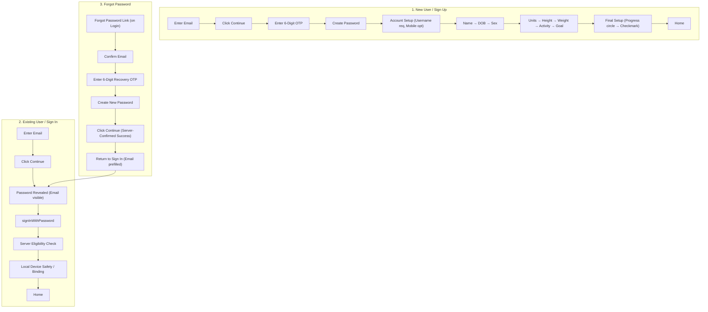
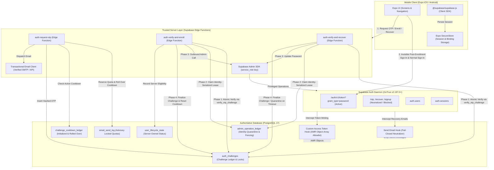

# Phase 1.2 Task 06I-A — Strict Auth Architecture & Server-Side Enforcement Decision

| Field | Value |
|---|---|
| **Task ID** | Task 06I-A (Revision R9 — Durable Identity Ledger Retention & Cascade-Delete Safety) |
| **Status** | **ARCHITECTURE PROPOSED — OWNER DECISION REQUIRED** |
| **Objective** | Resolve independent `im-tio` P1 review finding (`PRRT_kwDOVtCmZc658mO8`): decouple the durable identity-operation ledger (`admin_operation_ledger`) from short-lived OTP challenge deletion (`auth_challenges`) by removing `ON DELETE CASCADE`; establish distinct lifecycles for ephemeral challenges vs durable identity operations (initial-enrollment uniqueness, active recovery serialization, and quarantined indeterminate fencing); specify safe transactional cleanup procedures and provisional user deletion safety; add Cleanup Regression Tests A–H for Stage 06I-B2; document `supabase_auth_admin` permission prerequisites for the Custom Access Token Hook |
| **Execution Mode** | STRICTLY DOCUMENTATION-ONLY, OFFLINE SECURITY DESIGN CORRECTIONS (No app code, migrations, or hosted mutations) |
| **Authorization** | Owner instruction: follow `AGENTS.md`, `.ai/current.md`, Supabase skill; production project `bsfwzvgynwriswapxpsp` strictly READ-ONLY |
| **Implementation Owner** | Security Architecture & Research Agent |
| **Baseline Main Commit** | `317b4d4793368e6a9a2907d504044e876acfaab0` (PR #33 merged) |
| **Worktree Branch** | `docs/task06i-a-strict-auth-architecture` |
| **Security Invariants** | AUTH-12/17/22 **BLOCKED** on native GoTrue; Managed Supabase Auth **NOT VERIFIED**; Production Auth **NO-GO** |
| **Primary Reference** | [AGENTS.md](../../../AGENTS.md), [docs/04-AUTH-AND-SECURITY.md](../../../docs/04-AUTH-AND-SECURITY.md), [docs/27-OTP-FIRST-AUTH-LIFECYCLE.md](../../../docs/27-OTP-FIRST-AUTH-LIFECYCLE.md) |

---

## 1. Executive Summary & Core Decision

Task 06H-E definitively confirmed through controlled runtime integration testing that upstream Supabase Auth (GoTrue v2.197.0) cannot satisfy Tio-Workspace's non-negotiable security requirements out-of-the-box:
1. **AUTH-12 (Atomic Single-Use):** Failed under concurrent load — parallel redemption of a single OTP issued multiple distinct authenticated sessions (`session_id_claim_comparison=different`).
2. **AUTH-17 (Password Mutation Protection):** Failed — direct `PUT /auth/v1/user` by an OTP-authenticated session mutated the account password without supplying the current password, bypassing `security_update_password_require_current_password`.
3. **AUTH-22 (Five-Wrong Cooldown):** Failed — five consecutive invalid OTP submissions failed to trigger a 15-minute lockout; entering the valid code immediately afterwards succeeded.
4. **Purpose Isolation:** Failed — recovery OTP tokens crossed boundaries and successfully authenticated as `type: 'email'` and `type: 'magiclink'`.

### The Core Architectural Dilemma
Because Supabase GoTrue operates as a monolithic, public-facing Go daemon exposing standard endpoints (`/otp`, `/verify`, `/recover`, `/signup`, `/user`), and lacks native hooks for failed verification attempts, password updates, or transactional challenge locking, **client-side hiding, RLS policies, and basic provider flags cannot enforce strict security against direct API attacks**.

### Evidence Classification Framework
To maintain absolute evidence integrity, all claims in this document adhere to the following taxonomy:
- **`VERIFIED`:** Empirically proven in this repository with reproducible automated test runs (e.g. PR #33 baseline, Task 06H loopback binding, Task 06H-E GoTrue v2.197.0 failure reproductions).
- **`HISTORICAL LOCAL EVIDENCE`:** Executed in earlier bounded tasks against isolated local stacks (e.g. Task 06D Clone 1/2 provider flags, Task 06F session deletion on GoTrue v2.197.0, Task 06D Admin create/password update subflows).
- **`PROPOSED DESIGN — NOT TESTED`:** Architectural specifications, SQL patterns, and state-machine algorithms that are conceptually designed but have not yet been executed in an automated test harness in this repository (e.g. `auth_challenges` table, PostgreSQL row locking, sliding-window rate limit ledger, Admin reconciliation state machine, exclusive reverse proxy gateway).
- **`REQUIRES EXPERIMENT`:** Documented or prospective managed cloud capabilities whose availability, persistence, and bypass resistance require empirical proof on an isolated hosted instance (e.g. `EXTERNAL_EMAIL_MAGIC_LINK_DISABLED` on Supabase Cloud, Send Email Hook failure modes, Custom Access Token Hook cold-start behavior, PostgREST non-Auth JWT acceptance).

### Architecture Recommendation
- **Primary Recommendation: Option B (Managed Supabase Auth + Server-Owned Purpose-Bound OTP Gateway via Edge Functions & PostgreSQL Transactional Challenge Store)**.
  - *Status:* **PROPOSED EXPERIMENTAL CANDIDATE (NOT PROVEN)**.
  - Native public OTP and Magic Link issuance is targeted for disablement at the provider level (`EXTERNAL_EMAIL_MAGIC_LINK_DISABLED = true` / `disable_signup = true`).
  - Native password recovery emails are intercepted via a Send Email Hook, and native token issuance for recovery/OTP/non-password methods is blocked via a Custom Access Token Hook with an explicit fail-closed allowlist that inspects the object-array AMR structure (`amr[*].method`).
  - All OTP verification is consolidated into `private_auth.verify_otp_challenge` as the **sole authoritative database entry point** across both signup and recovery flows. Governed by the **Global Strict Lock Hierarchy** (Tier 1 Identity Advisory Lock -> Tier 2 Cooldown Row Lock -> Tier 3 Challenge Row Lock), this unified transaction handles valid redemptions, invalid attempts, active lockout checks (`cooldown_active`), and post-cooldown budget rollovers under a single row lock. Standalone failure functions (`record_failed_attempt`) and raw direct UPSERTs are completely retired to eliminate valid-vs-fifth-wrong race conditions.
  - OTP rate-limiting and challenge issuance (`private_auth.reserve_email_send`) serialize under the same Tier 2 cooldown row lock, strictly enforcing post-commit outbound email dispatch.
  - Supabase Auth is utilized strictly as a **Password Identity Provider** (`signInWithPassword`) and Admin API target (`admin.createUser`, `admin.updateUserById`).
  - *GoTrue Idempotency, Identity Quarantine & Durable Ledger Retention (R9):* GoTrue Admin API does NOT implement an `Idempotency-Key` header. Safe execution requires a server-owned, durable operation ledger (`admin_operation_ledger`) in PostgreSQL. To guarantee that initial-enrollment uniqueness and indeterminate operation quarantines survive short-lived OTP challenge cleanup, `admin_operation_ledger` is completely decoupled from cascading deletes (removing `ON DELETE CASCADE`). Routine purging of ephemeral `auth_challenges` rows leaves permanent enrollment guards and quarantine locks 100% intact. Initial enrollment is permanently serialized per identity (`target_user_id`, `normalized_email`), while password recovery is repeatable over the lifecycle. Identity claiming is encapsulated in `private_auth.claim_admin_operation` with explicit `EXCEPTION WHEN unique_violation` diagnostics for partial unique indexes to guarantee structured HTTP 409 conflict handling. If an Admin API password update times out or encounters network ambiguity, the operation enters an explicit **quarantined indeterminate state** (`quarantined_indeterminate`), retaining the identity lock at the database level to prevent racing external GoTrue mutations.
  - *Multi-Consumer JWT Cutover Nuance:* Deleting sessions in `auth.sessions` immediately invalidates Auth `/user` (403 on local GoTrue; hosted NOT VERIFIED), but stateless non-Auth JWT consumers (PostgREST Data API, Storage) will accept signed JWTs until their `exp` timestamp. Cutover must account for this lingering window or rotate signing secrets.
- **Contingency Fallback: Option D1 (Self-Hosted Supabase GoTrue Behind an Exclusive Reverse Proxy / API Gateway)**.
  - *Status:* **PROPOSED FALLBACK (NOT TESTED)**.
  - If managed Supabase controls fail to close native GoTrue public routes on a disposable hosted instance, GoTrue must be self-hosted in a private network where native `/otp`, `/verify`, `/recover`, `/signup`, and direct `/user` are physically unreachable from the public internet.

**Final Verdict:** Production Auth remains **NO-GO**. A tightly bounded two-stage proof-of-concept on a disposable managed project (**Task 06I-B1 / 06I-B2**) is required before any implementation or production activation. Stage 06I-B1 failure triggers an owner decision on Option D1, not automatic self-hosted deployment.

---

## 2. Reconciliation of Canonical Evidence & Empirical Baseline

| Task & Date | Scope & Method | Observed Evidence / Outcome | Status of Requirements | Contradiction / Conflict Resolved |
|---|---|---|---|---|
| **Task 06A** (2026-11-17) | Local GoTrue v2.197.0 via CLI | Sequential replay rejected; direct `PUT /user` overwritten; 5 wrong codes did not lock | AUTH-12 Sequential PASS; AUTH-17 FAIL; AUTH-22 FAIL | Proved GoTrue treats OTP sessions as recovery-capable. |
| **Task 06B** (2026-11-17) | GoTrue source review & isolated testing | Verified `security_update_password_require_current_password = true` exempts `session.IsRecovery()`; AMR classifies OTP/magiclink as recovery | AUTH-17 Confirmed FAIL in GoTrue engine design | Proved RLS and client flags cannot intercept GoTrue user update. |
| **Task 06C** (2026-11-17) | Architecture review (read-only) | Proposed server-owned challenge store; highlighted direct API bypass risks | Production Auth BLOCKED | Rejected client-only UX or RLS as an Auth boundary. |
| **Task 06D** (2026-11-17) | Isolated multi-container GoTrue testing | `MagicLinkEnabled=false` disabled `/otp` (422); Custom Access Token Hook blocked verify/refresh JWTs; preexisting access JWT still mutated password | AUTH-17 BLOCKED; Managed feasibility INCONCLUSIVE | Established that denying new JWT issuance does not revoke preexisting access tokens. |
| **Task 06F** (2026-11-17) | Session revocation hypothesis | Voluntary `POST /logout` or Admin password reset deleted session, causing `GET/PUT /user` to return `403/session_not_found` | LOCAL ONLY PASS for session invalidation; Hosted NOT VERIFIED | Highlighted that voluntary logout is insufficient; server-side session revocation is required. |
| **Task 06H-D** (2026-11-19) | Loopback Compose prototype | Kong + GoTrue + DB + Mailpit bound strictly to `127.0.0.1` | Infrastructure PASS (zero `0.0.0.0` bindings) | Resolved Windows Docker binding vulnerability without daemon modification. |
| **Task 06H-E** (2026-11-19) | Controlled runtime integration testing | Pinned GoTrue v2.197.0; 14 synthetic cases in Mailpit; Mode A (5/hr) & Mode B (30/hr) | **AUTH-12 FAIL (Concurrency)**<br>**AUTH-17 FAIL (Mutation)**<br>**AUTH-22 FAIL (Cooldown)**<br>**Purpose Crossover Observed** | **Empirically demonstrated race condition (2 sessions for 1 OTP) and purpose crossover (`recovery` accepted as `email` and `magiclink`).** |

---

## 3. Preservation of Owner-Approved Auth UX

The architectural recommendations strictly adhere to the owner-approved UI/UX design specifications in [`docs/27-OTP-FIRST-AUTH-LIFECYCLE.md`](../../../docs/27-OTP-FIRST-AUTH-LIFECYCLE.md) and [`DESIGN.md`](../../../DESIGN.md). **Zero changes to Expo screens, visual layout, typography, keyboard focus, error timing, or navigation are introduced.**



### Detailed UX & Lifecycle Invariants
1. **Sign Up Flow:**
   - Sequential presentation: Email → OTP → Password.
   - **Provisional UUID Reuse:** If an unverified or password-pending provisional UUID already exists for the normalized email in `user_lifecycle_state` (`EMAIL_VERIFIED_PASSWORD_PENDING`), the server-owned challenge records `user_id = provisional_uuid`. Upon successful OTP verification, initial password enrollment updates that existing provisional UUID via `admin.updateUserById(provisional_uuid, { password })` rather than minting duplicate identities.
   - **Password-Complete Accounts:** If `user_lifecycle_state` indicates an already established account (`PASSWORD_COMPLETE_PROFILE_PENDING` or `SERVER_ELIGIBLE`), Sign Up verification strictly rejects initial password enrollment and returns a generic anti-enumeration response directing the user to Sign In or Forgot Password. An existing password can never be overwritten through the Sign Up route.
   - **Post-Enrollment Authenticated Session Before Cloud Profile (P1-6):**
     - Step 4 (Create Password) submits password to `/auth-verify-and-enroll`. Upon server-side enrollment success (`200 OK { success: true, user_id: UUID }`), the mobile client immediately and invisibly performs a standard `supabase.auth.signInWithPassword({ email, password })` using the password currently in client memory.
     - The client verifies:
       1. The authenticated session `user.id` strictly matches the enrolled provisional `user_id`.
       2. The server lifecycle state is `PASSWORD_COMPLETE_PROFILE_PENDING`.
       3. The session holds server-trusted `amr` with `method: 'password'` (satisfying the Custom Access Token Hook allowlist).
     - The client seamlessly advances to Step 5 (Account Setup: Username required, Mobile optional) possessing a valid authenticated session under which private profile writes are permitted by `auth.uid() = id` RLS.
     - Local device fitness storage and Home readiness remain strictly locked until Cloud Profile is complete, server eligibility transitions to `SERVER_ELIGIBLE`, and local device binding checks pass.
     - If `signInWithPassword` fails (e.g. transient network interruption), no duplicate account creation or OTP replay is attempted; the user is routed to Sign In with Email prefilled to log in with their newly enrolled password.
2. **Sign In Flow:**
   - Normal login never sends an OTP and never modifies the stored password.
   - Email remains visible when Password is revealed after Continue.
   - No public account-existence query; no automatic mode switching between Sign Up and Sign In.
   - Direct `PUT /auth/v1/user` password mutation by normal login sessions is strictly prevented because normal sessions bear `method: 'password'`, enforcing `security_update_password_require_current_password = true`.
3. **Forgot Password Flow & Repeatability (P1-3):**
   - Initiated explicitly from the Login screen: Confirm Email → 6-Digit Recovery OTP → New Password.
   - Recovery verification grants **zero ambient session** and never routes to Home.
   - **Repeatable Recovery:** Password recovery is repeatable across the user's account lifecycle. Completing a recovery successfully records an audit log but does NOT block legitimate subsequent password recoveries.
   - Upon successful server-side password reset via Admin API (`admin.updateUserById(user_id, { password: new_password })`), all active user sessions are deleted from `auth.sessions`.
   - The client is redirected to Sign In with Email prefilled to perform an explicit `signInWithPassword` using the new password.
   - Local device storage remains locked until authenticated with the same bound UUID.

---

## 4. Core Security Architecture Enforcement

### 4.1. AUTH-12 — Atomic OTP Single-Use & Concurrency Serialization
Task 06H-E proved that GoTrue v2.197.0 suffers from a concurrency race condition: parallel requests with the same valid OTP both succeeded and minted two independent sessions.

#### Concurrency Serialization & The 5th-Failure Race Vulnerability (P1 Hardened — R7)
Task 06H-E proved that GoTrue v2.197.0 suffers from a concurrency race condition where parallel requests with the same valid OTP both minted independent sessions.

However, independent review finding `PRRT_kwDOVtCmZc656hwv` (im-tio [P1]) identified a critical cross-table concurrency vulnerability in earlier revisions: locking only `auth_challenges` (`FOR UPDATE OF c`) while `record_failed_attempt` locked `challenge_cooldown_ledger` independently permitted a severe race condition between a **concurrent 5th invalid attempt** and a **valid OTP submission**:
1. Request W (submitting a 5th incorrect guess) begins executing `record_failed_attempt`.
2. Request C (submitting the correct OTP) begins executing the verification query. In its statement snapshot, `l.cooldown_until IS NULL` evaluates to TRUE.
3. Request W commits its transaction, setting `cooldown_until = clock_timestamp() + INTERVAL '15 minutes'`.
4. Request C acquires the row lock on `auth_challenges`. Because it never acquired a row lock on `challenge_cooldown_ledger` or rechecked active cooldown state under lock, Request C proceeds to evaluate the HMAC hash, succeeds, and transitions the challenge to `pending_provisioning`!
5. **Vulnerability Impact:** The intended 5-failure lockout boundary (AUTH-22) is defeated under concurrent guessing, allowing an attacker or race condition to consume the challenge despite an active lockout having committed.

#### Global Strict Lock Hierarchy (R7)
To mathematically eliminate deadlocks and guarantee strict serializability across issuance, valid verification, failed attempts, and credential provisioning, all database transactions MUST strictly acquire locks according to the following **Global Strict Lock Hierarchy**:

```
Tier 1: Identity Advisory Lock      (PERFORM pg_advisory_xact_lock(hashtext('auth_identity:' || normalized_email)))
   │
   ▼
Tier 2: Cooldown Row Lock           (SELECT ... FROM challenge_cooldown_ledger WHERE normalized_email = ... FOR UPDATE)
   │
   ▼
Tier 3: Challenge Row Lock          (SELECT ... FROM auth_challenges WHERE challenge_id = ... FOR UPDATE)
   │
   ▼
Tier 4: Send Log Row                (INSERT INTO email_send_log ...)
   │
   ▼
Tier 5: Admin Operation Ledger Claim (INSERT INTO admin_operation_ledger ... / claim_admin_operation)
```

Because every transaction (OTP issuance, verification, invalid attempt recording, and recovery claiming) acquires locks in this top-down order, deadlocks cannot occur.

#### Unified Verification Transaction (`private_auth.verify_otp_challenge`)
To enforce this hierarchy and serialize successful redemptions with cooldown mutations, both valid and invalid attempts are consolidated under a single authoritative stored procedure, `private_auth.verify_otp_challenge` (draft specification):

```sql
-- Unified Challenge Verification & Cooldown Guard (P1 Hardened & R7)
CREATE OR REPLACE FUNCTION private_auth.verify_otp_challenge(
    p_challenge_id UUID,
    p_normalized_email TEXT,
    p_purpose private_auth.challenge_purpose,
    p_raw_code TEXT,
    p_server_pepper TEXT
) RETURNS TABLE (
    status TEXT,
    user_id UUID,
    provisioning_grant_id UUID,
    grant_expires_at TIMESTAMPTZ,
    remaining_attempts INT,
    cooldown_until TIMESTAMPTZ,
    retry_after_seconds INT
) AS $$
DECLARE
    v_cooldown private_auth.challenge_cooldown_ledger%ROWTYPE;
    v_challenge private_auth.auth_challenges%ROWTYPE;
    v_now TIMESTAMPTZ := clock_timestamp();
    v_computed_hash TEXT;
    v_is_valid BOOLEAN := FALSE;
    v_new_grant UUID;
    v_grant_exp TIMESTAMPTZ;
BEGIN
    -- Tier 1: Identity Advisory Lock
    PERFORM pg_advisory_xact_lock(hashtext('auth_identity:' || p_normalized_email));

    -- Ensure cooldown ledger row exists idempotently
    INSERT INTO private_auth.challenge_cooldown_ledger (
        normalized_email, purpose, consecutive_failed_attempts, cooldown_until, last_failed_at, updated_at
    ) VALUES (
        p_normalized_email, p_purpose, 0, NULL, NULL, v_now
    ) ON CONFLICT (normalized_email, purpose) DO NOTHING;

    -- Tier 2: Authoritative Cooldown Row Lock (serializes valid and invalid attempts)
    SELECT * INTO v_cooldown
    FROM private_auth.challenge_cooldown_ledger
    WHERE normalized_email = p_normalized_email AND purpose = p_purpose
    FOR UPDATE;

    -- Strict Lockout Check: If cooldown is active, fail closed with zero challenge mutation
    IF v_cooldown.cooldown_until IS NOT NULL AND v_cooldown.cooldown_until > v_now THEN
        RETURN QUERY SELECT
            'cooldown_active'::TEXT,
            NULL::UUID, NULL::UUID, NULL::TIMESTAMPTZ,
            0, v_cooldown.cooldown_until,
            GREATEST(1, EXTRACT(EPOCH FROM (v_cooldown.cooldown_until - v_now))::INT);
        RETURN;
    END IF;

    -- Cooldown Rollover: If prior cooldown expired, roll over to a fresh 5-attempt budget (R5)
    IF v_cooldown.cooldown_until IS NOT NULL AND v_cooldown.cooldown_until <= v_now THEN
        UPDATE private_auth.challenge_cooldown_ledger
        SET consecutive_failed_attempts = 0,
            cooldown_until = NULL,
            last_failed_at = NULL,
            updated_at = v_now
        WHERE normalized_email = p_normalized_email AND purpose = p_purpose
        RETURNING * INTO v_cooldown;
    END IF;

    -- Tier 3: Challenge Row Lock
    SELECT * INTO v_challenge
    FROM private_auth.auth_challenges
    WHERE challenge_id = p_challenge_id
      AND normalized_email = p_normalized_email
      AND purpose = p_purpose
    FOR UPDATE;

    IF NOT FOUND THEN
        RETURN QUERY SELECT
            'challenge_not_found'::TEXT,
            NULL::UUID, NULL::UUID, NULL::TIMESTAMPTZ,
            GREATEST(0, 5 - v_cooldown.consecutive_failed_attempts),
            v_cooldown.cooldown_until, 0;
        RETURN;
    END IF;

    IF v_challenge.status != 'issued' OR v_challenge.consumed_at IS NOT NULL THEN
        RETURN QUERY SELECT
            'already_consumed'::TEXT,
            NULL::UUID, NULL::UUID, NULL::TIMESTAMPTZ,
            GREATEST(0, 5 - v_cooldown.consecutive_failed_attempts),
            v_cooldown.cooldown_until, 0;
        RETURN;
    END IF;

    IF v_challenge.expires_at < v_now THEN
        RETURN QUERY SELECT
            'challenge_expired'::TEXT,
            NULL::UUID, NULL::UUID, NULL::TIMESTAMPTZ,
            GREATEST(0, 5 - v_cooldown.consecutive_failed_attempts),
            v_cooldown.cooldown_until, 0;
        RETURN;
    END IF;

    -- Constant-time cryptographic comparison (explicit hex encoding)
    v_computed_hash := encode(hmac(p_raw_code::bytea, p_server_pepper::bytea, 'sha256'), 'hex');
    v_is_valid := (v_challenge.code_hash = v_computed_hash);

    IF v_is_valid THEN
        -- Recheck cooldown state immediately before committing redemption
        IF v_cooldown.cooldown_until IS NOT NULL AND v_cooldown.cooldown_until > v_now THEN
            RETURN QUERY SELECT
                'cooldown_active'::TEXT,
                NULL::UUID, NULL::UUID, NULL::TIMESTAMPTZ,
                0, v_cooldown.cooldown_until,
                GREATEST(1, EXTRACT(EPOCH FROM (v_cooldown.cooldown_until - v_now))::INT);
            RETURN;
        END IF;

        -- Transition challenge to pending_provisioning
        v_new_grant := gen_random_uuid();
        v_grant_exp := v_now + INTERVAL '5 minutes';

        UPDATE private_auth.auth_challenges
        SET status = 'pending_provisioning',
            verified_at = v_now,
            provisioning_grant_id = v_new_grant,
            grant_expires_at = v_grant_exp
        WHERE id = v_challenge.id;

        -- Reset cooldown ledger on successful verification
        UPDATE private_auth.challenge_cooldown_ledger
        SET consecutive_failed_attempts = 0,
            cooldown_until = NULL,
            last_failed_at = NULL,
            updated_at = v_now
        WHERE normalized_email = p_normalized_email AND purpose = p_purpose;

        RETURN QUERY SELECT
            'verified'::TEXT,
            v_challenge.user_id,
            v_new_grant,
            v_grant_exp,
            5,
            NULL::TIMESTAMPTZ,
            0;
        RETURN;
    ELSE
        -- Invalid Code: Execute failure state machine under held Tier 2 row lock
        IF v_cooldown.consecutive_failed_attempts + 1 >= 5 THEN
            -- 5th failure: activate fixed 15-minute cooldown
            UPDATE private_auth.challenge_cooldown_ledger
            SET consecutive_failed_attempts = v_cooldown.consecutive_failed_attempts + 1,
                cooldown_until = v_now + INTERVAL '15 minutes',
                last_failed_at = v_now,
                updated_at = v_now
            WHERE normalized_email = p_normalized_email AND purpose = p_purpose
            RETURNING * INTO v_cooldown;

            RETURN QUERY SELECT
                'fifth_failure_activated_cooldown'::TEXT,
                NULL::UUID, NULL::UUID, NULL::TIMESTAMPTZ,
                0,
                v_cooldown.cooldown_until,
                900;
            RETURN;
        ELSE
            -- Failures 1-4: increment counter
            UPDATE private_auth.challenge_cooldown_ledger
            SET consecutive_failed_attempts = v_cooldown.consecutive_failed_attempts + 1,
                cooldown_until = NULL,
                last_failed_at = v_now,
                updated_at = v_now
            WHERE normalized_email = p_normalized_email AND purpose = p_purpose
            RETURNING * INTO v_cooldown;

            RETURN QUERY SELECT
                'invalid_code'::TEXT,
                NULL::UUID, NULL::UUID, NULL::TIMESTAMPTZ,
                GREATEST(0, 5 - v_cooldown.consecutive_failed_attempts),
                NULL::TIMESTAMPTZ,
                0;
            RETURN;
        END IF;
    END IF;
END;
$$ LANGUAGE plpgsql SECURITY DEFINER;
```

#### Concurrency Evaluation Under Unified Lock Hierarchy
- **Scenario A: Concurrent Identical Valid Tokens (AUTH-12):**
  - Request 1 and Request 2 both arrive with valid OTPs for the same challenge.
  - Request 1 acquires the Tier 2 cooldown lock and Tier 3 challenge lock. It updates the challenge to `pending_provisioning` and commits.
  - Request 2 waits on Tier 2. When it acquires Tier 2 and Tier 3, it reads `status = 'pending_provisioning'`. It immediately fails with `already_consumed`. Exactly 1 grant is issued.
- **Scenario B: Concurrent 5th Wrong Attempt vs. Valid OTP (AUTH-22 & AUTH-12 Race Closure):**
  - Challenge has 4 previous failed attempts (`consecutive_failed_attempts = 4`). Request W submits an invalid guess; Request C submits the valid OTP concurrently.
  - **Case B1 (Wrong guess acquires Tier 2 lock first):** Request W enters `verify_otp_challenge`, acquires Tier 2 lock, detects 5th failure, sets `cooldown_until = v_now + INTERVAL '15 minutes'`, and commits. Request C was blocked waiting for Tier 2 lock. When Request C unblocks, it reads the updated cooldown row, sees `cooldown_until > v_now`, and immediately terminates with `cooldown_active`. The valid OTP is rejected, and the challenge is NOT consumed.
  - **Case B2 (Valid OTP acquires Tier 2 lock first):** Request C enters `verify_otp_challenge`, acquires Tier 2 lock and Tier 3 lock, verifies the hash, updates challenge to `pending_provisioning`, resets cooldown counter to 0, and commits. Request W was blocked waiting for Tier 2 lock. When Request W unblocks, it acquires Tier 3 challenge lock, sees `status = 'pending_provisioning'`, and fails without triggering a lockout or invalidating the valid user's grant.
- **Scenario C: Concurrent Invalid Guesses (AUTH-22 Serialized Counting):**
  - Multiple concurrent invalid guesses queue strictly on the Tier 2 row lock inside `verify_otp_challenge`. Each guess observes the committed counter of its predecessor. Attempt 5 triggers the 15-minute lockout (`fifth_failure_activated_cooldown`); subsequent guesses observe `cooldown_until > v_now` and return `cooldown_active` with zero counter or deadline mutations.

#### The Cross-Service Distributed Transaction Problem & GoTrue Admin Idempotency Verdict
A critical architectural reality must be acknowledged: **a PostgreSQL database transaction cannot roll back an independent outbound HTTP call to Supabase GoTrue Admin API**.

Furthermore, source review of Supabase Auth (`supabase/auth` / GoTrue) confirms that **GoTrue does NOT implement or recognize an `Idempotency-Key` HTTP header** on `/admin/users`, `PUT /admin/users/{user_id}`, or any other endpoint. Merely sending an `Idempotency-Key` header provides zero native idempotency or duplicate-request prevention.

Holding an open PostgreSQL transaction during an outbound HTTP call to GoTrue introduces:
1. Connection pool exhaustion and elevated database latency under slow network conditions.
2. Dangerous partial failure states: if GoTrue creates the user or updates the password, but the subsequent database commit times out or aborts, PostgreSQL rolls back the challenge state while GoTrue persists the user state, creating severe identity desynchronization.
3. If GoTrue Admin API times out while actually succeeding on the GoTrue server, a naive retry could cause unexpected duplicate creation errors or race conditions.

#### Server-Owned Durable Operation Ledger & Identity Quarantine (P1-3, P1-4, P1-5, P2-7)
*(Status: PROPOSED DESIGN — NOT TESTED)*
To resolve cross-service coordination without impossible distributed transactions or non-existent provider headers, Option B implements an explicit **Server-Owned Durable Operation Ledger** (`private_auth.admin_operation_ledger`) coupled with a two-phase challenge state machine:

1. **Challenge Status Lifecycle:**
   `issued` -> `verifying` -> `pending_provisioning` -> `consumed` (or `provisioning_failed_retryable`, `failed_terminal`, `superseded`)
2. **Phase 1: Atomic In-Database Verification via `verify_otp_challenge` (Sole Authoritative Entry Point — R8):**
   - **Sole Authoritative Verifier Invariant (`PRRT_kwDOVtCmZc657ZXl`):** To eliminate all concurrency races between valid submissions and invalid attempt bookkeeping, `private_auth.verify_otp_challenge` is the **exclusive database entry point** for every OTP submission across both signup (`signup_initial_password`) and recovery (`recovery_password_reset`). Standalone failure-recording functions (`record_failed_attempt`) and direct SQL UPSERTs are **RETIRED AND PROHIBITED FROM PRODUCTION USE**.
   - **Complete Server-Side Edge Function Dispatch Sequence:**
     1. **Validate Request & Scope:** Edge Function parses incoming payload (`email`, `otp`, `password`/`new_password`) and binds the request strictly to the server-owned purpose (`signup_initial_password` or `recovery_password_reset`).
     2. **Normalize Identity:** Normalize email according to canonical repository policy (`email.trim().toLowerCase()`).
     3. **Authoritative Database Invocation:**
        ```sql
        SELECT * FROM private_auth.verify_otp_challenge(
            p_challenge_id := $1,
            p_normalized_email := $2,
            p_purpose := $3,
            p_raw_code := $4,
            p_server_pepper := $5
        );
        ```
     4. **Internal Result Category Evaluation:**
        - `verified`: Transition challenge to `pending_provisioning`, issue single-use `provisioning_grant_id`, reset cooldown ledger (`consecutive_failed_attempts = 0, cooldown_until = NULL`). Proceed immediately to Phase 2.
        - `cooldown_active`: Identity is currently under 15-minute lockout. Zero challenge or cooldown mutation. Fails closed.
        - `fifth_failure_activated_cooldown`: 5th consecutive invalid guess triggers fixed 15-minute cooldown (`cooldown_until = now + 15m`). Fails closed.
        - `invalid_code`: Incorrect OTP within active 5-attempt budget. Counter incremented; cooldown inactive. Fails closed.
        - `challenge_expired`: Challenge `expires_at < now`. Fails closed.
        - `already_consumed`: Challenge `status != 'issued'` or already consumed. Fails closed.
        - `challenge_not_found`: Challenge parameters mismatch or do not exist. Fails closed.
     5. **Generic Public Error Mapping (Anti-Enumeration):** Every failure category maps unconditionally to `HTTP 400 Bad Request` (`{ error: "invalid_grant", message: "Verification failed. Please try again or request a new code." }`). No internal category, counter value, or lockout deadline is ever exposed to the client.
     6. **No Alternative Retry Paths:** Edge Functions NEVER execute a fallback query, retry through an alternative SQL statement, or attempt manual ledger counter manipulation.
   - **Database Permissions & Defense-in-Depth Enforcement (R8):**
     Public PostgREST roles (`anon`, `authenticated`) have zero access to `private_auth`:
     ```sql
     REVOKE ALL ON SCHEMA private_auth FROM PUBLIC, anon, authenticated;
     GRANT USAGE ON SCHEMA private_auth TO service_role;

     REVOKE ALL ON ALL FUNCTIONS IN SCHEMA private_auth FROM PUBLIC, anon, authenticated;
     GRANT EXECUTE ON FUNCTION private_auth.reserve_email_send TO service_role;
     GRANT EXECUTE ON FUNCTION private_auth.verify_otp_challenge TO service_role;
     GRANT EXECUTE ON FUNCTION private_auth.claim_admin_operation TO service_role;
     ```
     Server pepper resides exclusively in Edge Function environment variables (`CHALLENGE_PEPPER`), passed only as a transient function parameter, and is never stored in PostgreSQL tables.
3. **Phase 2: Identity-Level Claim, Fencing & Repeatable Recovery (P1-3, P1-5, P2-7):**
   - Before calling GoTrue, the Edge Function attempts to atomically claim an execution lease in `private_auth.admin_operation_ledger`.
   - **Enrollment vs. Recovery Partial Unique Indexes (P1-3 & P1-5):**
     - Initial password enrollment is strictly once per identity (indexed across `completed` and `quarantined_indeterminate`):
       ```sql
       CREATE UNIQUE INDEX uq_admin_ledger_single_enrollment_user
       ON private_auth.admin_operation_ledger (target_user_id)
       WHERE operation_type = 'enroll_initial_password'
         AND status IN ('claimed', 'executing', 'reconciling', 'completed', 'quarantined_indeterminate');

       CREATE UNIQUE INDEX uq_admin_ledger_single_enrollment_email
       ON private_auth.admin_operation_ledger (normalized_email)
       WHERE operation_type = 'enroll_initial_password'
         AND status IN ('claimed', 'executing', 'reconciling', 'completed', 'quarantined_indeterminate');
       ```
     - Password recovery is repeatable, but only ONE active or quarantined recovery may exist at a time (does NOT index `completed`):
       ```sql
       CREATE UNIQUE INDEX uq_admin_ledger_active_recovery_user
       ON private_auth.admin_operation_ledger (target_user_id)
       WHERE operation_type = 'recovery_password_reset'
         AND status IN ('claimed', 'executing', 'reconciling', 'quarantined_indeterminate');

       CREATE UNIQUE INDEX uq_admin_ledger_active_recovery_email
       ON private_auth.admin_operation_ledger (normalized_email)
       WHERE operation_type = 'recovery_password_reset'
         AND status IN ('claimed', 'executing', 'reconciling', 'quarantined_indeterminate');
       ```
   - **Durable Identity Invariants & Lifecycle Decoupling (Stage 1 & 2 — R9 — `PRRT_kwDOVtCmZc658mO8`):**
     A critical architectural boundary exists between two independent lifecycles:
     1. **Ephemeral OTP Challenge Lifecycle:** Challenges carry a 10-minute expiry, single-use redemption, and are subject to routine cleanup ($> 24$ hours) to satisfy privacy data minimization.
     2. **Durable Admin Operation Lifecycle:** Initial password enrollment uniqueness (`uq_admin_ledger_single_enrollment_*`) must permanently survive for the entire account lifetime. Indeterminate quarantines (`quarantined_indeterminate`) must block conflicting operations indefinitely until explicit operator reconciliation.

     **The Cascade-Delete Defect & Resolution:**
     In earlier drafts, `admin_operation_ledger.challenge_id` specified `REFERENCES auth_challenges(challenge_id) ON DELETE CASCADE`. If routine retention cleanup purged an expired or consumed challenge, PostgreSQL cascaded the deletion into `admin_operation_ledger`. This silently erased `quarantined_indeterminate` locks, destroyed initial-enrollment uniqueness guards, and erased immutable audit evidence.

     *Evaluation of Architectural Alternatives:*
     - *Option A (Restrictive FK `ON DELETE RESTRICT`):* Prevents deletion of challenges associated with completed operations. However, this indefinitely blocks routine challenge cleanup, forcing code hashes and transient grant IDs to remain in the challenge table forever, causing index bloat and violating data minimization.
     - *Option B (Independently Durable Ledger — PREFERRED):* `admin_operation_ledger.challenge_id UUID UNIQUE NOT NULL` stores the immutable provenance challenge UUID **without an `ON DELETE CASCADE` foreign key dependency**. Referential validity is strictly asserted at claim time within `claim_admin_operation`. Routine cleanup of ephemeral challenges can safely purge `auth_challenges` rows after the retention window ($> 24$ hours) without affecting the durable ledger.

     *User Deletion Chain Safety (`auth.users → auth_challenges → admin_operation_ledger`):*
     In `auth_challenges`, `user_id` foreign key is decoupled (`ON DELETE SET NULL`), and `admin_operation_ledger` maintains zero cascading dependency from `auth.users`. Deleting a provisional user in `auth.users` CANNOT silently delete active or quarantined records in `admin_operation_ledger`. Account deletion is an authorized administrative procedure, strictly separated from routine challenge cleanup.

   - **Atomic Claim Helper with Claim-Time Referential Validation (`claim_admin_operation` — R9):**
     Claiming is encapsulated in a dedicated stored function that transactionally validates challenge status and grant validity, handles all partial unique index conflicts, and maps errors cleanly without crashing:
     ```sql
     CREATE OR REPLACE FUNCTION private_auth.claim_admin_operation(
         p_challenge_id UUID,
         p_normalized_email TEXT,
         p_target_user_id UUID,
         p_operation_type private_auth.operation_type,
         p_worker_lease_id UUID,
         p_idempotency_payload_hash TEXT
     ) RETURNS TABLE (
         claimed BOOLEAN,
         operation_id UUID,
         fencing_token BIGINT,
         conflict_code TEXT
     ) AS $$
     DECLARE
         v_op_id UUID;
         v_token BIGINT;
         v_err_constraint TEXT;
     BEGIN
         -- Claim-Time Referential Provenance Validation (R9)
         IF NOT EXISTS (
             SELECT 1 FROM private_auth.auth_challenges
             WHERE challenge_id = p_challenge_id
               AND normalized_email = p_normalized_email
               AND status = 'pending_provisioning'
               AND grant_expires_at > clock_timestamp()
         ) THEN
             RETURN QUERY SELECT FALSE, NULL::UUID, NULL::BIGINT, 'invalid_or_expired_grant'::TEXT;
             RETURN;
         END IF;

         BEGIN
             INSERT INTO private_auth.admin_operation_ledger (
                 challenge_id, normalized_email, target_user_id, operation_type,
                 status, worker_lease_id, lease_expires_at, fencing_token, idempotency_payload_hash
             ) VALUES (
                 p_challenge_id, p_normalized_email, p_target_user_id, p_operation_type,
                 'executing', p_worker_lease_id, clock_timestamp() + INTERVAL '30 seconds', 1, p_idempotency_payload_hash
             )
             RETURNING admin_operation_ledger.operation_id, admin_operation_ledger.fencing_token
             INTO v_op_id, v_token;

             RETURN QUERY SELECT TRUE, v_op_id, v_token, NULL::TEXT;
             RETURN;
         EXCEPTION WHEN unique_violation THEN
             GET STACKED DIAGNOSTICS v_err_constraint = CONSTRAINT_NAME;
             IF v_err_constraint = 'admin_operation_ledger_challenge_id_key' THEN
                 RETURN QUERY SELECT FALSE, NULL::UUID, NULL::BIGINT, 'challenge_already_claimed'::TEXT;
             ELSIF v_err_constraint IN ('uq_admin_ledger_single_enrollment_user', 'uq_admin_ledger_single_enrollment_email') THEN
                 RETURN QUERY SELECT FALSE, NULL::UUID, NULL::BIGINT, 'enrollment_conflict_identity_locked'::TEXT;
             ELSIF v_err_constraint IN ('uq_admin_ledger_active_recovery_user', 'uq_admin_ledger_active_recovery_email') THEN
                 RETURN QUERY SELECT FALSE, NULL::UUID, NULL::BIGINT, 'recovery_conflict_identity_locked'::TEXT;
             ELSE
                 RETURN QUERY SELECT FALSE, NULL::UUID, NULL::BIGINT, 'identity_conflict_generic'::TEXT;
             END IF;
             RETURN;
         END;
     END;
     $$ LANGUAGE plpgsql SECURITY DEFINER;
     ```
     The Edge Function inspects `claimed`: if `TRUE`, it proceeds to the outbound Admin API call with `fencing_token`; if `FALSE`, it maps the structured `conflict_code` directly to `HTTP 409 Conflict` (`{ error: "conflict", code: conflict_code }`).
   - **Expired-Lease Takeover & Fencing Token Protocol (P2-7):**
     If a worker crashes or encounters an event-loop pause, `INSERT ... ON CONFLICT DO NOTHING` affects 0 rows. A recovery worker cannot insert, but safely claims ownership using an atomic conditional update that increments a monotonic `fencing_token`:
     ```sql
     UPDATE private_auth.admin_operation_ledger
     SET worker_lease_id = $new_worker_lease_id,
         lease_expires_at = clock_timestamp() + INTERVAL '30 seconds',
         fencing_token = fencing_token + 1,
         attempt_count = attempt_count + 1,
         status = 'reconciling'
     WHERE challenge_id = $1
       AND status IN ('claimed', 'executing', 'reconciling')
       AND lease_expires_at < clock_timestamp()
     RETURNING operation_id, fencing_token, attempt_count;
     ```
   - **Stale Worker Rejection:** When finalizing or updating the ledger, workers MUST supply their acquired `fencing_token`. If a delayed worker wakes up after its lease expired, its database write matches 0 rows and is rejected.
4. **Phase 3: Outbound Admin Call & Identity Quarantine (P1-4):**
   - The lease-holding worker executes the GoTrue Admin API call (`admin.createUser` or `admin.updateUserById`).
   - **Initial Creation Ambiguity:** For initial user creation (`admin.createUser`), if the call times out, the worker queries `admin.listUsers` by email. If the user exists and was created within the operation window, the worker marks `status = 'completed'`. If not, safe retry is permitted.
   - **Password Update Ambiguity & Durable Identity Quarantine (P1-4):**
     For password enrollment or recovery reset (`admin.updateUserById`), **`user.updated_at` and session deletion DO NOT prove that this specific operation installed the requested password**. GoTrue provides no API to verify password hash state. Therefore:
     - If the Admin API call returns an ambiguous timeout / network error, the server **DOES NOT mark the operation completed**.
     - To prevent a slow GoTrue call from completing later and overwriting a newly chosen password, the operation enters a durable **quarantined indeterminate state**: `status = 'quarantined_indeterminate'`.
     - Because `'quarantined_indeterminate'` is retained in the unique partial indexes for BOTH enrollment and recovery, **the identity remains locked at the database level**.
     - No new recovery or enrollment operation can be initiated for that identity while the quarantine is active.
     - Database fencing tokens cannot cancel an external GoTrue HTTP request, so the identity quarantine prevents conflicting writes until safe completion can be established via an explicit operator-resolution procedure.
     - The challenge and grant are immediately neutralized (`status = 'failed_terminal'`) to prevent grant reuse. Blind retries are strictly prohibited.
     - The client receives a generic error (`HTTP 503 Service Unavailable`) advising the user that a network error occurred during credential provisioning and to attempt sign in or contact support. The user is NOT instructed to start a fresh recovery that could race.
     - **Safety vs. Availability Trade-off:** Safety is strictly prioritized to eliminate silent credential overwrite races, accepting temporary mutation unavailability until reconciled by an operator or authoritative background reconciliation.
5. **Phase 4: Finalization & Single-Use Enforcement:**
   - On confirmed Admin API success (200/201), the worker updates:
     `UPDATE private_auth.admin_operation_ledger SET status = 'completed', completed_at = clock_timestamp() WHERE operation_id = $1 AND fencing_token = $my_token;`
   - Challenge transitions to `consumed`:
     `UPDATE private_auth.auth_challenges SET status = 'consumed', consumed_at = clock_timestamp() WHERE challenge_id = $1;`
   - Permanent invalidation: A consumed grant or challenge can never be presented again.

#### Token Cryptography & Storage
- Six-digit numeric OTP generated via cryptographically secure pseudo-random number generator (`crypto.randomInt(100000, 1000000)`).
- **No Plaintext Storage:** Challenge table stores `code_hash = encode(HMAC-SHA256(code, server_pepper), 'hex')`.
- Server pepper resides exclusively in server-side environment secrets (`CHALLENGE_PEPPER`), never exposed to clients or database users without elevated permissions.

---

### 4.2. AUTH-17 — Password Mutation Protection & Identity Boundary
Task 06B, 06D, and 06H-E proved that any session bearing `amr: ['otp']` can call `PUT /auth/v1/user` and overwrite the password without supplying the current password.

#### Enforcement Architecture
1. **Denial of Native OTP Sessions:** The client never receives a Supabase Auth session from OTP verification. OTP verification occurs in the Edge Function, which returns only a purpose-bound transient verification grant (`provisioning_grant_id`) or proceeds immediately to server-side password enrollment.
2. **Explicit Fail-Closed Token Hook Allowlist with Object-Array AMR Parsing (P1-1):**
   *(Status: PROPOSED SPECIFICATION — REQUIRES EXPERIMENT ON HOSTED)*
   Supabase Auth emits the `amr` JWT claim as an array of JSON objects conforming to RFC 8176 (e.g. `[{"method": "password", "timestamp": 1234567890}]`). Testing the JSON array for string membership (`v_amr ? 'password'`) fails because the elements are objects, causing legitimate password-session refreshes to fail closed.
   To correctly enforce fail-closed security, the hook iterates over the array of objects, inspects `amr[*].method`, and applies strict allowlist logic:
   - **Allowed Authentication Methods:**
     1. `authentication_method = 'password'` for initial sign-in.
     2. `authentication_method = 'token_refresh'` ONLY WHEN server-trusted session claims establish that the session originated strictly from password authentication:
        - `claims->'amr'` is a valid JSON array of objects.
        - Exactly one or more objects have `method = 'password'`.
        - ZERO objects have disallowed methods (`'otp'`, `'recovery'`, `'magiclink'`, `'signup'`, `'invite'`, `'anonymous'`, `'oauth'`, or unknown/unrecognized methods).
        - Session metadata in `auth.sessions` confirms valid active state.
   - **Denied Authentication Methods (FAIL-CLOSED):**
     Any other authentication method or malformed AMR structure is unconditionally rejected with an exception/error:
     - `'otp'` -> REJECT (denies native `/verify` type email)
     - `'recovery'` -> REJECT (denies native `/verify` type recovery)
     - `'magiclink'` -> REJECT (denies native passwordless login)
     - `'email/signup'` -> REJECT (denies native signup confirmation)
     - `'invite'` -> REJECT (denies native invite token redemption)
     - `'anonymous'` -> REJECT (denies anonymous session minting)
     - `'oauth'` / third-party providers -> REJECT (unless separately authorized)
     - Missing, NULL, empty, malformed, or unknown `authentication_method` / `amr` -> REJECT
   - **Client Metadata Isolation:** Client-supplied metadata (`raw_user_meta_data`) is NEVER trusted to determine authentication method or permission.
   - **Preexisting Sessions:** Preexisting sessions lacking proof of password origin fail closed on token refresh.
   - **Hosted Provider Feasibility Gap:** If managed Supabase Cloud fails to pass reliable AMR payloads to the hook or if hook execution can be bypassed, Option B is **BLOCKED ON HOOK CAPABILITY** and requires Stage 06I-B1 verification.
3. **Session Revocation on Password Mutation:**
   - GoTrue's Admin API `updateUserById(userId, { password })` automatically deletes all existing active sessions from `auth.sessions` for that user.
   - Any outstanding access tokens fail subsequent `GET/PUT /auth/v1/user` calls with `403/session_not_found` (verified locally on GoTrue v2.197.0 in Task 06F; hosted NOT VERIFIED).
4. **Enforcing `Require Current Password` on Normal Sessions:**
   - Normal users sign in via `signInWithPassword`. Their session has `method = 'password'`.
   - For `method = 'password'`, GoTrue's `session.IsRecovery()` is `false`.
   - Therefore, `security_update_password_require_current_password = true` is fully enforced: direct `PUT /auth/v1/user` without `current_password` is rejected with `400/invalid_request`.

#### 4.2.1. JWT Lifecycle, Consumer Discrepancies & Safe Cutover
*(Status: PROPOSED SPECIFICATION — HOSTED NOT VERIFIED)*
To prevent false assumptions regarding token invalidation, the architectural behavior of Supabase JWTs across different platform consumers must be strictly differentiated:

1. **`auth.sessions` Row Deletion:**
   - GoTrue persists active session metadata in `auth.sessions`. The access token JWT contains a `session_id` UUID claim.
   - Calling `POST /logout` or executing an Admin password update deletes the corresponding row from `auth.sessions`.
2. **Auth `/user` Validation (Stateful Session Check):**
   - Calls to `GET /auth/v1/user` and `PUT /auth/v1/user` validate the cryptographic signature **and** actively query `auth.sessions` for `session_id`.
   - When the session row is deleted, Auth `/user` returns `403 Forbidden` (`session_not_found`) immediately (empirically confirmed on GoTrue v2.197.0 in Task 06F; hosted NOT VERIFIED).
3. **Data API / PostgREST Authorization (Stateless Signature Verification):**
   - PostgREST validates access JWTs **statelessly** using the shared `JWT_SECRET` (symmetric HMAC) or public key (asymmetric JWKS).
   - By default, PostgREST verifies signature, `exp`, and `nbf`, then executes queries under RLS. PostgREST does **NOT** query `auth.sessions` on every request.
   - **Security Consequence:** An unrevoked access token issued prior to cutover or password change will **continue to be accepted by PostgREST** for Data API reads/writes until its `exp` timestamp elapses, even if its session row in `auth.sessions` was deleted!
4. **Storage API & Edge Functions:**
   - Storage API operates similarly to PostgREST (stateless signature validation).
   - Edge Functions calling `supabase.auth.getUser(token)` contact GoTrue and fail immediately on deleted sessions (403). Edge Functions decoding JWTs locally accept them until `exp`.
5. **Signing Key Rotation vs. Revocation Nuance:**
   - Rotating a symmetric `JWT_SECRET` immediately invalidates all tokens signed by the old secret once PostgREST/Storage reload the secret.
   - However, in modern asymmetric key setups (JWKS), key rotation typically adds a new key while maintaining the old public key in the JWKS for a transition period. Existing tokens remain valid until the old key is purged from the JWKS or expires. The hosted project's key architecture (symmetric vs asymmetric) must not be assumed.
6. **Existing vs. New JWT Expiry Limits:**
   - Updating `jwt_exp` in project settings (e.g. reducing expiry to 300 seconds) applies **only to newly minted JWTs**.
   - Previously issued tokens have their `exp` claim immutably signed in their payload (typically 3600 seconds = 1 hour). Changing settings does not modify existing tokens.

#### Comprehensive Safe Cutover Procedure
To eliminate residual access tokens during cutover to Option B, the deployment plan must follow an explicit fail-closed sequence:
1. **Freeze Public Registration:** Enable `disable_signup = true` in Supabase Auth config.
2. **Disable Native OTP & MagicLink:** Apply `EXTERNAL_EMAIL_MAGIC_LINK_DISABLED = true` (or verified provider setting).
3. **Shorten Future JWT Lifetime:** Set `jwt_exp = 300` (5 minutes) for all future sessions.
4. **Delete Active Sessions:** Execute database session cleanup (`DELETE FROM auth.sessions;`) or trigger per-user Admin password reset.
5. **Address the Stateless Consumer Linger Window (PostgREST / Storage):**
   - *Option Cutover-A (Drain Window):* Wait out the maximum lingering lifetime of any pre-cutover token (e.g. 1 hour) before enabling live production data access.
   - *Option Cutover-B (Signing Secret Rotation):* Rotate the project's `JWT_SECRET` / purge old verification keys. This instantly breaks cryptographic validation for 100% of outstanding JWTs across PostgREST, Storage, and Auth simultaneously (requires all legitimate users to re-authenticate with password).
6. **Preserve Offline Local SQLite Safety:** On-device workout storage is account-bound to immutable `user_id` and decrypted with the device OS-protected key; it never reads remote PostgREST or relies on JWTs for offline CRUD.

#### Required Acceptance Tests for Cutover Verification
- **Test CUT-01 (Auth /user):** Verify previously issued OTP access token returns `403/session_not_found` after session deletion.
- **Test CUT-02 (PostgREST Data API):** Probe PostgREST endpoint with previously issued access token after session deletion; document whether request is rejected immediately or accepted until `exp`.
- **Test CUT-03 (Storage API):** Probe private storage bucket with previously issued access token after session deletion; verify rejection or document lingering window.
- **Test CUT-04 (Edge Functions):** Probe Edge Function utilizing `auth.getUser()`; verify immediate 403 rejection.

---

### 4.3. AUTH-22 — Five-Wrong Cooldown, Expiry Rollover & Rate Limits
Native GoTrue does not enforce a challenge-level failure budget. Task 06H-E proved that entering 5 wrong OTPs did not prevent immediate entry of the correct OTP.

#### Cross-Challenge Cooldown Ledger, First-Challenge Initialization & Expiry Rollover (P1-2, P1-3 & R5)
*(Status: PROPOSED DESIGN — NOT TESTED)*
Storing failed attempts exclusively on `auth_challenges` allows an attacker to bypass the 15-minute cooldown by requesting a new OTP (superseding the old row and creating a fresh challenge with `failed_attempts = 0`). To eliminate this bypass, Option B decouples attempt tracking into an authoritative **Identity-Level Cooldown Ledger** (`private_auth.challenge_cooldown_ledger`):

```sql
CREATE TABLE private_auth.challenge_cooldown_ledger (
    normalized_email TEXT NOT NULL,
    purpose private_auth.challenge_purpose NOT NULL,
    consecutive_failed_attempts INT NOT NULL DEFAULT 0,
    cooldown_until TIMESTAMPTZ,
    last_failed_at TIMESTAMPTZ,
    PRIMARY KEY (normalized_email, purpose)
);
```

#### Exact Cooldown Expiry, Failure-Budget Rollover & Non-Extensible Lockout Semantics (R5 & R6)
A critical defect identified in review was that retaining `consecutive_failed_attempts = 5` permanently after cooldown expiration caused the next challenge cycle to immediately re-lock upon a single incorrect guess. Furthermore, in Revision R5, an unexpected vulnerability was identified in the invalid-attempt UPSERT (`PRRT_kwDOVtCmZc655fpj`): if `consecutive_failed_attempts = 5` and `cooldown_until` was in the future, submitting further incorrect codes fell through to `consecutive_failed_attempts + 1` and `clock_timestamp() + INTERVAL '15 minutes'`, resetting `cooldown_until` on every invalid attempt. This created an indefinite account lockout vulnerability where repeated wrong guesses during an active lockout continually pushed the deadline 15 minutes into the future.

The authoritative state machine resolves both defects via **deterministic dual-touchpoint rollover** and an **enforced immutable active-cooldown guard**:

1. **Touchpoint 1: Challenge Issuance Rollover (`reserve_email_send`):**
   When `reserve_email_send(p_normalized_email, p_purpose)` runs under transactional advisory lock `pg_advisory_xact_lock(hashtext('email_send_quota:' || p_normalized_email))`:
   - If `cooldown_until > clock_timestamp()`: Active cooldown. Rejects issuance (`reason = 'cooldown_active'`). Zero mutation occurs.
   - If `cooldown_until IS NOT NULL AND cooldown_until <= clock_timestamp()`: The 15-minute cooldown has elapsed. The function atomically clears the expired state:
     ```sql
     UPDATE private_auth.challenge_cooldown_ledger
     SET consecutive_failed_attempts = 0,
         cooldown_until = NULL,
         last_failed_at = NULL,
         updated_at = clock_timestamp()
     WHERE normalized_email = p_normalized_email
       AND purpose = p_purpose
       AND cooldown_until <= clock_timestamp();
     ```
   - This ensures that issuing a replacement OTP after cooldown expiry starts with an empty failure ledger and a fresh 5-attempt budget.
2. **Touchpoint 2: Authoritative Verification Failure Mutation & Active-Cooldown Guard inside `verify_otp_challenge` (R8):**
   *Sole Authoritative Verifier Invariant (`PRRT_kwDOVtCmZc657ZXl`):* In Revision R8, separate standalone failure-recording functions (`record_failed_attempt`) and direct SQL UPSERTs are **RETIRED AND NOT IMPLEMENTED**.
   Executing failure mutations independently of challenge validation was vulnerable to a fatal concurrency race condition: an invalid guess could lock `challenge_cooldown_ledger` while a concurrent valid redemption locked only `auth_challenges`, allowing the valid OTP to consume the challenge despite an active lockout having committed.

   To eliminate this vulnerability, failure recording, cooldown lockout activation, active cooldown rejection, and post-cooldown rollover are **exclusively executed inside the single authoritative stored procedure `private_auth.verify_otp_challenge`** under the Global Strict Lock Hierarchy:
   - **Tier 1: Identity Advisory Lock:** `PERFORM pg_advisory_xact_lock(hashtext('auth_identity:' || p_normalized_email));`
   - **Tier 2: Authoritative Cooldown Row Lock:** `SELECT * FROM private_auth.challenge_cooldown_ledger WHERE normalized_email = ... AND purpose = ... FOR UPDATE;`
   - **Tier 3: Challenge Row Lock:** `SELECT * FROM private_auth.auth_challenges WHERE challenge_id = ... FOR UPDATE;`

   **Internal Result Categories Defined (`verify_otp_challenge`):**
   - `verified`: Code matches HMAC hash, cooldown verified inactive, challenge transitioned to `pending_provisioning`, single-use grant issued, cooldown ledger reset (`consecutive_failed_attempts = 0, cooldown_until = NULL`).
   - `invalid_code`: Code is incorrect (Attempt 1–4 of current cycle); counter incremented; cooldown is NOT active. Fails closed.
   - `fifth_failure_activated_cooldown`: Code is incorrect and counter reaches 5; fixed 15-minute lockout activated (`cooldown_until = now + 15m`). Fails closed.
   - `cooldown_active`: Identity is currently under an active lockout (`cooldown_until > now`). Verification rejected with zero state mutation. Counter and deadline unchanged. Fails closed.
   - `challenge_expired`: Challenge `expires_at < now`. Fails closed.
   - `already_consumed`: Challenge `status != 'issued'` or already consumed. Fails closed.
   - `challenge_not_found`: Challenge parameters mismatch or record does not exist. Fails closed.

   *(Historical Reference — Retired Standalone Failure Patterns):*
   The standalone direct SQL UPSERT and standalone `record_failed_attempt` patterns explored in Revisions R5 and R6 are preserved in project history for reference on why independent failure recording was rejected. They must NOT be deployed or called by any Edge Function.

3. **Touchpoint 3: Successful Verification Reset:**
   Upon successful verification of a valid OTP, the ledger resets:
   ```sql
   UPDATE private_auth.challenge_cooldown_ledger
   SET consecutive_failed_attempts = 0,
       cooldown_until = NULL,
       last_failed_at = NULL,
       updated_at = clock_timestamp()
   WHERE normalized_email = $normalized_email AND purpose = $purpose;
   ```
4. **Invariants Preserved:**
   - **Active Cooldown Non-Extensibility (P1 Fixed Deadline):** While `cooldown_until > clock_timestamp()`, any number of invalid OTP submissions produce zero mutations. Counter stays at 5, and the original cooldown deadline cannot be extended or pushed forward.
   - **Fresh Budget Guarantee:** Once `cooldown_until <= clock_timestamp()`, the subsequent cycle receives a full, fresh 5-attempt budget (Attempts 1–4 fail without cooldown; Attempt 5 triggers a fresh 15-minute cooldown).
   - **Cross-Challenge Scope:** Cooldown state is bound strictly to `(normalized_email, purpose)` and shared across challenge IDs, surviving resends, supersession, restarts, and device changes.
   - **Concurrency Safety:** Advisory locking at issuance and row locking (`FOR UPDATE`) at verification prevent parallel requests from independently corrupting or resetting the ledger or racing across the 5th-failure threshold.

#### Database-Enforced Email Quota Serialization (P1-2, P2-5 & R5)
*(Status: PROPOSED DESIGN — NOT TESTED)*
To eliminate the race condition where concurrent requests read stale counts and reserve simultaneous sends, email quota checking and reservation are serialized at the database transaction level using PostgreSQL transactional advisory locks (`pg_advisory_xact_lock`):

```sql
CREATE OR REPLACE FUNCTION private_auth.reserve_email_send(
    p_normalized_email TEXT,
    p_purpose private_auth.challenge_purpose
) RETURNS TABLE(allowed BOOLEAN, send_id UUID, retry_after_seconds INT, reason TEXT) AS $$
DECLARE
    v_recent_count INT;
    v_new_id UUID;
    v_last_send TIMESTAMPTZ;
    v_cooldown_until TIMESTAMPTZ;
    v_now TIMESTAMPTZ := clock_timestamp();
BEGIN
    -- Tier 1: Identity Advisory Lock
    PERFORM pg_advisory_xact_lock(hashtext('auth_identity:' || p_normalized_email));

    -- Transactionally initialize cooldown ledger row if absent (P1-2)
    INSERT INTO private_auth.challenge_cooldown_ledger (
        normalized_email, purpose, consecutive_failed_attempts, cooldown_until, last_failed_at, updated_at
    ) VALUES (
        p_normalized_email, p_purpose, 0, NULL, NULL, v_now
    ) ON CONFLICT (normalized_email, purpose) DO NOTHING;

    -- Tier 2: Acquire pessimistic row lock on the cooldown ledger (PRRT_kwDOVtCmZc656o5Q)
    -- Eliminates the issuance-vs-cooldown race where resend slips past an uncommitted 5th failure
    SELECT cooldown_until INTO v_cooldown_until
    FROM private_auth.challenge_cooldown_ledger
    WHERE normalized_email = p_normalized_email AND purpose = p_purpose
    FOR UPDATE;

    -- Check active cooldown for this purpose under lock
    IF v_cooldown_until IS NOT NULL AND v_cooldown_until > v_now THEN
        RETURN QUERY SELECT FALSE, NULL::UUID,
            GREATEST(1, EXTRACT(EPOCH FROM (v_cooldown_until - v_now))::INT),
            'cooldown_active'::TEXT;
        RETURN;
    END IF;

    -- Atomic Cooldown Rollover: If prior cooldown has expired, reset failure budget for the new cycle (R5)
    IF v_cooldown_until IS NOT NULL AND v_cooldown_until <= v_now THEN
        UPDATE private_auth.challenge_cooldown_ledger
        SET consecutive_failed_attempts = 0,
            cooldown_until = NULL,
            last_failed_at = NULL,
            updated_at = v_now
        WHERE normalized_email = p_normalized_email AND purpose = p_purpose;
    END IF;

    -- Tier 4: Check minimum 60-second interval across both purposes (P2-5 & R7)
    -- Predicate correctly accepts at >= 60 seconds and rejects strictly at < 60 seconds (PRRT_kwDOVtCmZc656o5e)
    SELECT created_at INTO v_last_send
    FROM private_auth.email_send_log
    WHERE normalized_email = p_normalized_email
      AND created_at > (v_now - INTERVAL '60 seconds')
      AND status IN ('reserved', 'sent')
    ORDER BY created_at DESC
    LIMIT 1;

    IF FOUND THEN
        RETURN QUERY SELECT FALSE, NULL::UUID,
            GREATEST(1, EXTRACT(EPOCH FROM (v_last_send + INTERVAL '60 seconds' - v_now))::INT),
            'interval_active'::TEXT;
        RETURN;
    END IF;

    -- Check rolling 1-hour window (max 5 sends across both purposes) (P2-5)
    SELECT COUNT(*) INTO v_recent_count
    FROM private_auth.email_send_log
    WHERE normalized_email = p_normalized_email
      AND created_at >= (v_now - INTERVAL '1 hour')
      AND status IN ('reserved', 'sent');

    IF v_recent_count >= 5 THEN
        RETURN QUERY SELECT FALSE, NULL::UUID, 3600, 'hourly_quota_exceeded'::TEXT;
        RETURN;
    END IF;

    -- Atomically reserve quota
    v_new_id := gen_random_uuid();
    INSERT INTO private_auth.email_send_log (id, normalized_email, purpose, status, created_at)
    VALUES (v_new_id, p_normalized_email, p_purpose, 'reserved', v_now);

    RETURN QUERY SELECT TRUE, v_new_id, 0, 'reserved'::TEXT;
END;
$$ LANGUAGE plpgsql SECURITY DEFINER;
```
- **Deterministic Quota Test Matrix (P2-5 & R7):**
  - **Test A (10 Simultaneous Requests):** Ten simultaneous requests for the same email serialize under `pg_advisory_xact_lock` and the Tier 2 cooldown row lock. The first request reserves quota (`allowed = true`). The subsequent nine requests execute within $< 60$ seconds of the first, find `created_at > (v_now - INTERVAL '60 seconds')`, and are REJECTED (`allowed = false, reason = 'interval_active'`). Exactly 1 reservation succeeds.
  - **Test B (Five Spaced Requests — Boundary Precision):** Five requests separated by $\ge 60$ seconds (e.g. $t = 0.000, 60.000, 120.000, 180.000, 240.000$ seconds) all pass both the inclusive 60-second spacing rule and the 5/hour count rule. Because the interval predicate evaluates `created_at > (v_now - INTERVAL '60 seconds')`, a request arriving at exactly $t = 60.000$ seconds evaluates to FALSE and is successfully accepted. Exactly 5 reservations succeed.
  - **Test C (Sixth Request Within Rolling Hour):** A sixth request attempted at $t = 300.000$ seconds ($\ge 60$ seconds after the 5th send, but within 60 minutes of the first send) passes the 60-second interval check but fails the rolling 1-hour count check ($5 \ge 5$). It is REJECTED (`allowed = false, reason = 'hourly_quota_exceeded'`).
  - **Test D (Rolling-Window Release):** At $t = 3601$ seconds (after the 1st send falls outside the 60-minute rolling window), a new request passes both checks and successfully reserves quota.
- **Post-Commit Outbound Email Dispatch Guarantee (R7):**
  To prevent phantom emails during transaction rollbacks or database errors, outbound email dispatch (`POST /send` to Resend/SMTP) occurs strictly **post-commit**. The database transaction completes `reserve_email_send` and inserts the hashed challenge into `auth_challenges`. Only after PostgreSQL returns a committed transaction does the Edge Function invoke the external email provider. If the database transaction rejects (e.g. `cooldown_active`, `interval_active`, `hourly_quota_exceeded`) or encounters an error, no outbound HTTP call is ever made.

#### Public Response & Anti-Enumeration Contract (P2-8)
To prevent timing or status code oracles that allow attackers to probe account existence or lockout status:
- **Public Request Route (`/auth-request-otp`):** Returns identical status `200 OK` and identical schema (`{ success: true, message: "If eligible, an email has been sent" }`) regardless of whether the email is unverified, provisional, password-complete, non-existent, rate-limited, or cooldown-locked.
- **Public Verification Routes (`/auth-verify-and-enroll`, `/auth-verify-and-recover`):**
  - **Uniform HTTP 400 Bad Request:** Returns generic error schema `{ "error": "invalid_grant", "message": "Verification failed. Please try again or request a new code." }` for invalid code, expired challenge, or active 15-minute cooldown.
  - **Status Code Oracle Avoidance:** Public responses **NEVER return HTTP 423 Locked** or distinct error codes. Testing independently asserts the generic HTTP 400 response on the public interface while directly querying `private_auth.challenge_cooldown_ledger` via backend database test assertions.
  - **Timing Side-Channel Boundary:** HMAC digest comparisons use `crypto.timingSafeEqual()`. Endpoint delay equalization across database lookups and bcrypt processing must be benchmarked and measured during prototype testing in Task 06I-B2.

---

### 4.3.1. Challenge State Machine & Concurrency Audit (11 Failure & Race Scenarios)
*(Status: PROPOSED SPECIFICATION — NOT TESTED)*
The state machine (`auth_challenges`, `challenge_cooldown_ledger`, `admin_operation_ledger`) is audited against 11 critical edge cases:

1. **Two Simultaneous Valid OTP Submissions:**
   - Both requests query `auth_challenges` with the valid OTP.
   - Request A executes atomic `UPDATE ... WHERE status = 'issued' RETURNING ...` and acquires the row lock.
   - Request B blocks; upon unblocking, it finds `status` is `'pending_provisioning'`.
   - Result: Exactly 1 transaction succeeds; parallel request gets 0 rows and returns generic `invalid_grant`.
2. **Five Concurrent Incorrect OTP Submissions, Fixed Lockout Deadline & Expiry Rollover (R8):**
   - Five threads submit wrong codes to `verify_otp_challenge`.
   - Each attempt serializes under the Tier 2 cooldown row lock (`FOR UPDATE`), incrementing `consecutive_failed_attempts` in `challenge_cooldown_ledger`.
   - Exactly the 5th qualifying increment activates the fixed 15-minute cooldown (`cooldown_until = clock_timestamp() + INTERVAL '15 minutes'`) and returns `fifth_failure_activated_cooldown`.
   - Any further invalid submissions during the active 15-minute cooldown (e.g. at T+1m, T+5m, T+14m) evaluate `cooldown_until > clock_timestamp()`, returning `cooldown_active` with zero counter or deadline mutation.
   - Result: All subsequent attempts within 15 minutes fail closed with generic HTTP 400 (`invalid_grant`) without extending `cooldown_until` or incrementing the counter past 5. Once the 15 minutes elapse, the original 10-minute challenge is already expired. Issuing a fresh replacement challenge starts with a rolled-over failure budget where the first wrong guess returns `invalid_code` with counter reset to 1.
3. **Expired Challenges:**
   - Candidate verification enforces `expires_at >= clock_timestamp()`.
   - Challenges older than 10 minutes return 0 rows and fail closed with generic verification failure, regardless of cooldown state.
4. **Resend, Generation Races & Cooldown Expiry (P1-3 & R5):**
   - Requesting a new OTP via `auth-request-otp` first checks `challenge_cooldown_ledger`. If cooldown is active, request is rejected. If cooldown has expired (`cooldown_until <= clock_timestamp()`), issuance atomically clears cooldown and resets `consecutive_failed_attempts = 0`.
   - Result: Active cooldown cannot be bypassed by resend; post-cooldown resend begins a fresh 5-attempt budget.
5. **Password-Complete Accounts Attempting Re-Enrollment:**
   - Pre-flight validation against `user_lifecycle_state` checks whether the account is `PASSWORD_COMPLETE_PROFILE_PENDING` or `SERVER_ELIGIBLE`.
   - Result: Re-enrollment via signup OTP is rejected before challenge issuance or password update; returns generic message.
6. **Duplicate Admin Creation & Repeatable Recovery (P1-3 & P1-5):**
   - Initial enrollment is serialized permanently by partial unique index `uq_admin_ledger_single_enrollment_user`. Multiple challenges for the same provisional identity fail closed.
   - Password recovery is repeatable: once an earlier recovery completes, `uq_admin_ledger_active_recovery_user` permits a subsequent recovery operation because `status = 'completed'` is not indexed.
7. **Worker Lease Reclaim & Fencing (P2-7):**
   - If Worker A crashes during an Admin call, Worker B reclaims the lease after 30 seconds via conditional update incrementing `fencing_token`.
   - Result: Worker B assumes ownership with a new generation. If Worker A subsequently wakes up, its database update fails due to an outdated fencing token.
8. **Ambiguous Admin Password Reset Outcome & Durable Identity Quarantine (P1-4):**
   - If GoTrue Admin API times out during password update, the operation enters `status = 'quarantined_indeterminate'`.
   - Result: Identity lock remains held in `admin_operation_ledger`. No new recovery or enrollment operation can be initiated for that identity. External GoTrue call cannot race with a newly submitted password.
9. **Operator Reconciliation of Quarantined Operations (P1-4):**
   - A quarantined operation requires operator review or authoritative background query. If password update is confirmed in GoTrue, ledger transitions to `completed`; if confirmed dropped, transitions to `failed_terminal`, safely releasing the identity lock.
10. **Recovery Grant Replay:**
    - A recovery grant transitions to `status = 'consumed'` with immutable `consumed_at`.
    - Result: Any subsequent presentation of that `provisioning_grant_id` is rejected. A single recovery grant can mutate a password exactly once.
11. **Privileged Operation Attempted After Grant Expiry:**
    - Each grant carries `grant_expires_at = verified_at + INTERVAL '5 minutes'`.
    - Result: If a client delays submitting the new password beyond 5 minutes, the grant expires and fails closed.

---

### 4.4. Purpose Isolation & Crossover Elimination
Task 06H-E revealed that GoTrue native recovery OTPs can be redeemed as `type: 'email'` and `type: 'magiclink'`.

#### Server-Owned Purpose Binding
In the server challenge store, the `purpose` column is an explicit PostgreSQL ENUM:
```sql
CREATE TYPE private_auth.challenge_purpose AS ENUM (
    'signup_initial_password',
    'recovery_password_reset'
);
```
- A verification endpoint for signup strictly specifies `WHERE purpose = 'signup_initial_password'`.
- A verification endpoint for recovery strictly specifies `WHERE purpose = 'recovery_password_reset'`.
- Purpose crossover is relationally prevented by design when the database query strictly validates the challenge record's `purpose` column against the requested operation. (Note: this is a proposed schema design; runtime behavior remains unverified until executed in Task 06I-B2).
- Native GoTrue `/verify` endpoints are blocked via the Custom Access Token Hook, preventing native AMR crossover.

---

### 4.5. Safe Retention & Cleanup Procedures (Stage 4 — R9)
*(Status: PROPOSED SPECIFICATION — NOT TESTED)*

To balance data minimization requirements (GDPR/privacy) with permanent security enforcement, cleanup operations are strictly compartmentalized across the ten operational scenarios:

| # | Lifecycle Scenario | Target State & Retention Policy | Cleanup Behavior & Guard Invariant |
|---|---|---|---|
| 1 | **Expired, never-verified challenge** | `expires_at < now`, `status = 'issued'` | Purged from `auth_challenges` after retention window ($> 24$ hours). Has zero entry in `admin_operation_ledger`. Cooldown ledger row handles lockout duration. |
| 2 | **Superseded challenge** | `status = 'superseded'` | Purged from `auth_challenges` after retention window ($> 24$ hours). |
| 3 | **Consumed challenge with completed Admin operation** | `c.status = 'consumed'`, `o.status = 'completed'` | Ephemeral challenge row is purged from `auth_challenges` after retention window ($> 24$ hours). The `admin_operation_ledger` row is **PERMANENTLY PRESERVED** (maintains initial enrollment uniqueness and audit trail). |
| 4 | **Challenge with actively executing Admin operation** | `o.status = 'executing'`, `o.lease_expires_at > now` | **STRICTLY PROTECTED:** Cleanup job skips any challenge associated with an active lease. |
| 5 | **Challenge with `quarantined_indeterminate` operation** | `o.status = 'quarantined_indeterminate'` | **IMMUTABLE SECURITY GUARD:** Challenge is preserved in database while quarantined to prevent premature reuse or state discrepancy. Once an operator reconciles the incident (marking the operation `completed` or `failed_terminal` and updating challenge `consumed` or `failed_terminal`), the challenge can be purged after the 24-hour retention window. The `admin_operation_ledger` quarantine row is **PERMANENT AND CAN NEVER BE PURGED BY AUTOMATED CLEANUP**. It blocks all conflicting mutations until explicit operator resolution. |
| 6 | **Completed initial enrollment** | `operation_type = 'enroll_initial_password'`, `status = 'completed'` | **PERMANENT SECURITY GUARD:** Retained indefinitely in `admin_operation_ledger`. Blocks second enrollment across entire installation life. |
| 7 | **Completed, repeatable password recovery** | `operation_type = 'recovery_password_reset'`, `status = 'completed'` | Retained in `admin_operation_ledger` for audit. Does not block future recovery because `uq_admin_ledger_active_recovery_*` indexes only active/quarantined states. |
| 8 | **Worker crash or ambiguous external Admin call** | `lease_expires_at < now`, unreconciled | Reclaimed by recovery worker via fencing token; or transitions to `quarantined_indeterminate`. Cleanup never deletes unreconciled rows. |
| 9 | **Provisional account deletion** | Deletion in `auth.users` | Deleting an unverified provisional user in `auth.users` sets `auth_challenges.user_id = NULL` (`ON DELETE SET NULL`) and CANNOT cascade into `admin_operation_ledger`. Active/quarantined operations remain fully protected. |
| 10 | **Authorized account erasure** | GDPR / user deletion request | Explicit administrative workflow (not automatic DB cascade). Verifies zero active/quarantined operations before deletion. Redacts PII (`normalized_email = 'anonymized_' || id`) while preserving tombstone to prevent credential resurrection. |

#### Authoritative Transactional Cleanup Function (`cleanup_expired_challenges`)
Routine maintenance is executed via a server-owned stored procedure running under `service_role`:

```sql
CREATE OR REPLACE FUNCTION private_auth.cleanup_expired_challenges(
    p_retention_interval INTERVAL DEFAULT INTERVAL '24 hours'
) RETURNS TABLE (
    purged_challenges INT,
    purged_logs INT
) AS $$
DECLARE
    v_purged_challenges INT := 0;
    v_purged_logs INT := 0;
    v_cutoff TIMESTAMPTZ := clock_timestamp() - p_retention_interval;
BEGIN
    -- Purge ephemeral auth_challenges that are:
    -- (1) consumed with terminal operations, OR
    -- (2) expired and unverified, OR
    -- (3) superseded, OR
    -- (4) failed_terminal, OR
    -- (5) abandoned post-verify with expired grants (PRRT_kwDOVtCmZc659g81).
    -- STRICT INVARIANT: NEVER delete challenges associated with active, reconciling, or quarantined operations!
    WITH deletable AS (
        SELECT c.id
        FROM private_auth.auth_challenges c
        LEFT JOIN private_auth.admin_operation_ledger o ON o.challenge_id = c.challenge_id
        WHERE c.created_at < v_cutoff
          AND (
              -- Case 1: Consumed with terminal admin operation (or no operation claimed)
              (c.status = 'consumed' AND (o.status IN ('completed', 'failed_terminal') OR o.status IS NULL))
              OR
              -- Case 2: Expired without verification
              (c.status = 'issued' AND c.expires_at < v_cutoff)
              OR
              -- Case 3: Superseded challenge
              (c.status = 'superseded')
              OR
              -- Case 4: Terminal failure challenge (reconciled by operator as completed or failed_terminal, or abandoned) (PRRT_kwDOVtCmZc659s0e)
              (c.status = 'failed_terminal' AND (o.status IN ('completed', 'failed_terminal') OR o.status IS NULL))
              OR
              -- Case 5: Verified challenge abandoned before or after claim with expired grant (PRRT_kwDOVtCmZc659g81, PRRT_kwDOVtCmZc659s0e)
              (c.status IN ('pending_provisioning', 'provisioning_failed_retryable')
               AND c.grant_expires_at < v_cutoff
               AND (o.status IN ('completed', 'failed_terminal') OR o.status IS NULL))
          )
          -- CRITICAL EXCLUSION: Never touch any challenge whose operation is active or quarantined!
          AND (o.status IS NULL OR o.status NOT IN ('claimed', 'executing', 'reconciling', 'quarantined_indeterminate'))
        FOR UPDATE OF c SKIP LOCKED
    )
    DELETE FROM private_auth.auth_challenges c
    USING deletable
    WHERE c.id = deletable.id;

    GET DIAGNOSTICS v_purged_challenges = ROW_COUNT;

    -- Purge old email_send_log entries beyond 7 days (preserves quota windows)
    DELETE FROM private_auth.email_send_log
    WHERE created_at < (clock_timestamp() - INTERVAL '7 days');

    GET DIAGNOSTICS v_purged_logs = ROW_COUNT;

    RETURN QUERY SELECT v_purged_challenges, v_purged_logs;
END;
$$ LANGUAGE plpgsql SECURITY DEFINER;
```

---

## 5. Architecture Candidate Comparison Matrix

| Criteria | Option A: Native GoTrue + Settings | Option B: Managed Supabase + Edge OTP Gateway | Option C: Managed Supabase + Hook Boundary | Option D1: Self-Hosted GoTrue + Exclusive Gateway | Option D2: Third-Party Auth (Auth0/Ory) |
|---|---|---|---|---|---|
| **AUTH-12 (Atomic Single-Use)** | **FAILS REQUIREMENT** (Concurrency race in 06H-E) | **PROPOSED DESIGN — REQUIRES EXPERIMENT** (Postgres conditional row lock designed; unexecuted in test harness) | **FAILS REQUIREMENT** (Hook cannot lock GoTrue verify) | **PROPOSED DESIGN — NOT TESTED** (Gateway serializes / custom store designed; unexecuted) | **DOCUMENTED BUT UNVERIFIED** (Vendor dependent) |
| **AUTH-17 (Password Mutation)** | **FAILS REQUIREMENT** (Direct `PUT /user` bypass in 06H-E) | **REQUIRES EXPERIMENT** (Admin API enrollment + native disablement & hook closure) | **FAILS REQUIREMENT** (No password update hook exists) | **PROPOSED DESIGN — NOT TESTED** (Direct `PUT /user` blocked by exclusive gateway) | **DOCUMENTED BUT UNVERIFIED** (Requires custom RLS JWT) |
| **AUTH-22 (Five-Wrong Cooldown)**| **FAILS REQUIREMENT** (Cooldown bypass in 06H-E) | **PROPOSED DESIGN — REQUIRES EXPERIMENT** (Postgres identity cooldown ledger with atomic rollover designed; unexecuted) | **FAILS REQUIREMENT** (No hook for failed OTP verify) | **PROPOSED DESIGN — NOT TESTED** (Gateway rate-limit ledger designed; unexecuted) | **DOCUMENTED BUT UNVERIFIED** (Vendor rule configs) |
| **Purpose Isolation** | **FAILS REQUIREMENT** (Crossover in 06H-E) | **PROPOSED DESIGN — REQUIRES EXPERIMENT** (Strict ENUM in challenge store designed; unexecuted) | **FAILS REQUIREMENT** (GoTrue AMR crossover) | **PROPOSED DESIGN — NOT TESTED** (Strict gateway purpose binding designed; unexecuted) | **DOCUMENTED BUT UNVERIFIED** |
| **Direct API Bypass Resistance** | **FAILS REQUIREMENT** (All endpoints public) | **REQUIRES EXPERIMENT** (Send Email Hook + Token Hook Allowlist on hosted) | **FAILS REQUIREMENT** (Endpoints remain callable) | **PROPOSED DESIGN** (Loopback container binding verified in 06H-D; gateway route blocking NOT TESTED) | **DOCUMENTED BUT UNVERIFIED** |
| **Session Revocation Safety** | **FAILS REQUIREMENT** (Preexisting JWTs survive) | **HISTORICAL LOCAL EVIDENCE** (Auth `/user` session deletion in 06F); Non-Auth JWT consumers & hosted NOT TESTED | **FAILS REQUIREMENT** | **PROPOSED DESIGN — NOT TESTED** (Gateway token invalidation) | **DOCUMENTED BUT UNVERIFIED** |
| **Existing UUID Preservation** | **HISTORICAL LOCAL EVIDENCE** (Standard GoTrue sign-in) | **HISTORICAL LOCAL EVIDENCE** (Task 06D Admin create/password update subflow); Edge Function orchestration NOT TESTED | **HISTORICAL LOCAL EVIDENCE** | **HISTORICAL LOCAL EVIDENCE** (GoTrue Admin subflow) | **FAILS REQUIREMENT** (Requires UUID migration) |
| **Mobile UX Compatibility** | **PROPOSED DESIGN** (Preserves merged mock routes and text; zero UI redesign) | **PROPOSED DESIGN** (Zero Expo redesign; invisible post-enrollment sign-in) | **PROPOSED DESIGN** | **PROPOSED DESIGN** | **REQUIRES EXPERIMENT** (SDK changes needed) |
| **Cost & Operational Burden** | Lowest (Managed Free/Pro) | Low (Supabase Managed + Edge Functions) | Low | High (Private VPS, Docker, monitoring, DB ops) | High (Monthly vendor subscription) |
| **Local-First Privacy** | Preserved | Preserved | Preserved | Preserved | Vendor privacy exposure |
| **Overall Classification** | **FAILS REQUIREMENT** | **RECOMMENDED EXPERIMENTAL CANDIDATE (NOT PROVEN)** | **NOT FEASIBLE UNDER CURRENT CONSTRAINTS** | **CONTINGENCY FALLBACK (NOT TESTED)** | **REJECTED (High Migration Friction)** |

---

## 6. Comprehensive Direct API Threat Model

The following matrix analyzes all public GoTrue attack paths against Option B enforcement:

| # | Endpoint / Vector | Attack / Unauthorized Action | Required Security Boundary | Current Empirical Evidence | Proposed Option B Enforcement | Failure / Rollback Behavior | Test Needed for Acceptance |
|---|---|---|---|---|---|---|---|
| 1 | `POST /auth/v1/otp` | Direct request for email OTP / magic link bypassing app limits | Public route rejection; no email sent; no session issued | Task 06D Clone 1: `422/email_provider_disabled` when magic link disabled | Set `EXTERNAL_EMAIL_MAGIC_LINK_DISABLED = true` on managed project | If setting missing, fail closed via Custom Access Token Hook | Verify direct `POST /otp` returns HTTP 422 on disposable hosted project |
| 2 | `POST /auth/v1/verify` (type: email/signup) | Redemption of brute-forced or intercepted OTP token | Rejection of token; no JWT minted | Task 06D Clone 2: Hook rejected verify with HTTP 500; 06H-E: concurrency race | Custom Access Token Hook explicit fail-closed allowlist denies `authentication_method = 'otp'` and `'email/signup'` | Returns HTTP 500 / error; zero session issued | Verify direct `POST /verify` with valid OTP returns error and no JWT |
| 3 | `POST /auth/v1/recover` | Direct password reset request to bypass server challenge limits | Interception of recovery email; no token delivered | Task 06D: `/recover` returned 200 even when magic link disabled | Send Email Hook intercepts `email_action_type = 'recovery'` and drops message. **Limitation:** Endpoint remains callable (returns 200); dropping email suppresses token delivery (email suppression boundary), not an endpoint elimination boundary | Message dropped; Mailpit delta = 0; no email leaves provider | Verify Send Email Hook logs drop and zero emails dispatched |
| 4 | `POST /auth/v1/verify` (type: recovery) | Direct submission of recovery token to obtain recovery session | Rejection of recovery JWT issuance | Task 06D: Hook blocked recovery verify | Custom Access Token Hook explicit allowlist denies `authentication_method = 'recovery'` | Returns error; zero session issued | Verify direct recovery verification returns no access token |
| 5 | `POST /auth/v1/signup` | Direct account creation with password before email verification | Disable public signup endpoint | Task 06D Clone 2: `disable_signup = true` returned `422/signup_disabled` | Set `disable_signup = true` in Supabase Auth config | Public signup permanently disabled; accounts created only via Admin API | Verify direct `POST /signup` returns HTTP 422 |
| 6 | `POST /auth/v1/resend` | Flood endpoint to exhaust email quota | Public route rejection | Task 06D: `/resend` type `signup` returned 200 without disable | Blocked by `disable_signup = true` and magic link disablement | Returns HTTP 422 or validation failed | Verify direct `/resend` calls fail |
| 7 | `PUT /auth/v1/user` (Direct Password Mutation) | Attacker possessing an OTP/recovery JWT updates password without old password | Strict requirement of current password on all sessions | Task 06H-E: Direct password overwrite succeeded with OTP JWT | 1. No OTP JWT ever issued.<br>2. Password sessions require `current_password`.<br>3. Admin updates revoke prior sessions. | GoTrue returns `400/invalid_request` (`current_password required`) | Verify `PUT /user` with new password fails without `current_password` |
| 8 | `POST /auth/v1/token?grant_type=password` | Legitimate password login | Seamless authentication for verified users | Task 06D & 06H-E: Password login returned 200 and valid session | Kept fully enabled and active; passes Token Hook allowlist | Returns 200 OK and session | Verify standard login works smoothly |
| 9 | `POST /auth/v1/token?grant_type=refresh_token` | Refreshing an existing session | Disallow refresh of revoked or OTP sessions | Task 06F: Revoked session refresh returned `400/refresh_token_not_found` | Hook allowlist parses `amr[*].method` objects; permits refresh ONLY if AMR contains `password` and zero non-password methods | Returns HTTP 400 / 500 exception | Verify password refresh succeeds and non-password refresh fails |
| 10 | Preexisting Auth Sessions | Using an access token minted prior to security cutover | Invalidation of all pre-cutover sessions | Task 06D FAIL: Unrevoked token still mutated password; Task 06F: logout/admin reset deleted session | Execute database session truncation or Admin password reset during cutover; set short `jwt_exp` (300s). Auth `/user` stateful check tested locally; stateless PostgREST/Storage requires cutover drain or secret rotation | Auth `/user` returns `403/session_not_found`; Data API rejects after token expiry or hook check | Verify pre-cutover tokens return 403 on `/user` and fail on Data API |
| 11 | Concurrent OTP Verification | Parallel requests with same OTP to get multiple sessions | Atomic single redemption | Task 06H-E FAIL: Pinned GoTrue allowed 2 parallel sessions | Handled by Edge Function + PostgreSQL atomic two-phase update (`status = 'pending_provisioning'`). Only 1 transaction wins | Exactly 1 request succeeds; parallel requests return `already_consumed` / 0 rows | Concurrency harness testing 10 parallel verify calls |
| 12 | Forged Purpose | Submitting recovery OTP to signup endpoint | Purpose isolation rejection | Task 06H-E: Purpose crossover observed in GoTrue | Database ENUM check: `purpose = 'signup_initial_password'` fails for recovery code | Request rejected with HTTP 400 | Verify cross-purpose redemption fails |
| 13 | Forged Client Metadata | Client passes `is_admin: true` or `email_verified: true` | Untrusted client metadata ignored by server | Task 06A: Client metadata ignored by RLS | Server lifecycle table ignores `raw_user_meta_data`; checks server facts only | Metadata saved as inert JSON; zero permission granted | Verify forged metadata does not grant server eligibility |
| 14 | Repeated Wrong OTP Attempts | Brute-force 6-digit code | 15-minute cooldown after 5 wrong attempts across challenges | Task 06H-E FAIL: 5 wrong attempts did not lock GoTrue | `challenge_cooldown_ledger` atomically increments failures; sets 15-min cooldown on 5th attempt; rolls over to fresh budget after expiry | Calls 1-4 return generic HTTP 400; call 5 sets cooldown; call 6 returns generic HTTP 400; post-expiry call begins fresh budget | Verify calls return generic HTTP 400 and database confirms 15-minute cooldown and post-expiry rollover |
| 15 | Email / Account Enumeration | Probing endpoints to identify registered emails | Parity in status, schema, and response timing | Task 06A: Body parity observed | Edge Functions return identical response for existing/non-existing emails | Identical response returned | Automated timing & response parity assertion |
| 16 | Privileged Admin Exposure | Attempting to access Admin API from client | Admin secret custody | Task 04 & 06C: Service-role key strictly server-side | Service-role key resides strictly in Supabase Vault / Edge Function secrets | Public requests with Anon key cannot invoke Admin methods | Verify Anon key rejected on Admin endpoints |

---

## 7. Managed Supabase Feasibility & Empirical Gaps

### Documented Capabilities vs Observed Local / Hosted Reality
1. **`EXTERNAL_EMAIL_MAGIC_LINK_DISABLED`:**
   - *Documented / Studio Source:* Added to Supabase Studio (commit `acde41a`, Nov 2026) under “Enable magic links and email OTP”. Source states passwords are unaffected.
   - *Observed Local:* Setting `GOTRUE_EXTERNAL_EMAIL_MAGIC_LINK_ENABLED=false` in GoTrue cleanly disables `/otp` and `/magiclink` (returns HTTP 422).
   - *Hosted Gap:* Public Management API OpenAPI specifications omitted this field. Its operational availability and persistence via Management API PATCH or Studio UI on managed hosted projects is **NOT VERIFIED**.
2. **Send Email Hook:**
   - *Documented:* Available on Free and Pro tiers. Intercepts all outgoing Auth emails.
   - *Observed Local:* In Task 06D, hook returned success and suppressed Mailpit dispatch.
   - *Hosted Gap:* Proof that Send Email Hook reliably intercepts native `/recover` without fallback to default Supabase SMTP under transient hook failure is **NOT VERIFIED**. Furthermore, dropping the recovery email prevents message delivery, but does not close the HTTP endpoint itself.
3. **Custom Access Token Hook Allowlist & Object-Array AMR:**
   - *Documented:* Intercepts JWT issuance on sign-in, token refresh, and OTP verification.
   - *Observed Local:* Task 06D proved hook can reject `/verify` with HTTP 500 and reject refresh.
   - *Hosted Gap:* Hook execution overhead, fail-closed reliability, and handling of Edge Function cold starts on managed hosted projects are **NOT VERIFIED**. Reliably extracting and validating the `amr` object-array structure under all token refresh conditions must be empirically validated in Stage 06I-B1.
4. **Session Invalidation on Password Update:**
   - *Documented / GoTrue Source:* Admin password update invalidates all active sessions for that user in `auth.sessions`.
   - *Observed Local:* Task 06F confirmed that after Admin password update, `GET /user` and `PUT /user` return `403/session_not_found`.
   - *Hosted Gap:* Verification that hosted Kong and PostgREST immediately respect session deletion without token caching is **NOT VERIFIED**. Non-Auth JWT consumers that only verify signature must be evaluated.
5. **Disposable Project Quota & Provider Limits:**
   - *Account Prerequisite:* Supabase accounts typically enforce a maximum of 2 active Free-tier projects. Before provisioning a disposable project for proof testing, available account quota must be checked to avoid unexpected billing or provisioning failures.

### Status of Production Project `bsfwzvgynwriswapxpsp`
- **READ-ONLY STATUS PRESERVED:** Project metadata confirms project is active (`Tio-Tnyx`, `ap-south-1`).
- **Zero changes made:** No Auth configuration PATCHed, no hooks deployed, no migrations run, no test emails dispatched.
- **Strict Boundary:** Production project cannot be used for boundary experiments. All proof testing must occur on an approved disposable project.

---

## 8. Detailed Target Architecture Specification (Option B)

### 8.1. System Architecture & Trust Boundaries



---

### 8.2. End-to-End Sequence Workflows

#### A. New User / Sign Up Workflow (with Identity Serialization, Fencing & Post-Enrollment Session)

```mermaid
sequenceDiagram
    autonumber
    actor User as User (Expo Mobile App)
    participant Edge as Edge Function (auth-request-otp / auth-verify-and-enroll)
    participant DB as PostgreSQL (challenges / cooldown / ledger / lifecycle)
    participant Email as Email Provider
    participant Admin as Supabase Auth (Admin API)
    participant GoTrue as Supabase Auth (Client API)
    participant RLS as Cloud Profile Store (PostgREST RLS)

    User->>Edge: POST /auth-request-otp { email, purpose: 'signup_initial_password' }
    Edge->>DB: reserve_email_send(email, purpose) under Tier 1 Advisory + Tier 2 Cooldown Lock
    Note over DB: Serializes with failed attempts; checks active lockout; rolls over expired cooldown (R7)
    alt Cooldown Active, Interval < 60s, or > 5 sends/hr
        DB-->>Edge: Quota Rejected / Cooldown Active
        Edge-->>User: 200 OK (Generic anti-enumeration message)
    else Quota Reserved
        DB-->>Edge: Reserved (send_id)
        Edge->>DB: Insert HMAC-SHA256(OTP) into auth_challenges (status: 'issued')
        Note over Edge,DB: Post-Commit Email Dispatch (R7): Transaction commits before sending
        Edge->>Email: Send 6-digit OTP
        Email-->>Edge: Accepted
        Edge->>DB: Update email_send_log status = 'sent'
        Edge-->>User: 200 OK (Generic anti-enumeration message)
    end

    Note over User: User reviews email & enters 6-digit OTP + New Password (Create Password screen)

    User->>Edge: POST /auth-verify-and-enroll { email, otp, password, purpose: 'signup_initial_password' }
    Edge->>DB: Phase 1: verify_otp_challenge(challenge_id, email, purpose, otp, pepper)
    Note over DB: Unified Lock Hierarchy (R7): Tier 1 Advisory -> Tier 2 Cooldown Lock -> Tier 3 Challenge Lock
    alt OTP Invalid or Cooldown Active
        DB-->>Edge: Verification Failed (invalid_code or cooldown_active)
        Edge-->>User: 400 Bad Request { error: "invalid_grant", message: "Verification failed. Please try again or request a new code." }
    else OTP Valid & Not Locked
        DB-->>Edge: Phase 1 Success: status = 'pending_provisioning', grant_id generated
        Edge->>DB: Phase 2: claim_admin_operation(challenge_id, email, user_id, op_type, lease_id, hash)
        Note over DB: Handles partial unique indexes via EXCEPTION WHEN unique_violation (R7)
        alt Competing Active or Quarantined Operation Exists
            DB-->>Edge: Conflict / Identity Locked (conflict_code)
            Edge-->>User: 409 Conflict { error: "conflict", code: conflict_code }
        else Lease Acquired (fencing_token = N)
            Note over Edge: Phase 3: Outbound Admin Call
            alt Provisional UUID Exists
                Edge->>Admin: admin.updateUserById(provisional_uuid, { password })
            else New Identity
                Edge->>Admin: admin.createUser({ email, password, email_confirm: true })
            end
            alt Admin Call Succeeded (200/201)
                Admin-->>Edge: User Created/Updated (user_id: UUID)
                Edge->>DB: Phase 4: UPDATE ledger status = 'completed' WHERE fencing_token = N; UPDATE challenges status = 'consumed'; reset cooldown
                Edge-->>User: 200 OK { success: true, user_id: UUID }
                Note over User: Invisible Authentication Step (P1-6): Screen order strictly preserved
                User->>GoTrue: signInWithPassword({ email, password }) (in-memory password)
                GoTrue-->>User: 200 OK { access_token, user: { id: UUID } } (amr: [{'method': 'password'}])
                Note over User: Client verifies session.user.id == UUID & lifecycle == PASSWORD_COMPLETE_PROFILE_PENDING
                User->>RLS: Save Cloud Profile (Username req, Mobile opt) authenticated under auth.uid() = id
                RLS-->>User: Profile Saved (200 OK)
                Note over User: User advances through Name -> DOB -> Sex -> Fitness Setup -> Home
            else Admin Call Timed Out / Network Ambiguity (P1-4)
                Note over Edge: Retain durable identity lock; quarantine operation
                Edge->>DB: Mark ledger status = 'quarantined_indeterminate'; challenge status = 'failed_terminal'
                Edge-->>User: 503 Service Unavailable { error: "credential_provisioning_ambiguous" }
            end
        end
    end
```

#### B. Existing User / Normal Sign In Workflow

```mermaid
sequenceDiagram
    autonumber
    actor User as User (Expo Mobile App)
    participant GoTrue as Supabase Auth (/auth/v1/token)
    participant Hook as Custom Access Token Hook
    participant Lifecycle as Database (user_lifecycle_state)
    participant Local as Local SQLite (SQLCipher Encrypted Store)

    User->>User: Enter Email → Continue → Enter Password
    User->>GoTrue: POST /auth/v1/token?grant_type=password { email, password }
    GoTrue->>Hook: Intercept token minting (authentication_method = 'password')
    Hook-->>GoTrue: Allow (Password AMR validated)
    GoTrue-->>User: 200 OK { access_token, user: { id: UUID } } (amr: [{'method': 'password'}])

    User->>Lifecycle: Query server-owned status (via authenticated RLS)
    Lifecycle-->>User: Status = SERVER_ELIGIBLE

    User->>Local: Verify single installation binding matches user.id
    alt UUID Mismatch
        Local-->>User: ACCOUNT_MISMATCH (Lock store; retain ciphertext)
    else UUID Matches Bound Account
        Local->>Local: Decrypt SQLite store with OS-protected key
        Local-->>User: LOCAL_READY
        User->>User: Route to Home Screen
    end
```

#### C. Forgot Password / Recovery Workflow (with Repeatable Recovery & Identity Quarantine)

```mermaid
sequenceDiagram
    autonumber
    actor User as User (Expo Mobile App)
    participant Edge as Edge Function (auth-request-otp / auth-verify-and-recover)
    participant DB as PostgreSQL (challenges / cooldown / ledger)
    participant Email as Email Provider
    participant Admin as Supabase Auth (Admin API)

    User->>Edge: POST /auth-request-otp { email, purpose: 'recovery_password_reset' }
    Edge->>DB: reserve_email_send(email, purpose) under Tier 1 Advisory + Tier 2 Cooldown Lock
    Note over DB: Serializes with failed attempts; checks active lockout; rolls over expired cooldown (R7)
    alt Rate Limit / Cooldown Active
        DB-->>Edge: Quota Rejected
        Edge-->>User: 200 OK (Generic anti-enumeration message)
    else Quota Reserved
        Edge->>DB: Check lifecycle (must be PASSWORD_COMPLETE / SERVER_ELIGIBLE)
        Edge->>DB: Insert HMAC-SHA256(OTP) into auth_challenges (purpose: recovery_password_reset)
        Note over Edge,DB: Post-Commit Email Dispatch (R7): Transaction commits before sending
        Edge->>Email: Send Recovery OTP
        Email-->>Edge: Accepted
        Edge->>DB: Update email_send_log status = 'sent'
        Edge-->>User: 200 OK (Generic anti-enumeration message)
    end

    Note over User: User enters Recovery OTP + New Password

    User->>Edge: POST /auth-verify-and-recover { email, otp, new_password, purpose: 'recovery_password_reset' }
    Edge->>DB: Phase 1: verify_otp_challenge(challenge_id, email, purpose, otp, pepper)
    Note over DB: Unified Lock Hierarchy (R7): Tier 1 Advisory -> Tier 2 Cooldown Lock -> Tier 3 Challenge Lock
    alt Verification Failed or Cooldown Active
        DB-->>Edge: Verification Failed (invalid_code or cooldown_active)
        Edge-->>User: 400 Bad Request { error: "invalid_grant", message: "Verification failed. Please try again or request a new code." }
    else Atomic Verification Succeeded
        DB-->>Edge: Phase 1 Success: status = 'pending_provisioning', grant_id generated
        Edge->>DB: Phase 2: claim_admin_operation(challenge_id, email, user_id, op_type, lease_id, hash)
        Note over DB: Handles partial unique indexes via EXCEPTION WHEN unique_violation (R7)
        alt Competing Active or Quarantined Recovery Exists
            DB-->>Edge: Conflict / Identity Quarantined (conflict_code)
            Edge-->>User: 409 Conflict { error: "conflict", code: conflict_code }
        else Lease Acquired (fencing_token = N)
            Edge->>Admin: admin.updateUserById(user_id, { password: new_password })
            alt Admin API Succeeded (200 OK)
                Admin-->>Edge: 200 OK (Password Updated & Sessions Revoked)
                Edge->>DB: Phase 4: UPDATE ledger status = 'completed'; challenges status = 'consumed'; reset cooldown
                Note over DB: status = 'completed' leaves index predicate; subsequent future recovery is permitted (P1-3)
                Edge-->>User: 200 OK { success: true }
                Note over User: Zero ambient session issued; redirect to Sign In with Email prefilled
                User->>User: Explicit signInWithPassword using New Password
            else Admin API Timed Out / Network Ambiguity (P1-4)
                Note over Edge: Retain durable identity quarantine; block conflicting recovery writes
                Edge->>DB: Mark ledger status = 'quarantined_indeterminate'; challenge status = 'failed_terminal'
                Edge-->>User: 503 Service Unavailable { error: "credential_update_ambiguous", message: "A network error occurred while updating credentials. Please attempt sign in or contact support." }
            end
        end
    end
```

---

### 8.3. Database Schema Proposal (`auth_challenges`, `challenge_cooldown_ledger`, `admin_operation_ledger` & `email_send_log`)

```sql
-- PostgreSQL Migration (Draft Specification — Proposed Design, Not Yet Implemented)
CREATE SCHEMA IF NOT EXISTS private_auth;

CREATE TYPE private_auth.challenge_purpose AS ENUM (
    'signup_initial_password',
    'recovery_password_reset'
);

CREATE TYPE private_auth.challenge_status AS ENUM (
    'issued',
    'pending_provisioning',
    'consumed',
    'provisioning_failed_retryable',
    'failed_terminal',
    'superseded'
);

CREATE TYPE private_auth.operation_type AS ENUM (
    'create_provisional_user',
    'enroll_initial_password',
    'recovery_password_reset'
);

CREATE TYPE private_auth.operation_status AS ENUM (
    'claimed',
    'executing',
    'reconciling',
    'completed',
    'failed_retryable',
    'quarantined_indeterminate',
    'failed_terminal'
);

-- Identity-Level Cooldown Ledger (P1-2, P1-3, R5 & R6: Transactionally initialized, rolled over & non-extensible)
CREATE TABLE private_auth.challenge_cooldown_ledger (
    normalized_email TEXT NOT NULL,
    purpose private_auth.challenge_purpose NOT NULL,
    consecutive_failed_attempts INT NOT NULL DEFAULT 0,
    cooldown_until TIMESTAMPTZ,
    last_failed_at TIMESTAMPTZ,
    created_at TIMESTAMPTZ NOT NULL DEFAULT clock_timestamp(),
    updated_at TIMESTAMPTZ NOT NULL DEFAULT clock_timestamp(),
    PRIMARY KEY (normalized_email, purpose)
);

CREATE TABLE private_auth.auth_challenges (
    id UUID PRIMARY KEY DEFAULT gen_random_uuid(),
    challenge_id UUID UNIQUE NOT NULL DEFAULT gen_random_uuid(),
    normalized_email TEXT NOT NULL,
    user_id UUID REFERENCES auth.users(id) ON DELETE SET NULL, -- Decoupled: user deletion does not cascade-purge active challenge or operation
    purpose private_auth.challenge_purpose NOT NULL,
    status private_auth.challenge_status NOT NULL DEFAULT 'issued',
    code_hash TEXT NOT NULL, -- encode(hmac(code::bytea, server_pepper::bytea, 'sha256'), 'hex')
    provisioning_grant_id UUID UNIQUE,
    issued_at TIMESTAMPTZ NOT NULL DEFAULT clock_timestamp(),
    verified_at TIMESTAMPTZ,
    grant_expires_at TIMESTAMPTZ,
    expires_at TIMESTAMPTZ NOT NULL DEFAULT (clock_timestamp() + INTERVAL '10 minutes'),
    consumed_at TIMESTAMPTZ,
    created_at TIMESTAMPTZ NOT NULL DEFAULT clock_timestamp()
);

CREATE INDEX idx_auth_challenges_lookup
ON private_auth.auth_challenges (challenge_id, normalized_email, purpose)
WHERE status = 'issued' AND consumed_at IS NULL;

-- Durable Operation Ledger with Identity Fencing & Quarantine (P1-3, P1-4, P1-5, P2-7 & R9 Decoupled)
CREATE TABLE private_auth.admin_operation_ledger (
    operation_id UUID PRIMARY KEY DEFAULT gen_random_uuid(),
    challenge_id UUID UNIQUE NOT NULL, -- Provenance identifier from verified auth_challenges (decoupled from cascade)
    normalized_email TEXT NOT NULL,
    target_user_id UUID, -- Identity identifier (decoupled from auth.users cascade)
    operation_type private_auth.operation_type NOT NULL,
    status private_auth.operation_status NOT NULL DEFAULT 'claimed',
    worker_lease_id UUID NOT NULL,
    lease_expires_at TIMESTAMPTZ NOT NULL DEFAULT (clock_timestamp() + INTERVAL '30 seconds'),
    fencing_token BIGINT NOT NULL DEFAULT 1,
    attempt_count INT NOT NULL DEFAULT 1,
    idempotency_payload_hash TEXT NOT NULL,
    error_log TEXT,
    created_at TIMESTAMPTZ NOT NULL DEFAULT clock_timestamp(),
    completed_at TIMESTAMPTZ
);

-- Initial Enrollment Uniqueness: Strictly once per identity (P1-3 & P1-5)
CREATE UNIQUE INDEX uq_admin_ledger_single_enrollment_user
ON private_auth.admin_operation_ledger (target_user_id)
WHERE operation_type = 'enroll_initial_password'
  AND status IN ('claimed', 'executing', 'reconciling', 'completed', 'quarantined_indeterminate');

CREATE UNIQUE INDEX uq_admin_ledger_single_enrollment_email
ON private_auth.admin_operation_ledger (normalized_email)
WHERE operation_type = 'enroll_initial_password'
  AND status IN ('claimed', 'executing', 'reconciling', 'completed', 'quarantined_indeterminate');

-- Password Recovery Uniqueness: Repeatable over lifecycle; blocks only active/quarantined operations (P1-3 & P1-4)
CREATE UNIQUE INDEX uq_admin_ledger_active_recovery_user
ON private_auth.admin_operation_ledger (target_user_id)
WHERE operation_type = 'recovery_password_reset'
  AND status IN ('claimed', 'executing', 'reconciling', 'quarantined_indeterminate');

CREATE UNIQUE INDEX uq_admin_ledger_active_recovery_email
ON private_auth.admin_operation_ledger (normalized_email)
WHERE operation_type = 'recovery_password_reset'
  AND status IN ('claimed', 'executing', 'reconciling', 'quarantined_indeterminate');

CREATE INDEX idx_admin_operation_ledger_active
ON private_auth.admin_operation_ledger (challenge_id, status)
WHERE status IN ('claimed', 'executing', 'reconciling', 'quarantined_indeterminate');

CREATE TABLE private_auth.email_send_log (
    id UUID PRIMARY KEY DEFAULT gen_random_uuid(),
    normalized_email TEXT NOT NULL,
    purpose private_auth.challenge_purpose NOT NULL,
    status TEXT NOT NULL CHECK (status IN ('reserved', 'sent', 'failed')),
    created_at TIMESTAMPTZ NOT NULL DEFAULT clock_timestamp()
);

CREATE INDEX idx_email_send_log_window
ON private_auth.email_send_log (normalized_email, created_at DESC);

-- Serialized Quota Reservation & Cooldown Boundary (P1-2, P2-5 & R7)
CREATE OR REPLACE FUNCTION private_auth.reserve_email_send(
    p_normalized_email TEXT,
    p_purpose private_auth.challenge_purpose
) RETURNS TABLE(allowed BOOLEAN, send_id UUID, retry_after_seconds INT, reason TEXT) AS $$
DECLARE
    v_recent_count INT;
    v_new_id UUID;
    v_last_send TIMESTAMPTZ;
    v_cooldown_until TIMESTAMPTZ;
    v_now TIMESTAMPTZ := clock_timestamp();
BEGIN
    -- Tier 1: Identity Advisory Lock
    PERFORM pg_advisory_xact_lock(hashtext('auth_identity:' || p_normalized_email));

    -- Transactionally initialize cooldown ledger row if absent (P1-2)
    INSERT INTO private_auth.challenge_cooldown_ledger (
        normalized_email, purpose, consecutive_failed_attempts, cooldown_until, last_failed_at, updated_at
    ) VALUES (
        p_normalized_email, p_purpose, 0, NULL, NULL, v_now
    ) ON CONFLICT (normalized_email, purpose) DO NOTHING;

    -- Tier 2: Acquire pessimistic row lock on the cooldown ledger (PRRT_kwDOVtCmZc656o5Q)
    -- Serializes issuance with failed verification attempts, eliminating the resend-vs-cooldown race
    SELECT cooldown_until INTO v_cooldown_until
    FROM private_auth.challenge_cooldown_ledger
    WHERE normalized_email = p_normalized_email AND purpose = p_purpose
    FOR UPDATE;

    -- Check active cooldown for this purpose under lock
    IF v_cooldown_until IS NOT NULL AND v_cooldown_until > v_now THEN
        RETURN QUERY SELECT FALSE, NULL::UUID,
            GREATEST(1, EXTRACT(EPOCH FROM (v_cooldown_until - v_now))::INT),
            'cooldown_active'::TEXT;
        RETURN;
    END IF;

    -- Atomic Cooldown Rollover: If prior cooldown has expired, reset failure budget for the new cycle (R5)
    IF v_cooldown_until IS NOT NULL AND v_cooldown_until <= v_now THEN
        UPDATE private_auth.challenge_cooldown_ledger
        SET consecutive_failed_attempts = 0,
            cooldown_until = NULL,
            last_failed_at = NULL,
            updated_at = v_now
        WHERE normalized_email = p_normalized_email AND purpose = p_purpose;
    END IF;

    -- Tier 4: Check minimum 60-second interval across both purposes (P2-5 & R7)
    -- Correct predicate accepts at >= 60 seconds and rejects at < 60 seconds (PRRT_kwDOVtCmZc656o5e)
    SELECT created_at INTO v_last_send
    FROM private_auth.email_send_log
    WHERE normalized_email = p_normalized_email
      AND created_at > (v_now - INTERVAL '60 seconds')
      AND status IN ('reserved', 'sent')
    ORDER BY created_at DESC
    LIMIT 1;

    IF FOUND THEN
        RETURN QUERY SELECT FALSE, NULL::UUID,
            GREATEST(1, EXTRACT(EPOCH FROM (v_last_send + INTERVAL '60 seconds' - v_now))::INT),
            'interval_active'::TEXT;
        RETURN;
    END IF;

    -- Check rolling 1-hour window (max 5 sends across both purposes) (P2-5)
    SELECT COUNT(*) INTO v_recent_count
    FROM private_auth.email_send_log
    WHERE normalized_email = p_normalized_email
      AND created_at >= (v_now - INTERVAL '1 hour')
      AND status IN ('reserved', 'sent');

    IF v_recent_count >= 5 THEN
        RETURN QUERY SELECT FALSE, NULL::UUID, 3600, 'hourly_quota_exceeded'::TEXT;
        RETURN;
    END IF;

    -- Atomically reserve quota
    v_new_id := gen_random_uuid();
    INSERT INTO private_auth.email_send_log (id, normalized_email, purpose, status, created_at)
    VALUES (v_new_id, p_normalized_email, p_purpose, 'reserved', v_now);

    RETURN QUERY SELECT TRUE, v_new_id, 0, 'reserved'::TEXT;
END;
$$ LANGUAGE plpgsql SECURITY DEFINER;

-- Unified Challenge Verification & Cooldown Guard (P1 Hardened & R7)
CREATE OR REPLACE FUNCTION private_auth.verify_otp_challenge(
    p_challenge_id UUID,
    p_normalized_email TEXT,
    p_purpose private_auth.challenge_purpose,
    p_raw_code TEXT,
    p_server_pepper TEXT
) RETURNS TABLE (
    status TEXT,
    user_id UUID,
    provisioning_grant_id UUID,
    grant_expires_at TIMESTAMPTZ,
    remaining_attempts INT,
    cooldown_until TIMESTAMPTZ,
    retry_after_seconds INT
) AS $$
DECLARE
    v_cooldown private_auth.challenge_cooldown_ledger%ROWTYPE;
    v_challenge private_auth.auth_challenges%ROWTYPE;
    v_now TIMESTAMPTZ := clock_timestamp();
    v_computed_hash TEXT;
    v_is_valid BOOLEAN := FALSE;
    v_new_grant UUID;
    v_grant_exp TIMESTAMPTZ;
BEGIN
    -- Tier 1: Identity Advisory Lock
    PERFORM pg_advisory_xact_lock(hashtext('auth_identity:' || p_normalized_email));

    -- Ensure cooldown ledger row exists idempotently
    INSERT INTO private_auth.challenge_cooldown_ledger (
        normalized_email, purpose, consecutive_failed_attempts, cooldown_until, last_failed_at, updated_at
    ) VALUES (
        p_normalized_email, p_purpose, 0, NULL, NULL, v_now
    ) ON CONFLICT (normalized_email, purpose) DO NOTHING;

    -- Tier 2: Authoritative Cooldown Row Lock (serializes valid and invalid attempts)
    SELECT * INTO v_cooldown
    FROM private_auth.challenge_cooldown_ledger
    WHERE normalized_email = p_normalized_email AND purpose = p_purpose
    FOR UPDATE;

    -- Strict Lockout Check: If cooldown is active, fail closed with zero challenge mutation
    IF v_cooldown.cooldown_until IS NOT NULL AND v_cooldown.cooldown_until > v_now THEN
        RETURN QUERY SELECT
            'cooldown_active'::TEXT,
            NULL::UUID, NULL::UUID, NULL::TIMESTAMPTZ,
            0, v_cooldown.cooldown_until,
            GREATEST(1, EXTRACT(EPOCH FROM (v_cooldown.cooldown_until - v_now))::INT);
        RETURN;
    END IF;

    -- Cooldown Rollover: If prior cooldown expired, roll over to a fresh 5-attempt budget (R5)
    IF v_cooldown.cooldown_until IS NOT NULL AND v_cooldown.cooldown_until <= v_now THEN
        UPDATE private_auth.challenge_cooldown_ledger
        SET consecutive_failed_attempts = 0,
            cooldown_until = NULL,
            last_failed_at = NULL,
            updated_at = v_now
        WHERE normalized_email = p_normalized_email AND purpose = p_purpose
        RETURNING * INTO v_cooldown;
    END IF;

    -- Tier 3: Challenge Row Lock
    SELECT * INTO v_challenge
    FROM private_auth.auth_challenges
    WHERE challenge_id = p_challenge_id
      AND normalized_email = p_normalized_email
      AND purpose = p_purpose
    FOR UPDATE;

    IF NOT FOUND THEN
        RETURN QUERY SELECT
            'challenge_not_found'::TEXT,
            NULL::UUID, NULL::UUID, NULL::TIMESTAMPTZ,
            GREATEST(0, 5 - v_cooldown.consecutive_failed_attempts),
            v_cooldown.cooldown_until, 0;
        RETURN;
    END IF;

    IF v_challenge.status != 'issued' OR v_challenge.consumed_at IS NOT NULL THEN
        RETURN QUERY SELECT
            'already_consumed'::TEXT,
            NULL::UUID, NULL::UUID, NULL::TIMESTAMPTZ,
            GREATEST(0, 5 - v_cooldown.consecutive_failed_attempts),
            v_cooldown.cooldown_until, 0;
        RETURN;
    END IF;

    IF v_challenge.expires_at < v_now THEN
        RETURN QUERY SELECT
            'challenge_expired'::TEXT,
            NULL::UUID, NULL::UUID, NULL::TIMESTAMPTZ,
            GREATEST(0, 5 - v_cooldown.consecutive_failed_attempts),
            v_cooldown.cooldown_until, 0;
        RETURN;
    END IF;

    -- Constant-time cryptographic comparison (explicit hex encoding)
    v_computed_hash := encode(hmac(p_raw_code::bytea, p_server_pepper::bytea, 'sha256'), 'hex');
    v_is_valid := (v_challenge.code_hash = v_computed_hash);

    IF v_is_valid THEN
        -- Recheck cooldown state immediately before committing redemption
        IF v_cooldown.cooldown_until IS NOT NULL AND v_cooldown.cooldown_until > v_now THEN
            RETURN QUERY SELECT
                'cooldown_active'::TEXT,
                NULL::UUID, NULL::UUID, NULL::TIMESTAMPTZ,
                0, v_cooldown.cooldown_until,
                GREATEST(1, EXTRACT(EPOCH FROM (v_cooldown.cooldown_until - v_now))::INT);
            RETURN;
        END IF;

        -- Transition challenge to pending_provisioning
        v_new_grant := gen_random_uuid();
        v_grant_exp := v_now + INTERVAL '5 minutes';

        UPDATE private_auth.auth_challenges
        SET status = 'pending_provisioning',
            verified_at = v_now,
            provisioning_grant_id = v_new_grant,
            grant_expires_at = v_grant_exp
        WHERE id = v_challenge.id;

        -- Reset cooldown ledger on successful verification
        UPDATE private_auth.challenge_cooldown_ledger
        SET consecutive_failed_attempts = 0,
            cooldown_until = NULL,
            last_failed_at = NULL,
            updated_at = v_now
        WHERE normalized_email = p_normalized_email AND purpose = p_purpose;

        RETURN QUERY SELECT
            'verified'::TEXT,
            v_challenge.user_id,
            v_new_grant,
            v_grant_exp,
            5,
            NULL::TIMESTAMPTZ,
            0;
        RETURN;
    ELSE
        -- Invalid Code: Execute failure state machine under held Tier 2 row lock
        IF v_cooldown.consecutive_failed_attempts + 1 >= 5 THEN
            -- 5th failure: activate fixed 15-minute cooldown
            UPDATE private_auth.challenge_cooldown_ledger
            SET consecutive_failed_attempts = v_cooldown.consecutive_failed_attempts + 1,
                cooldown_until = v_now + INTERVAL '15 minutes',
                last_failed_at = v_now,
                updated_at = v_now
            WHERE normalized_email = p_normalized_email AND purpose = p_purpose
            RETURNING * INTO v_cooldown;

            RETURN QUERY SELECT
                'fifth_failure_activated_cooldown'::TEXT,
                NULL::UUID, NULL::UUID, NULL::TIMESTAMPTZ,
                0,
                v_cooldown.cooldown_until,
                900;
            RETURN;
        ELSE
            -- Failures 1-4: increment counter
            UPDATE private_auth.challenge_cooldown_ledger
            SET consecutive_failed_attempts = v_cooldown.consecutive_failed_attempts + 1,
                cooldown_until = NULL,
                last_failed_at = v_now,
                updated_at = v_now
            WHERE normalized_email = p_normalized_email AND purpose = p_purpose
            RETURNING * INTO v_cooldown;

            RETURN QUERY SELECT
                'invalid_code'::TEXT,
                NULL::UUID, NULL::UUID, NULL::TIMESTAMPTZ,
                GREATEST(0, 5 - v_cooldown.consecutive_failed_attempts),
                NULL::TIMESTAMPTZ,
                0;
            RETURN;
        END IF;
    END IF;
END;
$$ LANGUAGE plpgsql SECURITY DEFINER;

-- Atomic Claim Helper with Referential Validation & Conflict Diagnostics (R7 & R9)
CREATE OR REPLACE FUNCTION private_auth.claim_admin_operation(
    p_challenge_id UUID,
    p_normalized_email TEXT,
    p_target_user_id UUID,
    p_operation_type private_auth.operation_type,
    p_worker_lease_id UUID,
    p_idempotency_payload_hash TEXT
) RETURNS TABLE (
    claimed BOOLEAN,
    operation_id UUID,
    fencing_token BIGINT,
    conflict_code TEXT
) AS $$
DECLARE
    v_op_id UUID;
    v_token BIGINT;
    v_err_constraint TEXT;
BEGIN
    -- Claim-Time Referential Provenance Validation (R9)
    IF NOT EXISTS (
        SELECT 1 FROM private_auth.auth_challenges
        WHERE challenge_id = p_challenge_id
          AND normalized_email = p_normalized_email
          AND status = 'pending_provisioning'
          AND grant_expires_at > clock_timestamp()
    ) THEN
        RETURN QUERY SELECT FALSE, NULL::UUID, NULL::BIGINT, 'invalid_or_expired_grant'::TEXT;
        RETURN;
    END IF;

    BEGIN
        INSERT INTO private_auth.admin_operation_ledger (
            challenge_id, normalized_email, target_user_id, operation_type,
            status, worker_lease_id, lease_expires_at, fencing_token, idempotency_payload_hash
        ) VALUES (
            p_challenge_id, p_normalized_email, p_target_user_id, p_operation_type,
            'executing', p_worker_lease_id, clock_timestamp() + INTERVAL '30 seconds', 1, p_idempotency_payload_hash
        )
        RETURNING admin_operation_ledger.operation_id, admin_operation_ledger.fencing_token
        INTO v_op_id, v_token;

        RETURN QUERY SELECT TRUE, v_op_id, v_token, NULL::TEXT;
        RETURN;
    EXCEPTION WHEN unique_violation THEN
        GET STACKED DIAGNOSTICS v_err_constraint = CONSTRAINT_NAME;
        IF v_err_constraint = 'admin_operation_ledger_challenge_id_key' THEN
            RETURN QUERY SELECT FALSE, NULL::UUID, NULL::BIGINT, 'challenge_already_claimed'::TEXT;
        ELSIF v_err_constraint IN ('uq_admin_ledger_single_enrollment_user', 'uq_admin_ledger_single_enrollment_email') THEN
            RETURN QUERY SELECT FALSE, NULL::UUID, NULL::BIGINT, 'enrollment_conflict_identity_locked'::TEXT;
        ELSIF v_err_constraint IN ('uq_admin_ledger_active_recovery_user', 'uq_admin_ledger_active_recovery_email') THEN
            RETURN QUERY SELECT FALSE, NULL::UUID, NULL::BIGINT, 'recovery_conflict_identity_locked'::TEXT;
        ELSE
            RETURN QUERY SELECT FALSE, NULL::UUID, NULL::BIGINT, 'identity_conflict_generic'::TEXT;
        END IF;
        RETURN;
    END;
END;
$$ LANGUAGE plpgsql SECURITY DEFINER;

-- Authoritative Transactional Challenge Retention Cleanup (Stage 4 — R9)
CREATE OR REPLACE FUNCTION private_auth.cleanup_expired_challenges(
    p_retention_interval INTERVAL DEFAULT INTERVAL '24 hours'
) RETURNS TABLE (
    purged_challenges INT,
    purged_logs INT
) AS $$
DECLARE
    v_purged_challenges INT := 0;
    v_purged_logs INT := 0;
    v_cutoff TIMESTAMPTZ := clock_timestamp() - p_retention_interval;
BEGIN
    -- Purge ephemeral auth_challenges that are:
    -- (1) consumed with terminal operations, OR
    -- (2) expired and unverified, OR
    -- (3) superseded, OR
    -- (4) failed_terminal, OR
    -- (5) abandoned post-verify with expired grants (PRRT_kwDOVtCmZc659g81).
    -- STRICT INVARIANT: NEVER delete challenges associated with active, reconciling, or quarantined operations!
    WITH deletable AS (
        SELECT c.id
        FROM private_auth.auth_challenges c
        LEFT JOIN private_auth.admin_operation_ledger o ON o.challenge_id = c.challenge_id
        WHERE c.created_at < v_cutoff
          AND (
              (c.status = 'consumed' AND (o.status IN ('completed', 'failed_terminal') OR o.status IS NULL))
              OR
              (c.status = 'issued' AND c.expires_at < v_cutoff)
              OR
              (c.status = 'superseded')
              OR
              (c.status = 'failed_terminal' AND (o.status IN ('completed', 'failed_terminal') OR o.status IS NULL))
              OR
              (c.status IN ('pending_provisioning', 'provisioning_failed_retryable')
               AND c.grant_expires_at < v_cutoff
               AND (o.status IN ('completed', 'failed_terminal') OR o.status IS NULL))
          )
          AND (o.status IS NULL OR o.status NOT IN ('claimed', 'executing', 'reconciling', 'quarantined_indeterminate'))
        FOR UPDATE OF c SKIP LOCKED
    )
    DELETE FROM private_auth.auth_challenges c
    USING deletable
    WHERE c.id = deletable.id;

    GET DIAGNOSTICS v_purged_challenges = ROW_COUNT;

    -- Purge old email_send_log entries beyond 7 days (preserves quota windows)
    DELETE FROM private_auth.email_send_log
    WHERE created_at < (clock_timestamp() - INTERVAL '7 days');

    GET DIAGNOSTICS v_purged_logs = ROW_COUNT;

    RETURN QUERY SELECT v_purged_challenges, v_purged_logs;
END;
$$ LANGUAGE plpgsql SECURITY DEFINER;

-- Custom Access Token Hook with RFC 8176 Object-Array AMR Parsing (P1-1 Draft)
CREATE OR REPLACE FUNCTION private_auth.custom_access_token_hook(event JSONB)
RETURNS JSONB AS $$
DECLARE
    v_method TEXT;
    v_amr JSONB;
    v_has_password BOOLEAN := FALSE;
    v_has_disallowed BOOLEAN := FALSE;
    v_elem JSONB;
BEGIN
    v_method := event->>'authentication_method';
    v_amr := event->'claims'->'amr';

    -- Explicit Fail-Closed Allowlist
    IF v_method = 'password' THEN
        -- Legitimate password sign-in
        RETURN event;
    ELSIF v_method = 'token_refresh' THEN
        -- Verify AMR is a valid JSON array of objects
        IF v_amr IS NULL OR jsonb_typeof(v_amr) != 'array' THEN
            RAISE EXCEPTION 'unauthorized_refresh_origin: invalid_amr_structure';
        END IF;

        -- Inspect each object's method property
        FOR v_elem IN SELECT * FROM jsonb_array_elements(v_amr) LOOP
            IF jsonb_typeof(v_elem) != 'object' OR v_elem->>'method' IS NULL THEN
                RAISE EXCEPTION 'unauthorized_refresh_origin: malformed_amr_entry';
            END IF;

            IF v_elem->>'method' = 'password' THEN
                v_has_password := TRUE;
            ELSIF v_elem->>'method' IN ('otp', 'recovery', 'magiclink', 'signup', 'invite', 'anonymous', 'oauth') THEN
                v_has_disallowed := TRUE;
            ELSE
                -- Unknown or unrecognized authentication method
                v_has_disallowed := TRUE;
            END IF;
        END LOOP;

        IF v_has_password AND NOT v_has_disallowed THEN
            RETURN event;
        ELSE
            RAISE EXCEPTION 'unauthorized_refresh_origin: disallowed_or_missing_password_method';
        END IF;
    ELSE
        -- Unconditionally reject all non-approved authentication methods
        RAISE EXCEPTION 'unauthorized_authentication_method: %', v_method;
    END IF;
END;
$$ LANGUAGE plpgsql SECURITY DEFINER;

-- Schema Security & Permissions (Sole Authoritative Entry Point Enforcement & Hook Privileges — R9)
REVOKE ALL ON SCHEMA private_auth FROM PUBLIC, anon, authenticated;
GRANT USAGE ON SCHEMA private_auth TO service_role;

REVOKE ALL ON ALL FUNCTIONS IN SCHEMA private_auth FROM PUBLIC, anon, authenticated;
GRANT EXECUTE ON FUNCTION private_auth.reserve_email_send TO service_role;
GRANT EXECUTE ON FUNCTION private_auth.verify_otp_challenge TO service_role;
GRANT EXECUTE ON FUNCTION private_auth.claim_admin_operation TO service_role;
GRANT EXECUTE ON FUNCTION private_auth.cleanup_expired_challenges TO service_role;

-- Hook Execution Privileges (GoTrue supabase_auth_admin Role — R9 Prerequisite)
-- Supabase GoTrue connects as supabase_auth_admin when executing PostgreSQL Auth Hooks
GRANT USAGE ON SCHEMA private_auth TO supabase_auth_admin;
GRANT EXECUTE ON FUNCTION private_auth.custom_access_token_hook TO supabase_auth_admin;
```

---

## 9. Proposed Task 06I-B Proof Plan (Two-Stage Bounded Experiment)

The owner is requested to consider a future, bounded two-stage proof-of-concept (**Task 06I-B1 / 06I-B2**) on a **disposable managed Supabase project**.

> [!IMPORTANT]
> **Prerequisites & Authority Principle:**
> 1. **Account Quota Prerequisite:** Supabase accounts typically enforce a maximum of 2 active Free-tier projects. Active account limits must be verified prior to provisioning.
> 2. **Explicit Authorization Gate:** No disposable project may be created, funded, or configured without explicit owner authorization. Production project `bsfwzvgynwriswapxpsp` remains strictly out of scope.
> 3. **Provider Proof Failure Rule:** If Stage 06I-B1 fails the provider boundary, work stops immediately; it triggers an **owner decision** on whether to fund Option D1 research. It does **NOT** automatically authorize self-hosted deployment. Stage 06I-B2 is separately gated and cannot begin automatically.

### Stage 06I-B1: Managed Provider Feasibility & Bypass Spike
**Goal:** Verify whether managed Supabase Cloud provider controls can completely neutralize native GoTrue attack routes without breaking password sign-in.
1. **Prerequisites & Quota Check:** Confirm active Supabase account has available project quota for a temporary Free-tier project (`tio-auth-proof-disposable`).
2. **Provider Route Disablement:**
   - Attempt Management API PATCH and Studio UI configuration for `EXTERNAL_EMAIL_MAGIC_LINK_DISABLED = true` and `disable_signup = true`.
   - Direct HTTP probes from outside the network:
     - `POST /auth/v1/otp` -> Must return `422/email_provider_disabled`.
     - `POST /auth/v1/signup` -> Must return `422/signup_disabled`.
3. **Hook Boundary Verification with RFC 8176 Object-Array Parsing (P1-1 & R9 Hook Privileges):**
   - Hook Execution Privileges Prerequisite (GoTrue `supabase_auth_admin` Role — R9):
     - Ensure `GRANT USAGE ON SCHEMA private_auth TO supabase_auth_admin;` and `GRANT EXECUTE ON FUNCTION private_auth.custom_access_token_hook TO supabase_auth_admin;` are applied.
     - Verify hook executes successfully under `supabase_auth_admin` role context without schema resolution or permission errors.
   - Deploy Send Email Hook: verify it intercepts `POST /auth/v1/recover` and suppresses email delivery.
   - Deploy Custom Access Token Hook with explicit fail-closed allowlist:
     - Test password sign-in -> PASS (`amr: [{'method': 'password', ...}]`).
     - Test password session refresh -> PASS (parses `amr[*].method`).
     - Negative test: Refresh with malformed AMR (string array, non-object, empty) -> REJECT.
     - Negative test: Refresh with missing AMR -> REJECT.
     - Negative test: Refresh with OTP-origin AMR (`[{'method': 'otp'}]`) -> REJECT.
     - Negative test: Refresh with recovery-origin AMR (`[{'method': 'recovery'}]`) -> REJECT.
     - Negative test: Refresh with unknown method AMR (`[{'method': 'custom'}]`) -> REJECT.
     - Negative test: Direct `POST /verify` (type: email) -> REJECT (HTTP 500 / error).
     - Negative test: Direct `POST /verify` (type: recovery) -> REJECT.
     - Negative test: Magiclink token exchange -> REJECT.
     - Negative test: Direct signup token exchange -> REJECT.
     - Negative test: Invite token exchange -> REJECT.
     - Negative test: Anonymous session minting -> REJECT.
4. **Session & Multi-Consumer JWT Cutover Verification:**
   - Mint a test password session.
   - Execute Admin API password reset (`admin.updateUserById`).
   - Probe `GET /auth/v1/user` and `PUT /auth/v1/user` -> Must return `403/session_not_found`.
   - Probe Data API (PostgREST) with the old JWT -> Document whether PostgREST immediately rejects the revoked session or accepts it until `exp`.
   - Probe Storage API with the old JWT -> Document whether Storage immediately rejects or accepts until `exp`.
   - Probe Edge Function calling `auth.getUser()` -> Document immediate 403 rejection.
5. **Strict STOP Condition:**
   - If `EXTERNAL_EMAIL_MAGIC_LINK_DISABLED` cannot be applied, if direct `/otp` remains open, or if Send Email Hook / Custom Access Token Hook fails to block non-password tokens -> **STOP IMMEDIATELY**. Report failure to the owner for an architecture decision on Option D1 (Self-Hosted Exclusive Gateway).

---

### Stage 06I-B2: Transactional Challenge & Server Lifecycle Prototype
**Goal:** Implement and test the proposed PostgreSQL challenge ledger, rate-limiting, and two-phase Admin API reconciliation.
*(Triggered ONLY after Stage 06I-B1 achieves verified pass and owner issues separate written approval).*
1. **Deploy Schema & Functions:**
   - Deploy `private_auth` schema, tables (`auth_challenges`, `challenge_cooldown_ledger`, `admin_operation_ledger`, `email_send_log`), and authoritative functions (`reserve_email_send`, `verify_otp_challenge`, `claim_admin_operation`, `cleanup_expired_challenges`).
   - Apply explicit database permissions (`REVOKE ALL FROM PUBLIC, anon, authenticated; GRANT USAGE/EXECUTE TO service_role; GRANT USAGE/EXECUTE TO supabase_auth_admin;`).
   - Deploy Edge Functions: `auth-request-otp`, `auth-verify-and-enroll`, `auth-verify-and-recover`.
2. **Targeted Acceptance & Regression Test Matrix (Tests A–K) (R8 Aligned):**
   *(All tests PROPOSED — NOT EXECUTED; evaluate under deterministic server-side clock controls)*
   - **Test A (Single Correct OTP & Single-Use Replay):**
     - Submit the correct OTP for an active challenge -> Database returns `verified`, challenge transitions to `pending_provisioning`, and single-use `provisioning_grant_id` is issued.
     - Immediate replay presentation of the same OTP -> Returns `already_consumed`. Public interface returns generic HTTP 400 `invalid_grant`.
   - **Test B (Parallel Single-Use Concurrency — AUTH-12):**
     - Fire 10 simultaneous parallel verification requests with the exact same valid OTP under concurrency load.
     - Assert exactly 1 request acquires Tier 2/Tier 3 locks and returns `verified` (`pending_provisioning`).
     - The remaining 9 requests observe `status = 'pending_provisioning'`, return `already_consumed`, and receive generic HTTP 400 `invalid_grant`. Exactly 1 session grant is issued; zero duplicate sessions created.
   - **Test C (Fifth Wrong Guess Commits First — Concurrency Race Closure — `PRRT_kwDOVtCmZc656hwv`):**
     - Setup: Challenge has 4 previous failed attempts (`consecutive_failed_attempts = 4`).
     - Concurrency: Launch Request W (submitting 5th incorrect guess) and Request C (submitting valid OTP) simultaneously under load.
     - Execution: Request W enters `verify_otp_challenge`, acquires Tier 2 cooldown lock, increments counter to 5, sets `cooldown_until = now + 15m`, and commits `fifth_failure_activated_cooldown`.
     - Assertion: Request C unblocks, acquires Tier 2 lock, evaluates `cooldown_until > now`, and terminates with `cooldown_active`. The valid OTP is rejected, challenge remains unconsumed (`status = 'issued'`), and zero grants are issued. Lockout is not bypassed.
   - **Test D (Valid OTP Commits First — Concurrency Race Closure):**
     - Setup: Challenge has 4 previous failed attempts (`consecutive_failed_attempts = 4`).
     - Concurrency: Request C (valid OTP) and Request W (5th wrong guess) arrive simultaneously.
     - Execution: Request C enters `verify_otp_challenge`, acquires Tier 2 lock and Tier 3 lock, validates hash, updates challenge to `pending_provisioning`, resets cooldown counter (`consecutive_failed_attempts = 0, cooldown_until = NULL`), and commits.
     - Assertion: Request W unblocks, acquires Tier 3 challenge lock, sees `status != 'issued'`, and returns `already_consumed`. Request W cannot trigger a lockout or invalidate Request C's active grant.
   - **Test E (Active Cooldown Non-Extensibility — P1 Invariant — `PRRT_kwDOVtCmZc655fpj`):**
     - After 5th failure at $T_0$ (`cooldown_until = T_0 + 15	ext{ minutes}$), submit invalid attempts during active cooldown (at $T_0 + 1	ext{m}$, $T_0 + 5	ext{m}$, $T_0 + 10	ext{m}$, $T_0 + 14	ext{m}$).
     - Public response: Every request is rejected with generic HTTP 400 `invalid_grant`.
     - Database assertion: `verify_otp_challenge` returns internal category `cooldown_active`. `consecutive_failed_attempts` remains exactly 5; the original $T_0 + 15	ext{m}$ deadline is completely unchanged; challenge remains unconsumed (`status = 'issued'`). Zero deadline extension is generated.
   - **Test F (Cooldown Expiry Rollover & Fresh 5-Attempt Budget — `PRRT_kwDOVtCmZc657idC`):**
     - At $T_0 + 15	ext{m }00	ext{s}$, cooldown expires.
     - Issue a fresh replacement challenge via `reserve_email_send`.
     - Submit wrong OTP #1 against the live new challenge -> `verify_otp_challenge` clears expired cooldown, sets `consecutive_failed_attempts = 1` and `cooldown_until = NULL`, returning internal category `invalid_code`.
     - Submit wrong OTPs #2, #3, #4 -> returns `invalid_code`, counter increments to 2, 3, 4 (`cooldown_until = NULL`).
     - Submit wrong OTP #5 -> returns `fifth_failure_activated_cooldown`, activating exactly one fresh 15-minute cooldown (`cooldown_until = T_1 + 15	ext{m}`).
   - **Test G (Old Expired Challenge Remains Unusable After Cooldown Expiry — `PRRT_kwDOVtCmZc657idC`):**
     - Physical Invariant: OTP challenges expire after 10 minutes (`expires_at = T_0 + 10	ext{m}`); cooldown lasts 15 minutes (`cooldown_until = T_0 + 15	ext{m}`).
     - At $T_0 + 15	ext{m }01	ext{s}$ (after cooldown expires), attempt to submit the old challenge (using either valid or invalid code).
     - Assertion: `verify_otp_challenge` detects `expires_at < now` and returns `challenge_expired`. Old challenge can NEVER be redeemed or used to manipulate the fresh failure budget.
   - **Test H (First-Ever Signup and Recovery Challenges):**
     - First-time signup OTP verification -> `verify_otp_challenge` initializes cooldown ledger row under Tier 2 lock with `consecutive_failed_attempts = 0, cooldown_until = NULL`, evaluates code, transitions to `pending_provisioning`, and returns `verified`.
     - First-time recovery OTP verification -> `verify_otp_challenge` locates/initializes cooldown ledger row, evaluates code, and returns `verified`.
   - **Test I (Issuance vs. Fifth-Wrong Concurrency & Post-Commit Email Dispatch — `PRRT_kwDOVtCmZc656o5Q`):**
     - When `consecutive_failed_attempts = 4`, concurrent Request W (5th wrong guess) and Request I (`reserve_email_send`).
     - Assertion: Request I serializes behind Tier 2 row lock. If Request W commits first, Request I detects `cooldown_until > now` and returns `allowed = false, reason = 'cooldown_active'`. Zero new challenge rows are inserted.
     - Post-Commit Dispatch: External email provider (`POST /send`) is invoked strictly **post-commit**. If the database transaction aborts or is rejected, zero emails are dispatched.
   - **Test J (Cross-Purpose Safety & Isolation):**
     - Active cooldown on `signup_initial_password` does not lock or mutate `recovery_password_reset` (`challenge_cooldown_ledger` rows are keyed independently by purpose).
     - The rolling hourly 5-send quota in `reserve_email_send` remains shared and independently enforced across both purposes.
   - **Test K (Public Anti-Enumeration Generic Responses):**
     - Direct HTTP probes against `/auth-request-otp` return identical generic 200 `{ success: true, message: "If eligible, an email has been sent" }` regardless of whether the email is unverified, registered, rate-limited, or in active cooldown.
     - Direct HTTP probes against `/auth-verify-and-enroll` and `/auth-verify-and-recover` return identical generic 400 `{ error: "invalid_grant", message: "Verification failed. Please try again or request a new code." }` across all failure result categories (`cooldown_active`, `fifth_failure_activated_cooldown`, `invalid_code`, `challenge_expired`, `already_consumed`, `challenge_not_found`).
   - **Deterministic Parallel Quota & Boundary Precision Test Matrix (P2-5 & R7):**
     - **Test Quota-A (10 Simultaneous Requests):** 10 simultaneous requests to `reserve_email_send` -> Exactly 1 reservation succeeds (`allowed = true, send_id = UUID`), 9 rejected under 60s rule (`allowed = false, reason = 'interval_active'`).
     - **Test Quota-B (Five Spaced Requests — Inclusive Boundary):** 5 requests separated by $\ge 60.000$ seconds -> All 5 succeed.
     - **Test Quota-Boundary (Sixty-Second Boundary Precision — `PRRT_kwDOVtCmZc656o5e`):**
       - At $t = 59.999$s: Evaluates `created_at > (v_now - INTERVAL '60 seconds')` as TRUE -> Assert REJECTED (`interval_active`).
       - At $t = 60.000$s: Evaluates `created_at > (v_now - INTERVAL '60 seconds')` as FALSE -> Assert ACCEPTED (`reserved`).
       - At $t = 60.001$s: Evaluates FALSE -> Assert ACCEPTED (`reserved`).
     - **Test Quota-C (Sixth Request Within Rolling Hour):** 6th request within 60 minutes -> Assert REJECTED (`hourly_quota_exceeded`).
     - **Test Quota-D (Rolling-Window Release):** After $t \ge 60$ minutes from 1st send -> Assert reservation succeeds.
   - **Repeatable Recovery & Identity Quarantine Tests:**
     - Password recovery completes -> ledger status `completed`. Subsequent password recovery permitted (`uq_admin_ledger_active_recovery_user` does not index `completed`).
     - Ambiguous Admin timeout -> ledger status `quarantined_indeterminate`. Subsequent recovery or enrollment rejected with `409 Conflict` until operator reconciliation.
     - Worker lease expiration -> recovery worker reclaims lease with incremented `fencing_token`; delayed worker write rejected.
   - **Post-Enrollment Session Test (P1-6):**
     - Client performs in-memory `signInWithPassword` immediately after enrollment, verifies UUID match, and saves cloud profile under `auth.uid() = id` RLS.
   - **Cleanup & Retention Regression Suite (Tests Cleanup-A through Cleanup-H) (R9 Aligned):**
     - **Test Cleanup-A (Expired Challenge Cleanup Preserves Durable Operation Evidence):**
       - Setup: Issue challenge $C_1$, verify it, claim operation $O_1$ (`status = 'completed'`). Age $C_1$ past 24-hour cutoff ($created\_at < clock\_timestamp() - INTERVAL '24 hours'$).
       - Action: Execute `SELECT * FROM private_auth.cleanup_expired_challenges(INTERVAL '24 hours');`.
       - Assertion: Challenge $C_1$ is deleted from `auth_challenges`. Operation $O_1$ remains completely intact in `admin_operation_ledger` with its original `challenge_id`, `completed_at`, and audit hash. Zero cascading deletes.
     - **Test Cleanup-B (Active Operation Protection — No Challenge Deletion While Executing):**
       - Setup: Challenge $C_2$ verified, operation $O_2$ claimed with `status = 'executing'`. Age $C_2$ past 24 hours.
       - Action: Execute `cleanup_expired_challenges()`.
       - Assertion: Challenge $C_2$ is NOT deleted (protected by `o.status NOT IN ('claimed', 'executing', 'reconciling', 'quarantined_indeterminate')`). Operation $O_2$ continues execution safely.
     - **Test Cleanup-C (Indeterminate Quarantine Survives Cleanup & Restart):**
       - Setup: Challenge $C_3$, operation $O_3$ has `status = 'quarantined_indeterminate'`. Age both past 24 hours.
       - Action: Execute `cleanup_expired_challenges()`.
       - Assertion: Neither $C_3$ nor $O_3$ is deleted. The quarantine lock (`uq_admin_ledger_single_enrollment_*` or `uq_admin_ledger_active_recovery_*`) remains active, preventing racing GoTrue operations or new recovery claims.
     - **Test Cleanup-D (Completed Initial Enrollment Guard Preserved Across Cleanup):**
       - Setup: Initial enrollment operation $O_4$ for user $U_1$ has `status = 'completed'`. Challenge $C_4$ aged past 24 hours.
       - Action: Run `cleanup_expired_challenges()`. Challenge $C_4$ is purged.
       - Assertion: $O_4$ remains in `admin_operation_ledger`. Subsequent attempt to enroll $U_1$ again triggers `uq_admin_ledger_single_enrollment_user` unique violation and is rejected with `enrollment_conflict_identity_locked`.
     - **Test Cleanup-E (Repeatable Recovery Audit Preservation):**
       - Setup: Password recovery operation $O_5$ has `status = 'completed'`. Challenge $C_5$ aged past 24 hours.
       - Action: Run `cleanup_expired_challenges()`. Challenge $C_5$ is purged.
       - Assertion: Recovery audit record $O_5$ is preserved. Subsequent recovery operation $O_6$ for the same user is permitted, while $O_5$ remains durable in historical audit logs.
     - **Test Cleanup-F (Provisional User Deletion Safety):**
       - Setup: Interrupted signup creates provisional user in `auth.users` ($U_{prov}$), referenced by `auth_challenges.user_id`. Operation $O_7$ is claimed.
       - Action: Administrative or scheduled cleanup deletes $U_{prov}$ from `auth.users`.
       - Assertion: `auth_challenges.user_id` is set to NULL (`ON DELETE SET NULL`). Zero rows are deleted in `auth_challenges` or `admin_operation_ledger`. Active identity locks and audit trails remain intact.
     - **Test Cleanup-G (Concurrent Cleanup and Admin Completion Race):**
       - Setup: Challenge $C_8$ is verified. Worker is actively completing operation $O_8$.
       - Concurrency: `cleanup_expired_challenges` runs concurrently with `UPDATE admin_operation_ledger SET status = 'completed'`.
       - Assertion: `FOR UPDATE OF c SKIP LOCKED` in cleanup skips actively locked challenge rows; zero race conditions or serialization aborts occur.
     - **Test Cleanup-H (Privacy Retention & Data Minimization):**
       - Setup: Expired unverified challenges ($> 24$h), superseded challenges ($> 24$h), and old `email_send_log` entries ($> 7$ days).
       - Action: Run `cleanup_expired_challenges()`.
       - Assertion: Ephemeral challenge codes and logs are purged; database storage is reclaimed; user privacy is preserved without sacrificing durable audit invariants.
3. **UUID Lifecycle Assertion:**
   - Test provisional UUID reuse for interrupted signups.
   - Test rejection of initial enrollment against an already password-complete UUID.

## 10. Summary & Sign-off

| Deliverable | Location | Status |
|---|---|---|
| Canonical Research Document | `.ai/tasks/auth/local-20261120-task06i-a-strict-auth-architecture.md` | **COMPLETE (Revision R9)** |
| Active Continuity Pointer | `.ai/current.md` | **UPDATED** |
| Research Worktree Branch | `docs/task06i-a-strict-auth-architecture` | **READY FOR REVIEW** |
| Final Architecture Verdict | **ARCHITECTURE PROPOSED — OWNER DECISION REQUIRED** | **PRODUCTION AUTH NO-GO** |

### Review Findings Disposition Summary (All 22 Findings Addressed Across Revisions R3–R9)
- **Previous R3 Findings (Retained & Verified):**
  - **P1-1 (Token Hook Allowlist — `PRRT_kwDOVtCmZc654L96`):** Explicit fail-closed allowlist for password sign-in and validated password-origin refresh.
  - **P1-2 (Atomic Email Quota — `PRRT_kwDOVtCmZc654L9_`):** Serialized quota check via `pg_advisory_xact_lock` in `reserve_email_send`.
  - **P1-3 (Cross-Challenge Cooldown — `PRRT_kwDOVtCmZc654L-F`):** Decoupled attempt ledger to `challenge_cooldown_ledger` keyed on `(normalized_email, purpose)`.
  - **P1-4 (Ambiguous Admin Password Update — `PRRT_kwDOVtCmZc654L-J`):** Eliminated heuristic success assumptions (`updated_at` / sessions); ambiguous timeouts fail closed.
  - **P1-5 (Identity-Level Serialization — `PRRT_kwDOVtCmZc654L-P`):** Identity-level partial unique indexes and monotonic fencing tokens.
  - **P1-6 (Signup Session Before Cloud Profile — `PRRT_kwDOVtCmZc654L-V`):** Invisible client `signInWithPassword` immediately following enrollment success.
  - **P2-7 (Worker Lease Reclaim & Fencing — `PRRT_kwDOVtCmZc654L-a`):** Conditional lease takeover checking `lease_expires_at < clock_timestamp()` with incremented `fencing_token`.
  - **P2-8 (Public Cooldown Response Consistency — `PRRT_kwDOVtCmZc654L-f`):** Unified public contract to generic `HTTP 400 Bad Request` (`invalid_grant`).
- **Previous R4 Findings (Retained & Verified):**
  - **P1-1 (Password-Session Refresh AMR Parsing — `PRRT_kwDOVtCmZc654tVm`):** Corrected hook to parse RFC 8176 array of objects (`amr[*].method`) via `jsonb_array_elements`.
  - **P1-2 (First Challenge Cooldown Ledger Initialization — `PRRT_kwDOVtCmZc654tVr`):** `reserve_email_send` transactionally initializes `challenge_cooldown_ledger` with `ON CONFLICT DO NOTHING`; candidate verification uses `LEFT JOIN`.
  - **P1-3 (Recovery Must Be Repeatable — `PRRT_kwDOVtCmZc654tVv`):** Separated single-use initial enrollment (`uq_admin_ledger_single_enrollment_user`, indexing `completed`) from repeatable recovery (`uq_admin_ledger_active_recovery_user`, indexing only active/quarantined states).
  - **P1-4 (Indeterminate Admin Update Identity Fencing — `PRRT_kwDOVtCmZc654tVz`):** Retained identity lock during timeouts via `status = 'quarantined_indeterminate'`; prevents racing GoTrue requests.
  - **P2-5 (Correct Parallel Quota Test Expectations — `PRRT_kwDOVtCmZc654tV5`):** Replaced flawed 5-of-10 expectation with deterministic 4-part matrix (Tests A–D).
- **Previous R5 Finding (Retained & Verified):**
  - **P2-1 (Cooldown Expiry Rollover & Failure-Budget Reset — `PRRT_kwDOVtCmZc655GZH`):** Designed atomic dual-touchpoint rollover: `reserve_email_send` clears expired cooldowns during post-cooldown challenge issuance, and verification failure upsert conditionally resets `consecutive_failed_attempts = 1` if `cooldown_until <= clock_timestamp()`. Guaranteed a fresh 5-attempt budget after cooldown expiry while preventing active cooldown bypass.
- **Previous R6 Finding (Retained & Verified):**
  - **P1-1 (Prevent Indefinite OTP Cooldown Extension — `PRRT_kwDOVtCmZc655fpj`):** Fixed the invalid-attempt mutation boundary by introducing an authoritative SQL predicate (`WHERE cooldown_until IS NULL OR cooldown_until <= clock_timestamp()`) and companion stored function `private_auth.record_failed_attempt` with pessimistic row locking (`FOR UPDATE`). Guaranteed that submissions during an active cooldown produce zero counter or deadline mutations (`active_cooldown_no_mutation`), enforcing a fixed 15-minute deadline measured strictly from the 5th qualifying failure. Reconciled state machine and defined Deterministic Regression Tests A–I for Stage 06I-B2.
- **New R7 Findings (Unified Concurrency & Boundary Closure):**
  - **P1-1 (Serialize Valid OTP Redemption Under Cooldown Row Lock — `PRRT_kwDOVtCmZc656hwv`):** Consolidated valid OTP verification and invalid attempt handling into a unified transaction boundary (`private_auth.verify_otp_challenge`) governed by the Global Strict Lock Hierarchy (Tier 1 Identity Advisory Lock -> Tier 2 Cooldown Row Lock -> Tier 3 Challenge Row Lock). Rechecked active cooldown state under lock immediately before committing successful redemption, eliminating the race condition where a valid OTP consumes a challenge concurrently locked out by a 5th wrong guess. Added 5th-wrong-versus-correct concurrent verification test suite for Stage 06I-B2.
  - **High-1 (Issuance Races Past Cooldown Lock — `PRRT_kwDOVtCmZc656o5Q`):** Upgraded `private_auth.reserve_email_send` to acquire the Tier 2 `FOR UPDATE` row lock on `challenge_cooldown_ledger`, serializing issuance with failed verification attempts and eliminating the resend-vs-cooldown race. Enforced strictly post-commit outbound email dispatch (`POST /send`).
  - **Medium-1 (Identity Unique Index Exception Handling — `PRRT_kwDOVtCmZc656o5X`):** Encapsulated operation claiming in `private_auth.claim_admin_operation` with an explicit `BEGIN ... EXCEPTION WHEN unique_violation THEN ... END;` block and constraint diagnostics (`uq_admin_ledger_single_enrollment_*`, `uq_admin_ledger_active_recovery_*`), mapping conflicting attempts to structured conflict codes (`enrollment_conflict_identity_locked`, `recovery_conflict_identity_locked`) for clean HTTP 409 Conflict handling.
  - **Low-1 (Sixty-Second Boundary Predicate Correction — `PRRT_kwDOVtCmZc656o5e`):** Corrected the interval predicate in `reserve_email_send` from `>=` to `created_at > (v_now - INTERVAL '60 seconds')`, ensuring requests at exactly $\ge 60.000$ seconds are accepted while requests strictly $< 60.000$ seconds are rejected, fully aligning with the owner-approved 60-second timer.
- **New R8 Findings (Single Authoritative Verifier & Test Contract Closure):**
  - **High-1 / corroborated by im-tio (Eliminate Alternative Verification Paths — `PRRT_kwDOVtCmZc657ZXl`):** Established `private_auth.verify_otp_challenge` as the **sole authoritative database entry point for every OTP submission** (valid, invalid, expired, consumed, active cooldown, post-cooldown rollover). Completely retired standalone failure functions (`record_failed_attempt`) and direct SQL UPSERTs from production specification, eliminating the valid-vs-fifth-wrong concurrency race condition. Documented complete server-side Edge Function dispatch sequence and explicit schema permissions (`REVOKE ALL FROM PUBLIC, anon, authenticated; GRANT USAGE/EXECUTE TO service_role`).
  - **P2 (Acceptance Test Contract & Expiry Model Synchronization — `PRRT_kwDOVtCmZc657idC`):** Aligned all Stage 06I-B2 acceptance tests with real `verify_otp_challenge` internal result categories (`cooldown_active`, `invalid_code`). Corrected post-cooldown test sequence to model 10-minute challenge expiration vs 15-minute cooldown by requiring issuance of a fresh replacement challenge prior to testing rollover to a fresh 5-attempt budget. Replaced obsolete `LEFT JOIN` references in First-Challenge tests with `verify_otp_challenge` assertions.

- **New R9 Finding (Durable Identity Ledger Retention & Cascade-Delete Safety — `PRRT_kwDOVtCmZc658mO8`):**
  - **P1 (Decouple Durable Identity Ledger from Short-Lived Challenges):** Resolved `im-tio` P1 finding on PR #34. In earlier drafts, `admin_operation_ledger.challenge_id` had `REFERENCES auth_challenges(challenge_id) ON DELETE CASCADE`. This violated core security invariants because routine cleanup of ephemeral 10-minute OTP challenges ($> 24$h) would silently cascade-delete `admin_operation_ledger` entries, erasing completed initial-enrollment uniqueness guards (`uq_admin_ledger_single_enrollment_*`), active worker fences, indeterminate quarantine locks (`quarantined_indeterminate`), and audit evidence.
  - **Decoupled Architecture (Option B):** Decoupled `admin_operation_ledger` from cascading foreign keys. `challenge_id` and `target_user_id` are stored as durable, immutable provenance and identity keys. Referential provenance is verified at claim time within `private_auth.claim_admin_operation` (requiring `auth_challenges.status = 'pending_provisioning'` and unexpired grant).
  - **User Deletion Cascade Safety:** Configured `auth_challenges.user_id` with `ON DELETE SET NULL`, preventing deletion of provisional or abandoned users in `auth.users` from cascading into challenges or the operations ledger.
  - **Authoritative Transactional Cleanup Procedure:** Designed and specified `private_auth.cleanup_expired_challenges(p_retention_interval)` with a 10-scenario policy matrix, locking via `FOR UPDATE SKIP LOCKED`, and strict safeguards preventing deletion of challenges tied to active, reconciling, or quarantined operations. Corrected cleanup predicates to purge post-verify abandoned/terminal challenges (`failed_terminal`, `pending_provisioning` with expired grants $> 24$h) across both operator-reconciled states (`completed` and `failed_terminal`), resolving Cursor Bugbot Medium findings (`PRRT_kwDOVtCmZc659g81` and `PRRT_kwDOVtCmZc659s0e`) and guaranteeing full data minimization.
  - **Cleanup & Retention Regression Suite:** Added Tests Cleanup-A through Cleanup-H to Stage 06I-B2.
  - **Hook Execution Privileges:** Documented requirement for `GRANT USAGE ON SCHEMA private_auth TO supabase_auth_admin` and `GRANT EXECUTE ON FUNCTION private_auth.custom_access_token_hook TO supabase_auth_admin` for Stage 06I-B1.
