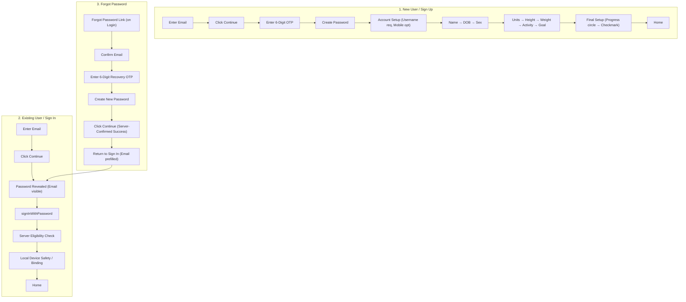
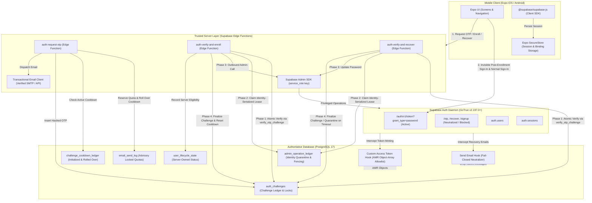

# Phase 1.2 Task 06I-A — Strict Auth Architecture & Server-Side Enforcement Decision

| Field | Value |
|---|---|
| **Task ID** | Task 06I-A (Revision R17 — Quarantine Retention & LEASE-G Acceptance Contract Closure) |
| **Status** | **ARCHITECTURE PROPOSED — OWNER DECISION REQUIRED** |
| **Objective** | Resolve the single outstanding independent reviewer finding on PR #34 while preserving all 51 previously resolved threads: Independent `im-tio` P2 (`PRRT_kwDOVtCmZc66UzCO`) — correct Test LEASE-G to strictly align with Section 4.5 retention matrix scenario #5 and the authoritative `NOT EXISTS` cleanup guard in `cleanup_expired_challenges`, ensuring that an expired challenge associated with a `quarantined_indeterminate` operation is NOT purged by routine maintenance; add Test LEASE-H demonstrating that time-based purge occurs only AFTER authorized external reconciliation settles the operation to a terminal state; add Test LEASE-I proving multi-operation quarantine retention; and preserve the authoritative cleanup PL/pgSQL function byte-identically across Section 4.5 and Section 8.3 |
| **Execution Mode** | STRICTLY DOCUMENTATION-ONLY, OFFLINE SECURITY DESIGN CORRECTIONS (No app code, migrations, or hosted mutations) |
| **Authorization** | Owner instruction: follow `AGENTS.md`, `.ai/current.md`, Supabase skill; production project `bsfwzvgynwriswapxpsp` strictly READ-ONLY |
| **Implementation Owner** | Security Architecture & Research Agent |
| **Baseline Main Commit** | `317b4d4793368e6a9a2907d504044e876acfaab0` (PR #33 merged) |
| **Worktree Branch** | `docs/task06i-a-strict-auth-architecture` |
| **Security Invariants** | AUTH-12/17/22 **BLOCKED** on native GoTrue; Managed Supabase Auth **NOT VERIFIED**; Production Auth **NO-GO** |
| **Primary Reference** | [AGENTS.md](../../../AGENTS.md), [docs/04-AUTH-AND-SECURITY.md](../../../docs/04-AUTH-AND-SECURITY.md), [docs/27-OTP-FIRST-AUTH-LIFECYCLE.md](../../../docs/27-OTP-FIRST-AUTH-LIFECYCLE.md) |

---

## 1. Executive Summary & Core Decision

Task 06H-E definitively confirmed through controlled runtime integration testing that upstream Supabase Auth (GoTrue v2.197.0) cannot satisfy Tio-Workspace's non-negotiable security requirements out-of-the-box:
1. **AUTH-12 (Atomic Single-Use):** Failed under concurrent load — parallel redemption of a single OTP issued multiple distinct authenticated sessions (`session_id_claim_comparison=different`).
2. **AUTH-17 (Password Mutation Protection):** Failed — direct `PUT /auth/v1/user` by an OTP-authenticated session mutated the account password without supplying the current password, bypassing `security_update_password_require_current_password`.
3. **AUTH-22 (Five-Wrong Cooldown):** Failed — five consecutive invalid OTP submissions failed to trigger a 15-minute lockout; entering the valid code immediately afterwards succeeded.
4. **Purpose Isolation:** Failed — recovery OTP tokens crossed boundaries and successfully authenticated as `type: 'email'` and `type: 'magiclink'`.

### The Core Architectural Dilemma
Because Supabase GoTrue operates as a monolithic, public-facing Go daemon exposing standard endpoints (`/otp`, `/verify`, `/recover`, `/signup`, `/user`), and lacks native hooks for failed verification attempts, password updates, or transactional challenge locking, **client-side hiding, RLS policies, and basic provider flags cannot enforce strict security against direct API attacks**.

### Evidence Classification Framework
To maintain absolute evidence integrity, all claims in this document adhere to the following taxonomy:
- **`VERIFIED`:** Empirically proven in this repository with reproducible automated test runs (e.g. PR #33 baseline, Task 06H loopback binding, Task 06H-E GoTrue v2.197.0 failure reproductions).
- **`HISTORICAL LOCAL EVIDENCE`:** Executed in earlier bounded tasks against isolated local stacks (e.g. Task 06D Clone 1/2 provider flags, Task 06F session deletion on GoTrue v2.197.0, Task 06D Admin create/password update subflows).
- **`PROPOSED DESIGN — NOT TESTED`:** Architectural specifications, SQL patterns, and state-machine algorithms that are conceptually designed but have not yet been executed in an automated test harness in this repository (e.g. `auth_challenges` table, PostgreSQL row locking, sliding-window rate limit ledger, Admin reconciliation state machine, exclusive reverse proxy gateway).
- **`REQUIRES EXPERIMENT`:** Documented or prospective managed cloud capabilities whose availability, persistence, and bypass resistance require empirical proof on an isolated hosted instance (e.g. `EXTERNAL_EMAIL_MAGIC_LINK_DISABLED` on Supabase Cloud, Send Email Hook failure modes, Custom Access Token Hook cold-start behavior, PostgREST non-Auth JWT acceptance).

### Architecture Recommendation
- **Primary Recommendation: Option B (Managed Supabase Auth + Server-Owned Purpose-Bound OTP Gateway via Edge Functions & PostgreSQL Transactional Challenge Store)**.
  - *Status:* **PROPOSED EXPERIMENTAL CANDIDATE (NOT PROVEN)**.
  - Native public OTP and Magic Link issuance is targeted for disablement at the provider level (`EXTERNAL_EMAIL_MAGIC_LINK_DISABLED = true` / `disable_signup = true`).
  - Native password recovery emails are intercepted via a Send Email Hook, and native token issuance for recovery/OTP/non-password methods is blocked via a Custom Access Token Hook with an explicit fail-closed allowlist that inspects the object-array AMR structure (`amr[*].method`).
  - All OTP verification is consolidated into `private_auth.verify_otp_challenge` as the **sole authoritative database entry point** across both signup and recovery flows. Governed by the **Global Strict Lock Hierarchy** (Tier 1 Identity Advisory Lock -> Tier 2 Cooldown Row Lock -> Tier 3 Challenge Row Lock), this unified transaction handles valid redemptions, invalid attempts, active lockout checks (`cooldown_active`), and post-cooldown budget rollovers under a single row lock. Standalone failure functions (`record_failed_attempt`) and raw direct UPSERTs are completely retired to eliminate valid-vs-fifth-wrong race conditions.
  - OTP rate-limiting and challenge issuance (`private_auth.reserve_email_send`) serialize under the same Tier 2 cooldown row lock, strictly enforcing post-commit outbound email dispatch.
  - Supabase Auth is utilized strictly as a **Password Identity Provider** (`signInWithPassword`) and Admin API target (`admin.createUser`, `admin.updateUserById`).
  - *GoTrue Idempotency, Identity Quarantine & Durable Ledger Retention (R9–R12):* GoTrue Admin API does NOT implement an `Idempotency-Key` header. Safe execution requires a server-owned, durable operation ledger (`admin_operation_ledger`) and persistent identity lifecycle state table (`identity_lifecycle`) in PostgreSQL. To guarantee that initial-enrollment uniqueness, provisional identity provenance, and indeterminate operation quarantines survive short-lived OTP challenge cleanup, `admin_operation_ledger` and `identity_lifecycle` are completely decoupled from cascading foreign keys. Routine purging of ephemeral `auth_challenges` rows leaves permanent enrollment guards, provisional identities, and quarantine locks 100% intact. Initial enrollment is permanently serialized per identity (`target_user_id`, `normalized_email`), while password recovery is repeatable over the lifecycle.
  - *Unified Security Invariant Matrix & Lock Hierarchy (R12–R13):* All privileged database functions strictly obey the Global Strict Lock Hierarchy (Tier 1 Identity Advisory Lock -> Tier 2 Cooldown Row Lock -> Tier 3 Challenge Row Lock -> Tier 4 Lifecycle Row Lock -> Tier 5 Send Log Insert -> Tier 6 Admin Operation Ledger Lock). Every security-critical function acquires locks in this top-down order and recomputes fresh database time (`v_now := clock_timestamp()`) post-lock before checking expiry boundaries (`database_now < deadline` valid, `database_now >= deadline` expired).
  - *Durable Provisional Creation, Immutable Operation Completion, Quarantine Retention & Acceptance Reconciliation (R12–R17 — `PRRT_kwDOVtCmZc66HSzf`, `PRRT_kwDOVtCmZc66HSzi`, `PRRT_kwDOVtCmZc66HSzq`, `PRRT_kwDOVtCmZc66HSzv`, `PRRT_kwDOVtCmZc66Hbdq`, `PRRT_kwDOVtCmZc66IIHq`, `PRRT_kwDOVtCmZc66JKK9`, `PRRT_kwDOVtCmZc66JKLF`, `PRRT_kwDOVtCmZc66TaVc`, `PRRT_kwDOVtCmZc66TaVm`, `PRRT_kwDOVtCmZc66T3N9`, `PRRT_kwDOVtCmZc66UE4S`, `PRRT_kwDOVtCmZc66UzCO`):* Provisional identity creation is strictly authorized under locked challenge state (`purpose = 'signup_initial_password'`, `status = 'pending_provisioning'`, matching unexpired grant). To mathematically eliminate cross-identity deadlocks, `complete_provisional_creation` adopts Option A: acquiring Tier 1 Identity Advisory Lock and Tier 4 Lifecycle Row Lock solely on the authoritative `normalized_email` record. Under the immutable completion guarantee (R16: `PRRT_kwDOVtCmZc66T3N9`), `complete_provisional_creation` acquires the Tier 6 ledger row lock and inspects `v_op.status = 'completed'` BEFORE checking for challenge presence, ensuring that routine cleanup of ephemeral challenges can NEVER demote, quarantine, or mutate a completed operation. All ledger mutations enforce conditional boundaries (`WHERE status = 'executing' AND worker_lease_id = p_worker_lease_id`). Furthermore, all legacy acceptance test specifications (`LIFE-C`, `LIFE-H`, `LEASE-C`, `LEASE-D`) are reconciled with the post-create quarantine invariant (R16: `PRRT_kwDOVtCmZc66UE4S`), strictly retaining creation fencing in `uq_admin_ledger_active_creation_email` across all post-create rejections and restricting fence release exclusively to verified external reconciliation. Finally, under the quarantine retention contract (R17: `PRRT_kwDOVtCmZc66UzCO`), Tests LEASE-G, LEASE-H, and LEASE-I strictly align with Section 4.5 retention matrix scenario #5 and the authoritative `NOT EXISTS` guard in `cleanup_expired_challenges`: an expired challenge associated with an unresolved `quarantined_indeterminate` operation is NEVER purged by automated cleanup, but remains preserved alongside ledger and lifecycle records until authorized external reconciliation settles the incident.
  - *Server-Authoritative Recovery & Enrollment Guards (R12 — `PRRT_kwDOVtCmZc66HSz6`):* Both signup enrollment and password recovery enforce Tier 4 `identity_lifecycle` row locks inside `claim_admin_operation`. Initial enrollment strictly requires `lifecycle_stage = 'provisional_created'`; password recovery strictly requires `lifecycle_stage = 'enrolled_password_complete'`. Quarantined or mismatched accounts fail closed.
  - *Official Provider Token Hook Contract & Fixtures (R13 — `PRRT_kwDOVtCmZc66It35`):* `custom_access_token_hook` strictly aligns with the official Supabase hook schema by reading `event->>'authentication_method'` as a top-level sibling of `claims`, extracting `claims` from `event->'claims'`, and inspecting AMR from `event->'claims'->'amr'`. Rejects native OTP, recovery, magiclink, and mixed AMR sessions fail-closed (SQLSTATE `42501`). Includes 10 provider-shaped test fixtures covering valid, denied, malformed, and missing event shapes.
  - *Pgcrypto Extension Schema Qualification (R13 — `PRRT_kwDOVtCmZc66IIHh`):* Under secure immutable empty search path (`SET search_path = ''`), `verify_otp_challenge` explicitly qualifies `extensions.hmac(...)` to resolve the `pgcrypto` extension installed in the `extensions` schema, preventing runtime "function does not exist" failures while mathematically preventing search-path hijacking attacks. Explicit least-privilege `REVOKE ALL` and `GRANT EXECUTE` statements protect all schema functions.
  - *Multi-Consumer JWT Cutover Nuance:* Deleting sessions in `auth.sessions` immediately invalidates Auth `/user` (403 on local GoTrue; hosted NOT VERIFIED), but stateless non-Auth JWT consumers (PostgREST Data API, Storage) will accept signed JWTs until their `exp` timestamp. Cutover must account for this lingering window or rotate signing secrets.
- **Contingency Fallback: Option D1 (Self-Hosted Supabase GoTrue Behind an Exclusive Reverse Proxy / API Gateway)**.
  - *Status:* **PROPOSED FALLBACK (NOT TESTED)**.
  - If managed Supabase controls fail to close native GoTrue public routes on a disposable hosted instance, GoTrue must be self-hosted in a private network where native `/otp`, `/verify`, `/recover`, `/signup`, and direct `/user` are physically unreachable from the public internet.

**Final Verdict:** Production Auth remains **NO-GO**. A tightly bounded two-stage proof-of-concept on a disposable managed project (**Task 06I-B1 / 06I-B2**) is required before any implementation or production activation. Stage 06I-B1 failure triggers an owner decision on Option D1, not automatic self-hosted deployment.

---

## 2. Reconciliation of Canonical Evidence & Empirical Baseline

| Task & Date | Scope & Method | Observed Evidence / Outcome | Status of Requirements | Contradiction / Conflict Resolved |
|---|---|---|---|---|
| **Task 06A** (2026-11-17) | Local GoTrue v2.197.0 via CLI | Sequential replay rejected; direct `PUT /user` overwritten; 5 wrong codes did not lock | AUTH-12 Sequential PASS; AUTH-17 FAIL; AUTH-22 FAIL | Proved GoTrue treats OTP sessions as recovery-capable. |
| **Task 06B** (2026-11-17) | GoTrue source review & isolated testing | Verified `security_update_password_require_current_password = true` exempts `session.IsRecovery()`; AMR classifies OTP/magiclink as recovery | AUTH-17 Confirmed FAIL in GoTrue engine design | Proved RLS and client flags cannot intercept GoTrue user update. |
| **Task 06C** (2026-11-17) | Architecture review (read-only) | Proposed server-owned challenge store; highlighted direct API bypass risks | Production Auth BLOCKED | Rejected client-only UX or RLS as an Auth boundary. |
| **Task 06D** (2026-11-17) | Isolated multi-container GoTrue testing | `MagicLinkEnabled=false` disabled `/otp` (422); Custom Access Token Hook blocked verify/refresh JWTs; preexisting access JWT still mutated password | AUTH-17 BLOCKED; Managed feasibility INCONCLUSIVE | Established that denying new JWT issuance does not revoke preexisting access tokens. |
| **Task 06F** (2026-11-17) | Session revocation hypothesis | Voluntary `POST /logout` or Admin password reset deleted session, causing `GET/PUT /user` to return `403/session_not_found` | LOCAL ONLY PASS for session invalidation; Hosted NOT VERIFIED | Highlighted that voluntary logout is insufficient; server-side session revocation is required. |
| **Task 06H-D** (2026-11-19) | Loopback Compose prototype | Kong + GoTrue + DB + Mailpit bound strictly to `127.0.0.1` | Infrastructure PASS (zero `0.0.0.0` bindings) | Resolved Windows Docker binding vulnerability without daemon modification. |
| **Task 06H-E** (2026-11-19) | Controlled runtime integration testing | Pinned GoTrue v2.197.0; 14 synthetic cases in Mailpit; Mode A (5/hr) & Mode B (30/hr) | **AUTH-12 FAIL (Concurrency)**<br>**AUTH-17 FAIL (Mutation)**<br>**AUTH-22 FAIL (Cooldown)**<br>**Purpose Crossover Observed** | **Empirically demonstrated race condition (2 sessions for 1 OTP) and purpose crossover (`recovery` accepted as `email` and `magiclink`).** |

---

## 3. Preservation of Owner-Approved Auth UX

The architectural recommendations strictly adhere to the owner-approved UI/UX design specifications in [`docs/27-OTP-FIRST-AUTH-LIFECYCLE.md`](../../../docs/27-OTP-FIRST-AUTH-LIFECYCLE.md) and [`DESIGN.md`](../../../DESIGN.md). **Zero changes to Expo screens, visual layout, typography, keyboard focus, error timing, or navigation are introduced.**



### Detailed UX & Lifecycle Invariants
1. **Sign Up Flow:**
   - Sequential presentation: Email → OTP → Password.
   - **Provisional UUID Reuse:** If an unverified or password-pending provisional UUID already exists for the normalized email in `user_lifecycle_state` (`EMAIL_VERIFIED_PASSWORD_PENDING`), the server-owned challenge records `user_id = provisional_uuid`. Upon successful OTP verification, initial password enrollment updates that existing provisional UUID via `admin.updateUserById(provisional_uuid, { password })` rather than minting duplicate identities.
   - **Password-Complete Accounts:** If `user_lifecycle_state` indicates an already established account (`PASSWORD_COMPLETE_PROFILE_PENDING` or `SERVER_ELIGIBLE`), Sign Up verification strictly rejects initial password enrollment and returns a generic anti-enumeration response directing the user to Sign In or Forgot Password. An existing password can never be overwritten through the Sign Up route.
   - **Post-Enrollment Authenticated Session Before Cloud Profile (P1-6):**
     - Step 4 (Create Password) submits password to `/auth-verify-and-enroll`. Upon server-side enrollment success (`200 OK { success: true, user_id: UUID }`), the mobile client immediately and invisibly performs a standard `supabase.auth.signInWithPassword({ email, password })` using the password currently in client memory.
     - The client verifies:
       1. The authenticated session `user.id` strictly matches the enrolled provisional `user_id`.
       2. The server lifecycle state is `PASSWORD_COMPLETE_PROFILE_PENDING`.
       3. The session holds server-trusted `amr` with `method: 'password'` (satisfying the Custom Access Token Hook allowlist).
     - The client seamlessly advances to Step 5 (Account Setup: Username required, Mobile optional) possessing a valid authenticated session under which private profile writes are permitted by `auth.uid() = id` RLS.
     - Local device fitness storage and Home readiness remain strictly locked until Cloud Profile is complete, server eligibility transitions to `SERVER_ELIGIBLE`, and local device binding checks pass.
     - If `signInWithPassword` fails (e.g. transient network interruption), no duplicate account creation or OTP replay is attempted; the user is routed to Sign In with Email prefilled to log in with their newly enrolled password.
2. **Sign In Flow:**
   - Normal login never sends an OTP and never modifies the stored password.
   - Email remains visible when Password is revealed after Continue.
   - No public account-existence query; no automatic mode switching between Sign Up and Sign In.
   - Direct `PUT /auth/v1/user` password mutation by normal login sessions is strictly prevented because normal sessions bear `method: 'password'`, enforcing `security_update_password_require_current_password = true`.
3. **Forgot Password Flow & Repeatability (P1-3):**
   - Initiated explicitly from the Login screen: Confirm Email → 6-Digit Recovery OTP → New Password.
   - Recovery verification grants **zero ambient session** and never routes to Home.
   - **Repeatable Recovery:** Password recovery is repeatable across the user's account lifecycle. Completing a recovery successfully records an audit log but does NOT block legitimate subsequent password recoveries.
   - Upon successful server-side password reset via Admin API (`admin.updateUserById(user_id, { password: new_password })`), all active user sessions are deleted from `auth.sessions`.
   - The client is redirected to Sign In with Email prefilled to perform an explicit `signInWithPassword` using the new password.
   - Local device storage remains locked until authenticated with the same bound UUID.

---

## 4. Core Security Architecture Enforcement

### 4.1. AUTH-12 — Atomic OTP Single-Use & Concurrency Serialization
Task 06H-E proved that GoTrue v2.197.0 suffers from a concurrency race condition: parallel requests with the same valid OTP both succeeded and minted two independent sessions.

#### Concurrency Serialization & The 5th-Failure Race Vulnerability (P1 Hardened — R7)
Task 06H-E proved that GoTrue v2.197.0 suffers from a concurrency race condition where parallel requests with the same valid OTP both minted independent sessions.

However, independent review finding `PRRT_kwDOVtCmZc656hwv` (im-tio [P1]) identified a critical cross-table concurrency vulnerability in earlier revisions: locking only `auth_challenges` (`FOR UPDATE OF c`) while `record_failed_attempt` locked `challenge_cooldown_ledger` independently permitted a severe race condition between a **concurrent 5th invalid attempt** and a **valid OTP submission**:
1. Request W (submitting a 5th incorrect guess) begins executing `record_failed_attempt`.
2. Request C (submitting the correct OTP) begins executing the verification query. In its statement snapshot, `l.cooldown_until IS NULL` evaluates to TRUE.
3. Request W commits its transaction, setting `cooldown_until = clock_timestamp() + INTERVAL '15 minutes'`.
4. Request C acquires the row lock on `auth_challenges`. Because it never acquired a row lock on `challenge_cooldown_ledger` or rechecked active cooldown state under lock, Request C proceeds to evaluate the HMAC hash, succeeds, and transitions the challenge to `pending_provisioning`!
5. **Vulnerability Impact:** The intended 5-failure lockout boundary (AUTH-22) is defeated under concurrent guessing, allowing an attacker or race condition to consume the challenge despite an active lockout having committed.

#### Global Strict Lock Hierarchy (R7–R14)
To mathematically eliminate deadlocks and guarantee strict serializability across issuance, valid verification, failed attempts, provisional identity lifecycle, and credential provisioning, all database transactions MUST strictly acquire locks according to the following **Global Strict Lock Hierarchy**:

```
Tier 1: Identity Advisory Lock      (PERFORM pg_advisory_xact_lock(hashtext('auth_identity:' || normalized_email)))
   │
   ▼
Tier 2: Cooldown Row Lock           (SELECT ... FROM challenge_cooldown_ledger WHERE normalized_email = ... FOR UPDATE)
   │
   ▼
Tier 3: Challenge Row Lock          (SELECT ... FROM auth_challenges WHERE challenge_id = ... FOR UPDATE)
   │
   ▼
Tier 4: Identity Lifecycle Row Lock (SELECT ... FROM identity_lifecycle WHERE normalized_email = ... FOR UPDATE)
   │
   ▼
Tier 5: Send Log Row                (INSERT INTO email_send_log ...)
   │
   ▼
Tier 6: Admin Operation Ledger Claim (INSERT INTO admin_operation_ledger ... / claim_admin_operation)
```

Because every transaction (OTP issuance, verification, provisional identity reservation/completion, invalid attempt recording, password enrollment, and recovery claiming) acquires locks in this top-down order, deadlocks cannot occur.

##### Single Authoritative Email-Owner Row Lock Policy (Option A — R14 Closure: PRRT_kwDOVtCmZc66JKK9)
To mathematically eliminate cross-identity deadlocks, all lifecycle-mutating functions adhere to **Option A**:
- **Single Resource Partitioning:** Every transaction strictly locks the lifecycle row corresponding to the authoritative `normalized_email` under the Tier 1 Identity Advisory Lock (`auth_identity:<normalized_email>`).
- **Elimination of Cross-Identity Row Locks:** Functions NEVER acquire a second lifecycle row lock on an unrelated `target_user_id`. When concurrent requests submit swapped identities (e.g. Request 1: email A, target UUID B; Request 2: email B, target UUID A), Request 1 locks exclusively resources for identity A, and Request 2 locks exclusively resources for identity B. Because the sets of locked resources are completely disjoint, circular waiting (Coffman Condition 4) is impossible, eliminating `40P01` deadlock conditions.
- **Constraint-Backed Cross-Identity Integrity:** Cross-identity integrity is verified without row locks:
  1. *Authoritative Auth lookup:* `SELECT lower(trim(email)) FROM auth.users WHERE id = p_target_user_id` confirms whether the target user exists and matches `normalized_email`.
  2. *Constraint enforcement:* `identity_lifecycle.user_id` is the PRIMARY KEY, and `normalized_email` is UNIQUE. Any anomalous concurrent insertion of a duplicate UUID raises `unique_violation` (SQLSTATE `23505`), which is caught deterministically and transitioned to `quarantined_indeterminate`.
- **SQLSTATE 40P01 Deadlock Handling Contract:** In the event of an unexpected deadlock from uncoordinated external queries, PostgreSQL detects `40P01`. The transaction fails closed and rolls back. The caller (Edge Function) receives a database error, must NOT fabricate a successful claim, and must NOT trigger blind external GoTrue mutations.

##### Post-External-Operation Quarantine Principle & Authoritative Reconciliation Contract (R15 Closure: PRRT_kwDOVtCmZc66TaVc)
`complete_provisional_creation` executes strictly **after** the outbound `admin.createUser` call to Supabase GoTrue. Under the core architectural reality that external network operations cannot be rolled back by PostgreSQL transactions, local validation failures after external invocation require strict handling:
- **Core Principle:** A local validation failure after an external `admin.createUser` attempt is **NOT** evidence that the user was not created. Writing `status = 'failed_terminal'` is strictly prohibited on post-create failure branches, because `failed_terminal` is excluded from the partial unique index `uq_admin_ledger_active_creation_email` (`WHERE operation_type = 'create_provisional_user' AND status IN ('claimed', 'executing', 'reconciling', 'quarantined_indeterminate')`). Releasing that index guard prematurely would allow a new `reserve_provisional_creation` to succeed and launch another `admin.createUser` against an untracked, orphaned passwordless user in `auth.users`, reopening the R11 duplicate/orphan identity vulnerability.
- **Fail-Closed Quarantine Enforcement:** All post-create failure paths (`invalid_challenge_purpose_or_status`, `target_user_email_mismatch`, `account_already_enrolled`, `target_user_not_found`, `email_already_bound_to_different_user`, `user_id_already_bound_to_different_email`, `challenge_not_found`, `enrollment_in_progress`, `invalid_lifecycle_stage`) transition `admin_operation_ledger` to `status = 'quarantined_indeterminate'`, record the exact error in `error_log`, set `completed_at`, and preserve the worker lease and fencing token.
- **Persistent Creation Fencing:** Because `quarantined_indeterminate` is indexed by `uq_admin_ledger_active_creation_email`, the normalized email remains strictly locked against new creation reservations. No second `admin.createUser` can ever be launched for that email.
- **Authoritative Reconciliation & Fence Release Lifecycle:**
  1. *Creation Reserved (`claimed` / `executing`):* Worker lease active; `admin.createUser` in flight.
  2. *Creation Completed (`completed`):* Provisional identity verified in `auth.users`, bound in `identity_lifecycle`, and challenge linked.
  3. *Creation Indeterminate (`quarantined_indeterminate`):* Network timeout, email mismatch, or validation failure occurred after external call. Identity fence remains active.
  4. *Reconciliation In Progress (`reconciling`):* Dedicated background reconciliation worker acquires the lease to inspect external state.
  5. *Reconciled Safe Binding:* If external inspection verifies that the provisional user in `auth.users` was indeed created by this operation and has no password, the reconciliation worker safely binds the UUID to `identity_lifecycle` and marks the operation `completed`.
  6. *Reconciled Terminal Failure (`failed_terminal`):* If and ONLY if authoritative external inspection proves that GoTrue never created the user, or the orphaned passwordless user is safely compensated and removed, the reconciliation worker transitions the operation to `failed_terminal`, finally releasing `uq_admin_ledger_active_creation_email`.
  7. *Operator Intervention Required:* If reconciliation cannot authoritatively resolve identity ownership (e.g., target UUID is password-enrolled or bound elsewhere), quarantine is permanently held for manual security review. Automated processes NEVER delete users or reassign identities based on email equality alone.

##### Completion Replay Policy & Status Rejection Contract (R15 Closure: PRRT_kwDOVtCmZc66TaVm)
To eliminate dead or contradictory code paths and guarantee deterministic behavior under concurrent or retried completions, `complete_provisional_creation` enforces a strict **Minimal Replay Rejection Policy**:
- **Rejection of Completed Operations:** Upon acquiring the Tier 6 ledger row lock, the procedure immediately checks `v_op.status`. If `v_op.status = 'completed'`, the operation has already been finalized by the first authorized worker. The procedure immediately returns `completed = FALSE, conflict_code = 'operation_already_completed'`.
- **Zero Duplicate Mutations:** No additional inserts into `identity_lifecycle`, updates to `auth_challenges`, or external GoTrue calls occur. The existing valid binding is preserved completely unaltered.
- **Unambiguous State Distinctions:**
  - *Completed Operation Replay:* `v_op.status = 'completed'` -> returns `FALSE, 'operation_already_completed'`.
  - *Quarantined Operation Replay:* `v_op.status = 'quarantined_indeterminate'` -> returns `FALSE, 'operation_quarantined'`.
  - *Stale Worker or Expired Lease:* `v_op.worker_lease_id != p_worker_lease_id` or `v_now >= v_op.lease_expires_at` -> returns `FALSE, 'invalid_lease_state'` / `'lease_expired'`, leaving the executing ledger row unmodified for the reconciliation sweeper.
  - *Separate Operation for Same Email:* Blocked upstream by `uq_admin_ledger_active_creation_email` during reservation (`creation_already_reserved`).
  - *Resumed Execution:* If `v_op.status = 'executing'` and worker holds a valid unexpired lease, and `identity_lifecycle` already has the identical `(p_target_user_id, normalized_email, 'provisional_created')`, the procedure finalizes the pending challenge and ledger cleanly without demotion.

##### Immutable Operation Completion & Missing-Challenge Protocol (R16 Closure: PRRT_kwDOVtCmZc66T3N9)
Under the decoupled lifecycle architecture established in Revision R9, ephemeral rows in `auth_challenges` are routinely purged by `cleanup_expired_challenges` after 24 hours. Because `admin_operation_ledger` and `identity_lifecycle` survive challenge cleanup, replays or late inquiries for completed operations will observe a missing challenge row. To prevent missing challenges from corrupting or demoting completed operations, `complete_provisional_creation` implements a strict lock and evaluation protocol:
- **Lock Ordering & Nonexistent Rows:** Under the Global Lock Hierarchy, the procedure queries `auth_challenges WHERE challenge_id = ... FOR UPDATE`. If the ephemeral challenge row has been cleaned up (`NOT FOUND`), the procedure records `v_challenge_found := FALSE` and **does NOT perform any database write or state transition**.
- **Tier 6 Evaluation Before Challenge Check:** The procedure proceeds to acquire the Tier 6 ledger row lock on `admin_operation_ledger`. Before evaluating whether the challenge was found, the procedure inspects `v_op.status`:
  - If `v_op.status = 'completed'`, the operation is **100% immutable**. The procedure immediately exits with `completed = FALSE, conflict_code = 'operation_already_completed'`. The missing challenge is ignored, and zero mutations occur.
  - If `v_op.status = 'quarantined_indeterminate'`, the procedure exits with `completed = FALSE, conflict_code = 'operation_quarantined'`. Zero mutations occur.
- **Conditional Executing Guard:** Every single `UPDATE private_auth.admin_operation_ledger` statement inside `complete_provisional_creation` enforces the explicit conditional guard:
  ```sql
  WHERE operation_id = p_operation_id
    AND status = 'executing'
    AND worker_lease_id = p_worker_lease_id
  ```
  This guarantees that a stale worker, an already-completed operation, or a quarantined record can never be modified. If an operation was actively `executing` and lost its challenge evidence in-flight, it transitions to `quarantined_indeterminate` with `error_log = 'challenge_not_found'`.
- **Authoritative Missing-Challenge Result Policy:**

| Locked Operation Status | Ephemeral Challenge State | Worker Lease Ownership | Required Outcome & Action |
|---|---|---|---|
| `completed` | Purged / Missing | Any | `operation_already_completed`; zero mutation; ledger row immutable |
| `quarantined_indeterminate` | Purged / Missing | Any | `operation_quarantined`; zero mutation; quarantine fence retained |
| `executing` | Purged / Missing | Valid unexpired lease | Transition to `quarantined_indeterminate` with `challenge_not_found`; creation fence retained |
| `executing` | Purged / Missing | Expired lease | `lease_expired`; zero mutation; ledger row intact for reconciliation sweeper |
| `executing` | Present / Valid | Wrong lease ID | `invalid_lease_state`; zero mutation |
| `executing` | Present / Valid | Valid unexpired lease | Proceed with post-create validation and identity binding |

#### Cross-Function Security Invariant Matrix (R12 End-to-End Closure)
To guarantee zero security gaps, unambiguous authority, and complete SQL consistency across all authentication paths, all database functions adhere to the following **Cross-Function Security Invariant Matrix**:

| Function | Permitted Roles | Required Locks (In Tier Order) | Time Capture Order | Lifecycle Stage Preconditions | Operation / Purpose Binding | Failure Modes & Error Codes | Enforced Security Invariants |
|---|---|---|---|---|---|---|---|
| `reserve_email_send` | `service_role` | Tier 1 Advisory -> Tier 2 Cooldown Row -> Tier 5 Send Log Insert | Post-lock (`v_now := clock_timestamp()`) | Any | Bound to `p_purpose` | `cooldown_active`, `interval_too_short`, `hourly_limit_exceeded` | AUTH-22 cooldown check; strict 60s interval & 5/hr quota; anti-enumeration |
| `verify_otp_challenge` | `service_role` | Tier 1 Advisory -> Tier 2 Cooldown Row -> Tier 3 Challenge Row | Post-lock (`v_now := clock_timestamp()`) | N/A (binds provisional or enrolled if found) | Bound to `p_purpose` matching challenge row | `challenge_not_found`, `cooldown_active`, `already_consumed`, `challenge_expired`, `invalid_code`, `fifth_failure_activated_cooldown` | AUTH-12 single-use; AUTH-22 5th-failure race elimination; post-lock expiry; monotonic cooldown rollover; schema-qualified `extensions.hmac` under `SET search_path = ''` (R13: `PRRT_kwDOVtCmZc66IIHh`) |
| `reserve_provisional_creation` | `service_role` | Tier 1 Advisory -> Tier 3 Challenge Row -> Tier 4 Lifecycle Row -> Tier 6 Ledger Insert | Post-lock (`v_now := clock_timestamp()`) | Fails closed on all non-eligible stages: `enrolled_password_complete`, `quarantined_indeterminate`, `enrollment_pending` | Strict: `purpose = 'signup_initial_password'` & `p_normalized_email` | `challenge_not_found`, `invalid_challenge_status`, `grant_mismatch`, `grant_expired`, `account_already_enrolled`, `identity_quarantined`, `enrollment_in_progress`, `creation_quarantined_indeterminate`, `creation_already_reserved` | Prov identity reservation boundary (H3, H4, H5); prevents duplicate GoTrue user creation; isolates signup from recovery |
| `complete_provisional_creation` | `service_role` | Tier 1 Advisory -> Tier 3 Challenge Row -> Tier 4 Lifecycle Row (authoritative `normalized_email` ONLY, Option A) -> Tier 6 Ledger Row | Post-lock (`v_now := clock_timestamp()`) | Strictly monotonic: permits insert of `provisional_created`; rejects demotion if already enrolled, quarantined, or pending; fails closed on cross-identity UUID/email mismatch | Strict: `operation_type = 'create_provisional_user'`, signup challenge purpose, and `auth.users` normalized email match | `operation_not_found`, `invalid_operation_type`, `challenge_not_found`, `operation_already_completed`, `operation_quarantined`, `invalid_challenge_purpose_or_status`, `invalid_lease_state`, `lease_expired`, `target_user_not_found`, `target_user_email_mismatch`, `account_already_enrolled`, `identity_quarantined`, `email_already_bound_to_different_user`, `user_id_already_bound_to_different_email`, `lifecycle_demotion_prohibited` | Immutable operation completion guarantee (R16: `PRRT_kwDOVtCmZc66T3N9`): status = 'completed' evaluated under Tier 6 lock before missing-challenge check, preventing demotion after challenge cleanup; conditional WHERE status = 'executing' AND worker_lease_id = p_worker_lease_id on all ledger mutations; post-create strict quarantine principle (R15: `PRRT_kwDOVtCmZc66TaVc`); minimal completion replay policy (R15: `PRRT_kwDOVtCmZc66TaVm`); single authoritative email-owner locking (Option A: `PRRT_kwDOVtCmZc66JKK9`); binds minted user_id |
| `claim_admin_operation` | `service_role` | Tier 1 Advisory -> Tier 3 Challenge Row -> Tier 4 Lifecycle Row -> Tier 6 Ledger Insert | Post-lock (`v_now := clock_timestamp()`) | Signup: strictly `provisional_created`. Recovery: strictly `enrolled_password_complete`. Both reject quarantined accounts | Signup: `enroll_initial_password`. Recovery: `recovery_password_reset`. Strict purpose mapping | `challenge_not_found`, `email_mismatch`, `invalid_challenge_status`, `grant_mismatch`, `grant_expired`, `operation_purpose_mismatch`, `target_user_id_required`, `recovery_target_user_missing`, `user_id_mismatch`, `target_user_not_found`, `account_already_enrolled`, `account_not_enrolled`, `identity_quarantined`, `challenge_already_claimed`, `enrollment_conflict_identity_locked` | AUTH-17 password enrollment protection (M1); strict purpose mapping (R10); lease fencing & idempotency |
| `cleanup_expired_challenges` | `service_role` | Tier 3 Challenge Row (`FOR UPDATE SKIP LOCKED`) | Cutoff (`v_cutoff := clock_timestamp() - interval`) | N/A | Evaluates all associated operations via scoped `NOT EXISTS` | None (returns purged counts) | M3 1-to-many challenge operation retention; leaves active, reconciling, and quarantined operations 100% intact |
| `custom_access_token_hook` | `supabase_auth_admin` | Evaluates provider hook event in memory | N/A | Enforces server-authoritative password origin | Validates `event->>'authentication_method' = 'password'` or `token_refresh` and pure password AMR | Exception SQLSTATE `42501` on any non-password, mixed AMR, or malformed claims | AUTH-17 fail-closed allowlist with official Supabase provider event contract (R13: `PRRT_kwDOVtCmZc66It35`); denies native OTP/magiclink/recovery session minting |

#### Post-Lock Expiry Re-evaluation & Strict Boundary Semantics (R11 — `PRRT_kwDOVtCmZc66GwiI`)
A subtle and critical vulnerability identified in review (`PRRT_kwDOVtCmZc66GwiI`) occurred when functions declared:
```sql
DECLARE
    v_now TIMESTAMPTZ := clock_timestamp();
```
Evaluating `clock_timestamp()` at function entry captured database time *before* acquiring the Tier 1 advisory lock and Tier 2/3 row locks. If another transaction was holding an exclusive lock on that identity or challenge, the waiting transaction blocked. A transaction could sit blocked across the 10-minute OTP expiration deadline or 5-minute provisioning grant deadline, but once unblocked, it evaluated `v_challenge.expires_at < v_now` against the stale pre-lock timestamp, incorrectly accepting an expired credential!

**Mandatory Post-Lock Expiry Protocol:**
1. Transaction acquires all required advisory and row locks (Tier 1, Tier 2, Tier 3, Tier 4).
2. Authoritative locked records are read.
3. Fresh database timestamp is evaluated post-lock: `v_now := clock_timestamp();`.
4. Expiration boundaries are evaluated using this fresh timestamp.
5. Consistent fail-closed boundary semantics are applied across all functions:
   - **Active Window:** Valid only while `v_now < expires_at` (or `v_now < grant_expires_at`).
   - **Expired Deadline:** At `v_now >= expires_at` (or `v_now >= grant_expires_at`), the credential is expired and immediately rejected.
   - **Cooldown Window:** Lockout is active while `v_now < cooldown_until`. At `v_now >= cooldown_until`, cooldown is expired and rolls over to a fresh failure budget.

#### Unified Verification Transaction (`private_auth.verify_otp_challenge`)
To enforce this hierarchy and serialize successful redemptions with cooldown mutations, both valid and invalid attempts are consolidated under a single authoritative stored procedure, `private_auth.verify_otp_challenge` (draft specification):

```sql
-- Unified Challenge Verification, Cooldown Guard & Provisional Identity Reuse (P1 Hardened & R7–R11)
CREATE OR REPLACE FUNCTION private_auth.verify_otp_challenge(
    p_challenge_id UUID,
    p_normalized_email TEXT,
    p_purpose private_auth.challenge_purpose,
    p_raw_code TEXT,
    p_server_pepper TEXT
) RETURNS TABLE (
    status TEXT,
    user_id UUID,
    provisioning_grant_id UUID,
    grant_expires_at TIMESTAMPTZ,
    remaining_attempts INT,
    cooldown_until TIMESTAMPTZ,
    retry_after_seconds INT
) AS $$
DECLARE
    v_cooldown private_auth.challenge_cooldown_ledger%ROWTYPE;
    v_challenge private_auth.auth_challenges%ROWTYPE;
    v_now TIMESTAMPTZ;
    v_computed_hash TEXT;
    v_is_valid BOOLEAN := FALSE;
    v_new_grant UUID;
    v_grant_exp TIMESTAMPTZ;
    v_bound_user_id UUID;
    v_existing_user_id UUID;
    v_existing_stage private_auth.lifecycle_stage;
    v_auth_user_id UUID;
    v_auth_pwd TEXT;
BEGIN
    -- Tier 1: Identity Advisory Lock
    PERFORM pg_advisory_xact_lock(hashtext('auth_identity:' || p_normalized_email));

    -- Tier 2: Authoritative Cooldown Row Lock (serializes valid and invalid attempts)
    -- Ensure cooldown ledger row exists idempotently
    INSERT INTO private_auth.challenge_cooldown_ledger (
        normalized_email, purpose, consecutive_failed_attempts, cooldown_until, last_failed_at, updated_at
    ) VALUES (
        p_normalized_email, p_purpose, 0, NULL, NULL, clock_timestamp()
    ) ON CONFLICT (normalized_email, purpose) DO NOTHING;

    SELECT * INTO v_cooldown
    FROM private_auth.challenge_cooldown_ledger
    WHERE normalized_email = p_normalized_email AND purpose = p_purpose
    FOR UPDATE;

    -- Tier 3: Challenge Row Lock
    SELECT * INTO v_challenge
    FROM private_auth.auth_challenges
    WHERE challenge_id = p_challenge_id
      AND normalized_email = p_normalized_email
      AND purpose = p_purpose
    FOR UPDATE;

    IF NOT FOUND THEN
        RETURN QUERY SELECT
            'challenge_not_found'::TEXT,
            NULL::UUID, NULL::UUID, NULL::TIMESTAMPTZ,
            GREATEST(0, 5 - v_cooldown.consecutive_failed_attempts),
            v_cooldown.cooldown_until, 0;
        RETURN;
    END IF;

    -- CRITICAL R11 FIX: Compute fresh database timestamp AFTER acquiring Tier 1, Tier 2, and Tier 3 locks
    v_now := clock_timestamp();

    -- Strict Lockout Check: If cooldown is active, fail closed with zero challenge mutation
    -- Boundary: v_now < cooldown_until is active; v_now >= cooldown_until is expired
    IF v_cooldown.cooldown_until IS NOT NULL AND v_now < v_cooldown.cooldown_until THEN
        RETURN QUERY SELECT
            'cooldown_active'::TEXT,
            NULL::UUID, NULL::UUID, NULL::TIMESTAMPTZ,
            0, v_cooldown.cooldown_until,
            GREATEST(1, EXTRACT(EPOCH FROM (v_cooldown.cooldown_until - v_now))::INT);
        RETURN;
    END IF;

    -- Cooldown Rollover: If prior cooldown expired (v_now >= cooldown_until), reset failure budget (R5)
    IF v_cooldown.cooldown_until IS NOT NULL AND v_now >= v_cooldown.cooldown_until THEN
        UPDATE private_auth.challenge_cooldown_ledger
        SET consecutive_failed_attempts = 0,
            cooldown_until = NULL,
            last_failed_at = NULL,
            updated_at = v_now
        WHERE normalized_email = p_normalized_email AND purpose = p_purpose
        RETURNING * INTO v_cooldown;
    END IF;

    IF v_challenge.status != 'issued' OR v_challenge.consumed_at IS NOT NULL THEN
        RETURN QUERY SELECT
            'already_consumed'::TEXT,
            NULL::UUID, NULL::UUID, NULL::TIMESTAMPTZ,
            GREATEST(0, 5 - v_cooldown.consecutive_failed_attempts),
            v_cooldown.cooldown_until, 0;
        RETURN;
    END IF;

    -- Expiry Check: OTP is valid ONLY while v_now < expires_at. At v_now >= expires_at, fail closed!
    IF v_now >= v_challenge.expires_at THEN
        RETURN QUERY SELECT
            'challenge_expired'::TEXT,
            NULL::UUID, NULL::UUID, NULL::TIMESTAMPTZ,
            GREATEST(0, 5 - v_cooldown.consecutive_failed_attempts),
            v_cooldown.cooldown_until, 0;
        RETURN;
    END IF;

    -- Constant-time cryptographic comparison (explicit hex encoding)
    -- Constant-time cryptographic comparison (pgcrypto extension schema-qualified under SET search_path = '' — R13: PRRT_kwDOVtCmZc66IIHh)
    v_computed_hash := encode(extensions.hmac(p_raw_code::bytea, p_server_pepper::bytea, 'sha256'), 'hex');
    v_is_valid := (v_challenge.code_hash = v_computed_hash);

    IF v_is_valid THEN
        -- Recheck cooldown state immediately before committing redemption
        IF v_cooldown.cooldown_until IS NOT NULL AND v_now < v_cooldown.cooldown_until THEN
            RETURN QUERY SELECT
                'cooldown_active'::TEXT,
                NULL::UUID, NULL::UUID, NULL::TIMESTAMPTZ,
                0, v_cooldown.cooldown_until,
                GREATEST(1, EXTRACT(EPOCH FROM (v_cooldown.cooldown_until - v_now))::INT);
            RETURN;
        END IF;

        -- Transition challenge to pending_provisioning
        v_new_grant := gen_random_uuid();
        v_grant_exp := v_now + INTERVAL '5 minutes';
        v_bound_user_id := v_challenge.user_id;

        -- Provisional Identity Lookup & Reuse / Existing Enrolled Identity Binding (R11)
        IF v_bound_user_id IS NULL THEN
            SELECT l.user_id, l.lifecycle_stage INTO v_existing_user_id, v_existing_stage
            FROM private_auth.identity_lifecycle l
            WHERE l.normalized_email = p_normalized_email;

            IF FOUND THEN
                v_bound_user_id := v_existing_user_id;
                UPDATE private_auth.auth_challenges
                SET user_id = v_existing_user_id
                WHERE id = v_challenge.id;
            ELSE
                -- Check auth.users for existing account
                SELECT u.id, u.encrypted_password INTO v_auth_user_id, v_auth_pwd
                FROM auth.users u
                WHERE lower(trim(u.email)) = p_normalized_email
                LIMIT 1;

                IF FOUND THEN
                    IF v_auth_pwd IS NOT NULL AND v_auth_pwd <> '' THEN
                        -- Populate identity_lifecycle with enrolled_password_complete
                        INSERT INTO private_auth.identity_lifecycle (
                            user_id, normalized_email, lifecycle_stage, enrolled_at
                        ) VALUES (
                            v_auth_user_id, p_normalized_email, 'enrolled_password_complete', v_now
                        ) ON CONFLICT (user_id) DO UPDATE
                          SET lifecycle_stage = 'enrolled_password_complete', updated_at = v_now;

                        v_bound_user_id := v_auth_user_id;
                        UPDATE private_auth.auth_challenges
                        SET user_id = v_auth_user_id
                        WHERE id = v_challenge.id;
                    END IF;
                END IF;
            END IF;
        END IF;

        UPDATE private_auth.auth_challenges
        SET status = 'pending_provisioning',
            verified_at = v_now,
            provisioning_grant_id = v_new_grant,
            grant_expires_at = v_grant_exp
        WHERE id = v_challenge.id;

        -- Reset cooldown ledger on successful verification
        UPDATE private_auth.challenge_cooldown_ledger
        SET consecutive_failed_attempts = 0,
            cooldown_until = NULL,
            last_failed_at = NULL,
            updated_at = v_now
        WHERE normalized_email = p_normalized_email AND purpose = p_purpose;

        RETURN QUERY SELECT
            'verified'::TEXT,
            v_bound_user_id,
            v_new_grant,
            v_grant_exp,
            5,
            NULL::TIMESTAMPTZ,
            0;
        RETURN;
    ELSE
        -- Invalid Code: Execute failure state machine under held Tier 2 row lock
        IF v_cooldown.consecutive_failed_attempts + 1 >= 5 THEN
            -- 5th failure: activate fixed 15-minute cooldown
            UPDATE private_auth.challenge_cooldown_ledger
            SET consecutive_failed_attempts = v_cooldown.consecutive_failed_attempts + 1,
                cooldown_until = v_now + INTERVAL '15 minutes',
                last_failed_at = v_now,
                updated_at = v_now
            WHERE normalized_email = p_normalized_email AND purpose = p_purpose
            RETURNING * INTO v_cooldown;

            RETURN QUERY SELECT
                'fifth_failure_activated_cooldown'::TEXT,
                NULL::UUID, NULL::UUID, NULL::TIMESTAMPTZ,
                0,
                v_cooldown.cooldown_until,
                900;
            RETURN;
        ELSE
            -- Failures 1-4: increment counter
            UPDATE private_auth.challenge_cooldown_ledger
            SET consecutive_failed_attempts = v_cooldown.consecutive_failed_attempts + 1,
                cooldown_until = NULL,
                last_failed_at = v_now,
                updated_at = v_now
            WHERE normalized_email = p_normalized_email AND purpose = p_purpose
            RETURNING * INTO v_cooldown;

            RETURN QUERY SELECT
                'invalid_code'::TEXT,
                NULL::UUID, NULL::UUID, NULL::TIMESTAMPTZ,
                GREATEST(0, 5 - v_cooldown.consecutive_failed_attempts),
                NULL::TIMESTAMPTZ,
                0;
            RETURN;
        END IF;
    END IF;
END;
$$ LANGUAGE plpgsql SECURITY DEFINER SET search_path = '';
```

#### Concurrency Evaluation Under Unified Lock Hierarchy
By routing all verification logic through `verify_otp_challenge` under the Global Strict Lock Hierarchy, the valid-vs-5th-wrong race is eliminated:
- **Scenario A (5th Wrong Guess Acquires Lock First):** Request W increments attempts to 5 and sets `cooldown_until = now + 15m`. When Request C acquires the Tier 2 lock, it evaluates `v_cooldown.cooldown_until > v_now`, aborts immediately with `cooldown_active`, and challenge state remains unmutated (`status = 'issued'`).
- **Scenario B (Valid OTP Acquires Lock First):** Request C verifies the HMAC hash, clears `consecutive_failed_attempts = 0`, sets `cooldown_until = NULL`, and transitions the challenge to `pending_provisioning`. When Request W acquires the lock, it evaluates `v_challenge.status != 'issued'` and aborts with `already_consumed`.
- **Zero Lock Collisions:** Because both paths serialize on `challenge_cooldown_ledger` FOR UPDATE before reading `auth_challenges`, neither transaction can act on stale cooldown state.

#### The Cross-Service Distributed Transaction Problem & GoTrue Admin Idempotency Verdict
GoTrue is an external HTTP service backed by its own internal SQL connection pool. PostgreSQL transactions inside an Edge Function CANNOT roll back a GoTrue mutation if an unhandled error occurs later in the Edge Function, nor can GoTrue roll back a committed PostgreSQL row if GoTrue subsequently crashes.

Furthermore, empirical testing and official Supabase documentation confirm that **Supabase GoTrue does NOT support an `Idempotency-Key` HTTP header** for `admin.createUser` or `admin.updateUserById`. Sending `Idempotency-Key: <UUID>` is silently ignored; repeating a timed-out call executes an independent mutation.

#### Server-Owned Durable Operation Ledger & Identity Quarantine (P1-3, P1-4, P1-5, P2-7, R9–R12 Closure)
To bridge this gap without risking duplicate user creation, silent credential overwrite, or orphan passwordless identities, the architecture establishes a **Server-Owned Durable Operation Ledger** (`private_auth.admin_operation_ledger`) and persistent identity state table (`private_auth.identity_lifecycle`):

1. **Challenge & Identity Status Lifecycle:**
   - Challenge: `issued` -> `pending_provisioning` -> `consumed` (or `provisioning_failed_retryable`, `failed_terminal`, `superseded`).
   - Identity Lifecycle: `provisional_created` -> `enrollment_pending` -> `enrolled_password_complete` (or `quarantined_indeterminate`).

2. **Durable Provisional Identity Safety & Lifecycle Demotion Prevention (R11–R12 — `PRRT_kwDOVtCmZc66F5EN`, `PRRT_kwDOVtCmZc66HSzf`, `PRRT_kwDOVtCmZc66HSzi`, `PRRT_kwDOVtCmZc66HSzq`, `PRRT_kwDOVtCmZc66HSzv`, `PRRT_kwDOVtCmZc66HSz0`, `PRRT_kwDOVtCmZc66HSz_`, `PRRT_kwDOVtCmZc66Hbdq`):**
   In previous drafts, `admin.createUser` was called out-of-band before `claim_admin_operation`. If the claim was subsequently rejected, an unconfirmed passwordless `auth.users` row was stranded without durable provenance, causing all subsequent signups for that email to fail on GoTrue's unique email constraint.
   Furthermore, review findings on PR #34 uncovered critical edge cases:
   - *Demotion Prevention (H2 — `PRRT_kwDOVtCmZc66HSzf`):* `complete_provisional_creation` previously executed `ON CONFLICT (user_id) DO UPDATE SET lifecycle_stage = 'provisional_created'`, which silently demoted completed accounts (`enrolled_password_complete`) or quarantined accounts (`quarantined_indeterminate`) back to provisional status. In R12, monotonic lifecycle transitions are enforced under lock: any attempt to demote an existing enrolled, quarantined, or in-progress account is strictly rejected.
   - *Strict Signup Challenge Binding (H3 — `PRRT_kwDOVtCmZc66HSzi`):* `reserve_provisional_creation` verifies that the challenge matches `p_normalized_email` AND `purpose = 'signup_initial_password'`. A password recovery challenge is strictly prevented from reserving user creation.
   - *Fail Closed on All Lifecycle Stages (H4 — `PRRT_kwDOVtCmZc66HSzq`):* `reserve_provisional_creation` explicitly inspects every lifecycle stage. In-progress enrollments (`enrollment_pending`) fail closed with `enrollment_in_progress`; already enrolled accounts return `account_already_enrolled`; quarantined accounts return `identity_quarantined`.
   - *Quarantined Creation Partial Unique Index (H5 — `PRRT_kwDOVtCmZc66HSzv`):* `uq_admin_ledger_active_creation_email` includes `'quarantined_indeterminate'` alongside `'claimed'`, `'executing'`, and `'reconciling'`, ensuring racing or timed-out creations cannot spawn duplicates while under investigation.
   - *Decoupled Identity Lifecycle Primary Key (H6 — `PRRT_kwDOVtCmZc66HSz0`):* `identity_lifecycle.user_id UUID PRIMARY KEY` is decoupled from foreign key cascade deletion (`REFERENCES auth.users(id) ON DELETE SET NULL` was invalid and destroyed audit records).
   - *Global Lock Hierarchy & Post-Lock Time Evaluation (M2 — `PRRT_kwDOVtCmZc66HSz_`):* `complete_provisional_creation` acquires the Tier 1 Identity Advisory Lock before acquiring the Tier 6 ledger row lock, and evaluates fresh database time (`v_now := clock_timestamp()`) post-lock before checking lease expiry.
   - *Authoritative Purpose & User Email Matching (`im-tio` P1 — `PRRT_kwDOVtCmZc66Hbdq`):* `complete_provisional_creation` verifies that the operation ledger record has `operation_type = 'create_provisional_user'`, verifies the linked challenge has `purpose = 'signup_initial_password'` and `status = 'pending_provisioning'`, and queries `auth.users` to confirm the minted UUID exists and matches the reserved `normalized_email`.

   **Two-Step Server Lifecycle Execution:**
   - **Step A: Creation Reservation:** Edge Function invokes `private_auth.reserve_provisional_creation(challenge_id, grant_id, email, lease_id, hash)`. Under Tier 1 advisory lock, database checks grant validity (post-lock `v_now`), verifies the email is not already enrolled, and inserts an executing creation lease into `admin_operation_ledger` (`operation_type = 'create_provisional_user'`).
   - **Step B: External Creation:** Edge Function calls `admin.createUser({ email, email_confirm: false })` (NO password).
   - **Step C: Durable Completion:** Edge Function invokes `private_auth.complete_provisional_creation(op_id, lease_id, new_user_id)`. Database obeys lock hierarchy, enforces monotonic lifecycle transitions, binds `auth_challenges.user_id = new_user_id`, and marks the creation ledger record `completed`.
   - **Step D: Safe Resume on Interrupted Signup:** If client disconnects or claim fails before password enrollment, the provisional identity remains tracked in `identity_lifecycle`. When the user returns and verifies a fresh signup OTP, `verify_otp_challenge` reuses the existing provisional UUID, skipping `admin.createUser` entirely!

3. **Server-Authoritative Password-Complete Protection & Recovery Lifecycle Guard (R11–R12 — `PRRT_kwDOVtCmZc66F5EZ`, `PRRT_kwDOVtCmZc66HSz6`):**
   In earlier drafts, `claim_admin_operation` accepted any caller-supplied UUID matching the verified email. This allowed an existing password-complete account to be overwritten through Sign Up if an Edge Function lifecycle precheck was bypassed.
   Furthermore, review finding M1 (`PRRT_kwDOVtCmZc66HSz6`) identified that the recovery branch failed to acquire a Tier 4 lifecycle row lock, permitting password recovery claims against unverified or provisional identities.
   In R12, `claim_admin_operation` enforces strict server-authoritative checks across both branches under Tier 4 row lock:
   - **Signup Branch (`signup_initial_password`):** Queries `identity_lifecycle` FOR UPDATE for the target user. Requires `lifecycle_stage = 'provisional_created'`. If `lifecycle_stage = 'enrolled_password_complete'`, it strictly rejects with `account_already_enrolled` (SQLSTATE `42501`). If `lifecycle_stage = 'quarantined_indeterminate'`, it strictly rejects with `identity_quarantined` (SQLSTATE `55P03`). Sign Up route can NEVER mutate or overwrite an existing account's password.
   - **Recovery Branch (`recovery_password_reset` — M1 Hardened):** Acquires Tier 4 row lock on `identity_lifecycle` for `v_bound_user_id` FOR UPDATE. Strictly requires `lifecycle_stage = 'enrolled_password_complete'`. If account is provisional or quarantined, claim is rejected with `account_not_enrolled` or `identity_quarantined`.
   - **Defense-in-Depth:** Checks `auth.users.encrypted_password`. If a password hash is present during signup, it reconciles `identity_lifecycle` to `enrolled_password_complete` and aborts with `account_already_enrolled`.

```sql
-- Provisional Creation Reservation Helper (R11–R12 Hardened — H3, H4, H5)
CREATE OR REPLACE FUNCTION private_auth.reserve_provisional_creation(
    p_challenge_id UUID,
    p_provisioning_grant_id UUID,
    p_normalized_email TEXT,
    p_worker_lease_id UUID,
    p_idempotency_payload_hash TEXT
) RETURNS TABLE (
    allowed BOOLEAN,
    operation_id UUID,
    conflict_code TEXT
) AS $$
DECLARE
    v_challenge RECORD;
    v_lifecycle RECORD;
    v_active_op RECORD;
    v_now TIMESTAMPTZ;
    v_op_id UUID;
BEGIN
    -- Tier 1: Identity Advisory Lock
    PERFORM pg_advisory_xact_lock(hashtext('auth_identity:' || p_normalized_email));

    -- Tier 3: Challenge Row Lock with strict email and signup purpose check (H3 — PRRT_kwDOVtCmZc66HSzi)
    SELECT * INTO v_challenge
    FROM private_auth.auth_challenges
    WHERE challenge_id = p_challenge_id
      AND normalized_email = p_normalized_email
      AND purpose = 'signup_initial_password'::private_auth.challenge_purpose
    FOR UPDATE;

    IF NOT FOUND THEN
        RETURN QUERY SELECT FALSE, NULL::UUID, 'challenge_not_found'::TEXT;
        RETURN;
    END IF;

    -- Post-Lock Timestamp Evaluation (R11/R12)
    v_now := clock_timestamp();

    IF v_challenge.status != 'pending_provisioning' THEN
        RETURN QUERY SELECT FALSE, NULL::UUID, 'invalid_challenge_status'::TEXT;
        RETURN;
    END IF;

    IF v_challenge.provisioning_grant_id IS NULL OR v_challenge.provisioning_grant_id != p_provisioning_grant_id THEN
        RETURN QUERY SELECT FALSE, NULL::UUID, 'grant_mismatch'::TEXT;
        RETURN;
    END IF;

    -- Boundary: v_now < grant_expires_at is valid; v_now >= grant_expires_at is expired
    IF v_challenge.grant_expires_at IS NULL OR v_now >= v_challenge.grant_expires_at THEN
        RETURN QUERY SELECT FALSE, NULL::UUID, 'grant_expired'::TEXT;
        RETURN;
    END IF;

    -- Tier 4: Check identity_lifecycle under lock and fail closed on ALL non-eligible stages (H4 — PRRT_kwDOVtCmZc66HSzq)
    SELECT * INTO v_lifecycle
    FROM private_auth.identity_lifecycle
    WHERE normalized_email = p_normalized_email
    FOR UPDATE;

    IF FOUND THEN
        IF v_lifecycle.lifecycle_stage = 'enrolled_password_complete' THEN
            RETURN QUERY SELECT FALSE, NULL::UUID, 'account_already_enrolled'::TEXT;
            RETURN;
        ELSIF v_lifecycle.lifecycle_stage = 'quarantined_indeterminate' THEN
            RETURN QUERY SELECT FALSE, NULL::UUID, 'identity_quarantined'::TEXT;
            RETURN;
        ELSIF v_lifecycle.lifecycle_stage = 'enrollment_pending' THEN
            RETURN QUERY SELECT FALSE, NULL::UUID, 'enrollment_in_progress'::TEXT;
            RETURN;
        ELSIF v_lifecycle.lifecycle_stage = 'provisional_created' THEN
            -- Already exists as provisional; reuse it directly
            UPDATE private_auth.auth_challenges
            SET user_id = v_lifecycle.user_id
            WHERE id = v_challenge.id;

            RETURN QUERY SELECT FALSE, NULL::UUID, 'provisional_already_exists'::TEXT;
            RETURN;
        ELSE
            -- Fail-closed on any unrecognized lifecycle stage
            RETURN QUERY SELECT FALSE, NULL::UUID, 'invalid_lifecycle_stage'::TEXT;
            RETURN;
        END IF;
    END IF;

    -- Check active or quarantined creation lease in admin_operation_ledger (H5 — PRRT_kwDOVtCmZc66HSzv)
    SELECT * INTO v_active_op
    FROM private_auth.admin_operation_ledger
    WHERE normalized_email = p_normalized_email
      AND operation_type = 'create_provisional_user'
      AND status IN ('claimed', 'executing', 'reconciling', 'quarantined_indeterminate')
    ORDER BY created_at DESC
    LIMIT 1;

    IF FOUND THEN
        IF v_active_op.status = 'quarantined_indeterminate' THEN
            RETURN QUERY SELECT FALSE, NULL::UUID, 'creation_quarantined_indeterminate'::TEXT;
            RETURN;
        ELSE
            RETURN QUERY SELECT FALSE, NULL::UUID, 'creation_already_reserved'::TEXT;
            RETURN;
        END IF;
    END IF;

    -- Tier 6: Insert executing creation lease
    BEGIN
        INSERT INTO private_auth.admin_operation_ledger (
            challenge_id, normalized_email, target_user_id, operation_type,
            status, worker_lease_id, lease_expires_at, fencing_token, idempotency_payload_hash
        ) VALUES (
            p_challenge_id, p_normalized_email, NULL, 'create_provisional_user',
            'executing', p_worker_lease_id, v_now + INTERVAL '30 seconds', 1, p_idempotency_payload_hash
        ) RETURNING admin_operation_ledger.operation_id INTO v_op_id;

        RETURN QUERY SELECT TRUE, v_op_id, NULL::TEXT;
        RETURN;
    EXCEPTION WHEN unique_violation THEN
        RETURN QUERY SELECT FALSE, NULL::UUID, 'creation_already_reserved'::TEXT;
        RETURN;
    END;
END;
$$ LANGUAGE plpgsql SECURITY DEFINER SET search_path = '';

-- Provisional Creation Completion Helper (R11–R13 Hardened — H2, H6, M2, im-tio P1, R13 Email Uniqueness: PRRT_kwDOVtCmZc66IIHq)
CREATE OR REPLACE FUNCTION private_auth.complete_provisional_creation(
    p_operation_id UUID,
    p_worker_lease_id UUID,
    p_target_user_id UUID
) RETURNS TABLE (
    completed BOOLEAN,
    conflict_code TEXT
) AS $$
DECLARE
    v_op_meta RECORD;
    v_op RECORD;
    v_challenge RECORD;
    v_challenge_found BOOLEAN := FALSE;
    v_lifecycle RECORD;
    v_auth_email TEXT;
    v_now TIMESTAMPTZ;
BEGIN
    -- Step 1: Pre-read operation metadata without row lock to resolve identity for Tier 1 Advisory Lock
    SELECT normalized_email, challenge_id, operation_type
    INTO v_op_meta
    FROM private_auth.admin_operation_ledger
    WHERE operation_id = p_operation_id;

    IF NOT FOUND THEN
        RETURN QUERY SELECT FALSE, 'operation_not_found'::TEXT;
        RETURN;
    END IF;

    -- Authorize operation_type (im-tio P1 — PRRT_kwDOVtCmZc66Hbdq)
    IF v_op_meta.operation_type != 'create_provisional_user'::private_auth.operation_type THEN
        RETURN QUERY SELECT FALSE, 'invalid_operation_type'::TEXT;
        RETURN;
    END IF;

    -- Step 2: Acquire locks in strict Global Lock Hierarchy order (M2 — PRRT_kwDOVtCmZc66HSz_)
    -- Tier 1: Identity Advisory Lock on normalized_email
    PERFORM pg_advisory_xact_lock(hashtext('auth_identity:' || v_op_meta.normalized_email));

    -- Tier 3: Challenge Row Lock (Inspect existence under lock; do NOT mutate if purged — R16: PRRT_kwDOVtCmZc66T3N9)
    SELECT * INTO v_challenge
    FROM private_auth.auth_challenges
    WHERE challenge_id = v_op_meta.challenge_id
    FOR UPDATE;

    v_challenge_found := FOUND;

    -- Tier 4: Identity Lifecycle Row Lock (Option A: Single authoritative email-owner lock — R14: PRRT_kwDOVtCmZc66JKK9)
    -- Under held Tier 1 normalized_email advisory lock, lock ONLY the lifecycle record for this email.
    -- Never lock an unrelated lifecycle record by target_user_id, eliminating circular wait deadlocks.
    SELECT * INTO v_lifecycle
    FROM private_auth.identity_lifecycle
    WHERE normalized_email = v_op_meta.normalized_email
    FOR UPDATE;

    -- Tier 6: Admin Operation Ledger Row Lock
    SELECT * INTO v_op
    FROM private_auth.admin_operation_ledger
    WHERE operation_id = p_operation_id
    FOR UPDATE;

    IF NOT FOUND THEN
        RETURN QUERY SELECT FALSE, 'operation_not_found'::TEXT;
        RETURN;
    END IF;

    -- Step 3: Immutable Terminal / Existing State Check (R15/R16 — PRRT_kwDOVtCmZc66T3N9, PRRT_kwDOVtCmZc66TaVm)
    -- Completed operations are 100% immutable: missing challenges after cleanup can NEVER demote completed operations.
    IF v_op.status = 'completed' THEN
        RETURN QUERY SELECT FALSE, 'operation_already_completed'::TEXT;
        RETURN;
    ELSIF v_op.status = 'quarantined_indeterminate' THEN
        RETURN QUERY SELECT FALSE, 'operation_quarantined'::TEXT;
        RETURN;
    END IF;

    -- Step 4: Post-Lock Timestamp Evaluation (M2 — PRRT_kwDOVtCmZc66HSz_)
    v_now := clock_timestamp();

    -- Validate active executing worker lease ownership and lease expiry post-lock
    IF v_op.worker_lease_id != p_worker_lease_id OR v_op.status != 'executing' THEN
        RETURN QUERY SELECT FALSE, 'invalid_lease_state'::TEXT;
        RETURN;
    END IF;

    IF v_now >= v_op.lease_expires_at THEN
        RETURN QUERY SELECT FALSE, 'lease_expired'::TEXT;
        RETURN;
    END IF;

    -- Step 5: Challenge Evidence Check for Active Executing Operation (R16: PRRT_kwDOVtCmZc66T3N9)
    -- If an actively executing operation lost its challenge in-flight, quarantine it safely with conditional guard.
    IF NOT v_challenge_found THEN
        UPDATE private_auth.admin_operation_ledger
        SET status = 'quarantined_indeterminate',
            error_log = 'challenge_not_found',
            completed_at = v_now
        WHERE operation_id = p_operation_id
          AND status = 'executing'
          AND worker_lease_id = p_worker_lease_id;

        RETURN QUERY SELECT FALSE, 'challenge_not_found'::TEXT;
        RETURN;
    END IF;

    -- Step 6: Post-Create Strict Quarantine Principle (R15: PRRT_kwDOVtCmZc66TaVc)
    -- Once outbound admin.createUser has been invoked, validation failures MUST NOT release the creation fence.
    -- All post-create failure branches transition to quarantined_indeterminate with conditional executing guard.

    -- Authorize Challenge Purpose & Status (im-tio P1 — PRRT_kwDOVtCmZc66Hbdq)
    IF v_challenge.purpose != 'signup_initial_password'::private_auth.challenge_purpose
       OR v_challenge.status != 'pending_provisioning'::private_auth.challenge_status THEN
        UPDATE private_auth.admin_operation_ledger
        SET status = 'quarantined_indeterminate',
            error_log = 'invalid_challenge_purpose_or_status',
            completed_at = v_now
        WHERE operation_id = p_operation_id
          AND status = 'executing'
          AND worker_lease_id = p_worker_lease_id;

        RETURN QUERY SELECT FALSE, 'invalid_challenge_purpose_or_status'::TEXT;
        RETURN;
    END IF;

    -- Verify target user exists in auth.users and matches normalized email (im-tio P1 — PRRT_kwDOVtCmZc66Hbdq)
    SELECT lower(trim(email)) INTO v_auth_email
    FROM auth.users
    WHERE id = p_target_user_id;

    IF NOT FOUND THEN
        -- Indeterminate conflict: GoTrue API claimed user creation, but row not visible in auth.users.
        UPDATE private_auth.admin_operation_ledger
        SET status = 'quarantined_indeterminate',
            error_log = 'target_user_not_found',
            completed_at = v_now
        WHERE operation_id = p_operation_id
          AND status = 'executing'
          AND worker_lease_id = p_worker_lease_id;

        RETURN QUERY SELECT FALSE, 'target_user_not_found'::TEXT;
        RETURN;
    END IF;

    IF v_auth_email != v_op.normalized_email THEN
        -- Post-create mismatch: Target user exists in auth.users but belongs to a DIFFERENT email!
        UPDATE private_auth.admin_operation_ledger
        SET status = 'quarantined_indeterminate',
            error_log = 'target_user_email_mismatch',
            completed_at = v_now
        WHERE operation_id = p_operation_id
          AND status = 'executing'
          AND worker_lease_id = p_worker_lease_id;

        RETURN QUERY SELECT FALSE, 'target_user_email_mismatch'::TEXT;
        RETURN;
    END IF;

    -- Evaluate identity_lifecycle for normalized_email
    IF v_lifecycle.user_id IS NOT NULL THEN
        -- Case 1A: Email already enrolled with completed password
        IF v_lifecycle.lifecycle_stage = 'enrolled_password_complete' THEN
            UPDATE private_auth.admin_operation_ledger
            SET status = 'quarantined_indeterminate',
                error_log = 'account_already_enrolled',
                completed_at = v_now
            WHERE operation_id = p_operation_id
              AND status = 'executing'
              AND worker_lease_id = p_worker_lease_id;

            RETURN QUERY SELECT FALSE, 'account_already_enrolled'::TEXT;
            RETURN;
        -- Case 1B: Email already quarantined indeterminate
        ELSIF v_lifecycle.lifecycle_stage = 'quarantined_indeterminate' THEN
            UPDATE private_auth.admin_operation_ledger
            SET status = 'quarantined_indeterminate',
                error_log = 'identity_quarantined',
                completed_at = v_now
            WHERE operation_id = p_operation_id
              AND status = 'executing'
              AND worker_lease_id = p_worker_lease_id;

            RETURN QUERY SELECT FALSE, 'identity_quarantined'::TEXT;
            RETURN;
        -- Case 1C: Enrollment pending in progress
        ELSIF v_lifecycle.lifecycle_stage = 'enrollment_pending' THEN
            UPDATE private_auth.admin_operation_ledger
            SET status = 'quarantined_indeterminate',
                error_log = 'enrollment_in_progress',
                completed_at = v_now
            WHERE operation_id = p_operation_id
              AND status = 'executing'
              AND worker_lease_id = p_worker_lease_id;

            RETURN QUERY SELECT FALSE, 'enrollment_in_progress'::TEXT;
            RETURN;
        -- Case 1D: Email is provisional_created
        ELSIF v_lifecycle.lifecycle_stage = 'provisional_created' THEN
            IF v_lifecycle.user_id != p_target_user_id THEN
                -- Indeterminate collision: Email already provisionally bound to a different UUID!
                UPDATE private_auth.identity_lifecycle
                SET lifecycle_stage = 'quarantined_indeterminate',
                    quarantined_at = v_now,
                    quarantine_reason = 'email_bound_to_different_provisional_user',
                    updated_at = v_now
                WHERE normalized_email = v_op_meta.normalized_email;

                UPDATE private_auth.admin_operation_ledger
                SET status = 'quarantined_indeterminate',
                    error_log = 'email_already_bound_to_different_user',
                    completed_at = v_now
                WHERE operation_id = p_operation_id
                  AND status = 'executing'
                  AND worker_lease_id = p_worker_lease_id;

                RETURN QUERY SELECT FALSE, 'email_already_bound_to_different_user'::TEXT;
                RETURN;
            ELSE
                -- Resumed completion: Same email and same user_id under active executing lease
                UPDATE private_auth.identity_lifecycle
                SET last_challenge_id = v_op.challenge_id,
                    last_operation_id = p_operation_id,
                    updated_at = v_now
                WHERE user_id = p_target_user_id;

                UPDATE private_auth.auth_challenges
                SET user_id = p_target_user_id
                WHERE challenge_id = v_op.challenge_id;

                UPDATE private_auth.admin_operation_ledger
                SET status = 'completed',
                    target_user_id = p_target_user_id,
                    completed_at = v_now
                WHERE operation_id = p_operation_id
                  AND status = 'executing'
                  AND worker_lease_id = p_worker_lease_id;

                RETURN QUERY SELECT TRUE, NULL::TEXT;
                RETURN;
            END IF;
        ELSE
            -- Unknown lifecycle stage fail-closed
            UPDATE private_auth.admin_operation_ledger
            SET status = 'quarantined_indeterminate',
                error_log = 'invalid_lifecycle_stage',
                completed_at = v_now
            WHERE operation_id = p_operation_id
              AND status = 'executing'
              AND worker_lease_id = p_worker_lease_id;

            RETURN QUERY SELECT FALSE, 'invalid_lifecycle_stage'::TEXT;
            RETURN;
        END IF;
    ELSE
        -- Case 2: Fresh provisional signup identity
        BEGIN
            INSERT INTO private_auth.identity_lifecycle (
                user_id, normalized_email, lifecycle_stage, provisional_created_at, last_challenge_id, last_operation_id
            ) VALUES (
                p_target_user_id, v_op.normalized_email, 'provisional_created', v_now, v_op.challenge_id, p_operation_id
            );
        EXCEPTION WHEN unique_violation THEN
            -- Target user_id is already registered in identity_lifecycle under a different email!
            UPDATE private_auth.admin_operation_ledger
            SET status = 'quarantined_indeterminate',
                error_log = 'user_id_already_bound_to_different_email',
                completed_at = v_now
            WHERE operation_id = p_operation_id
              AND status = 'executing'
              AND worker_lease_id = p_worker_lease_id;

            RETURN QUERY SELECT FALSE, 'user_id_already_bound_to_different_email'::TEXT;
            RETURN;
        END;

        -- Link challenge to target user
        UPDATE private_auth.auth_challenges
        SET user_id = p_target_user_id
        WHERE challenge_id = v_op.challenge_id;

        -- Complete ledger record
        UPDATE private_auth.admin_operation_ledger
        SET status = 'completed',
            target_user_id = p_target_user_id,
            completed_at = v_now
        WHERE operation_id = p_operation_id
          AND status = 'executing'
          AND worker_lease_id = p_worker_lease_id;

        RETURN QUERY SELECT TRUE, NULL::TEXT;
        RETURN;
    END IF;
END;
$$ LANGUAGE plpgsql SECURITY DEFINER SET search_path = '';

-- Authoritative Claim Helper with Strict Identity, Purpose & Recovery Lifecycle Guard (R7, R9, R10, R11 & R12 — M1)
CREATE OR REPLACE FUNCTION private_auth.claim_admin_operation(
    p_challenge_id UUID,
    p_provisioning_grant_id UUID,
    p_normalized_email TEXT,
    p_target_user_id UUID,
    p_operation_type private_auth.operation_type,
    p_worker_lease_id UUID,
    p_idempotency_payload_hash TEXT
) RETURNS TABLE (
    claimed BOOLEAN,
    operation_id UUID,
    fencing_token BIGINT,
    target_user_id UUID,
    operation_type private_auth.operation_type,
    conflict_code TEXT
) AS $$
DECLARE
    v_op_id UUID;
    v_token BIGINT;
    v_err_constraint TEXT;
    v_challenge RECORD;
    v_lifecycle RECORD;
    v_expected_op private_auth.operation_type;
    v_bound_user_id UUID;
    v_auth_user_email TEXT;
    v_auth_user_pwd TEXT;
    v_now TIMESTAMPTZ;
BEGIN
    -- Tier 1: Identity Advisory Transaction Lock (Global Strict Lock Hierarchy)
    PERFORM pg_advisory_xact_lock(hashtext('auth_identity:' || p_normalized_email));

    -- Tier 3: Lock referenced challenge row for authoritative validation
    SELECT * INTO v_challenge
    FROM private_auth.auth_challenges
    WHERE challenge_id = p_challenge_id
    FOR UPDATE;

    IF NOT FOUND THEN
        RETURN QUERY SELECT FALSE, NULL::UUID, NULL::BIGINT, NULL::UUID, NULL::private_auth.operation_type, 'challenge_not_found'::TEXT;
        RETURN;
    END IF;

    -- CRITICAL R11/R12 FIX: Compute fresh database timestamp AFTER acquiring Tier 1 and Tier 3 locks
    v_now := clock_timestamp();

    -- 1. Validate Normalized Email
    IF v_challenge.normalized_email != p_normalized_email THEN
        RETURN QUERY SELECT FALSE, NULL::UUID, NULL::BIGINT, NULL::UUID, NULL::private_auth.operation_type, 'email_mismatch'::TEXT;
        RETURN;
    END IF;

    -- 2. Validate Challenge Status
    IF v_challenge.status != 'pending_provisioning' THEN
        IF v_challenge.status = 'consumed' THEN
            RETURN QUERY SELECT FALSE, NULL::UUID, NULL::BIGINT, NULL::UUID, NULL::private_auth.operation_type, 'challenge_already_consumed'::TEXT;
        ELSIF v_challenge.status = 'superseded' THEN
            RETURN QUERY SELECT FALSE, NULL::UUID, NULL::BIGINT, NULL::UUID, NULL::private_auth.operation_type, 'challenge_superseded'::TEXT;
        ELSIF v_challenge.status = 'issued' THEN
            RETURN QUERY SELECT FALSE, NULL::UUID, NULL::BIGINT, NULL::UUID, NULL::private_auth.operation_type, 'challenge_not_verified'::TEXT;
        ELSE
            RETURN QUERY SELECT FALSE, NULL::UUID, NULL::BIGINT, NULL::UUID, NULL::private_auth.operation_type, 'invalid_challenge_status'::TEXT;
        END IF;
        RETURN;
    END IF;

    -- 3. Validate Provisioning Grant ID and Expiry (Post-Lock R11/R12)
    IF p_provisioning_grant_id IS NULL OR v_challenge.provisioning_grant_id IS NULL OR v_challenge.provisioning_grant_id != p_provisioning_grant_id THEN
        RETURN QUERY SELECT FALSE, NULL::UUID, NULL::BIGINT, NULL::UUID, NULL::private_auth.operation_type, 'grant_mismatch'::TEXT;
        RETURN;
    END IF;

    -- Expiry Check: Grant is valid ONLY while v_now < grant_expires_at. At v_now >= grant_expires_at, fail closed!
    IF v_challenge.grant_expires_at IS NULL OR v_now >= v_challenge.grant_expires_at THEN
        RETURN QUERY SELECT FALSE, NULL::UUID, NULL::BIGINT, NULL::UUID, NULL::private_auth.operation_type, 'grant_expired'::TEXT;
        RETURN;
    END IF;

    -- 4. Derive and Enforce Purpose-to-Operation Mapping
    IF v_challenge.purpose = 'signup_initial_password' THEN
        v_expected_op := 'enroll_initial_password'::private_auth.operation_type;
    ELSIF v_challenge.purpose = 'recovery_password_reset' THEN
        v_expected_op := 'recovery_password_reset'::private_auth.operation_type;
    ELSE
        RETURN QUERY SELECT FALSE, NULL::UUID, NULL::BIGINT, NULL::UUID, NULL::private_auth.operation_type, 'unsupported_challenge_purpose'::TEXT;
        RETURN;
    END IF;

    IF p_operation_type IS NOT NULL AND p_operation_type != v_expected_op THEN
        RETURN QUERY SELECT FALSE, NULL::UUID, NULL::BIGINT, NULL::UUID, NULL::private_auth.operation_type, 'operation_purpose_mismatch'::TEXT;
        RETURN;
    END IF;

    -- 5. Strict Target Identity Binding & Lifecycle Enforcement (R10, R11 & R12 — M1 Hardened)
    IF p_target_user_id IS NULL AND v_challenge.user_id IS NULL THEN
        RETURN QUERY SELECT FALSE, NULL::UUID, NULL::BIGINT, NULL::UUID, NULL::private_auth.operation_type, 'target_user_id_required'::TEXT;
        RETURN;
    END IF;

    IF v_challenge.purpose = 'recovery_password_reset' THEN
        IF v_challenge.user_id IS NULL THEN
            RETURN QUERY SELECT FALSE, NULL::UUID, NULL::BIGINT, NULL::UUID, NULL::private_auth.operation_type, 'recovery_target_user_missing'::TEXT;
            RETURN;
        END IF;
        IF p_target_user_id IS NOT NULL AND p_target_user_id != v_challenge.user_id THEN
            RETURN QUERY SELECT FALSE, NULL::UUID, NULL::BIGINT, NULL::UUID, NULL::private_auth.operation_type, 'user_id_mismatch'::TEXT;
            RETURN;
        END IF;
        v_bound_user_id := v_challenge.user_id;

        -- Tier 4: Recovery Branch Lifecycle Row Lock & Eligibility (M1 — PRRT_kwDOVtCmZc66HSz6)
        SELECT * INTO v_lifecycle
        FROM private_auth.identity_lifecycle
        WHERE user_id = v_bound_user_id
        FOR UPDATE;

        IF NOT FOUND THEN
            -- Check auth.users for existing account credentials
            SELECT email, encrypted_password INTO v_auth_user_email, v_auth_user_pwd
            FROM auth.users
            WHERE id = v_bound_user_id;

            IF NOT FOUND THEN
                RETURN QUERY SELECT FALSE, NULL::UUID, NULL::BIGINT, NULL::UUID, NULL::private_auth.operation_type, 'target_user_not_found'::TEXT;
                RETURN;
            END IF;

            IF v_auth_user_pwd IS NOT NULL AND v_auth_user_pwd <> '' THEN
                INSERT INTO private_auth.identity_lifecycle (
                    user_id, normalized_email, lifecycle_stage, enrolled_at
                ) VALUES (
                    v_bound_user_id, p_normalized_email, 'enrolled_password_complete', v_now
                ) ON CONFLICT (user_id) DO UPDATE
                  SET lifecycle_stage = 'enrolled_password_complete', updated_at = v_now
                RETURNING * INTO v_lifecycle;
            ELSE
                RETURN QUERY SELECT FALSE, NULL::UUID, NULL::BIGINT, NULL::UUID, NULL::private_auth.operation_type, 'missing_identity_lifecycle'::TEXT;
                RETURN;
            END IF;
        END IF;

        IF v_lifecycle.lifecycle_stage = 'quarantined_indeterminate' THEN
            RETURN QUERY SELECT FALSE, NULL::UUID, NULL::BIGINT, NULL::UUID, NULL::private_auth.operation_type, 'identity_quarantined'::TEXT;
            RETURN;
        ELSIF v_lifecycle.lifecycle_stage != 'enrolled_password_complete' THEN
            RETURN QUERY SELECT FALSE, NULL::UUID, NULL::BIGINT, NULL::UUID, NULL::private_auth.operation_type, 'account_not_enrolled'::TEXT;
            RETURN;
        END IF;

    ELSIF v_challenge.purpose = 'signup_initial_password' THEN
        IF v_challenge.user_id IS NOT NULL THEN
            IF p_target_user_id IS NOT NULL AND p_target_user_id != v_challenge.user_id THEN
                RETURN QUERY SELECT FALSE, NULL::UUID, NULL::BIGINT, NULL::UUID, NULL::private_auth.operation_type, 'user_id_mismatch'::TEXT;
                RETURN;
            END IF;
            v_bound_user_id := v_challenge.user_id;
        ELSE
            -- Genuinely new signup must have provisional identity bound via complete_provisional_creation
            SELECT email INTO v_auth_user_email
            FROM auth.users
            WHERE id = p_target_user_id;

            IF NOT FOUND THEN
                RETURN QUERY SELECT FALSE, NULL::UUID, NULL::BIGINT, NULL::UUID, NULL::private_auth.operation_type, 'target_user_not_found'::TEXT;
                RETURN;
            END IF;

            IF lower(trim(v_auth_user_email)) != p_normalized_email THEN
                RETURN QUERY SELECT FALSE, NULL::UUID, NULL::BIGINT, NULL::UUID, NULL::private_auth.operation_type, 'target_user_email_mismatch'::TEXT;
                RETURN;
            END IF;

            v_bound_user_id := p_target_user_id;
        END IF;

        -- Tier 4: Identity Lifecycle Row Lock & Eligibility Enforcement (Stage 2 — PRRT_kwDOVtCmZc66F5EZ)
        SELECT * INTO v_lifecycle
        FROM private_auth.identity_lifecycle
        WHERE user_id = v_bound_user_id
        FOR UPDATE;

        IF NOT FOUND THEN
            -- Check auth.users for missing lifecycle record
            SELECT email, encrypted_password INTO v_auth_user_email, v_auth_user_pwd
            FROM auth.users
            WHERE id = v_bound_user_id;

            IF NOT FOUND THEN
                RETURN QUERY SELECT FALSE, NULL::UUID, NULL::BIGINT, NULL::UUID, NULL::private_auth.operation_type, 'target_user_not_found'::TEXT;
                RETURN;
            END IF;

            -- If password exists, account is already enrolled!
            IF v_auth_user_pwd IS NOT NULL AND v_auth_user_pwd <> '' THEN
                INSERT INTO private_auth.identity_lifecycle (
                    user_id, normalized_email, lifecycle_stage, enrolled_at
                ) VALUES (
                    v_bound_user_id, p_normalized_email, 'enrolled_password_complete', v_now
                ) ON CONFLICT (user_id) DO NOTHING;

                RETURN QUERY SELECT FALSE, NULL::UUID, NULL::BIGINT, NULL::UUID, NULL::private_auth.operation_type, 'account_already_enrolled'::TEXT;
                RETURN;
            ELSE
                RETURN QUERY SELECT FALSE, NULL::UUID, NULL::BIGINT, NULL::UUID, NULL::private_auth.operation_type, 'missing_identity_lifecycle'::TEXT;
                RETURN;
            END IF;
        END IF;

        -- Enforce strict lifecycle stage eligibility
        IF v_lifecycle.lifecycle_stage = 'enrolled_password_complete' THEN
            RETURN QUERY SELECT FALSE, NULL::UUID, NULL::BIGINT, NULL::UUID, NULL::private_auth.operation_type, 'account_already_enrolled'::TEXT;
            RETURN;
        ELSIF v_lifecycle.lifecycle_stage = 'quarantined_indeterminate' THEN
            RETURN QUERY SELECT FALSE, NULL::UUID, NULL::BIGINT, NULL::UUID, NULL::private_auth.operation_type, 'identity_quarantined'::TEXT;
            RETURN;
        ELSIF v_lifecycle.lifecycle_stage != 'provisional_created' THEN
            RETURN QUERY SELECT FALSE, NULL::UUID, NULL::BIGINT, NULL::UUID, NULL::private_auth.operation_type, 'invalid_lifecycle_stage'::TEXT;
            RETURN;
        END IF;

        -- Defense-in-depth: Check auth.users for non-empty encrypted_password
        SELECT email, encrypted_password INTO v_auth_user_email, v_auth_user_pwd
        FROM auth.users
        WHERE id = v_bound_user_id;

        IF v_auth_user_pwd IS NOT NULL AND v_auth_user_pwd <> '' THEN
            UPDATE private_auth.identity_lifecycle
            SET lifecycle_stage = 'enrolled_password_complete', updated_at = v_now
            WHERE user_id = v_bound_user_id;

            RETURN QUERY SELECT FALSE, NULL::UUID, NULL::BIGINT, NULL::UUID, NULL::private_auth.operation_type, 'account_already_enrolled'::TEXT;
            RETURN;
        END IF;
    END IF;

    -- 6. Insert Durable Operation Record with Fencing & Unique Index Handling
    BEGIN
        INSERT INTO private_auth.admin_operation_ledger (
            challenge_id, normalized_email, target_user_id, operation_type,
            status, worker_lease_id, lease_expires_at, fencing_token, idempotency_payload_hash
        ) VALUES (
            p_challenge_id, p_normalized_email, v_bound_user_id, v_expected_op,
            'executing', p_worker_lease_id, v_now + INTERVAL '30 seconds', 1, p_idempotency_payload_hash
        )
        RETURNING admin_operation_ledger.operation_id, admin_operation_ledger.fencing_token
        INTO v_op_id, v_token;

        -- Atomically update lifecycle to enrollment_pending
        IF v_challenge.purpose = 'signup_initial_password' THEN
            UPDATE private_auth.identity_lifecycle
            SET lifecycle_stage = 'enrollment_pending',
                updated_at = v_now
            WHERE user_id = v_bound_user_id;

            IF v_challenge.user_id IS NULL THEN
                UPDATE private_auth.auth_challenges
                SET user_id = v_bound_user_id
                WHERE id = v_challenge.id;
            END IF;
        END IF;

        RETURN QUERY SELECT TRUE, v_op_id, v_token, v_bound_user_id, v_expected_op, NULL::TEXT;
        RETURN;
    EXCEPTION WHEN unique_violation THEN
        GET STACKED DIAGNOSTICS v_err_constraint = CONSTRAINT_NAME;
        IF v_err_constraint = 'uq_admin_ledger_challenge_operation' THEN
            RETURN QUERY SELECT FALSE, NULL::UUID, NULL::BIGINT, NULL::UUID, NULL::private_auth.operation_type, 'challenge_already_claimed'::TEXT;
        ELSIF v_err_constraint IN ('uq_admin_ledger_single_enrollment_user', 'uq_admin_ledger_single_enrollment_email') THEN
            RETURN QUERY SELECT FALSE, NULL::UUID, NULL::BIGINT, NULL::UUID, NULL::private_auth.operation_type, 'enrollment_conflict_identity_locked'::TEXT;
        ELSIF v_err_constraint IN ('uq_admin_ledger_active_recovery_user', 'uq_admin_ledger_active_recovery_email') THEN
            RETURN QUERY SELECT FALSE, NULL::UUID, NULL::BIGINT, NULL::UUID, NULL::private_auth.operation_type, 'recovery_conflict_identity_locked'::TEXT;
        ELSE
            RETURN QUERY SELECT FALSE, NULL::UUID, NULL::BIGINT, NULL::UUID, NULL::private_auth.operation_type, 'identity_conflict_generic'::TEXT;
        END IF;
        RETURN;
    END;
END;
$$ LANGUAGE plpgsql SECURITY DEFINER SET search_path = '';
```
#### Token Cryptography & Storage
- Six-digit numeric OTP generated via cryptographically secure pseudo-random number generator (`crypto.randomInt(100000, 1000000)`).
- **No Plaintext Storage:** Challenge table stores `code_hash = encode(HMAC-SHA256(code, server_pepper), 'hex')`.
- Server pepper resides exclusively in server-side environment secrets (`CHALLENGE_PEPPER`), never exposed to clients or database users without elevated permissions.

---

### 4.2. AUTH-17 — Password Mutation Protection & Identity Boundary
Task 06B, 06D, and 06H-E proved that any session bearing `amr: ['otp']` can call `PUT /auth/v1/user` and overwrite the password without supplying the current password.

#### Enforcement Architecture
1. **Denial of Native OTP Sessions:** The client never receives a Supabase Auth session from OTP verification. OTP verification occurs in the Edge Function, which returns only a purpose-bound transient verification grant (`provisioning_grant_id`) or proceeds immediately to server-side password enrollment.
2. **Explicit Fail-Closed Token Hook Allowlist with Official Provider Event Schema (P1-1, H1 Hardened, R13 Official Contract Aligned — PRRT_kwDOVtCmZc66It35):**
   *(Status: PROPOSED SPECIFICATION — REQUIRES EXPERIMENT ON HOSTED)*
   Official Supabase documentation (`https://supabase.com/docs/guides/auth/auth-hooks/custom-access-token-hook`) defines the hook function input signature as `custom_access_token_hook(event JSONB) RETURNS JSONB`. The input `event` contains three top-level sibling keys:
   - `user_id` (UUID string)
   - `claims` (JSON object containing standard JWT claims)
   - `authentication_method` (string indicating the authentication event, e.g. `"password"`, `"token_refresh"`, `"otp"`, `"recovery"`, `"oauth"`)

   Independent review finding `PRRT_kwDOVtCmZc66It35` (im-tio [P1]) identified that earlier revisions mistakenly read `claims->>'authentication_method'`. Because `authentication_method` is a top-level sibling of `claims`, reading it from `claims` evaluated to NULL, causing legitimate password sign-ins and token refreshes to fail closed with SQLSTATE `42501`.

   In R13, the hook strictly aligns with the official provider contract:
   - **Mandatory Top-Level Authentication Method Check:** The hook explicitly checks `event->>'authentication_method'`. It must strictly equal `'password'` (for initial sign-in) or `'token_refresh'`. Any missing, null, empty, or disallowed value immediately aborts with SQLSTATE `42501`.
   - **Claims Object Extraction:** `claims := event->'claims';` validates that `claims` is a non-null JSON object.
   - **Complete AMR Array Traversal & Mixed AMR Rejection:** The hook inspects EVERY element in `claims->'amr'`. It verifies that `method = 'password'` is present AND that ZERO disallowed methods (`'otp'`, `'recovery'`, `'magiclink'`, `'signup'`, `'invite'`, `'anonymous'`, `'oauth'`, `'sso'`, or unknown methods) are present. If a mixed AMR array is encountered (e.g. both password and OTP/recovery present), the hook strictly rejects the token minting.
   - **Allowed Authentication Methods:**
     1. `authentication_method = 'password'` for initial sign-in.
     2. `authentication_method = 'token_refresh'` ONLY WHEN server-trusted session claims establish that the session originated strictly from password authentication:
        - `claims->'amr'` is a valid JSON array of objects.
        - Exactly one or more objects have `method = 'password'`.
        - ZERO objects have disallowed methods (`'otp'`, `'recovery'`, `'magiclink'`, `'signup'`, `'invite'`, `'anonymous'`, `'oauth'`, or unknown/unrecognized methods).
        - Session metadata in `auth.sessions` confirms valid active state.
   - **Denied Authentication Methods (FAIL-CLOSED):**
     Any other authentication method or malformed AMR structure is unconditionally rejected with an exception/error:
     - `'otp'` -> REJECT (denies native `/verify` type email)
     - `'recovery'` -> REJECT (denies native `/verify` type recovery)
     - `'magiclink'` -> REJECT (denies native passwordless login)
     - `'email/signup'` -> REJECT (denies native signup confirmation)
     - `'invite'` -> REJECT (denies native invite token redemption)
     - `'anonymous'` -> REJECT (denies anonymous session minting)
     - `'oauth'` / third-party providers -> REJECT (unless separately authorized)
     - Missing, NULL, empty, malformed, or unknown `authentication_method` / `amr` -> REJECT
   - **Client Metadata Isolation:** Client-supplied metadata (`raw_user_meta_data`) is NEVER trusted to determine authentication method or permission.
   - **Preexisting Sessions:** Preexisting sessions lacking proof of password origin fail closed on token refresh.
   - **Managed Provider Feasibility Blocker — Token Refresh Session Origin Evidence:**
     If managed Supabase Cloud on `authentication_method = 'token_refresh'` does not reliably provide tamper-proof evidence linking the refresh back to an original password authentication (e.g. if AMR can be manipulated or if GoTrue omits AMR during refresh), Option B is **BLOCKED ON HOOK CAPABILITY** and requires empirical proof in Stage 06I-B1. The architecture explicitly does not fabricate artificial session-origin guarantees.
3. **Session Revocation on Password Mutation:**
   - GoTrue's Admin API `updateUserById(userId, { password })` automatically deletes all existing active sessions from `auth.sessions` for that user.
   - Any outstanding access tokens fail subsequent `GET/PUT /auth/v1/user` calls with `403/session_not_found` (verified locally on GoTrue v2.197.0 in Task 06F; hosted NOT VERIFIED).
4. **Enforcing `Require Current Password` on Normal Sessions:**
   - Normal users sign in via `signInWithPassword`. Their session has `method = 'password'`.
   - For `method = 'password'`, GoTrue's `session.IsRecovery()` is `false`.
   - Therefore, `security_update_password_require_current_password = true` is fully enforced: direct `PUT /auth/v1/user` without `current_password` is rejected with `400/invalid_request`.

#### 4.2.1. JWT Lifecycle, Consumer Discrepancies & Safe Cutover
*(Status: PROPOSED SPECIFICATION — HOSTED NOT VERIFIED)*
To prevent false assumptions regarding token invalidation, the architectural behavior of Supabase JWTs across different platform consumers must be strictly differentiated:

1. **`auth.sessions` Row Deletion:**
   - GoTrue persists active session metadata in `auth.sessions`. The access token JWT contains a `session_id` UUID claim.
   - Calling `POST /logout` or executing an Admin password update deletes the corresponding row from `auth.sessions`.
2. **Auth `/user` Validation (Stateful Session Check):**
   - Calls to `GET /auth/v1/user` and `PUT /auth/v1/user` validate the cryptographic signature **and** actively query `auth.sessions` for `session_id`.
   - When the session row is deleted, Auth `/user` returns `403 Forbidden` (`session_not_found`) immediately (empirically confirmed on GoTrue v2.197.0 in Task 06F; hosted NOT VERIFIED).
3. **Data API / PostgREST Authorization (Stateless Signature Verification):**
   - PostgREST validates access JWTs **statelessly** using the shared `JWT_SECRET` (symmetric HMAC) or public key (asymmetric JWKS).
   - By default, PostgREST verifies signature, `exp`, and `nbf`, then executes queries under RLS. PostgREST does **NOT** query `auth.sessions` on every request.
   - **Security Consequence:** An unrevoked access token issued prior to cutover or password change will **continue to be accepted by PostgREST** for Data API reads/writes until its `exp` timestamp elapses, even if its session row in `auth.sessions` was deleted!
4. **Storage API & Edge Functions:**
   - Storage API operates similarly to PostgREST (stateless signature validation).
   - Edge Functions calling `supabase.auth.getUser(token)` contact GoTrue and fail immediately on deleted sessions (403). Edge Functions decoding JWTs locally accept them until `exp`.
5. **Signing Key Rotation vs. Revocation Nuance:**
   - Rotating a symmetric `JWT_SECRET` immediately invalidates all tokens signed by the old secret once PostgREST/Storage reload the secret.
   - However, in modern asymmetric key setups (JWKS), key rotation typically adds a new key while maintaining the old public key in the JWKS for a transition period. Existing tokens remain valid until the old key is purged from the JWKS or expires. The hosted project's key architecture (symmetric vs asymmetric) must not be assumed.
6. **Existing vs. New JWT Expiry Limits:**
   - Updating `jwt_exp` in project settings (e.g. reducing expiry to 300 seconds) applies **only to newly minted JWTs**.
   - Previously issued tokens have their `exp` claim immutably signed in their payload (typically 3600 seconds = 1 hour). Changing settings does not modify existing tokens.

#### Comprehensive Safe Cutover Procedure
To eliminate residual access tokens during cutover to Option B, the deployment plan must follow an explicit fail-closed sequence:
1. **Freeze Public Registration:** Enable `disable_signup = true` in Supabase Auth config.
2. **Disable Native OTP & MagicLink:** Apply `EXTERNAL_EMAIL_MAGIC_LINK_DISABLED = true` (or verified provider setting).
3. **Shorten Future JWT Lifetime:** Set `jwt_exp = 300` (5 minutes) for all future sessions.
4. **Delete Active Sessions:** Execute database session cleanup (`DELETE FROM auth.sessions;`) or trigger per-user Admin password reset.
5. **Address the Stateless Consumer Linger Window (PostgREST / Storage):**
   - *Option Cutover-A (Drain Window):* Wait out the maximum lingering lifetime of any pre-cutover token (e.g. 1 hour) before enabling live production data access.
   - *Option Cutover-B (Signing Secret Rotation):* Rotate the project's `JWT_SECRET` / purge old verification keys. This instantly breaks cryptographic validation for 100% of outstanding JWTs across PostgREST, Storage, and Auth simultaneously (requires all legitimate users to re-authenticate with password).
6. **Preserve Offline Local SQLite Safety:** On-device workout storage is account-bound to immutable `user_id` and decrypted with the device OS-protected key; it never reads remote PostgREST or relies on JWTs for offline CRUD.

#### Required Acceptance Tests for Cutover Verification
- **Test CUT-01 (Auth /user):** Verify previously issued OTP access token returns `403/session_not_found` after session deletion.
- **Test CUT-02 (PostgREST Data API):** Probe PostgREST endpoint with previously issued access token after session deletion; document whether request is rejected immediately or accepted until `exp`.
- **Test CUT-03 (Storage API):** Probe private storage bucket with previously issued access token after session deletion; verify rejection or document lingering window.
- **Test CUT-04 (Edge Functions):** Probe Edge Function utilizing `auth.getUser()`; verify immediate 403 rejection.

---

#### 4.2.2. Provider-Shaped Token Hook Test Fixtures (SPECIFIED / NOT EXECUTED)
To eliminate schema ambiguity and provide concrete verification criteria for Stage 06I-B1 / 06I-B2, the following 10 provider-shaped fixtures specify the exact top-level JSON inputs and expected database outcomes:

```json
// Fixture 1: Valid Initial Password Authentication (ALLOWED)
// Input:
{
  "user_id": "d0407a9a-3f43-4e4b-9e20-5c3b5d38a0a4",
  "authentication_method": "password",
  "claims": {
    "sub": "d0407a9a-3f43-4e4b-9e20-5c3b5d38a0a4",
    "email": "user@example.com",
    "role": "authenticated",
    "amr": [{ "method": "password", "timestamp": 1700000000 }]
  }
}
// Expected Outcome: 200 OK; modified event returned with user_metadata.amr_authenticated = "true"

// Fixture 2: Valid Token Refresh with Password-Origin AMR (ALLOWED)
// Input:
{
  "user_id": "d0407a9a-3f43-4e4b-9e20-5c3b5d38a0a4",
  "authentication_method": "token_refresh",
  "claims": {
    "sub": "d0407a9a-3f43-4e4b-9e20-5c3b5d38a0a4",
    "email": "user@example.com",
    "role": "authenticated",
    "amr": [{ "method": "password", "timestamp": 1700000000 }]
  }
}
// Expected Outcome: 200 OK; modified event returned with user_metadata.amr_authenticated = "true"

// Fixture 3: Native Email OTP Authentication (DENIED - FAIL-CLOSED)
// Input:
{
  "user_id": "d0407a9a-3f43-4e4b-9e20-5c3b5d38a0a4",
  "authentication_method": "otp",
  "claims": {
    "sub": "d0407a9a-3f43-4e4b-9e20-5c3b5d38a0a4",
    "email": "user@example.com",
    "role": "authenticated",
    "amr": [{ "method": "otp", "timestamp": 1700000000 }]
  }
}
// Expected Outcome: EXCEPTION SQLSTATE 42501; "authentication_method otp not permitted by policy"; zero token issued

// Fixture 4: Native Recovery Authentication (DENIED - FAIL-CLOSED)
// Input:
{
  "user_id": "d0407a9a-3f43-4e4b-9e20-5c3b5d38a0a4",
  "authentication_method": "recovery",
  "claims": {
    "sub": "d0407a9a-3f43-4e4b-9e20-5c3b5d38a0a4",
    "email": "user@example.com",
    "role": "authenticated",
    "amr": [{ "method": "recovery", "timestamp": 1700000000 }]
  }
}
// Expected Outcome: EXCEPTION SQLSTATE 42501; "authentication_method recovery not permitted by policy"; zero token issued

// Fixture 5: Native Magiclink Authentication (DENIED - FAIL-CLOSED)
// Input:
{
  "user_id": "d0407a9a-3f43-4e4b-9e20-5c3b5d38a0a4",
  "authentication_method": "magiclink",
  "claims": {
    "sub": "d0407a9a-3f43-4e4b-9e20-5c3b5d38a0a4",
    "email": "user@example.com",
    "role": "authenticated",
    "amr": [{ "method": "magiclink", "timestamp": 1700000000 }]
  }
}
// Expected Outcome: EXCEPTION SQLSTATE 42501; "authentication_method magiclink not permitted by policy"; zero token issued

// Fixture 6: Password Method Combined with Prohibited OTP AMR (DENIED - MIXED AMR)
// Input:
{
  "user_id": "d0407a9a-3f43-4e4b-9e20-5c3b5d38a0a4",
  "authentication_method": "password",
  "claims": {
    "sub": "d0407a9a-3f43-4e4b-9e20-5c3b5d38a0a4",
    "email": "user@example.com",
    "role": "authenticated",
    "amr": [
      { "method": "password", "timestamp": 1700000000 },
      { "method": "otp", "timestamp": 1700000000 }
    ]
  }
}
// Expected Outcome: EXCEPTION SQLSTATE 42501; "AMR method not authorized by policy (allowlist: pure password only, no mixed or non-password methods)"; zero token issued

// Fixture 7: Missing Authentication Method (DENIED - FAIL-CLOSED)
// Input:
{
  "user_id": "d0407a9a-3f43-4e4b-9e20-5c3b5d38a0a4",
  "claims": {
    "sub": "d0407a9a-3f43-4e4b-9e20-5c3b5d38a0a4",
    "email": "user@example.com",
    "role": "authenticated",
    "amr": [{ "method": "password", "timestamp": 1700000000 }]
  }
}
// Expected Outcome: EXCEPTION SQLSTATE 42501; "authentication_method NULL not permitted by policy"; zero token issued

// Fixture 8: Unknown Authentication Method (DENIED - FAIL-CLOSED)
// Input:
{
  "user_id": "d0407a9a-3f43-4e4b-9e20-5c3b5d38a0a4",
  "authentication_method": "saml_sso",
  "claims": {
    "sub": "d0407a9a-3f43-4e4b-9e20-5c3b5d38a0a4",
    "email": "user@example.com",
    "role": "authenticated",
    "amr": [{ "method": "saml_sso", "timestamp": 1700000000 }]
  }
}
// Expected Outcome: EXCEPTION SQLSTATE 42501; "authentication_method saml_sso not permitted by policy"; zero token issued

// Fixture 9: Malformed AMR Array (DENIED - FAIL-CLOSED)
// Input:
{
  "user_id": "d0407a9a-3f43-4e4b-9e20-5c3b5d38a0a4",
  "authentication_method": "password",
  "claims": {
    "sub": "d0407a9a-3f43-4e4b-9e20-5c3b5d38a0a4",
    "email": "user@example.com",
    "role": "authenticated",
    "amr": []
  }
}
// Expected Outcome: EXCEPTION SQLSTATE 42501; "AMR array missing or empty"; zero token issued

// Fixture 10: Missing Claims Object (DENIED - FAIL-CLOSED)
// Input:
{
  "user_id": "d0407a9a-3f43-4e4b-9e20-5c3b5d38a0a4",
  "authentication_method": "password"
}
// Expected Outcome: EXCEPTION SQLSTATE 42501; "claims object missing or malformed"; zero token issued
```

---

### 4.3. AUTH-22 — Five-Wrong Cooldown, Expiry Rollover & Rate Limits
Native GoTrue does not enforce a challenge-level failure budget. Task 06H-E proved that entering 5 wrong OTPs did not prevent immediate entry of the correct OTP.

#### Cross-Challenge Cooldown Ledger, First-Challenge Initialization & Expiry Rollover (P1-2, P1-3 & R5)
*(Status: PROPOSED DESIGN — NOT TESTED)*
Storing failed attempts exclusively on `auth_challenges` allows an attacker to bypass the 15-minute cooldown by requesting a new OTP (superseding the old row and creating a fresh challenge with `failed_attempts = 0`). To eliminate this bypass, Option B decouples attempt tracking into an authoritative **Identity-Level Cooldown Ledger** (`private_auth.challenge_cooldown_ledger`):

```sql
CREATE TABLE private_auth.challenge_cooldown_ledger (
    normalized_email TEXT NOT NULL,
    purpose private_auth.challenge_purpose NOT NULL,
    consecutive_failed_attempts INT NOT NULL DEFAULT 0,
    cooldown_until TIMESTAMPTZ,
    last_failed_at TIMESTAMPTZ,
    PRIMARY KEY (normalized_email, purpose)
);
```

#### Exact Cooldown Expiry, Failure-Budget Rollover & Non-Extensible Lockout Semantics (R5 & R6)
A critical defect identified in review was that retaining `consecutive_failed_attempts = 5` permanently after cooldown expiration caused the next challenge cycle to immediately re-lock upon a single incorrect guess. Furthermore, in Revision R5, an unexpected vulnerability was identified in the invalid-attempt UPSERT (`PRRT_kwDOVtCmZc655fpj`): if `consecutive_failed_attempts = 5` and `cooldown_until` was in the future, submitting further incorrect codes fell through to `consecutive_failed_attempts + 1` and `clock_timestamp() + INTERVAL '15 minutes'`, resetting `cooldown_until` on every invalid attempt. This created an indefinite account lockout vulnerability where repeated wrong guesses during an active lockout continually pushed the deadline 15 minutes into the future.

The authoritative state machine resolves both defects via **deterministic dual-touchpoint rollover** and an **enforced immutable active-cooldown guard**:

1. **Touchpoint 1: Challenge Issuance Rollover (`reserve_email_send`):**
   When `reserve_email_send(p_normalized_email, p_purpose)` runs under transactional advisory lock `pg_advisory_xact_lock(hashtext('email_send_quota:' || p_normalized_email))`:
   - If `cooldown_until > clock_timestamp()`: Active cooldown. Rejects issuance (`reason = 'cooldown_active'`). Zero mutation occurs.
   - If `cooldown_until IS NOT NULL AND cooldown_until <= clock_timestamp()`: The 15-minute cooldown has elapsed. The function atomically clears the expired state:
     ```sql
     UPDATE private_auth.challenge_cooldown_ledger
     SET consecutive_failed_attempts = 0,
         cooldown_until = NULL,
         last_failed_at = NULL,
         updated_at = clock_timestamp()
     WHERE normalized_email = p_normalized_email
       AND purpose = p_purpose
       AND cooldown_until <= clock_timestamp();
     ```
   - This ensures that issuing a replacement OTP after cooldown expiry starts with an empty failure ledger and a fresh 5-attempt budget.
2. **Touchpoint 2: Authoritative Verification Failure Mutation & Active-Cooldown Guard inside `verify_otp_challenge` (R8):**
   *Sole Authoritative Verifier Invariant (`PRRT_kwDOVtCmZc657ZXl`):* In Revision R8, separate standalone failure-recording functions (`record_failed_attempt`) and direct SQL UPSERTs are **RETIRED AND NOT IMPLEMENTED**.
   Executing failure mutations independently of challenge validation was vulnerable to a fatal concurrency race condition: an invalid guess could lock `challenge_cooldown_ledger` while a concurrent valid redemption locked only `auth_challenges`, allowing the valid OTP to consume the challenge despite an active lockout having committed.

   To eliminate this vulnerability, failure recording, cooldown lockout activation, active cooldown rejection, and post-cooldown rollover are **exclusively executed inside the single authoritative stored procedure `private_auth.verify_otp_challenge`** under the Global Strict Lock Hierarchy:
   - **Tier 1: Identity Advisory Lock:** `PERFORM pg_advisory_xact_lock(hashtext('auth_identity:' || p_normalized_email));`
   - **Tier 2: Authoritative Cooldown Row Lock:** `SELECT * FROM private_auth.challenge_cooldown_ledger WHERE normalized_email = ... AND purpose = ... FOR UPDATE;`
   - **Tier 3: Challenge Row Lock:** `SELECT * FROM private_auth.auth_challenges WHERE challenge_id = ... FOR UPDATE;`

   **Internal Result Categories Defined (`verify_otp_challenge`):**
   - `verified`: Code matches HMAC hash, cooldown verified inactive, challenge transitioned to `pending_provisioning`, single-use grant issued, cooldown ledger reset (`consecutive_failed_attempts = 0, cooldown_until = NULL`).
   - `invalid_code`: Code is incorrect (Attempt 1–4 of current cycle); counter incremented; cooldown is NOT active. Fails closed.
   - `fifth_failure_activated_cooldown`: Code is incorrect and counter reaches 5; fixed 15-minute lockout activated (`cooldown_until = now + 15m`). Fails closed.
   - `cooldown_active`: Identity is currently under an active lockout (`cooldown_until > now`). Verification rejected with zero state mutation. Counter and deadline unchanged. Fails closed.
   - `challenge_expired`: Challenge `expires_at < now`. Fails closed.
   - `already_consumed`: Challenge `status != 'issued'` or already consumed. Fails closed.
   - `challenge_not_found`: Challenge parameters mismatch or record does not exist. Fails closed.

   *(Historical Reference — Retired Standalone Failure Patterns):*
   The standalone direct SQL UPSERT and standalone `record_failed_attempt` patterns explored in Revisions R5 and R6 are preserved in project history for reference on why independent failure recording was rejected. They must NOT be deployed or called by any Edge Function.

3. **Touchpoint 3: Successful Verification Reset:**
   Upon successful verification of a valid OTP, the ledger resets:
   ```sql
   UPDATE private_auth.challenge_cooldown_ledger
   SET consecutive_failed_attempts = 0,
       cooldown_until = NULL,
       last_failed_at = NULL,
       updated_at = clock_timestamp()
   WHERE normalized_email = $normalized_email AND purpose = $purpose;
   ```
4. **Invariants Preserved:**
   - **Active Cooldown Non-Extensibility (P1 Fixed Deadline):** While `cooldown_until > clock_timestamp()`, any number of invalid OTP submissions produce zero mutations. Counter stays at 5, and the original cooldown deadline cannot be extended or pushed forward.
   - **Fresh Budget Guarantee:** Once `cooldown_until <= clock_timestamp()`, the subsequent cycle receives a full, fresh 5-attempt budget (Attempts 1–4 fail without cooldown; Attempt 5 triggers a fresh 15-minute cooldown).
   - **Cross-Challenge Scope:** Cooldown state is bound strictly to `(normalized_email, purpose)` and shared across challenge IDs, surviving resends, supersession, restarts, and device changes.
   - **Concurrency Safety:** Advisory locking at issuance and row locking (`FOR UPDATE`) at verification prevent parallel requests from independently corrupting or resetting the ledger or racing across the 5th-failure threshold.

#### Database-Enforced Email Quota Serialization (P1-2, P2-5 & R5)
*(Status: PROPOSED DESIGN — NOT TESTED)*
To eliminate the race condition where concurrent requests read stale counts and reserve simultaneous sends, email quota checking and reservation are serialized at the database transaction level using PostgreSQL transactional advisory locks (`pg_advisory_xact_lock`):

```sql
CREATE OR REPLACE FUNCTION private_auth.reserve_email_send(
    p_normalized_email TEXT,
    p_purpose private_auth.challenge_purpose
) RETURNS TABLE(allowed BOOLEAN, send_id UUID, retry_after_seconds INT, reason TEXT) AS $$
DECLARE
    v_recent_count INT;
    v_new_id UUID;
    v_last_send TIMESTAMPTZ;
    v_cooldown_until TIMESTAMPTZ;
    v_now TIMESTAMPTZ;
BEGIN
    -- Tier 1: Identity Advisory Lock
    PERFORM pg_advisory_xact_lock(hashtext('auth_identity:' || p_normalized_email));

    -- Transactionally initialize cooldown ledger row if absent (P1-2)
    INSERT INTO private_auth.challenge_cooldown_ledger (
        normalized_email, purpose, consecutive_failed_attempts, cooldown_until, last_failed_at, updated_at
    ) VALUES (
        p_normalized_email, p_purpose, 0, NULL, NULL, clock_timestamp()
    ) ON CONFLICT (normalized_email, purpose) DO NOTHING;

    -- Tier 2: Acquire pessimistic row lock on the cooldown ledger (PRRT_kwDOVtCmZc656o5Q)
    SELECT cooldown_until INTO v_cooldown_until
    FROM private_auth.challenge_cooldown_ledger
    WHERE normalized_email = p_normalized_email AND purpose = p_purpose
    FOR UPDATE;

    -- Post-Lock Timestamp Evaluation (R11 — PRRT_kwDOVtCmZc66GwiI)
    v_now := clock_timestamp();

    -- Check active cooldown for this purpose under lock (boundary: v_now < v_cooldown_until)
    IF v_cooldown_until IS NOT NULL AND v_now < v_cooldown_until THEN
        RETURN QUERY SELECT FALSE, NULL::UUID,
            GREATEST(1, EXTRACT(EPOCH FROM (v_cooldown_until - v_now))::INT),
            'cooldown_active'::TEXT;
        RETURN;
    END IF;

    -- Atomic Cooldown Rollover: If prior cooldown expired (v_now >= v_cooldown_until), reset failure budget (R5, R11)
    IF v_cooldown_until IS NOT NULL AND v_now >= v_cooldown_until THEN
        UPDATE private_auth.challenge_cooldown_ledger
        SET consecutive_failed_attempts = 0,
            cooldown_until = NULL,
            last_failed_at = NULL,
            updated_at = v_now
        WHERE normalized_email = p_normalized_email AND purpose = p_purpose;
    END IF;

    -- Tier 4: Check minimum 60-second interval across both purposes (P2-5 & R7)
    SELECT created_at INTO v_last_send
    FROM private_auth.email_send_log
    WHERE normalized_email = p_normalized_email
      AND created_at > (v_now - INTERVAL '60 seconds')
      AND status IN ('reserved', 'sent')
    ORDER BY created_at DESC
    LIMIT 1;

    IF FOUND THEN
        RETURN QUERY SELECT FALSE, NULL::UUID,
            GREATEST(1, EXTRACT(EPOCH FROM (v_last_send + INTERVAL '60 seconds' - v_now))::INT),
            'interval_active'::TEXT;
        RETURN;
    END IF;

    -- Check rolling 1-hour window (max 5 sends across both purposes) (P2-5)
    SELECT COUNT(*) INTO v_recent_count
    FROM private_auth.email_send_log
    WHERE normalized_email = p_normalized_email
      AND created_at >= (v_now - INTERVAL '1 hour')
      AND status IN ('reserved', 'sent');

    IF v_recent_count >= 5 THEN
        RETURN QUERY SELECT FALSE, NULL::UUID, 3600, 'hourly_quota_exceeded'::TEXT;
        RETURN;
    END IF;

    -- Atomically reserve quota
    v_new_id := gen_random_uuid();
    INSERT INTO private_auth.email_send_log (id, normalized_email, purpose, status, created_at)
    VALUES (v_new_id, p_normalized_email, p_purpose, 'reserved', v_now);

    RETURN QUERY SELECT TRUE, v_new_id, 0, 'reserved'::TEXT;
END;
$$ LANGUAGE plpgsql SECURITY DEFINER SET search_path = '';
```
- **Deterministic Quota Test Matrix (P2-5 & R7):**
  - **Test A (10 Simultaneous Requests):** Ten simultaneous requests for the same email serialize under `pg_advisory_xact_lock` and the Tier 2 cooldown row lock. The first request reserves quota (`allowed = true`). The subsequent nine requests execute within $< 60$ seconds of the first, find `created_at > (v_now - INTERVAL '60 seconds')`, and are REJECTED (`allowed = false, reason = 'interval_active'`). Exactly 1 reservation succeeds.
  - **Test B (Five Spaced Requests — Boundary Precision):** Five requests separated by $\ge 60$ seconds (e.g. $t = 0.000, 60.000, 120.000, 180.000, 240.000$ seconds) all pass both the inclusive 60-second spacing rule and the 5/hour count rule. Because the interval predicate evaluates `created_at > (v_now - INTERVAL '60 seconds')`, a request arriving at exactly $t = 60.000$ seconds evaluates to FALSE and is successfully accepted. Exactly 5 reservations succeed.
  - **Test C (Sixth Request Within Rolling Hour):** A sixth request attempted at $t = 300.000$ seconds ($\ge 60$ seconds after the 5th send, but within 60 minutes of the first send) passes the 60-second interval check but fails the rolling 1-hour count check ($5 \ge 5$). It is REJECTED (`allowed = false, reason = 'hourly_quota_exceeded'`).
  - **Test D (Rolling-Window Release):** At $t = 3601$ seconds (after the 1st send falls outside the 60-minute rolling window), a new request passes both checks and successfully reserves quota.
- **Post-Commit Outbound Email Dispatch Guarantee (R7):**
  To prevent phantom emails during transaction rollbacks or database errors, outbound email dispatch (`POST /send` to Resend/SMTP) occurs strictly **post-commit**. The database transaction completes `reserve_email_send` and inserts the hashed challenge into `auth_challenges`. Only after PostgreSQL returns a committed transaction does the Edge Function invoke the external email provider. If the database transaction rejects (e.g. `cooldown_active`, `interval_active`, `hourly_quota_exceeded`) or encounters an error, no outbound HTTP call is ever made.

#### Public Response & Anti-Enumeration Contract (P2-8)
To prevent timing or status code oracles that allow attackers to probe account existence or lockout status:
- **Public Request Route (`/auth-request-otp`):** Returns identical status `200 OK` and identical schema (`{ success: true, message: "If eligible, an email has been sent" }`) regardless of whether the email is unverified, provisional, password-complete, non-existent, rate-limited, or cooldown-locked.
- **Public Verification Routes (`/auth-verify-and-enroll`, `/auth-verify-and-recover`):**
  - **Uniform HTTP 400 Bad Request:** Returns generic error schema `{ "error": "invalid_grant", "message": "Verification failed. Please try again or request a new code." }` for invalid code, expired challenge, or active 15-minute cooldown.
  - **Status Code Oracle Avoidance:** Public responses **NEVER return HTTP 423 Locked** or distinct error codes. Testing independently asserts the generic HTTP 400 response on the public interface while directly querying `private_auth.challenge_cooldown_ledger` via backend database test assertions.
  - **Timing Side-Channel Boundary:** HMAC digest comparisons use `crypto.timingSafeEqual()`. Endpoint delay equalization across database lookups and bcrypt processing must be benchmarked and measured during prototype testing in Task 06I-B2.

---

### 4.3.1. Challenge State Machine & Concurrency Audit (11 Failure & Race Scenarios)
*(Status: PROPOSED SPECIFICATION — NOT TESTED)*
The state machine (`auth_challenges`, `challenge_cooldown_ledger`, `admin_operation_ledger`) is audited against 11 critical edge cases:

1. **Two Simultaneous Valid OTP Submissions:**
   - Both requests query `auth_challenges` with the valid OTP.
   - Request A executes atomic `UPDATE ... WHERE status = 'issued' RETURNING ...` and acquires the row lock.
   - Request B blocks; upon unblocking, it finds `status` is `'pending_provisioning'`.
   - Result: Exactly 1 transaction succeeds; parallel request gets 0 rows and returns generic `invalid_grant`.
2. **Five Concurrent Incorrect OTP Submissions, Fixed Lockout Deadline & Expiry Rollover (R8):**
   - Five threads submit wrong codes to `verify_otp_challenge`.
   - Each attempt serializes under the Tier 2 cooldown row lock (`FOR UPDATE`), incrementing `consecutive_failed_attempts` in `challenge_cooldown_ledger`.
   - Exactly the 5th qualifying increment activates the fixed 15-minute cooldown (`cooldown_until = clock_timestamp() + INTERVAL '15 minutes'`) and returns `fifth_failure_activated_cooldown`.
   - Any further invalid submissions during the active 15-minute cooldown (e.g. at T+1m, T+5m, T+14m) evaluate `cooldown_until > clock_timestamp()`, returning `cooldown_active` with zero counter or deadline mutation.
   - Result: All subsequent attempts within 15 minutes fail closed with generic HTTP 400 (`invalid_grant`) without extending `cooldown_until` or incrementing the counter past 5. Once the 15 minutes elapse, the original 10-minute challenge is already expired. Issuing a fresh replacement challenge starts with a rolled-over failure budget where the first wrong guess returns `invalid_code` with counter reset to 1.
3. **Expired Challenges:**
   - Candidate verification enforces `expires_at >= clock_timestamp()`.
   - Challenges older than 10 minutes return 0 rows and fail closed with generic verification failure, regardless of cooldown state.
4. **Resend, Generation Races & Cooldown Expiry (P1-3 & R5):**
   - Requesting a new OTP via `auth-request-otp` first checks `challenge_cooldown_ledger`. If cooldown is active, request is rejected. If cooldown has expired (`cooldown_until <= clock_timestamp()`), issuance atomically clears cooldown and resets `consecutive_failed_attempts = 0`.
   - Result: Active cooldown cannot be bypassed by resend; post-cooldown resend begins a fresh 5-attempt budget.
5. **Password-Complete Accounts Attempting Re-Enrollment:**
   - Pre-flight validation against `user_lifecycle_state` checks whether the account is `PASSWORD_COMPLETE_PROFILE_PENDING` or `SERVER_ELIGIBLE`.
   - Result: Re-enrollment via signup OTP is rejected before challenge issuance or password update; returns generic message.
6. **Duplicate Admin Creation & Repeatable Recovery (P1-3 & P1-5):**
   - Initial enrollment is serialized permanently by partial unique index `uq_admin_ledger_single_enrollment_user`. Multiple challenges for the same provisional identity fail closed.
   - Password recovery is repeatable: once an earlier recovery completes, `uq_admin_ledger_active_recovery_user` permits a subsequent recovery operation because `status = 'completed'` is not indexed.
7. **Worker Lease Reclaim & Fencing (P2-7):**
   - If Worker A crashes during an Admin call, Worker B reclaims the lease after 30 seconds via conditional update incrementing `fencing_token`.
   - Result: Worker B assumes ownership with a new generation. If Worker A subsequently wakes up, its database update fails due to an outdated fencing token.
8. **Ambiguous Admin Password Reset Outcome & Durable Identity Quarantine (P1-4):**
   - If GoTrue Admin API times out during password update, the operation enters `status = 'quarantined_indeterminate'`.
   - Result: Identity lock remains held in `admin_operation_ledger`. No new recovery or enrollment operation can be initiated for that identity. External GoTrue call cannot race with a newly submitted password.
9. **Operator Reconciliation of Quarantined Operations (P1-4):**
   - A quarantined operation requires operator review or authoritative background query. If password update is confirmed in GoTrue, ledger transitions to `completed`; if confirmed dropped, transitions to `failed_terminal`, safely releasing the identity lock.
10. **Recovery Grant Replay:**
    - A recovery grant transitions to `status = 'consumed'` with immutable `consumed_at`.
    - Result: Any subsequent presentation of that `provisioning_grant_id` is rejected. A single recovery grant can mutate a password exactly once.
11. **Privileged Operation Attempted After Grant Expiry:**
    - Each grant carries `grant_expires_at = verified_at + INTERVAL '5 minutes'`.
    - Result: If a client delays submitting the new password beyond 5 minutes, the grant expires and fails closed.

---

### 4.4. Purpose Isolation & Crossover Elimination
Task 06H-E revealed that GoTrue native recovery OTPs can be redeemed as `type: 'email'` and `type: 'magiclink'`.

#### Server-Owned Purpose Binding
In the server challenge store, the `purpose` column is an explicit PostgreSQL ENUM:
```sql
CREATE TYPE private_auth.challenge_purpose AS ENUM (
    'signup_initial_password',
    'recovery_password_reset'
);
```
- A verification endpoint for signup strictly specifies `WHERE purpose = 'signup_initial_password'`.
- A verification endpoint for recovery strictly specifies `WHERE purpose = 'recovery_password_reset'`.
- Purpose crossover is relationally prevented by design when the database query strictly validates the challenge record's `purpose` column against the requested operation. (Note: this is a proposed schema design; runtime behavior remains unverified until executed in Task 06I-B2).
- Native GoTrue `/verify` endpoints are blocked via the Custom Access Token Hook, preventing native AMR crossover.

---

### 4.5. Safe Retention & Cleanup Procedures (Stage 4 — R9)
*(Status: PROPOSED SPECIFICATION — NOT TESTED)*

To balance data minimization requirements (GDPR/privacy) with permanent security enforcement, cleanup operations are strictly compartmentalized across the ten operational scenarios:

| # | Lifecycle Scenario | Target State & Retention Policy | Cleanup Behavior & Guard Invariant |
|---|---|---|---|
| 1 | **Expired, never-verified challenge** | `expires_at < now`, `status = 'issued'` | Purged from `auth_challenges` after retention window ($> 24$ hours). Has zero entry in `admin_operation_ledger`. Cooldown ledger row handles lockout duration. |
| 2 | **Superseded challenge** | `status = 'superseded'` | Purged from `auth_challenges` after retention window ($> 24$ hours). |
| 3 | **Consumed challenge with completed Admin operation** | `c.status = 'consumed'`, `o.status = 'completed'` | Ephemeral challenge row is purged from `auth_challenges` after retention window ($> 24$ hours). The `admin_operation_ledger` row is **PERMANENTLY PRESERVED** (maintains initial enrollment uniqueness and audit trail). |
| 4 | **Challenge with actively executing Admin operation** | `o.status = 'executing'`, `o.lease_expires_at > now` | **STRICTLY PROTECTED:** Cleanup job skips any challenge associated with an active lease. |
| 5 | **Challenge with `quarantined_indeterminate` operation** | `o.status = 'quarantined_indeterminate'` | **IMMUTABLE SECURITY GUARD:** Challenge is preserved in database while quarantined to prevent premature reuse or state discrepancy. Once an operator reconciles the incident (marking the operation `completed` or `failed_terminal` and updating challenge `consumed` or `failed_terminal`), the challenge can be purged after the 24-hour retention window. The `admin_operation_ledger` quarantine row is **PERMANENT AND CAN NEVER BE PURGED BY AUTOMATED CLEANUP**. It blocks all conflicting mutations until explicit operator resolution. |
| 6 | **Completed initial enrollment** | `operation_type = 'enroll_initial_password'`, `status = 'completed'` | **PERMANENT SECURITY GUARD:** Retained indefinitely in `admin_operation_ledger`. Blocks second enrollment across entire installation life. |
| 7 | **Completed, repeatable password recovery** | `operation_type = 'recovery_password_reset'`, `status = 'completed'` | Retained in `admin_operation_ledger` for audit. Does not block future recovery because `uq_admin_ledger_active_recovery_*` indexes only active/quarantined states. |
| 8 | **Worker crash or ambiguous external Admin call** | `lease_expires_at < now`, unreconciled | Reclaimed by recovery worker via fencing token; or transitions to `quarantined_indeterminate`. Cleanup never deletes unreconciled rows. |
| 9 | **Provisional account deletion** | Deletion in `auth.users` | Deleting an unverified provisional user in `auth.users` sets `auth_challenges.user_id = NULL` (`ON DELETE SET NULL`) and CANNOT cascade into `admin_operation_ledger`. Active/quarantined operations remain fully protected. |
| 10 | **Authorized account erasure** | GDPR / user deletion request | Explicit administrative workflow (not automatic DB cascade). Verifies zero active/quarantined operations before deletion. Redacts PII (`normalized_email = 'anonymized_' || id`) while preserving tombstone to prevent credential resurrection. |

#### Authoritative Transactional Cleanup Function (`cleanup_expired_challenges`)
Routine maintenance is executed via a server-owned stored procedure running under `service_role`:

```sql
CREATE OR REPLACE FUNCTION private_auth.cleanup_expired_challenges(
    p_retention_interval INTERVAL DEFAULT INTERVAL '24 hours'
) RETURNS TABLE (
    purged_challenges INT,
    purged_logs INT
) AS $$
DECLARE
    v_purged_challenges INT := 0;
    v_purged_logs INT := 0;
    v_cutoff TIMESTAMPTZ := clock_timestamp() - p_retention_interval;
BEGIN
    -- Purge ephemeral auth_challenges that are:
    -- (1) consumed with terminal operations, OR
    -- (2) expired and unverified, OR
    -- (3) superseded, OR
    -- (4) failed_terminal, OR
    -- (5) abandoned post-verify with expired grants (PRRT_kwDOVtCmZc659g81).
    -- STRICT INVARIANT: NEVER delete challenges associated with active, reconciling, or quarantined operations!
    -- STRICT INVARIANT: identity_lifecycle and admin_operation_ledger are completely decoupled and retained intact!
    -- CRITICAL M3 FIX: Scoped NOT EXISTS across all operations for this challenge safely handles 1-to-many operations (PRRT_kwDOVtCmZc66HS0C)
    WITH deletable AS (
        SELECT c.id
        FROM private_auth.auth_challenges c
        WHERE c.created_at < v_cutoff
          AND (
              -- Case 1: Consumed
              c.status = 'consumed'
              OR
              -- Case 2: Expired without verification
              (c.status = 'issued' AND c.expires_at < v_cutoff)
              OR
              -- Case 3: Superseded challenge
              c.status = 'superseded'
              OR
              -- Case 4: Terminal failure challenge
              c.status = 'failed_terminal'
              OR
              -- Case 5: Verified challenge abandoned before or after claim with expired grant
              (c.status IN ('pending_provisioning', 'provisioning_failed_retryable')
               AND c.grant_expires_at < v_cutoff)
          )
          -- CRITICAL M3 FIX: Scoped NOT EXISTS across all associated operations
          AND NOT EXISTS (
              SELECT 1
              FROM private_auth.admin_operation_ledger o
              WHERE o.challenge_id = c.challenge_id
                AND o.status IN ('claimed', 'executing', 'reconciling', 'quarantined_indeterminate')
          )
        FOR UPDATE OF c SKIP LOCKED
    ),
    deleted_chal AS (
        DELETE FROM private_auth.auth_challenges
        WHERE id IN (SELECT id FROM deletable)
        RETURNING id
    ),
    deleted_logs AS (
        DELETE FROM private_auth.email_send_log
        WHERE created_at < (clock_timestamp() - INTERVAL '7 days')
        RETURNING id
    )
    SELECT
        (SELECT COUNT(*)::INT FROM deleted_chal),
        (SELECT COUNT(*)::INT FROM deleted_logs)
    INTO v_purged_challenges, v_purged_logs;

    RETURN QUERY SELECT v_purged_challenges, v_purged_logs;
END;
$$ LANGUAGE plpgsql SECURITY DEFINER SET search_path = '';
```

---

## 5. Architecture Candidate Comparison Matrix

| Criteria | Option A: Native GoTrue + Settings | Option B: Managed Supabase + Edge OTP Gateway | Option C: Managed Supabase + Hook Boundary | Option D1: Self-Hosted GoTrue + Exclusive Gateway | Option D2: Third-Party Auth (Auth0/Ory) |
|---|---|---|---|---|---|
| **AUTH-12 (Atomic Single-Use)** | **FAILS REQUIREMENT** (Concurrency race in 06H-E) | **PROPOSED DESIGN — REQUIRES EXPERIMENT** (Postgres conditional row lock designed; unexecuted in test harness) | **FAILS REQUIREMENT** (Hook cannot lock GoTrue verify) | **PROPOSED DESIGN — NOT TESTED** (Gateway serializes / custom store designed; unexecuted) | **DOCUMENTED BUT UNVERIFIED** (Vendor dependent) |
| **AUTH-17 (Password Mutation)** | **FAILS REQUIREMENT** (Direct `PUT /user` bypass in 06H-E) | **REQUIRES EXPERIMENT** (Admin API enrollment + native disablement & hook closure) | **FAILS REQUIREMENT** (No password update hook exists) | **PROPOSED DESIGN — NOT TESTED** (Direct `PUT /user` blocked by exclusive gateway) | **DOCUMENTED BUT UNVERIFIED** (Requires custom RLS JWT) |
| **AUTH-22 (Five-Wrong Cooldown)**| **FAILS REQUIREMENT** (Cooldown bypass in 06H-E) | **PROPOSED DESIGN — REQUIRES EXPERIMENT** (Postgres identity cooldown ledger with atomic rollover designed; unexecuted) | **FAILS REQUIREMENT** (No hook for failed OTP verify) | **PROPOSED DESIGN — NOT TESTED** (Gateway rate-limit ledger designed; unexecuted) | **DOCUMENTED BUT UNVERIFIED** (Vendor rule configs) |
| **Purpose Isolation** | **FAILS REQUIREMENT** (Crossover in 06H-E) | **PROPOSED DESIGN — REQUIRES EXPERIMENT** (Strict ENUM in challenge store designed; unexecuted) | **FAILS REQUIREMENT** (GoTrue AMR crossover) | **PROPOSED DESIGN — NOT TESTED** (Strict gateway purpose binding designed; unexecuted) | **DOCUMENTED BUT UNVERIFIED** |
| **Direct API Bypass Resistance** | **FAILS REQUIREMENT** (All endpoints public) | **REQUIRES EXPERIMENT** (Send Email Hook + Token Hook Allowlist on hosted) | **FAILS REQUIREMENT** (Endpoints remain callable) | **PROPOSED DESIGN** (Loopback container binding verified in 06H-D; gateway route blocking NOT TESTED) | **DOCUMENTED BUT UNVERIFIED** |
| **Session Revocation Safety** | **FAILS REQUIREMENT** (Preexisting JWTs survive) | **HISTORICAL LOCAL EVIDENCE** (Auth `/user` session deletion in 06F); Non-Auth JWT consumers & hosted NOT TESTED | **FAILS REQUIREMENT** | **PROPOSED DESIGN — NOT TESTED** (Gateway token invalidation) | **DOCUMENTED BUT UNVERIFIED** |
| **Existing UUID Preservation** | **HISTORICAL LOCAL EVIDENCE** (Standard GoTrue sign-in) | **HISTORICAL LOCAL EVIDENCE** (Task 06D Admin create/password update subflow); Edge Function orchestration NOT TESTED | **HISTORICAL LOCAL EVIDENCE** | **HISTORICAL LOCAL EVIDENCE** (GoTrue Admin subflow) | **FAILS REQUIREMENT** (Requires UUID migration) |
| **Mobile UX Compatibility** | **PROPOSED DESIGN** (Preserves merged mock routes and text; zero UI redesign) | **PROPOSED DESIGN** (Zero Expo redesign; invisible post-enrollment sign-in) | **PROPOSED DESIGN** | **PROPOSED DESIGN** | **REQUIRES EXPERIMENT** (SDK changes needed) |
| **Cost & Operational Burden** | Lowest (Managed Free/Pro) | Low (Supabase Managed + Edge Functions) | Low | High (Private VPS, Docker, monitoring, DB ops) | High (Monthly vendor subscription) |
| **Local-First Privacy** | Preserved | Preserved | Preserved | Preserved | Vendor privacy exposure |
| **Overall Classification** | **FAILS REQUIREMENT** | **RECOMMENDED EXPERIMENTAL CANDIDATE (NOT PROVEN)** | **NOT FEASIBLE UNDER CURRENT CONSTRAINTS** | **CONTINGENCY FALLBACK (NOT TESTED)** | **REJECTED (High Migration Friction)** |

---

## 6. Comprehensive Direct API Threat Model

The following matrix analyzes all public GoTrue attack paths against Option B enforcement:

| # | Endpoint / Vector | Attack / Unauthorized Action | Required Security Boundary | Current Empirical Evidence | Proposed Option B Enforcement | Failure / Rollback Behavior | Test Needed for Acceptance |
|---|---|---|---|---|---|---|---|
| 1 | `POST /auth/v1/otp` | Direct request for email OTP / magic link bypassing app limits | Public route rejection; no email sent; no session issued | Task 06D Clone 1: `422/email_provider_disabled` when magic link disabled | Set `EXTERNAL_EMAIL_MAGIC_LINK_DISABLED = true` on managed project | If setting missing, fail closed via Custom Access Token Hook | Verify direct `POST /otp` returns HTTP 422 on disposable hosted project |
| 2 | `POST /auth/v1/verify` (type: email/signup) | Redemption of brute-forced or intercepted OTP token | Rejection of token; no JWT minted | Task 06D Clone 2: Hook rejected verify with HTTP 500; 06H-E: concurrency race | Custom Access Token Hook explicit fail-closed allowlist denies `authentication_method = 'otp'` and `'email/signup'` | Returns HTTP 500 / error; zero session issued | Verify direct `POST /verify` with valid OTP returns error and no JWT |
| 3 | `POST /auth/v1/recover` | Direct password reset request to bypass server challenge limits | Interception of recovery email; no token delivered | Task 06D: `/recover` returned 200 even when magic link disabled | Send Email Hook intercepts `email_action_type = 'recovery'` and drops message. **Limitation:** Endpoint remains callable (returns 200); dropping email suppresses token delivery (email suppression boundary), not an endpoint elimination boundary | Message dropped; Mailpit delta = 0; no email leaves provider | Verify Send Email Hook logs drop and zero emails dispatched |
| 4 | `POST /auth/v1/verify` (type: recovery) | Direct submission of recovery token to obtain recovery session | Rejection of recovery JWT issuance | Task 06D: Hook blocked recovery verify | Custom Access Token Hook explicit allowlist denies `authentication_method = 'recovery'` | Returns error; zero session issued | Verify direct recovery verification returns no access token |
| 5 | `POST /auth/v1/signup` | Direct account creation with password before email verification | Disable public signup endpoint | Task 06D Clone 2: `disable_signup = true` returned `422/signup_disabled` | Set `disable_signup = true` in Supabase Auth config | Public signup permanently disabled; accounts created only via Admin API | Verify direct `POST /signup` returns HTTP 422 |
| 6 | `POST /auth/v1/resend` | Flood endpoint to exhaust email quota | Public route rejection | Task 06D: `/resend` type `signup` returned 200 without disable | Blocked by `disable_signup = true` and magic link disablement | Returns HTTP 422 or validation failed | Verify direct `/resend` calls fail |
| 7 | `PUT /auth/v1/user` (Direct Password Mutation) | Attacker possessing an OTP/recovery JWT updates password without old password | Strict requirement of current password on all sessions | Task 06H-E: Direct password overwrite succeeded with OTP JWT | 1. No OTP JWT ever issued.<br>2. Password sessions require `current_password`.<br>3. Admin updates revoke prior sessions. | GoTrue returns `400/invalid_request` (`current_password required`) | Verify `PUT /user` with new password fails without `current_password` |
| 8 | `POST /auth/v1/token?grant_type=password` | Legitimate password login | Seamless authentication for verified users | Task 06D & 06H-E: Password login returned 200 and valid session | Kept fully enabled and active; passes Token Hook allowlist | Returns 200 OK and session | Verify standard login works smoothly |
| 9 | `POST /auth/v1/token?grant_type=refresh_token` | Refreshing an existing session | Disallow refresh of revoked or OTP sessions | Task 06F: Revoked session refresh returned `400/refresh_token_not_found` | Hook allowlist parses `amr[*].method` objects; permits refresh ONLY if AMR contains `password` and zero non-password methods | Returns HTTP 400 / 500 exception | Verify password refresh succeeds and non-password refresh fails |
| 10 | Preexisting Auth Sessions | Using an access token minted prior to security cutover | Invalidation of all pre-cutover sessions | Task 06D FAIL: Unrevoked token still mutated password; Task 06F: logout/admin reset deleted session | Execute database session truncation or Admin password reset during cutover; set short `jwt_exp` (300s). Auth `/user` stateful check tested locally; stateless PostgREST/Storage requires cutover drain or secret rotation | Auth `/user` returns `403/session_not_found`; Data API rejects after token expiry or hook check | Verify pre-cutover tokens return 403 on `/user` and fail on Data API |
| 11 | Concurrent OTP Verification | Parallel requests with same OTP to get multiple sessions | Atomic single redemption | Task 06H-E FAIL: Pinned GoTrue allowed 2 parallel sessions | Handled by Edge Function + PostgreSQL atomic two-phase update (`status = 'pending_provisioning'`). Only 1 transaction wins | Exactly 1 request succeeds; parallel requests return `already_consumed` / 0 rows | Concurrency harness testing 10 parallel verify calls |
| 12 | Forged Purpose | Submitting recovery OTP to signup endpoint | Purpose isolation rejection | Task 06H-E: Purpose crossover observed in GoTrue | Database ENUM check: `purpose = 'signup_initial_password'` fails for recovery code | Request rejected with HTTP 400 | Verify cross-purpose redemption fails |
| 13 | Forged Client Metadata | Client passes `is_admin: true` or `email_verified: true` | Untrusted client metadata ignored by server | Task 06A: Client metadata ignored by RLS | Server lifecycle table ignores `raw_user_meta_data`; checks server facts only | Metadata saved as inert JSON; zero permission granted | Verify forged metadata does not grant server eligibility |
| 14 | Repeated Wrong OTP Attempts | Brute-force 6-digit code | 15-minute cooldown after 5 wrong attempts across challenges | Task 06H-E FAIL: 5 wrong attempts did not lock GoTrue | `challenge_cooldown_ledger` atomically increments failures; sets 15-min cooldown on 5th attempt; rolls over to fresh budget after expiry | Calls 1-4 return generic HTTP 400; call 5 sets cooldown; call 6 returns generic HTTP 400; post-expiry call begins fresh budget | Verify calls return generic HTTP 400 and database confirms 15-minute cooldown and post-expiry rollover |
| 15 | Email / Account Enumeration | Probing endpoints to identify registered emails | Parity in status, schema, and response timing | Task 06A: Body parity observed | Edge Functions return identical response for existing/non-existing emails | Identical response returned | Automated timing & response parity assertion |
| 16 | Privileged Admin Exposure | Attempting to access Admin API from client | Admin secret custody | Task 04 & 06C: Service-role key strictly server-side | Service-role key resides strictly in Supabase Vault / Edge Function secrets | Public requests with Anon key cannot invoke Admin methods | Verify Anon key rejected on Admin endpoints |

---

## 7. Managed Supabase Feasibility & Empirical Gaps

### Documented Capabilities vs Observed Local / Hosted Reality
1. **`EXTERNAL_EMAIL_MAGIC_LINK_DISABLED`:**
   - *Documented / Studio Source:* Added to Supabase Studio (commit `acde41a`, Nov 2026) under “Enable magic links and email OTP”. Source states passwords are unaffected.
   - *Observed Local:* Setting `GOTRUE_EXTERNAL_EMAIL_MAGIC_LINK_ENABLED=false` in GoTrue cleanly disables `/otp` and `/magiclink` (returns HTTP 422).
   - *Hosted Gap:* Public Management API OpenAPI specifications omitted this field. Its operational availability and persistence via Management API PATCH or Studio UI on managed hosted projects is **NOT VERIFIED**.
2. **Send Email Hook:**
   - *Documented:* Available on Free and Pro tiers. Intercepts all outgoing Auth emails.
   - *Observed Local:* In Task 06D, hook returned success and suppressed Mailpit dispatch.
   - *Hosted Gap:* Proof that Send Email Hook reliably intercepts native `/recover` without fallback to default Supabase SMTP under transient hook failure is **NOT VERIFIED**. Furthermore, dropping the recovery email prevents message delivery, but does not close the HTTP endpoint itself.
3. **Custom Access Token Hook Allowlist & Object-Array AMR:**
   - *Documented:* Intercepts JWT issuance on sign-in, token refresh, and OTP verification.
   - *Observed Local:* Task 06D proved hook can reject `/verify` with HTTP 500 and reject refresh.
   - *Hosted Gap:* Hook execution overhead, fail-closed reliability, and handling of Edge Function cold starts on managed hosted projects are **NOT VERIFIED**. Reliably extracting and validating the `amr` object-array structure under all token refresh conditions must be empirically validated in Stage 06I-B1.
4. **Session Invalidation on Password Update:**
   - *Documented / GoTrue Source:* Admin password update invalidates all active sessions for that user in `auth.sessions`.
   - *Observed Local:* Task 06F confirmed that after Admin password update, `GET /user` and `PUT /user` return `403/session_not_found`.
   - *Hosted Gap:* Verification that hosted Kong and PostgREST immediately respect session deletion without token caching is **NOT VERIFIED**. Non-Auth JWT consumers that only verify signature must be evaluated.
5. **Disposable Project Quota & Provider Limits:**
   - *Account Prerequisite:* Supabase accounts typically enforce a maximum of 2 active Free-tier projects. Before provisioning a disposable project for proof testing, available account quota must be checked to avoid unexpected billing or provisioning failures.

### Status of Production Project `bsfwzvgynwriswapxpsp`
- **READ-ONLY STATUS PRESERVED:** Project metadata confirms project is active (`Tio-Tnyx`, `ap-south-1`).
- **Zero changes made:** No Auth configuration PATCHed, no hooks deployed, no migrations run, no test emails dispatched.
- **Strict Boundary:** Production project cannot be used for boundary experiments. All proof testing must occur on an approved disposable project.

---

## 8. Detailed Target Architecture Specification (Option B)

### 8.1. System Architecture & Trust Boundaries



---

### 8.2. End-to-End Sequence Workflows

#### A. New User / Sign Up Workflow (with Identity Serialization, Fencing & Post-Enrollment Session)

```mermaid
sequenceDiagram
    autonumber
    actor User as User (Expo Mobile App)
    participant Edge as Edge Function (auth-request-otp / auth-verify-and-enroll)
    participant DB as PostgreSQL (challenges / cooldown / ledger / lifecycle)
    participant Email as Email Provider
    participant Admin as Supabase Auth (Admin API)
    participant GoTrue as Supabase Auth (Client API)
    participant RLS as Cloud Profile Store (PostgREST RLS)

    User->>Edge: POST /auth-request-otp { email, purpose: 'signup_initial_password' }
    Edge->>DB: reserve_email_send(email, purpose) under Tier 1 Advisory + Tier 2 Cooldown Lock
    Note over DB: Post-lock timestamp; serializes with failed attempts; checks active lockout; rolls over expired cooldown (R7, R11)
    alt Cooldown Active, Interval < 60s, or > 5 sends/hr
        DB-->>Edge: Quota Rejected / Cooldown Active
        Edge-->>User: 200 OK (Generic anti-enumeration message)
    else Quota Reserved
        DB-->>Edge: Reserved (send_id)
        Edge->>DB: Insert HMAC-SHA256(OTP) into auth_challenges (status: 'issued')
        Note over Edge,DB: Post-Commit Email Dispatch (R7): Transaction commits before sending
        Edge->>Email: Send 6-digit OTP
        Email-->>Edge: Accepted
        Edge->>DB: Update email_send_log status = 'sent'
        Edge-->>User: 200 OK (Generic anti-enumeration message)
    end

    Note over User: User reviews email & enters 6-digit OTP + New Password (Create Password screen)

    User->>Edge: POST /auth-verify-and-enroll { email, otp, password, purpose: 'signup_initial_password' }
    Edge->>DB: Phase 1: verify_otp_challenge(challenge_id, email, purpose, otp, pepper)
    Note over DB: Unified Lock Hierarchy: Tier 1 Advisory -> Tier 2 Cooldown -> Tier 3 Challenge Lock (R7)
    Note over DB: Post-Lock Timestamp Evaluation (R11): recomputes clock_timestamp() post-lock; verifies v_now < expires_at
    alt OTP Invalid, Cooldown Active, or Expired Post-Lock
        DB-->>Edge: Verification Failed (invalid_code, cooldown_active, challenge_expired)
        Edge-->>User: 400 Bad Request { error: "invalid_grant", message: "Verification failed. Please try again or request a new code." }
    else OTP Valid & Not Locked
        DB-->>Edge: Phase 1 Success: status = 'pending_provisioning', grant_id generated, user_id (if returning provisional)
        alt Provisional Identity Already Bound in identity_lifecycle (Returning Signup — PROV-02)
            Note over Edge: Reuses existing provisional UUID from DB; skips createUser
        else Genuinely New Identity (No Prior Provisional User — PROV-01)
            Edge->>DB: reserve_provisional_creation(challenge_id, grant_id, email, lease_id, hash)
            Note over DB: Tier 1 Advisory + Tier 3 Challenge Lock: post-lock v_now; validates signup purpose & grant; verifies email not enrolled/quarantined/pending; inserts executing creation lease (H3, H4, H5)
            DB-->>Edge: Creation Reserved (op_id)
            Edge->>Admin: admin.createUser({ email, email_confirm: false }) (Server lifecycle: creates unconfirmed provisional identity with NO password)
            alt createUser Succeeded (201)
                Admin-->>Edge: Provisional Identity Minted (provisional_uuid)
                Edge->>DB: complete_provisional_creation(op_id, lease_id, provisional_uuid)
                Note over DB: Tier 1 -> Tier 3 -> Tier 4 -> Tier 6 locks: post-lock v_now; validates operation_type & auth.users email; prevents lifecycle demotion; binds user_id; completes ledger (H2, M2, im-tio P1)
                DB-->>Edge: Creation Completed (provisional_uuid)
            else createUser Ambiguous / Timeout (PROV-03)
                Edge->>DB: record_operation_quarantine(op_id, lease_id, 'createUser timeout')
                Note over DB: Quarantines creation lease; prevents racing retries
                Edge-->>User: 503 Service Unavailable { error: "provisional_creation_ambiguous" }
            end
        end
        Edge->>DB: Phase 2: claim_admin_operation(challenge_id, grant_id, email, provisional_uuid, 'enroll_initial_password', lease_id, hash)
        Note over DB: Tier 1 Advisory + Tier 3 Challenge + Tier 4 Lifecycle Lock: post-lock v_now; requires lifecycle_stage == 'provisional_created'; rejects enrolled accounts (R10, R11)
        alt Claim Rejected (Account Already Enrolled, Expired Grant, or Quarantined)
            DB-->>Edge: Conflict / Identity Locked (account_already_enrolled / grant_expired)
            Edge-->>User: 409 Conflict { error: "conflict", code: conflict_code }
            Note over Edge: Aborts immediately; zero password mutation called (Test Claim-L, AUTH-17-01)
        else Lease Acquired (fencing_token = N, target_user_id = provisional_uuid)
            Note over Edge: Phase 3: Outbound Privileged Password Enrollment
            Edge->>Admin: admin.updateUserById(provisional_uuid, { password, email_confirm: true })
            alt Admin Call Succeeded (200/201)
                Admin-->>Edge: User Enrolled/Updated (user_id: UUID)
                Edge->>DB: Phase 4: UPDATE ledger status = 'completed'; UPDATE lifecycle stage = 'enrolled_password_complete'; challenges status = 'consumed'
                Edge-->>User: 200 OK { success: true, user_id: UUID }
                Note over User: Invisible Authentication Step (P1-6): Screen order strictly preserved
                User->>GoTrue: signInWithPassword({ email, password }) (in-memory password)
                GoTrue-->>User: 200 OK { access_token, user: { id: UUID } } (amr: [{'method': 'password'}])
                Note over User: Client verifies session.user.id == UUID & lifecycle == PASSWORD_COMPLETE_PROFILE_PENDING
                User->>RLS: Save Cloud Profile (Username req, Mobile opt) authenticated under auth.uid() = id
                RLS-->>User: Profile Saved (200 OK)
                Note over User: User advances through Name -> DOB -> Sex -> Fitness Setup -> Home
            else Admin Call Timed Out / Network Ambiguity (P1-4)
                Note over Edge: Retain durable identity lock; quarantine operation
                Edge->>DB: Mark ledger status = 'quarantined_indeterminate'; lifecycle stage = 'quarantined_indeterminate'; challenge status = 'failed_terminal'
                Edge-->>User: 503 Service Unavailable { error: "credential_provisioning_ambiguous" }
            end
        end
    end
```

#### B. Existing User / Normal Sign In Workflow

```mermaid
sequenceDiagram
    autonumber
    actor User as User (Expo Mobile App)
    participant GoTrue as Supabase Auth (/auth/v1/token)
    participant Hook as Custom Access Token Hook
    participant Lifecycle as Database (user_lifecycle_state)
    participant Local as Local SQLite (SQLCipher Encrypted Store)

    User->>User: Enter Email → Continue → Enter Password
    User->>GoTrue: POST /auth/v1/token?grant_type=password { email, password }
    GoTrue->>Hook: Intercept token minting (authentication_method = 'password')
    Hook-->>GoTrue: Allow (Password AMR validated)
    GoTrue-->>User: 200 OK { access_token, user: { id: UUID } } (amr: [{'method': 'password'}])

    User->>Lifecycle: Query server-owned status (via authenticated RLS)
    Lifecycle-->>User: Status = SERVER_ELIGIBLE

    User->>Local: Verify single installation binding matches user.id
    alt UUID Mismatch
        Local-->>User: ACCOUNT_MISMATCH (Lock store; retain ciphertext)
    else UUID Matches Bound Account
        Local->>Local: Decrypt SQLite store with OS-protected key
        Local-->>User: LOCAL_READY
        User->>User: Route to Home Screen
    end
```

#### C. Forgot Password / Recovery Workflow (with Repeatable Recovery & Identity Quarantine)

```mermaid
sequenceDiagram
    autonumber
    actor User as User (Expo Mobile App)
    participant Edge as Edge Function (auth-request-otp / auth-verify-and-recover)
    participant DB as PostgreSQL (challenges / cooldown / ledger / lifecycle)
    participant Email as Email Provider
    participant Admin as Supabase Auth (Admin API)

    User->>Edge: POST /auth-request-otp { email, purpose: 'recovery_password_reset' }
    Edge->>DB: reserve_email_send(email, purpose) under Tier 1 Advisory + Tier 2 Cooldown Lock
    Note over DB: Post-lock timestamp; serializes with failed attempts; checks active lockout; rolls over expired cooldown (R7, R11)
    alt Rate Limit / Cooldown Active
        DB-->>Edge: Quota Rejected
        Edge-->>User: 200 OK (Generic anti-enumeration message)
    else Quota Reserved
        Edge->>DB: Check lifecycle (must be enrolled_password_complete / SERVER_ELIGIBLE)
        Edge->>DB: Insert HMAC-SHA256(OTP) into auth_challenges (purpose: recovery_password_reset)
        Note over Edge,DB: Post-Commit Email Dispatch (R7): Transaction commits before sending
        Edge->>Email: Send Recovery OTP
        Email-->>Edge: Accepted
        Edge->>DB: Update email_send_log status = 'sent'
        Edge-->>User: 200 OK (Generic anti-enumeration message)
    end

    Note over User: User enters Recovery OTP + New Password

    User->>Edge: POST /auth-verify-and-recover { email, otp, new_password, purpose: 'recovery_password_reset' }
    Edge->>DB: Phase 1: verify_otp_challenge(challenge_id, email, purpose, otp, pepper)
    Note over DB: Unified Lock Hierarchy: Tier 1 Advisory -> Tier 2 Cooldown -> Tier 3 Challenge Lock (R7)
    Note over DB: Post-Lock Timestamp Evaluation (R11): recomputes clock_timestamp() post-lock; verifies v_now < expires_at
    alt Verification Failed, Cooldown Active, or Expired Post-Lock
        DB-->>Edge: Verification Failed (invalid_code, cooldown_active, challenge_expired)
        Edge-->>User: 400 Bad Request { error: "invalid_grant", message: "Verification failed. Please try again or request a new code." }
    else Atomic Verification Succeeded
        DB-->>Edge: Phase 1 Success: status = 'pending_provisioning', grant_id generated
        Edge->>DB: Phase 2: claim_admin_operation(challenge_id, grant_id, email, user_id, 'recovery_password_reset', lease_id, hash)
        Note over DB: Tier 1 Advisory + Tier 3 Challenge + Tier 4 Lifecycle Lock: post-lock v_now; validates grant, purpose mapping, enrolled lifecycle & exact registered user_id (R10, R11, R12 — M1)
        alt Competing Active or Quarantined Recovery Exists (or Grant Expired Post-Lock)
            DB-->>Edge: Conflict / Identity Quarantined (conflict_code)
            Edge-->>User: 409 Conflict { error: "conflict", code: conflict_code }
        else Lease Acquired (fencing_token = N)
            Edge->>Admin: admin.updateUserById(user_id, { password: new_password })
            alt Admin API Succeeded (200 OK)
                Admin-->>Edge: 200 OK (Password Updated & Sessions Revoked)
                Edge->>DB: Phase 4: UPDATE ledger status = 'completed'; challenges status = 'consumed'; reset cooldown
                Note over DB: status = 'completed' leaves index predicate; subsequent future recovery is permitted (P1-3)
                Edge-->>User: 200 OK { success: true }
                Note over User: Zero ambient session issued; redirect to Sign In with Email prefilled
                User->>User: Explicit signInWithPassword using New Password
            else Admin API Timed Out / Network Ambiguity (P1-4)
                Note over Edge: Retain durable identity quarantine; block conflicting recovery writes
                Edge->>DB: Mark ledger status = 'quarantined_indeterminate'; challenge status = 'failed_terminal'
                Edge-->>User: 503 Service Unavailable { error: "credential_update_ambiguous", message: "A network error occurred while updating credentials. Please attempt sign in or contact support." }
            end
        end
    end
```

---

### 8.3. Database Schema Proposal (`auth_challenges`, `challenge_cooldown_ledger`, `identity_lifecycle`, `admin_operation_ledger` & `email_send_log`)

```sql
-- PostgreSQL Migration (Draft Specification — Proposed Design, Not Yet Implemented)
CREATE SCHEMA IF NOT EXISTS private_auth;

CREATE TYPE private_auth.challenge_purpose AS ENUM (
    'signup_initial_password',
    'recovery_password_reset'
);

CREATE TYPE private_auth.challenge_status AS ENUM (
    'issued',
    'pending_provisioning',
    'consumed',
    'provisioning_failed_retryable',
    'failed_terminal',
    'superseded'
);

CREATE TYPE private_auth.operation_type AS ENUM (
    'create_provisional_user',
    'enroll_initial_password',
    'recovery_password_reset'
);

CREATE TYPE private_auth.operation_status AS ENUM (
    'claimed',
    'executing',
    'reconciling',
    'completed',
    'failed_retryable',
    'quarantined_indeterminate',
    'failed_terminal'
);

-- Identity Lifecycle State Machine ENUM (Stage 1 & 2 — R11)
CREATE TYPE private_auth.lifecycle_stage AS ENUM (
    'provisional_created',        -- Unconfirmed provisional user created via server lifecycle; no password enrolled yet
    'enrollment_pending',         -- Verified signup challenge actively executing password enrollment lease
    'enrolled_password_complete', -- Password successfully enrolled; permanently ineligible for initial signup enrollment
    'quarantined_indeterminate'   -- Unresolved or ambiguous external mutation; blocked from conflicting operations until operator reconciliation
);

-- Identity-Level Cooldown Ledger (P1-2, P1-3, R5 & R6: Transactionally initialized, rolled over & non-extensible)
CREATE TABLE private_auth.challenge_cooldown_ledger (
    normalized_email TEXT NOT NULL,
    purpose private_auth.challenge_purpose NOT NULL,
    consecutive_failed_attempts INT NOT NULL DEFAULT 0,
    cooldown_until TIMESTAMPTZ,
    last_failed_at TIMESTAMPTZ,
    created_at TIMESTAMPTZ NOT NULL DEFAULT clock_timestamp(),
    updated_at TIMESTAMPTZ NOT NULL DEFAULT clock_timestamp(),
    PRIMARY KEY (normalized_email, purpose)
);

CREATE TABLE private_auth.auth_challenges (
    id UUID PRIMARY KEY DEFAULT gen_random_uuid(),
    challenge_id UUID UNIQUE NOT NULL DEFAULT gen_random_uuid(),
    normalized_email TEXT NOT NULL,
    user_id UUID REFERENCES auth.users(id) ON DELETE SET NULL, -- Decoupled: user deletion does not cascade-purge active challenge or operation
    purpose private_auth.challenge_purpose NOT NULL,
    status private_auth.challenge_status NOT NULL DEFAULT 'issued',
    code_hash TEXT NOT NULL, -- encode(extensions.hmac(code::bytea, server_pepper::bytea, 'sha256'), 'hex')
    provisioning_grant_id UUID UNIQUE,
    issued_at TIMESTAMPTZ NOT NULL DEFAULT clock_timestamp(),
    verified_at TIMESTAMPTZ,
    grant_expires_at TIMESTAMPTZ,
    expires_at TIMESTAMPTZ NOT NULL DEFAULT (clock_timestamp() + INTERVAL '10 minutes'),
    consumed_at TIMESTAMPTZ,
    created_at TIMESTAMPTZ NOT NULL DEFAULT clock_timestamp()
);

CREATE INDEX idx_auth_challenges_lookup
ON private_auth.auth_challenges (challenge_id, normalized_email, purpose)
WHERE status = 'issued' AND consumed_at IS NULL;

-- Durable Identity Lifecycle State Table (P1-3, P1-5 & R11 — Stage 1 & 2)
-- Tracks provisional creation provenance, enrollment completion, and indeterminate quarantines decoupled from challenge retention
CREATE TABLE private_auth.identity_lifecycle (
    user_id UUID PRIMARY KEY, -- Decoupled from auth.users foreign key cascade; preserves lifecycle provenance & quarantine evidence (H6 — PRRT_kwDOVtCmZc66HSz0)
    normalized_email TEXT NOT NULL UNIQUE,
    lifecycle_stage private_auth.lifecycle_stage NOT NULL,
    provisional_created_at TIMESTAMPTZ NOT NULL DEFAULT clock_timestamp(),
    enrolled_at TIMESTAMPTZ,
    quarantined_at TIMESTAMPTZ,
    quarantine_reason TEXT,
    last_challenge_id UUID,
    last_operation_id UUID,
    created_at TIMESTAMPTZ NOT NULL DEFAULT clock_timestamp(),
    updated_at TIMESTAMPTZ NOT NULL DEFAULT clock_timestamp()
);

CREATE INDEX idx_identity_lifecycle_lookup
ON private_auth.identity_lifecycle (normalized_email, lifecycle_stage);

-- Durable Operation Ledger with Identity Fencing & Quarantine (P1-3, P1-4, P1-5, P2-7, R9 & R11 Decoupled)
CREATE TABLE private_auth.admin_operation_ledger (
    operation_id UUID PRIMARY KEY DEFAULT gen_random_uuid(),
    challenge_id UUID NOT NULL, -- Provenance identifier from verified auth_challenges (decoupled from cascade)
    normalized_email TEXT NOT NULL,
    target_user_id UUID, -- Identity identifier (decoupled from auth.users cascade)
    operation_type private_auth.operation_type NOT NULL,
    status private_auth.operation_status NOT NULL DEFAULT 'claimed',
    worker_lease_id UUID NOT NULL,
    lease_expires_at TIMESTAMPTZ NOT NULL DEFAULT (clock_timestamp() + INTERVAL '30 seconds'),
    fencing_token BIGINT NOT NULL DEFAULT 1,
    attempt_count INT NOT NULL DEFAULT 1,
    idempotency_payload_hash TEXT NOT NULL,
    error_log TEXT,
    created_at TIMESTAMPTZ NOT NULL DEFAULT clock_timestamp(),
    completed_at TIMESTAMPTZ,
    CONSTRAINT uq_admin_ledger_challenge_operation UNIQUE (challenge_id, operation_type)
);

-- Initial Enrollment Uniqueness: Strictly once per identity (P1-3 & P1-5)
CREATE UNIQUE INDEX uq_admin_ledger_single_enrollment_user
ON private_auth.admin_operation_ledger (target_user_id)
WHERE operation_type = 'enroll_initial_password'
  AND status IN ('claimed', 'executing', 'reconciling', 'completed', 'quarantined_indeterminate');

CREATE UNIQUE INDEX uq_admin_ledger_single_enrollment_email
ON private_auth.admin_operation_ledger (normalized_email)
WHERE operation_type = 'enroll_initial_password'
  AND status IN ('claimed', 'executing', 'reconciling', 'completed', 'quarantined_indeterminate');

-- Provisional Creation Serialization & Active Lease Guards (Stage 1 — R11)
CREATE UNIQUE INDEX uq_admin_ledger_active_creation_email
ON private_auth.admin_operation_ledger (normalized_email)
WHERE operation_type = 'create_provisional_user'
  AND status IN ('claimed', 'executing', 'reconciling', 'quarantined_indeterminate');

CREATE UNIQUE INDEX uq_admin_ledger_creation_user
ON private_auth.admin_operation_ledger (target_user_id)
WHERE operation_type = 'create_provisional_user'
  AND status = 'completed';

-- Password Recovery Uniqueness: Repeatable over lifecycle; blocks only active/quarantined operations (P1-3 & P1-4)
CREATE UNIQUE INDEX uq_admin_ledger_active_recovery_user
ON private_auth.admin_operation_ledger (target_user_id)
WHERE operation_type = 'recovery_password_reset'
  AND status IN ('claimed', 'executing', 'reconciling', 'quarantined_indeterminate');

CREATE UNIQUE INDEX uq_admin_ledger_active_recovery_email
ON private_auth.admin_operation_ledger (normalized_email)
WHERE operation_type = 'recovery_password_reset'
  AND status IN ('claimed', 'executing', 'reconciling', 'quarantined_indeterminate');

CREATE INDEX idx_admin_operation_ledger_active
ON private_auth.admin_operation_ledger (challenge_id, status)
WHERE status IN ('claimed', 'executing', 'reconciling', 'quarantined_indeterminate');

CREATE TABLE private_auth.email_send_log (
    id UUID PRIMARY KEY DEFAULT gen_random_uuid(),
    normalized_email TEXT NOT NULL,
    purpose private_auth.challenge_purpose NOT NULL,
    status TEXT NOT NULL CHECK (status IN ('reserved', 'sent', 'failed')),
    created_at TIMESTAMPTZ NOT NULL DEFAULT clock_timestamp()
);

CREATE INDEX idx_email_send_log_window
ON private_auth.email_send_log (normalized_email, created_at DESC);

-- Serialized Quota Reservation & Cooldown Boundary (P1-2, P2-5, R7 & R11)
CREATE OR REPLACE FUNCTION private_auth.reserve_email_send(
    p_normalized_email TEXT,
    p_purpose private_auth.challenge_purpose
) RETURNS TABLE(allowed BOOLEAN, send_id UUID, retry_after_seconds INT, reason TEXT) AS $$
DECLARE
    v_recent_count INT;
    v_new_id UUID;
    v_last_send TIMESTAMPTZ;
    v_cooldown_until TIMESTAMPTZ;
    v_now TIMESTAMPTZ;
BEGIN
    -- Tier 1: Identity Advisory Lock
    PERFORM pg_advisory_xact_lock(hashtext('auth_identity:' || p_normalized_email));

    -- Transactionally initialize cooldown ledger row if absent (P1-2)
    INSERT INTO private_auth.challenge_cooldown_ledger (
        normalized_email, purpose, consecutive_failed_attempts, cooldown_until, last_failed_at, updated_at
    ) VALUES (
        p_normalized_email, p_purpose, 0, NULL, NULL, clock_timestamp()
    ) ON CONFLICT (normalized_email, purpose) DO NOTHING;

    -- Tier 2: Acquire pessimistic row lock on the cooldown ledger (PRRT_kwDOVtCmZc656o5Q)
    SELECT cooldown_until INTO v_cooldown_until
    FROM private_auth.challenge_cooldown_ledger
    WHERE normalized_email = p_normalized_email AND purpose = p_purpose
    FOR UPDATE;

    -- Post-Lock Timestamp Evaluation (R11 — PRRT_kwDOVtCmZc66GwiI)
    v_now := clock_timestamp();

    -- Check active cooldown for this purpose under lock (boundary: v_now < v_cooldown_until)
    IF v_cooldown_until IS NOT NULL AND v_now < v_cooldown_until THEN
        RETURN QUERY SELECT FALSE, NULL::UUID,
            GREATEST(1, EXTRACT(EPOCH FROM (v_cooldown_until - v_now))::INT),
            'cooldown_active'::TEXT;
        RETURN;
    END IF;

    -- Atomic Cooldown Rollover: If prior cooldown expired (v_now >= v_cooldown_until), reset failure budget (R5, R11)
    IF v_cooldown_until IS NOT NULL AND v_now >= v_cooldown_until THEN
        UPDATE private_auth.challenge_cooldown_ledger
        SET consecutive_failed_attempts = 0,
            cooldown_until = NULL,
            last_failed_at = NULL,
            updated_at = v_now
        WHERE normalized_email = p_normalized_email AND purpose = p_purpose;
    END IF;

    -- Tier 4: Check minimum 60-second interval across both purposes (P2-5 & R7)
    SELECT created_at INTO v_last_send
    FROM private_auth.email_send_log
    WHERE normalized_email = p_normalized_email
      AND created_at > (v_now - INTERVAL '60 seconds')
      AND status IN ('reserved', 'sent')
    ORDER BY created_at DESC
    LIMIT 1;

    IF FOUND THEN
        RETURN QUERY SELECT FALSE, NULL::UUID,
            GREATEST(1, EXTRACT(EPOCH FROM (v_last_send + INTERVAL '60 seconds' - v_now))::INT),
            'interval_active'::TEXT;
        RETURN;
    END IF;

    -- Check rolling 1-hour window (max 5 sends across both purposes) (P2-5)
    SELECT COUNT(*) INTO v_recent_count
    FROM private_auth.email_send_log
    WHERE normalized_email = p_normalized_email
      AND created_at >= (v_now - INTERVAL '1 hour')
      AND status IN ('reserved', 'sent');

    IF v_recent_count >= 5 THEN
        RETURN QUERY SELECT FALSE, NULL::UUID, 3600, 'hourly_quota_exceeded'::TEXT;
        RETURN;
    END IF;

    -- Atomically reserve quota
    v_new_id := gen_random_uuid();
    INSERT INTO private_auth.email_send_log (id, normalized_email, purpose, status, created_at)
    VALUES (v_new_id, p_normalized_email, p_purpose, 'reserved', v_now);

    RETURN QUERY SELECT TRUE, v_new_id, 0, 'reserved'::TEXT;
END;
$$ LANGUAGE plpgsql SECURITY DEFINER SET search_path = '';

-- Unified Challenge Verification, Cooldown Guard & Provisional Identity Reuse (P1 Hardened & R7–R11)
CREATE OR REPLACE FUNCTION private_auth.verify_otp_challenge(
    p_challenge_id UUID,
    p_normalized_email TEXT,
    p_purpose private_auth.challenge_purpose,
    p_raw_code TEXT,
    p_server_pepper TEXT
) RETURNS TABLE (
    status TEXT,
    user_id UUID,
    provisioning_grant_id UUID,
    grant_expires_at TIMESTAMPTZ,
    remaining_attempts INT,
    cooldown_until TIMESTAMPTZ,
    retry_after_seconds INT
) AS $$
DECLARE
    v_cooldown private_auth.challenge_cooldown_ledger%ROWTYPE;
    v_challenge private_auth.auth_challenges%ROWTYPE;
    v_now TIMESTAMPTZ;
    v_computed_hash TEXT;
    v_is_valid BOOLEAN := FALSE;
    v_new_grant UUID;
    v_grant_exp TIMESTAMPTZ;
    v_bound_user_id UUID;
    v_existing_user_id UUID;
    v_existing_stage private_auth.lifecycle_stage;
    v_auth_user_id UUID;
    v_auth_pwd TEXT;
BEGIN
    -- Tier 1: Identity Advisory Lock
    PERFORM pg_advisory_xact_lock(hashtext('auth_identity:' || p_normalized_email));

    -- Tier 2: Authoritative Cooldown Row Lock (serializes valid and invalid attempts)
    -- Ensure cooldown ledger row exists idempotently
    INSERT INTO private_auth.challenge_cooldown_ledger (
        normalized_email, purpose, consecutive_failed_attempts, cooldown_until, last_failed_at, updated_at
    ) VALUES (
        p_normalized_email, p_purpose, 0, NULL, NULL, clock_timestamp()
    ) ON CONFLICT (normalized_email, purpose) DO NOTHING;

    SELECT * INTO v_cooldown
    FROM private_auth.challenge_cooldown_ledger
    WHERE normalized_email = p_normalized_email AND purpose = p_purpose
    FOR UPDATE;

    -- Tier 3: Challenge Row Lock
    SELECT * INTO v_challenge
    FROM private_auth.auth_challenges
    WHERE challenge_id = p_challenge_id
      AND normalized_email = p_normalized_email
      AND purpose = p_purpose
    FOR UPDATE;

    IF NOT FOUND THEN
        RETURN QUERY SELECT
            'challenge_not_found'::TEXT,
            NULL::UUID, NULL::UUID, NULL::TIMESTAMPTZ,
            GREATEST(0, 5 - v_cooldown.consecutive_failed_attempts),
            v_cooldown.cooldown_until, 0;
        RETURN;
    END IF;

    -- CRITICAL R11 FIX: Compute fresh database timestamp AFTER acquiring Tier 1, Tier 2, and Tier 3 locks
    v_now := clock_timestamp();

    -- Strict Lockout Check: If cooldown is active, fail closed with zero challenge mutation
    -- Boundary: v_now < cooldown_until is active; v_now >= cooldown_until is expired
    IF v_cooldown.cooldown_until IS NOT NULL AND v_now < v_cooldown.cooldown_until THEN
        RETURN QUERY SELECT
            'cooldown_active'::TEXT,
            NULL::UUID, NULL::UUID, NULL::TIMESTAMPTZ,
            0, v_cooldown.cooldown_until,
            GREATEST(1, EXTRACT(EPOCH FROM (v_cooldown.cooldown_until - v_now))::INT);
        RETURN;
    END IF;

    -- Cooldown Rollover: If prior cooldown expired (v_now >= cooldown_until), reset failure budget (R5)
    IF v_cooldown.cooldown_until IS NOT NULL AND v_now >= v_cooldown.cooldown_until THEN
        UPDATE private_auth.challenge_cooldown_ledger
        SET consecutive_failed_attempts = 0,
            cooldown_until = NULL,
            last_failed_at = NULL,
            updated_at = v_now
        WHERE normalized_email = p_normalized_email AND purpose = p_purpose
        RETURNING * INTO v_cooldown;
    END IF;

    IF v_challenge.status != 'issued' OR v_challenge.consumed_at IS NOT NULL THEN
        RETURN QUERY SELECT
            'already_consumed'::TEXT,
            NULL::UUID, NULL::UUID, NULL::TIMESTAMPTZ,
            GREATEST(0, 5 - v_cooldown.consecutive_failed_attempts),
            v_cooldown.cooldown_until, 0;
        RETURN;
    END IF;

    -- Expiry Check: OTP is valid ONLY while v_now < expires_at. At v_now >= expires_at, fail closed!
    IF v_now >= v_challenge.expires_at THEN
        RETURN QUERY SELECT
            'challenge_expired'::TEXT,
            NULL::UUID, NULL::UUID, NULL::TIMESTAMPTZ,
            GREATEST(0, 5 - v_cooldown.consecutive_failed_attempts),
            v_cooldown.cooldown_until, 0;
        RETURN;
    END IF;

    -- Constant-time cryptographic comparison (explicit hex encoding)
    -- Constant-time cryptographic comparison (pgcrypto extension schema-qualified under SET search_path = '' — R13: PRRT_kwDOVtCmZc66IIHh)
    v_computed_hash := encode(extensions.hmac(p_raw_code::bytea, p_server_pepper::bytea, 'sha256'), 'hex');
    v_is_valid := (v_challenge.code_hash = v_computed_hash);

    IF v_is_valid THEN
        -- Recheck cooldown state immediately before committing redemption
        IF v_cooldown.cooldown_until IS NOT NULL AND v_now < v_cooldown.cooldown_until THEN
            RETURN QUERY SELECT
                'cooldown_active'::TEXT,
                NULL::UUID, NULL::UUID, NULL::TIMESTAMPTZ,
                0, v_cooldown.cooldown_until,
                GREATEST(1, EXTRACT(EPOCH FROM (v_cooldown.cooldown_until - v_now))::INT);
            RETURN;
        END IF;

        -- Transition challenge to pending_provisioning
        v_new_grant := gen_random_uuid();
        v_grant_exp := v_now + INTERVAL '5 minutes';
        v_bound_user_id := v_challenge.user_id;

        -- Provisional Identity Lookup & Reuse / Existing Enrolled Identity Binding (R11)
        IF v_bound_user_id IS NULL THEN
            SELECT l.user_id, l.lifecycle_stage INTO v_existing_user_id, v_existing_stage
            FROM private_auth.identity_lifecycle l
            WHERE l.normalized_email = p_normalized_email;

            IF FOUND THEN
                v_bound_user_id := v_existing_user_id;
                UPDATE private_auth.auth_challenges
                SET user_id = v_existing_user_id
                WHERE id = v_challenge.id;
            ELSE
                -- Check auth.users for existing account
                SELECT u.id, u.encrypted_password INTO v_auth_user_id, v_auth_pwd
                FROM auth.users u
                WHERE lower(trim(u.email)) = p_normalized_email
                LIMIT 1;

                IF FOUND THEN
                    IF v_auth_pwd IS NOT NULL AND v_auth_pwd <> '' THEN
                        -- Populate identity_lifecycle with enrolled_password_complete
                        INSERT INTO private_auth.identity_lifecycle (
                            user_id, normalized_email, lifecycle_stage, enrolled_at
                        ) VALUES (
                            v_auth_user_id, p_normalized_email, 'enrolled_password_complete', v_now
                        ) ON CONFLICT (user_id) DO UPDATE
                          SET lifecycle_stage = 'enrolled_password_complete', updated_at = v_now;

                        v_bound_user_id := v_auth_user_id;
                        UPDATE private_auth.auth_challenges
                        SET user_id = v_auth_user_id
                        WHERE id = v_challenge.id;
                    END IF;
                END IF;
            END IF;
        END IF;

        UPDATE private_auth.auth_challenges
        SET status = 'pending_provisioning',
            verified_at = v_now,
            provisioning_grant_id = v_new_grant,
            grant_expires_at = v_grant_exp
        WHERE id = v_challenge.id;

        -- Reset cooldown ledger on successful verification
        UPDATE private_auth.challenge_cooldown_ledger
        SET consecutive_failed_attempts = 0,
            cooldown_until = NULL,
            last_failed_at = NULL,
            updated_at = v_now
        WHERE normalized_email = p_normalized_email AND purpose = p_purpose;

        RETURN QUERY SELECT
            'verified'::TEXT,
            v_bound_user_id,
            v_new_grant,
            v_grant_exp,
            5,
            NULL::TIMESTAMPTZ,
            0;
        RETURN;
    ELSE
        -- Invalid Code: Execute failure state machine under held Tier 2 row lock
        IF v_cooldown.consecutive_failed_attempts + 1 >= 5 THEN
            -- 5th failure: activate fixed 15-minute cooldown
            UPDATE private_auth.challenge_cooldown_ledger
            SET consecutive_failed_attempts = v_cooldown.consecutive_failed_attempts + 1,
                cooldown_until = v_now + INTERVAL '15 minutes',
                last_failed_at = v_now,
                updated_at = v_now
            WHERE normalized_email = p_normalized_email AND purpose = p_purpose
            RETURNING * INTO v_cooldown;

            RETURN QUERY SELECT
                'fifth_failure_activated_cooldown'::TEXT,
                NULL::UUID, NULL::UUID, NULL::TIMESTAMPTZ,
                0,
                v_cooldown.cooldown_until,
                900;
            RETURN;
        ELSE
            -- Failures 1-4: increment counter
            UPDATE private_auth.challenge_cooldown_ledger
            SET consecutive_failed_attempts = v_cooldown.consecutive_failed_attempts + 1,
                cooldown_until = NULL,
                last_failed_at = v_now,
                updated_at = v_now
            WHERE normalized_email = p_normalized_email AND purpose = p_purpose
            RETURNING * INTO v_cooldown;

            RETURN QUERY SELECT
                'invalid_code'::TEXT,
                NULL::UUID, NULL::UUID, NULL::TIMESTAMPTZ,
                GREATEST(0, 5 - v_cooldown.consecutive_failed_attempts),
                NULL::TIMESTAMPTZ,
                0;
            RETURN;
        END IF;
    END IF;
END;
$$ LANGUAGE plpgsql SECURITY DEFINER SET search_path = '';

-- Provisional Creation Reservation Helper (R11–R12 Hardened — H3, H4, H5)
CREATE OR REPLACE FUNCTION private_auth.reserve_provisional_creation(
    p_challenge_id UUID,
    p_provisioning_grant_id UUID,
    p_normalized_email TEXT,
    p_worker_lease_id UUID,
    p_idempotency_payload_hash TEXT
) RETURNS TABLE (
    allowed BOOLEAN,
    operation_id UUID,
    conflict_code TEXT
) AS $$
DECLARE
    v_challenge RECORD;
    v_lifecycle RECORD;
    v_active_op RECORD;
    v_now TIMESTAMPTZ;
    v_op_id UUID;
BEGIN
    -- Tier 1: Identity Advisory Lock
    PERFORM pg_advisory_xact_lock(hashtext('auth_identity:' || p_normalized_email));

    -- Tier 3: Challenge Row Lock with strict email and signup purpose check (H3 — PRRT_kwDOVtCmZc66HSzi)
    SELECT * INTO v_challenge
    FROM private_auth.auth_challenges
    WHERE challenge_id = p_challenge_id
      AND normalized_email = p_normalized_email
      AND purpose = 'signup_initial_password'::private_auth.challenge_purpose
    FOR UPDATE;

    IF NOT FOUND THEN
        RETURN QUERY SELECT FALSE, NULL::UUID, 'challenge_not_found'::TEXT;
        RETURN;
    END IF;

    -- Post-Lock Timestamp Evaluation (R11/R12)
    v_now := clock_timestamp();

    IF v_challenge.status != 'pending_provisioning' THEN
        RETURN QUERY SELECT FALSE, NULL::UUID, 'invalid_challenge_status'::TEXT;
        RETURN;
    END IF;

    IF v_challenge.provisioning_grant_id IS NULL OR v_challenge.provisioning_grant_id != p_provisioning_grant_id THEN
        RETURN QUERY SELECT FALSE, NULL::UUID, 'grant_mismatch'::TEXT;
        RETURN;
    END IF;

    -- Boundary: v_now < grant_expires_at is valid; v_now >= grant_expires_at is expired
    IF v_challenge.grant_expires_at IS NULL OR v_now >= v_challenge.grant_expires_at THEN
        RETURN QUERY SELECT FALSE, NULL::UUID, 'grant_expired'::TEXT;
        RETURN;
    END IF;

    -- Tier 4: Check identity_lifecycle under lock and fail closed on ALL non-eligible stages (H4 — PRRT_kwDOVtCmZc66HSzq)
    SELECT * INTO v_lifecycle
    FROM private_auth.identity_lifecycle
    WHERE normalized_email = p_normalized_email
    FOR UPDATE;

    IF FOUND THEN
        IF v_lifecycle.lifecycle_stage = 'enrolled_password_complete' THEN
            RETURN QUERY SELECT FALSE, NULL::UUID, 'account_already_enrolled'::TEXT;
            RETURN;
        ELSIF v_lifecycle.lifecycle_stage = 'quarantined_indeterminate' THEN
            RETURN QUERY SELECT FALSE, NULL::UUID, 'identity_quarantined'::TEXT;
            RETURN;
        ELSIF v_lifecycle.lifecycle_stage = 'enrollment_pending' THEN
            RETURN QUERY SELECT FALSE, NULL::UUID, 'enrollment_in_progress'::TEXT;
            RETURN;
        ELSIF v_lifecycle.lifecycle_stage = 'provisional_created' THEN
            -- Already exists as provisional; reuse it directly
            UPDATE private_auth.auth_challenges
            SET user_id = v_lifecycle.user_id
            WHERE id = v_challenge.id;

            RETURN QUERY SELECT FALSE, NULL::UUID, 'provisional_already_exists'::TEXT;
            RETURN;
        ELSE
            -- Fail-closed on any unrecognized lifecycle stage
            RETURN QUERY SELECT FALSE, NULL::UUID, 'invalid_lifecycle_stage'::TEXT;
            RETURN;
        END IF;
    END IF;

    -- Check active or quarantined creation lease in admin_operation_ledger (H5 — PRRT_kwDOVtCmZc66HSzv)
    SELECT * INTO v_active_op
    FROM private_auth.admin_operation_ledger
    WHERE normalized_email = p_normalized_email
      AND operation_type = 'create_provisional_user'
      AND status IN ('claimed', 'executing', 'reconciling', 'quarantined_indeterminate')
    ORDER BY created_at DESC
    LIMIT 1;

    IF FOUND THEN
        IF v_active_op.status = 'quarantined_indeterminate' THEN
            RETURN QUERY SELECT FALSE, NULL::UUID, 'creation_quarantined_indeterminate'::TEXT;
            RETURN;
        ELSE
            RETURN QUERY SELECT FALSE, NULL::UUID, 'creation_already_reserved'::TEXT;
            RETURN;
        END IF;
    END IF;

    -- Tier 6: Insert executing creation lease
    BEGIN
        INSERT INTO private_auth.admin_operation_ledger (
            challenge_id, normalized_email, target_user_id, operation_type,
            status, worker_lease_id, lease_expires_at, fencing_token, idempotency_payload_hash
        ) VALUES (
            p_challenge_id, p_normalized_email, NULL, 'create_provisional_user',
            'executing', p_worker_lease_id, v_now + INTERVAL '30 seconds', 1, p_idempotency_payload_hash
        ) RETURNING admin_operation_ledger.operation_id INTO v_op_id;

        RETURN QUERY SELECT TRUE, v_op_id, NULL::TEXT;
        RETURN;
    EXCEPTION WHEN unique_violation THEN
        RETURN QUERY SELECT FALSE, NULL::UUID, 'creation_already_reserved'::TEXT;
        RETURN;
    END;
END;
$$ LANGUAGE plpgsql SECURITY DEFINER SET search_path = '';

-- Provisional Creation Completion Helper (R11–R12 Hardened — H2, H6, M2, im-tio P1)
CREATE OR REPLACE FUNCTION private_auth.complete_provisional_creation(
    p_operation_id UUID,
    p_worker_lease_id UUID,
    p_target_user_id UUID
) RETURNS TABLE (
    completed BOOLEAN,
    conflict_code TEXT
) AS $$
DECLARE
    v_op_meta RECORD;
    v_op RECORD;
    v_challenge RECORD;
    v_challenge_found BOOLEAN := FALSE;
    v_lifecycle RECORD;
    v_auth_email TEXT;
    v_now TIMESTAMPTZ;
BEGIN
    -- Step 1: Pre-read operation metadata without row lock to resolve identity for Tier 1 Advisory Lock
    SELECT normalized_email, challenge_id, operation_type
    INTO v_op_meta
    FROM private_auth.admin_operation_ledger
    WHERE operation_id = p_operation_id;

    IF NOT FOUND THEN
        RETURN QUERY SELECT FALSE, 'operation_not_found'::TEXT;
        RETURN;
    END IF;

    -- Authorize operation_type (im-tio P1 — PRRT_kwDOVtCmZc66Hbdq)
    IF v_op_meta.operation_type != 'create_provisional_user'::private_auth.operation_type THEN
        RETURN QUERY SELECT FALSE, 'invalid_operation_type'::TEXT;
        RETURN;
    END IF;

    -- Step 2: Acquire locks in strict Global Lock Hierarchy order (M2 — PRRT_kwDOVtCmZc66HSz_)
    -- Tier 1: Identity Advisory Lock on normalized_email
    PERFORM pg_advisory_xact_lock(hashtext('auth_identity:' || v_op_meta.normalized_email));

    -- Tier 3: Challenge Row Lock (Inspect existence under lock; do NOT mutate if purged — R16: PRRT_kwDOVtCmZc66T3N9)
    SELECT * INTO v_challenge
    FROM private_auth.auth_challenges
    WHERE challenge_id = v_op_meta.challenge_id
    FOR UPDATE;

    v_challenge_found := FOUND;

    -- Tier 4: Identity Lifecycle Row Lock (Option A: Single authoritative email-owner lock — R14: PRRT_kwDOVtCmZc66JKK9)
    -- Under held Tier 1 normalized_email advisory lock, lock ONLY the lifecycle record for this email.
    -- Never lock an unrelated lifecycle record by target_user_id, eliminating circular wait deadlocks.
    SELECT * INTO v_lifecycle
    FROM private_auth.identity_lifecycle
    WHERE normalized_email = v_op_meta.normalized_email
    FOR UPDATE;

    -- Tier 6: Admin Operation Ledger Row Lock
    SELECT * INTO v_op
    FROM private_auth.admin_operation_ledger
    WHERE operation_id = p_operation_id
    FOR UPDATE;

    IF NOT FOUND THEN
        RETURN QUERY SELECT FALSE, 'operation_not_found'::TEXT;
        RETURN;
    END IF;

    -- Step 3: Immutable Terminal / Existing State Check (R15/R16 — PRRT_kwDOVtCmZc66T3N9, PRRT_kwDOVtCmZc66TaVm)
    -- Completed operations are 100% immutable: missing challenges after cleanup can NEVER demote completed operations.
    IF v_op.status = 'completed' THEN
        RETURN QUERY SELECT FALSE, 'operation_already_completed'::TEXT;
        RETURN;
    ELSIF v_op.status = 'quarantined_indeterminate' THEN
        RETURN QUERY SELECT FALSE, 'operation_quarantined'::TEXT;
        RETURN;
    END IF;

    -- Step 4: Post-Lock Timestamp Evaluation (M2 — PRRT_kwDOVtCmZc66HSz_)
    v_now := clock_timestamp();

    -- Validate active executing worker lease ownership and lease expiry post-lock
    IF v_op.worker_lease_id != p_worker_lease_id OR v_op.status != 'executing' THEN
        RETURN QUERY SELECT FALSE, 'invalid_lease_state'::TEXT;
        RETURN;
    END IF;

    IF v_now >= v_op.lease_expires_at THEN
        RETURN QUERY SELECT FALSE, 'lease_expired'::TEXT;
        RETURN;
    END IF;

    -- Step 5: Challenge Evidence Check for Active Executing Operation (R16: PRRT_kwDOVtCmZc66T3N9)
    -- If an actively executing operation lost its challenge in-flight, quarantine it safely with conditional guard.
    IF NOT v_challenge_found THEN
        UPDATE private_auth.admin_operation_ledger
        SET status = 'quarantined_indeterminate',
            error_log = 'challenge_not_found',
            completed_at = v_now
        WHERE operation_id = p_operation_id
          AND status = 'executing'
          AND worker_lease_id = p_worker_lease_id;

        RETURN QUERY SELECT FALSE, 'challenge_not_found'::TEXT;
        RETURN;
    END IF;

    -- Step 6: Post-Create Strict Quarantine Principle (R15: PRRT_kwDOVtCmZc66TaVc)
    -- Once outbound admin.createUser has been invoked, validation failures MUST NOT release the creation fence.
    -- All post-create failure branches transition to quarantined_indeterminate with conditional executing guard.

    -- Authorize Challenge Purpose & Status (im-tio P1 — PRRT_kwDOVtCmZc66Hbdq)
    IF v_challenge.purpose != 'signup_initial_password'::private_auth.challenge_purpose
       OR v_challenge.status != 'pending_provisioning'::private_auth.challenge_status THEN
        UPDATE private_auth.admin_operation_ledger
        SET status = 'quarantined_indeterminate',
            error_log = 'invalid_challenge_purpose_or_status',
            completed_at = v_now
        WHERE operation_id = p_operation_id
          AND status = 'executing'
          AND worker_lease_id = p_worker_lease_id;

        RETURN QUERY SELECT FALSE, 'invalid_challenge_purpose_or_status'::TEXT;
        RETURN;
    END IF;

    -- Verify target user exists in auth.users and matches normalized email (im-tio P1 — PRRT_kwDOVtCmZc66Hbdq)
    SELECT lower(trim(email)) INTO v_auth_email
    FROM auth.users
    WHERE id = p_target_user_id;

    IF NOT FOUND THEN
        -- Indeterminate conflict: GoTrue API claimed user creation, but row not visible in auth.users.
        UPDATE private_auth.admin_operation_ledger
        SET status = 'quarantined_indeterminate',
            error_log = 'target_user_not_found',
            completed_at = v_now
        WHERE operation_id = p_operation_id
          AND status = 'executing'
          AND worker_lease_id = p_worker_lease_id;

        RETURN QUERY SELECT FALSE, 'target_user_not_found'::TEXT;
        RETURN;
    END IF;

    IF v_auth_email != v_op.normalized_email THEN
        -- Post-create mismatch: Target user exists in auth.users but belongs to a DIFFERENT email!
        UPDATE private_auth.admin_operation_ledger
        SET status = 'quarantined_indeterminate',
            error_log = 'target_user_email_mismatch',
            completed_at = v_now
        WHERE operation_id = p_operation_id
          AND status = 'executing'
          AND worker_lease_id = p_worker_lease_id;

        RETURN QUERY SELECT FALSE, 'target_user_email_mismatch'::TEXT;
        RETURN;
    END IF;

    -- Evaluate identity_lifecycle for normalized_email
    IF v_lifecycle.user_id IS NOT NULL THEN
        -- Case 1A: Email already enrolled with completed password
        IF v_lifecycle.lifecycle_stage = 'enrolled_password_complete' THEN
            UPDATE private_auth.admin_operation_ledger
            SET status = 'quarantined_indeterminate',
                error_log = 'account_already_enrolled',
                completed_at = v_now
            WHERE operation_id = p_operation_id
              AND status = 'executing'
              AND worker_lease_id = p_worker_lease_id;

            RETURN QUERY SELECT FALSE, 'account_already_enrolled'::TEXT;
            RETURN;
        -- Case 1B: Email already quarantined indeterminate
        ELSIF v_lifecycle.lifecycle_stage = 'quarantined_indeterminate' THEN
            UPDATE private_auth.admin_operation_ledger
            SET status = 'quarantined_indeterminate',
                error_log = 'identity_quarantined',
                completed_at = v_now
            WHERE operation_id = p_operation_id
              AND status = 'executing'
              AND worker_lease_id = p_worker_lease_id;

            RETURN QUERY SELECT FALSE, 'identity_quarantined'::TEXT;
            RETURN;
        -- Case 1C: Enrollment pending in progress
        ELSIF v_lifecycle.lifecycle_stage = 'enrollment_pending' THEN
            UPDATE private_auth.admin_operation_ledger
            SET status = 'quarantined_indeterminate',
                error_log = 'enrollment_in_progress',
                completed_at = v_now
            WHERE operation_id = p_operation_id
              AND status = 'executing'
              AND worker_lease_id = p_worker_lease_id;

            RETURN QUERY SELECT FALSE, 'enrollment_in_progress'::TEXT;
            RETURN;
        -- Case 1D: Email is provisional_created
        ELSIF v_lifecycle.lifecycle_stage = 'provisional_created' THEN
            IF v_lifecycle.user_id != p_target_user_id THEN
                -- Indeterminate collision: Email already provisionally bound to a different UUID!
                UPDATE private_auth.identity_lifecycle
                SET lifecycle_stage = 'quarantined_indeterminate',
                    quarantined_at = v_now,
                    quarantine_reason = 'email_bound_to_different_provisional_user',
                    updated_at = v_now
                WHERE normalized_email = v_op_meta.normalized_email;

                UPDATE private_auth.admin_operation_ledger
                SET status = 'quarantined_indeterminate',
                    error_log = 'email_already_bound_to_different_user',
                    completed_at = v_now
                WHERE operation_id = p_operation_id
                  AND status = 'executing'
                  AND worker_lease_id = p_worker_lease_id;

                RETURN QUERY SELECT FALSE, 'email_already_bound_to_different_user'::TEXT;
                RETURN;
            ELSE
                -- Resumed completion: Same email and same user_id under active executing lease
                UPDATE private_auth.identity_lifecycle
                SET last_challenge_id = v_op.challenge_id,
                    last_operation_id = p_operation_id,
                    updated_at = v_now
                WHERE user_id = p_target_user_id;

                UPDATE private_auth.auth_challenges
                SET user_id = p_target_user_id
                WHERE challenge_id = v_op.challenge_id;

                UPDATE private_auth.admin_operation_ledger
                SET status = 'completed',
                    target_user_id = p_target_user_id,
                    completed_at = v_now
                WHERE operation_id = p_operation_id
                  AND status = 'executing'
                  AND worker_lease_id = p_worker_lease_id;

                RETURN QUERY SELECT TRUE, NULL::TEXT;
                RETURN;
            END IF;
        ELSE
            -- Unknown lifecycle stage fail-closed
            UPDATE private_auth.admin_operation_ledger
            SET status = 'quarantined_indeterminate',
                error_log = 'invalid_lifecycle_stage',
                completed_at = v_now
            WHERE operation_id = p_operation_id
              AND status = 'executing'
              AND worker_lease_id = p_worker_lease_id;

            RETURN QUERY SELECT FALSE, 'invalid_lifecycle_stage'::TEXT;
            RETURN;
        END IF;
    ELSE
        -- Case 2: Fresh provisional signup identity
        BEGIN
            INSERT INTO private_auth.identity_lifecycle (
                user_id, normalized_email, lifecycle_stage, provisional_created_at, last_challenge_id, last_operation_id
            ) VALUES (
                p_target_user_id, v_op.normalized_email, 'provisional_created', v_now, v_op.challenge_id, p_operation_id
            );
        EXCEPTION WHEN unique_violation THEN
            -- Target user_id is already registered in identity_lifecycle under a different email!
            UPDATE private_auth.admin_operation_ledger
            SET status = 'quarantined_indeterminate',
                error_log = 'user_id_already_bound_to_different_email',
                completed_at = v_now
            WHERE operation_id = p_operation_id
              AND status = 'executing'
              AND worker_lease_id = p_worker_lease_id;

            RETURN QUERY SELECT FALSE, 'user_id_already_bound_to_different_email'::TEXT;
            RETURN;
        END;

        -- Link challenge to target user
        UPDATE private_auth.auth_challenges
        SET user_id = p_target_user_id
        WHERE challenge_id = v_op.challenge_id;

        -- Complete ledger record
        UPDATE private_auth.admin_operation_ledger
        SET status = 'completed',
            target_user_id = p_target_user_id,
            completed_at = v_now
        WHERE operation_id = p_operation_id
          AND status = 'executing'
          AND worker_lease_id = p_worker_lease_id;

        RETURN QUERY SELECT TRUE, NULL::TEXT;
        RETURN;
    END IF;
END;
$$ LANGUAGE plpgsql SECURITY DEFINER SET search_path = '';

-- Authoritative Claim Helper with Strict Identity, Purpose & Recovery Lifecycle Guard (R7, R9, R10, R11 & R12 — M1)
CREATE OR REPLACE FUNCTION private_auth.claim_admin_operation(
    p_challenge_id UUID,
    p_provisioning_grant_id UUID,
    p_normalized_email TEXT,
    p_target_user_id UUID,
    p_operation_type private_auth.operation_type,
    p_worker_lease_id UUID,
    p_idempotency_payload_hash TEXT
) RETURNS TABLE (
    claimed BOOLEAN,
    operation_id UUID,
    fencing_token BIGINT,
    target_user_id UUID,
    operation_type private_auth.operation_type,
    conflict_code TEXT
) AS $$
DECLARE
    v_op_id UUID;
    v_token BIGINT;
    v_err_constraint TEXT;
    v_challenge RECORD;
    v_lifecycle RECORD;
    v_expected_op private_auth.operation_type;
    v_bound_user_id UUID;
    v_auth_user_email TEXT;
    v_auth_user_pwd TEXT;
    v_now TIMESTAMPTZ;
BEGIN
    -- Tier 1: Identity Advisory Transaction Lock (Global Strict Lock Hierarchy)
    PERFORM pg_advisory_xact_lock(hashtext('auth_identity:' || p_normalized_email));

    -- Tier 3: Lock referenced challenge row for authoritative validation
    SELECT * INTO v_challenge
    FROM private_auth.auth_challenges
    WHERE challenge_id = p_challenge_id
    FOR UPDATE;

    IF NOT FOUND THEN
        RETURN QUERY SELECT FALSE, NULL::UUID, NULL::BIGINT, NULL::UUID, NULL::private_auth.operation_type, 'challenge_not_found'::TEXT;
        RETURN;
    END IF;

    -- CRITICAL R11/R12 FIX: Compute fresh database timestamp AFTER acquiring Tier 1 and Tier 3 locks
    v_now := clock_timestamp();

    -- 1. Validate Normalized Email
    IF v_challenge.normalized_email != p_normalized_email THEN
        RETURN QUERY SELECT FALSE, NULL::UUID, NULL::BIGINT, NULL::UUID, NULL::private_auth.operation_type, 'email_mismatch'::TEXT;
        RETURN;
    END IF;

    -- 2. Validate Challenge Status
    IF v_challenge.status != 'pending_provisioning' THEN
        IF v_challenge.status = 'consumed' THEN
            RETURN QUERY SELECT FALSE, NULL::UUID, NULL::BIGINT, NULL::UUID, NULL::private_auth.operation_type, 'challenge_already_consumed'::TEXT;
        ELSIF v_challenge.status = 'superseded' THEN
            RETURN QUERY SELECT FALSE, NULL::UUID, NULL::BIGINT, NULL::UUID, NULL::private_auth.operation_type, 'challenge_superseded'::TEXT;
        ELSIF v_challenge.status = 'issued' THEN
            RETURN QUERY SELECT FALSE, NULL::UUID, NULL::BIGINT, NULL::UUID, NULL::private_auth.operation_type, 'challenge_not_verified'::TEXT;
        ELSE
            RETURN QUERY SELECT FALSE, NULL::UUID, NULL::BIGINT, NULL::UUID, NULL::private_auth.operation_type, 'invalid_challenge_status'::TEXT;
        END IF;
        RETURN;
    END IF;

    -- 3. Validate Provisioning Grant ID and Expiry (Post-Lock R11/R12)
    IF p_provisioning_grant_id IS NULL OR v_challenge.provisioning_grant_id IS NULL OR v_challenge.provisioning_grant_id != p_provisioning_grant_id THEN
        RETURN QUERY SELECT FALSE, NULL::UUID, NULL::BIGINT, NULL::UUID, NULL::private_auth.operation_type, 'grant_mismatch'::TEXT;
        RETURN;
    END IF;

    -- Expiry Check: Grant is valid ONLY while v_now < grant_expires_at. At v_now >= grant_expires_at, fail closed!
    IF v_challenge.grant_expires_at IS NULL OR v_now >= v_challenge.grant_expires_at THEN
        RETURN QUERY SELECT FALSE, NULL::UUID, NULL::BIGINT, NULL::UUID, NULL::private_auth.operation_type, 'grant_expired'::TEXT;
        RETURN;
    END IF;

    -- 4. Derive and Enforce Purpose-to-Operation Mapping
    IF v_challenge.purpose = 'signup_initial_password' THEN
        v_expected_op := 'enroll_initial_password'::private_auth.operation_type;
    ELSIF v_challenge.purpose = 'recovery_password_reset' THEN
        v_expected_op := 'recovery_password_reset'::private_auth.operation_type;
    ELSE
        RETURN QUERY SELECT FALSE, NULL::UUID, NULL::BIGINT, NULL::UUID, NULL::private_auth.operation_type, 'unsupported_challenge_purpose'::TEXT;
        RETURN;
    END IF;

    IF p_operation_type IS NOT NULL AND p_operation_type != v_expected_op THEN
        RETURN QUERY SELECT FALSE, NULL::UUID, NULL::BIGINT, NULL::UUID, NULL::private_auth.operation_type, 'operation_purpose_mismatch'::TEXT;
        RETURN;
    END IF;

    -- 5. Strict Target Identity Binding & Lifecycle Enforcement (R10, R11 & R12 — M1 Hardened)
    IF p_target_user_id IS NULL AND v_challenge.user_id IS NULL THEN
        RETURN QUERY SELECT FALSE, NULL::UUID, NULL::BIGINT, NULL::UUID, NULL::private_auth.operation_type, 'target_user_id_required'::TEXT;
        RETURN;
    END IF;

    IF v_challenge.purpose = 'recovery_password_reset' THEN
        IF v_challenge.user_id IS NULL THEN
            RETURN QUERY SELECT FALSE, NULL::UUID, NULL::BIGINT, NULL::UUID, NULL::private_auth.operation_type, 'recovery_target_user_missing'::TEXT;
            RETURN;
        END IF;
        IF p_target_user_id IS NOT NULL AND p_target_user_id != v_challenge.user_id THEN
            RETURN QUERY SELECT FALSE, NULL::UUID, NULL::BIGINT, NULL::UUID, NULL::private_auth.operation_type, 'user_id_mismatch'::TEXT;
            RETURN;
        END IF;
        v_bound_user_id := v_challenge.user_id;

        -- Tier 4: Recovery Branch Lifecycle Row Lock & Eligibility (M1 — PRRT_kwDOVtCmZc66HSz6)
        SELECT * INTO v_lifecycle
        FROM private_auth.identity_lifecycle
        WHERE user_id = v_bound_user_id
        FOR UPDATE;

        IF NOT FOUND THEN
            -- Check auth.users for existing account credentials
            SELECT email, encrypted_password INTO v_auth_user_email, v_auth_user_pwd
            FROM auth.users
            WHERE id = v_bound_user_id;

            IF NOT FOUND THEN
                RETURN QUERY SELECT FALSE, NULL::UUID, NULL::BIGINT, NULL::UUID, NULL::private_auth.operation_type, 'target_user_not_found'::TEXT;
                RETURN;
            END IF;

            IF v_auth_user_pwd IS NOT NULL AND v_auth_user_pwd <> '' THEN
                INSERT INTO private_auth.identity_lifecycle (
                    user_id, normalized_email, lifecycle_stage, enrolled_at
                ) VALUES (
                    v_bound_user_id, p_normalized_email, 'enrolled_password_complete', v_now
                ) ON CONFLICT (user_id) DO UPDATE
                  SET lifecycle_stage = 'enrolled_password_complete', updated_at = v_now
                RETURNING * INTO v_lifecycle;
            ELSE
                RETURN QUERY SELECT FALSE, NULL::UUID, NULL::BIGINT, NULL::UUID, NULL::private_auth.operation_type, 'missing_identity_lifecycle'::TEXT;
                RETURN;
            END IF;
        END IF;

        IF v_lifecycle.lifecycle_stage = 'quarantined_indeterminate' THEN
            RETURN QUERY SELECT FALSE, NULL::UUID, NULL::BIGINT, NULL::UUID, NULL::private_auth.operation_type, 'identity_quarantined'::TEXT;
            RETURN;
        ELSIF v_lifecycle.lifecycle_stage != 'enrolled_password_complete' THEN
            RETURN QUERY SELECT FALSE, NULL::UUID, NULL::BIGINT, NULL::UUID, NULL::private_auth.operation_type, 'account_not_enrolled'::TEXT;
            RETURN;
        END IF;

    ELSIF v_challenge.purpose = 'signup_initial_password' THEN
        IF v_challenge.user_id IS NOT NULL THEN
            IF p_target_user_id IS NOT NULL AND p_target_user_id != v_challenge.user_id THEN
                RETURN QUERY SELECT FALSE, NULL::UUID, NULL::BIGINT, NULL::UUID, NULL::private_auth.operation_type, 'user_id_mismatch'::TEXT;
                RETURN;
            END IF;
            v_bound_user_id := v_challenge.user_id;
        ELSE
            -- Genuinely new signup must have provisional identity bound via complete_provisional_creation
            SELECT email INTO v_auth_user_email
            FROM auth.users
            WHERE id = p_target_user_id;

            IF NOT FOUND THEN
                RETURN QUERY SELECT FALSE, NULL::UUID, NULL::BIGINT, NULL::UUID, NULL::private_auth.operation_type, 'target_user_not_found'::TEXT;
                RETURN;
            END IF;

            IF lower(trim(v_auth_user_email)) != p_normalized_email THEN
                RETURN QUERY SELECT FALSE, NULL::UUID, NULL::BIGINT, NULL::UUID, NULL::private_auth.operation_type, 'target_user_email_mismatch'::TEXT;
                RETURN;
            END IF;

            v_bound_user_id := p_target_user_id;
        END IF;

        -- Tier 4: Identity Lifecycle Row Lock & Eligibility Enforcement (Stage 2 — PRRT_kwDOVtCmZc66F5EZ)
        SELECT * INTO v_lifecycle
        FROM private_auth.identity_lifecycle
        WHERE user_id = v_bound_user_id
        FOR UPDATE;

        IF NOT FOUND THEN
            -- Check auth.users for missing lifecycle record
            SELECT email, encrypted_password INTO v_auth_user_email, v_auth_user_pwd
            FROM auth.users
            WHERE id = v_bound_user_id;

            IF NOT FOUND THEN
                RETURN QUERY SELECT FALSE, NULL::UUID, NULL::BIGINT, NULL::UUID, NULL::private_auth.operation_type, 'target_user_not_found'::TEXT;
                RETURN;
            END IF;

            -- If password exists, account is already enrolled!
            IF v_auth_user_pwd IS NOT NULL AND v_auth_user_pwd <> '' THEN
                INSERT INTO private_auth.identity_lifecycle (
                    user_id, normalized_email, lifecycle_stage, enrolled_at
                ) VALUES (
                    v_bound_user_id, p_normalized_email, 'enrolled_password_complete', v_now
                ) ON CONFLICT (user_id) DO NOTHING;

                RETURN QUERY SELECT FALSE, NULL::UUID, NULL::BIGINT, NULL::UUID, NULL::private_auth.operation_type, 'account_already_enrolled'::TEXT;
                RETURN;
            ELSE
                RETURN QUERY SELECT FALSE, NULL::UUID, NULL::BIGINT, NULL::UUID, NULL::private_auth.operation_type, 'missing_identity_lifecycle'::TEXT;
                RETURN;
            END IF;
        END IF;

        -- Enforce strict lifecycle stage eligibility
        IF v_lifecycle.lifecycle_stage = 'enrolled_password_complete' THEN
            RETURN QUERY SELECT FALSE, NULL::UUID, NULL::BIGINT, NULL::UUID, NULL::private_auth.operation_type, 'account_already_enrolled'::TEXT;
            RETURN;
        ELSIF v_lifecycle.lifecycle_stage = 'quarantined_indeterminate' THEN
            RETURN QUERY SELECT FALSE, NULL::UUID, NULL::BIGINT, NULL::UUID, NULL::private_auth.operation_type, 'identity_quarantined'::TEXT;
            RETURN;
        ELSIF v_lifecycle.lifecycle_stage != 'provisional_created' THEN
            RETURN QUERY SELECT FALSE, NULL::UUID, NULL::BIGINT, NULL::UUID, NULL::private_auth.operation_type, 'invalid_lifecycle_stage'::TEXT;
            RETURN;
        END IF;

        -- Defense-in-depth: Check auth.users for non-empty encrypted_password
        SELECT email, encrypted_password INTO v_auth_user_email, v_auth_user_pwd
        FROM auth.users
        WHERE id = v_bound_user_id;

        IF v_auth_user_pwd IS NOT NULL AND v_auth_user_pwd <> '' THEN
            UPDATE private_auth.identity_lifecycle
            SET lifecycle_stage = 'enrolled_password_complete', updated_at = v_now
            WHERE user_id = v_bound_user_id;

            RETURN QUERY SELECT FALSE, NULL::UUID, NULL::BIGINT, NULL::UUID, NULL::private_auth.operation_type, 'account_already_enrolled'::TEXT;
            RETURN;
        END IF;
    END IF;

    -- 6. Insert Durable Operation Record with Fencing & Unique Index Handling
    BEGIN
        INSERT INTO private_auth.admin_operation_ledger (
            challenge_id, normalized_email, target_user_id, operation_type,
            status, worker_lease_id, lease_expires_at, fencing_token, idempotency_payload_hash
        ) VALUES (
            p_challenge_id, p_normalized_email, v_bound_user_id, v_expected_op,
            'executing', p_worker_lease_id, v_now + INTERVAL '30 seconds', 1, p_idempotency_payload_hash
        )
        RETURNING admin_operation_ledger.operation_id, admin_operation_ledger.fencing_token
        INTO v_op_id, v_token;

        -- Atomically update lifecycle to enrollment_pending
        IF v_challenge.purpose = 'signup_initial_password' THEN
            UPDATE private_auth.identity_lifecycle
            SET lifecycle_stage = 'enrollment_pending',
                updated_at = v_now
            WHERE user_id = v_bound_user_id;

            IF v_challenge.user_id IS NULL THEN
                UPDATE private_auth.auth_challenges
                SET user_id = v_bound_user_id
                WHERE id = v_challenge.id;
            END IF;
        END IF;

        RETURN QUERY SELECT TRUE, v_op_id, v_token, v_bound_user_id, v_expected_op, NULL::TEXT;
        RETURN;
    EXCEPTION WHEN unique_violation THEN
        GET STACKED DIAGNOSTICS v_err_constraint = CONSTRAINT_NAME;
        IF v_err_constraint = 'uq_admin_ledger_challenge_operation' THEN
            RETURN QUERY SELECT FALSE, NULL::UUID, NULL::BIGINT, NULL::UUID, NULL::private_auth.operation_type, 'challenge_already_claimed'::TEXT;
        ELSIF v_err_constraint IN ('uq_admin_ledger_single_enrollment_user', 'uq_admin_ledger_single_enrollment_email') THEN
            RETURN QUERY SELECT FALSE, NULL::UUID, NULL::BIGINT, NULL::UUID, NULL::private_auth.operation_type, 'enrollment_conflict_identity_locked'::TEXT;
        ELSIF v_err_constraint IN ('uq_admin_ledger_active_recovery_user', 'uq_admin_ledger_active_recovery_email') THEN
            RETURN QUERY SELECT FALSE, NULL::UUID, NULL::BIGINT, NULL::UUID, NULL::private_auth.operation_type, 'recovery_conflict_identity_locked'::TEXT;
        ELSE
            RETURN QUERY SELECT FALSE, NULL::UUID, NULL::BIGINT, NULL::UUID, NULL::private_auth.operation_type, 'identity_conflict_generic'::TEXT;
        END IF;
        RETURN;
    END;
END;
$$ LANGUAGE plpgsql SECURITY DEFINER SET search_path = '';

-- Authoritative Transactional Challenge Retention Cleanup (Stage 4 — R9 & R11)
CREATE OR REPLACE FUNCTION private_auth.cleanup_expired_challenges(
    p_retention_interval INTERVAL DEFAULT INTERVAL '24 hours'
) RETURNS TABLE (
    purged_challenges INT,
    purged_logs INT
) AS $$
DECLARE
    v_purged_challenges INT := 0;
    v_purged_logs INT := 0;
    v_cutoff TIMESTAMPTZ := clock_timestamp() - p_retention_interval;
BEGIN
    -- Purge ephemeral auth_challenges that are:
    -- (1) consumed with terminal operations, OR
    -- (2) expired and unverified, OR
    -- (3) superseded, OR
    -- (4) failed_terminal, OR
    -- (5) abandoned post-verify with expired grants (PRRT_kwDOVtCmZc659g81).
    -- STRICT INVARIANT: NEVER delete challenges associated with active, reconciling, or quarantined operations!
    -- STRICT INVARIANT: identity_lifecycle and admin_operation_ledger are completely decoupled and retained intact!
    -- CRITICAL M3 FIX: Scoped NOT EXISTS across all operations for this challenge safely handles 1-to-many operations (PRRT_kwDOVtCmZc66HS0C)
    WITH deletable AS (
        SELECT c.id
        FROM private_auth.auth_challenges c
        WHERE c.created_at < v_cutoff
          AND (
              -- Case 1: Consumed
              c.status = 'consumed'
              OR
              -- Case 2: Expired without verification
              (c.status = 'issued' AND c.expires_at < v_cutoff)
              OR
              -- Case 3: Superseded challenge
              c.status = 'superseded'
              OR
              -- Case 4: Terminal failure challenge
              c.status = 'failed_terminal'
              OR
              -- Case 5: Verified challenge abandoned before or after claim with expired grant
              (c.status IN ('pending_provisioning', 'provisioning_failed_retryable')
               AND c.grant_expires_at < v_cutoff)
          )
          -- CRITICAL M3 FIX: Scoped NOT EXISTS across all associated operations
          AND NOT EXISTS (
              SELECT 1
              FROM private_auth.admin_operation_ledger o
              WHERE o.challenge_id = c.challenge_id
                AND o.status IN ('claimed', 'executing', 'reconciling', 'quarantined_indeterminate')
          )
        FOR UPDATE OF c SKIP LOCKED
    ),
    deleted_chal AS (
        DELETE FROM private_auth.auth_challenges
        WHERE id IN (SELECT id FROM deletable)
        RETURNING id
    ),
    deleted_logs AS (
        DELETE FROM private_auth.email_send_log
        WHERE created_at < (clock_timestamp() - INTERVAL '7 days')
        RETURNING id
    )
    SELECT
        (SELECT COUNT(*)::INT FROM deleted_chal),
        (SELECT COUNT(*)::INT FROM deleted_logs)
    INTO v_purged_challenges, v_purged_logs;

    RETURN QUERY SELECT v_purged_challenges, v_purged_logs;
END;
$$ LANGUAGE plpgsql SECURITY DEFINER SET search_path = '';

-- Custom Access Token Hook with Fail-Closed Allowlist & RFC 8176 Object-Array AMR (P1-1, R4, R9 & R12 Hardened — H1, M4)
CREATE OR REPLACE FUNCTION private_auth.custom_access_token_hook(event JSONB)
RETURNS JSONB AS $$
DECLARE
    claims JSONB;
    amr_array JSONB;
    amr_elem JSONB;
    v_auth_method TEXT;
    v_has_password BOOLEAN := FALSE;
    v_has_disallowed BOOLEAN := FALSE;
    amr_method TEXT;
BEGIN
    -- Top-level authentication method from Supabase hook contract (R13 — PRRT_kwDOVtCmZc66It35)
    v_auth_method := event->>'authentication_method';

    -- Strict fail-closed check on top-level authentication_method
    IF v_auth_method IS NULL OR v_auth_method NOT IN ('password', 'token_refresh') THEN
        RAISE EXCEPTION 'Access Denied: authentication_method % not permitted by policy', COALESCE(v_auth_method, 'NULL')
            USING ERRCODE = '42501',
                  HINT = 'Only password and valid token_refresh authentication methods are permitted';
    END IF;

    -- Extract claims object from event
    claims := event->'claims';
    IF claims IS NULL OR jsonb_typeof(claims) != 'object' THEN
        RAISE EXCEPTION 'Access Denied: claims object missing or malformed'
            USING ERRCODE = '42501';
    END IF;

    amr_array := claims->'amr';

    IF amr_array IS NULL OR jsonb_typeof(amr_array) != 'array' OR jsonb_array_length(amr_array) = 0 THEN
        RAISE EXCEPTION 'Access Denied: AMR array missing or empty'
            USING ERRCODE = '42501';
    END IF;

    -- Complete AMR Array Traversal & Mixed AMR Rejection (H1 & R13)
    FOR amr_elem IN SELECT * FROM jsonb_array_elements(amr_array) LOOP
        IF jsonb_typeof(amr_elem) = 'object' THEN
            amr_method := amr_elem->>'method';
        ELSIF jsonb_typeof(amr_elem) = 'string' THEN
            amr_method := amr_elem#>>'{}';
        ELSE
            amr_method := NULL;
        END IF;

        IF amr_method = 'password' THEN
            v_has_password := TRUE;
        ELSIF amr_method IN ('otp', 'recovery', 'magiclink', 'signup', 'invite', 'anonymous', 'oauth', 'sso') OR amr_method IS NULL THEN
            v_has_disallowed := TRUE;
        ELSE
            -- Unknown/unrecognized method rejected fail-closed
            v_has_disallowed := TRUE;
        END IF;
    END LOOP;

    -- Mixed AMR or missing password method is strictly denied
    IF NOT v_has_password OR v_has_disallowed THEN
        RAISE EXCEPTION 'Access Denied: AMR method not authorized by policy (allowlist: pure password only, no mixed or non-password methods)'
            USING ERRCODE = '42501',
                  HINT = 'Direct OTP token exchange and mixed AMR sessions are rejected by fail-closed hook policy';
    END IF;

    claims := jsonb_set(claims, '{user_metadata, amr_authenticated}', '"true"'::jsonb);
    claims := jsonb_set(claims, '{app_metadata, security_role}', '"authenticated_user"'::jsonb);
    event := jsonb_set(event, '{claims}', claims);
    RETURN event;
END;$$ LANGUAGE plpgsql SECURITY DEFINER SET search_path = '';

-- Least-Privilege Role & Execution Grants (M4 — PRRT_kwDOVtCmZc66HS0F)
REVOKE ALL ON ALL FUNCTIONS IN SCHEMA private_auth FROM PUBLIC;
REVOKE ALL ON ALL TABLES IN SCHEMA private_auth FROM PUBLIC;

-- Grant execution to trusted service_role only (Edge Functions)
GRANT EXECUTE ON FUNCTION private_auth.reserve_email_send(TEXT, private_auth.challenge_purpose) TO service_role;
GRANT EXECUTE ON FUNCTION private_auth.verify_otp_challenge(UUID, TEXT, private_auth.challenge_purpose, TEXT, TEXT) TO service_role;
GRANT EXECUTE ON FUNCTION private_auth.reserve_provisional_creation(UUID, UUID, TEXT, UUID, TEXT) TO service_role;
GRANT EXECUTE ON FUNCTION private_auth.complete_provisional_creation(UUID, UUID, UUID) TO service_role;
GRANT EXECUTE ON FUNCTION private_auth.claim_admin_operation(UUID, UUID, TEXT, UUID, private_auth.operation_type, UUID, TEXT) TO service_role;
GRANT EXECUTE ON FUNCTION private_auth.cleanup_expired_challenges(INTERVAL) TO service_role;

-- Grant execution to supabase_auth_admin for token hook
GRANT EXECUTE ON FUNCTION private_auth.custom_access_token_hook(JSONB) TO supabase_auth_admin;
GRANT USAGE ON SCHEMA private_auth TO service_role, supabase_auth_admin;
```

---

## 9. Proposed Task 06I-B Proof Plan (Two-Stage Bounded Experiment)

The owner is requested to consider a future, bounded two-stage proof-of-concept (**Task 06I-B1 / 06I-B2**) on a **disposable managed Supabase project**.

> [!IMPORTANT]
> **Prerequisites & Authority Principle:**
> 1. **Account Quota Prerequisite:** Supabase accounts typically enforce a maximum of 2 active Free-tier projects. Active account limits must be verified prior to provisioning.
> 2. **Explicit Authorization Gate:** No disposable project may be created, funded, or configured without explicit owner authorization. Production project `bsfwzvgynwriswapxpsp` remains strictly out of scope.
> 3. **Provider Proof Failure Rule:** If Stage 06I-B1 fails the provider boundary, work stops immediately; it triggers an **owner decision** on whether to fund Option D1 research. It does **NOT** automatically authorize self-hosted deployment. Stage 06I-B2 is separately gated and cannot begin automatically.

### Stage 06I-B1: Managed Provider Feasibility & Bypass Spike
**Goal:** Verify whether managed Supabase Cloud provider controls can completely neutralize native GoTrue attack routes without breaking password sign-in.
1. **Prerequisites & Quota Check:** Confirm active Supabase account has available project quota for a temporary Free-tier project (`tio-auth-proof-disposable`).
2. **Provider Route Disablement:**
   - Attempt Management API PATCH and Studio UI configuration for `EXTERNAL_EMAIL_MAGIC_LINK_DISABLED = true` and `disable_signup = true`.
   - Direct HTTP probes from outside the network:
     - `POST /auth/v1/otp` -> Must return `422/email_provider_disabled`.
     - `POST /auth/v1/signup` -> Must return `422/signup_disabled`.
3. **Hook Boundary Verification with RFC 8176 Object-Array Parsing (P1-1 & R9 Hook Privileges):**
   - Hook Execution Privileges Prerequisite (GoTrue `supabase_auth_admin` Role — R9):
     - Ensure `GRANT USAGE ON SCHEMA private_auth TO supabase_auth_admin;` and `GRANT EXECUTE ON FUNCTION private_auth.custom_access_token_hook TO supabase_auth_admin;` are applied.
     - Verify hook executes successfully under `supabase_auth_admin` role context without schema resolution or permission errors.
   - Deploy Send Email Hook: verify it intercepts `POST /auth/v1/recover` and suppresses email delivery.
   - Deploy Custom Access Token Hook with explicit fail-closed allowlist:
     - Test password sign-in -> PASS (`amr: [{'method': 'password', ...}]`).
     - Test password session refresh -> PASS (parses `amr[*].method`).
     - Negative test: Refresh with malformed AMR (string array, non-object, empty) -> REJECT.
     - Negative test: Refresh with missing AMR -> REJECT.
     - Negative test: Refresh with OTP-origin AMR (`[{'method': 'otp'}]`) -> REJECT.
     - Negative test: Refresh with recovery-origin AMR (`[{'method': 'recovery'}]`) -> REJECT.
     - Negative test: Refresh with unknown method AMR (`[{'method': 'custom'}]`) -> REJECT.
     - Negative test: Direct `POST /verify` (type: email) -> REJECT (HTTP 500 / error).
     - Negative test: Direct `POST /verify` (type: recovery) -> REJECT.
     - Negative test: Magiclink token exchange -> REJECT.
     - Negative test: Direct signup token exchange -> REJECT.
     - Negative test: Invite token exchange -> REJECT.
     - Negative test: Anonymous session minting -> REJECT.
4. **Session & Multi-Consumer JWT Cutover Verification:**
   - Mint a test password session.
   - Execute Admin API password reset (`admin.updateUserById`).
   - Probe `GET /auth/v1/user` and `PUT /auth/v1/user` -> Must return `403/session_not_found`.
   - Probe Data API (PostgREST) with the old JWT -> Document whether PostgREST immediately rejects the revoked session or accepts it until `exp`.
   - Probe Storage API with the old JWT -> Document whether Storage immediately rejects or accepts until `exp`.
   - Probe Edge Function calling `auth.getUser()` -> Document immediate 403 rejection.
5. **Strict STOP Condition:**
   - If `EXTERNAL_EMAIL_MAGIC_LINK_DISABLED` cannot be applied, if direct `/otp` remains open, or if Send Email Hook / Custom Access Token Hook fails to block non-password tokens -> **STOP IMMEDIATELY**. Report failure to the owner for an architecture decision on Option D1 (Self-Hosted Exclusive Gateway).

---

### Stage 06I-B2: Transactional Challenge & Server Lifecycle Prototype
**Goal:** Implement and test the proposed PostgreSQL challenge ledger, rate-limiting, and two-phase Admin API reconciliation.
*(Triggered ONLY after Stage 06I-B1 achieves verified pass and owner issues separate written approval).*
1. **Deploy Schema & Functions:**
   - Deploy `private_auth` schema, tables (`auth_challenges`, `challenge_cooldown_ledger`, `admin_operation_ledger`, `email_send_log`), and authoritative functions (`reserve_email_send`, `verify_otp_challenge`, `claim_admin_operation`, `cleanup_expired_challenges`).
   - Apply explicit database permissions (`REVOKE ALL FROM PUBLIC, anon, authenticated; GRANT USAGE/EXECUTE TO service_role; GRANT USAGE/EXECUTE TO supabase_auth_admin;`).
   - Deploy Edge Functions: `auth-request-otp`, `auth-verify-and-enroll`, `auth-verify-and-recover`.
2. **Targeted Acceptance & Regression Test Matrix (Tests A–K) (R8 Aligned):**
   *(All tests PROPOSED — NOT EXECUTED; evaluate under deterministic server-side clock controls)*
   - **Test A (Single Correct OTP & Single-Use Replay):**
     - Submit the correct OTP for an active challenge -> Database returns `verified`, challenge transitions to `pending_provisioning`, and single-use `provisioning_grant_id` is issued.
     - Immediate replay presentation of the same OTP -> Returns `already_consumed`. Public interface returns generic HTTP 400 `invalid_grant`.
   - **Test B (Parallel Single-Use Concurrency — AUTH-12):**
     - Fire 10 simultaneous parallel verification requests with the exact same valid OTP under concurrency load.
     - Assert exactly 1 request acquires Tier 2/Tier 3 locks and returns `verified` (`pending_provisioning`).
     - The remaining 9 requests observe `status = 'pending_provisioning'`, return `already_consumed`, and receive generic HTTP 400 `invalid_grant`. Exactly 1 session grant is issued; zero duplicate sessions created.
   - **Test C (Fifth Wrong Guess Commits First — Concurrency Race Closure — `PRRT_kwDOVtCmZc656hwv`):**
     - Setup: Challenge has 4 previous failed attempts (`consecutive_failed_attempts = 4`).
     - Concurrency: Launch Request W (submitting 5th incorrect guess) and Request C (submitting valid OTP) simultaneously under load.
     - Execution: Request W enters `verify_otp_challenge`, acquires Tier 2 cooldown lock, increments counter to 5, sets `cooldown_until = now + 15m`, and commits `fifth_failure_activated_cooldown`.
     - Assertion: Request C unblocks, acquires Tier 2 lock, evaluates `cooldown_until > now`, and terminates with `cooldown_active`. The valid OTP is rejected, challenge remains unconsumed (`status = 'issued'`), and zero grants are issued. Lockout is not bypassed.
   - **Test D (Valid OTP Commits First — Concurrency Race Closure):**
     - Setup: Challenge has 4 previous failed attempts (`consecutive_failed_attempts = 4`).
     - Concurrency: Request C (valid OTP) and Request W (5th wrong guess) arrive simultaneously.
     - Execution: Request C enters `verify_otp_challenge`, acquires Tier 2 lock and Tier 3 lock, validates hash, updates challenge to `pending_provisioning`, resets cooldown counter (`consecutive_failed_attempts = 0, cooldown_until = NULL`), and commits.
     - Assertion: Request W unblocks, acquires Tier 3 challenge lock, sees `status != 'issued'`, and returns `already_consumed`. Request W cannot trigger a lockout or invalidate Request C's active grant.
   - **Test E (Active Cooldown Non-Extensibility — P1 Invariant — `PRRT_kwDOVtCmZc655fpj`):**
     - After 5th failure at $T_0$ (`cooldown_until = T_0 + 15	ext{ minutes}$), submit invalid attempts during active cooldown (at $T_0 + 1	ext{m}$, $T_0 + 5	ext{m}$, $T_0 + 10	ext{m}$, $T_0 + 14	ext{m}$).
     - Public response: Every request is rejected with generic HTTP 400 `invalid_grant`.
     - Database assertion: `verify_otp_challenge` returns internal category `cooldown_active`. `consecutive_failed_attempts` remains exactly 5; the original $T_0 + 15	ext{m}$ deadline is completely unchanged; challenge remains unconsumed (`status = 'issued'`). Zero deadline extension is generated.
   - **Test F (Cooldown Expiry Rollover & Fresh 5-Attempt Budget — `PRRT_kwDOVtCmZc657idC`):**
     - At $T_0 + 15	ext{m }00	ext{s}$, cooldown expires.
     - Issue a fresh replacement challenge via `reserve_email_send`.
     - Submit wrong OTP #1 against the live new challenge -> `verify_otp_challenge` clears expired cooldown, sets `consecutive_failed_attempts = 1` and `cooldown_until = NULL`, returning internal category `invalid_code`.
     - Submit wrong OTPs #2, #3, #4 -> returns `invalid_code`, counter increments to 2, 3, 4 (`cooldown_until = NULL`).
     - Submit wrong OTP #5 -> returns `fifth_failure_activated_cooldown`, activating exactly one fresh 15-minute cooldown (`cooldown_until = T_1 + 15	ext{m}`).
   - **Test G (Old Expired Challenge Remains Unusable After Cooldown Expiry — `PRRT_kwDOVtCmZc657idC`):**
     - Physical Invariant: OTP challenges expire after 10 minutes (`expires_at = T_0 + 10	ext{m}`); cooldown lasts 15 minutes (`cooldown_until = T_0 + 15	ext{m}`).
     - At $T_0 + 15	ext{m }01	ext{s}$ (after cooldown expires), attempt to submit the old challenge (using either valid or invalid code).
     - Assertion: `verify_otp_challenge` detects `expires_at < now` and returns `challenge_expired`. Old challenge can NEVER be redeemed or used to manipulate the fresh failure budget.
   - **Test H (First-Ever Signup and Recovery Challenges):**
     - First-time signup OTP verification -> `verify_otp_challenge` initializes cooldown ledger row under Tier 2 lock with `consecutive_failed_attempts = 0, cooldown_until = NULL`, evaluates code, transitions to `pending_provisioning`, and returns `verified`.
     - First-time recovery OTP verification -> `verify_otp_challenge` locates/initializes cooldown ledger row, evaluates code, and returns `verified`.
   - **Test I (Issuance vs. Fifth-Wrong Concurrency & Post-Commit Email Dispatch — `PRRT_kwDOVtCmZc656o5Q`):**
     - When `consecutive_failed_attempts = 4`, concurrent Request W (5th wrong guess) and Request I (`reserve_email_send`).
     - Assertion: Request I serializes behind Tier 2 row lock. If Request W commits first, Request I detects `cooldown_until > now` and returns `allowed = false, reason = 'cooldown_active'`. Zero new challenge rows are inserted.
     - Post-Commit Dispatch: External email provider (`POST /send`) is invoked strictly **post-commit**. If the database transaction aborts or is rejected, zero emails are dispatched.
   - **Test J (Cross-Purpose Safety & Isolation):**
     - Active cooldown on `signup_initial_password` does not lock or mutate `recovery_password_reset` (`challenge_cooldown_ledger` rows are keyed independently by purpose).
     - The rolling hourly 5-send quota in `reserve_email_send` remains shared and independently enforced across both purposes.
   - **Test K (Public Anti-Enumeration Generic Responses):**
     - Direct HTTP probes against `/auth-request-otp` return identical generic 200 `{ success: true, message: "If eligible, an email has been sent" }` regardless of whether the email is unverified, registered, rate-limited, or in active cooldown.
     - Direct HTTP probes against `/auth-verify-and-enroll` and `/auth-verify-and-recover` return identical generic 400 `{ error: "invalid_grant", message: "Verification failed. Please try again or request a new code." }` across all failure result categories (`cooldown_active`, `fifth_failure_activated_cooldown`, `invalid_code`, `challenge_expired`, `already_consumed`, `challenge_not_found`).
   - **Deterministic Parallel Quota & Boundary Precision Test Matrix (P2-5 & R7):**
     - **Test Quota-A (10 Simultaneous Requests):** 10 simultaneous requests to `reserve_email_send` -> Exactly 1 reservation succeeds (`allowed = true, send_id = UUID`), 9 rejected under 60s rule (`allowed = false, reason = 'interval_active'`).
     - **Test Quota-B (Five Spaced Requests — Inclusive Boundary):** 5 requests separated by $\ge 60.000$ seconds -> All 5 succeed.
     - **Test Quota-Boundary (Sixty-Second Boundary Precision — `PRRT_kwDOVtCmZc656o5e`):**
       - At $t = 59.999$s: Evaluates `created_at > (v_now - INTERVAL '60 seconds')` as TRUE -> Assert REJECTED (`interval_active`).
       - At $t = 60.000$s: Evaluates `created_at > (v_now - INTERVAL '60 seconds')` as FALSE -> Assert ACCEPTED (`reserved`).
       - At $t = 60.001$s: Evaluates FALSE -> Assert ACCEPTED (`reserved`).
     - **Test Quota-C (Sixth Request Within Rolling Hour):** 6th request within 60 minutes -> Assert REJECTED (`hourly_quota_exceeded`).
     - **Test Quota-D (Rolling-Window Release):** After $t \ge 60$ minutes from 1st send -> Assert reservation succeeds.
   - **Repeatable Recovery & Identity Quarantine Tests:**
     - Password recovery completes -> ledger status `completed`. Subsequent password recovery permitted (`uq_admin_ledger_active_recovery_user` does not index `completed`).
     - Ambiguous Admin timeout -> ledger status `quarantined_indeterminate`. Subsequent recovery or enrollment rejected with `409 Conflict` until operator reconciliation.
     - Worker lease expiration -> recovery worker reclaims lease with incremented `fencing_token`; delayed worker write rejected.
   - **Post-Enrollment Session Test (P1-6):**
     - Client performs in-memory `signInWithPassword` immediately after enrollment, verifies UUID match, and saves cloud profile under `auth.uid() = id` RLS.
   - **Cleanup & Retention Regression Suite (Tests Cleanup-A through Cleanup-H) (R9 Aligned):**
     - **Test Cleanup-A (Expired Challenge Cleanup Preserves Durable Operation Evidence):**
       - Setup: Issue challenge $C_1$, verify it, claim operation $O_1$ (`status = 'completed'`). Age $C_1$ past 24-hour cutoff ($created\_at < clock\_timestamp() - INTERVAL '24 hours'$).
       - Action: Execute `SELECT * FROM private_auth.cleanup_expired_challenges(INTERVAL '24 hours');`.
       - Assertion: Challenge $C_1$ is deleted from `auth_challenges`. Operation $O_1$ remains completely intact in `admin_operation_ledger` with its original `challenge_id`, `completed_at`, and audit hash. Zero cascading deletes.
     - **Test Cleanup-B (Active Operation Protection — No Challenge Deletion While Executing):**
       - Setup: Challenge $C_2$ verified, operation $O_2$ claimed with `status = 'executing'`. Age $C_2$ past 24 hours.
       - Action: Execute `cleanup_expired_challenges()`.
       - Assertion: Challenge $C_2$ is NOT deleted (protected by `o.status NOT IN ('claimed', 'executing', 'reconciling', 'quarantined_indeterminate')`). Operation $O_2$ continues execution safely.
     - **Test Cleanup-C (Indeterminate Quarantine Survives Cleanup & Restart):**
       - Setup: Challenge $C_3$, operation $O_3$ has `status = 'quarantined_indeterminate'`. Age both past 24 hours.
       - Action: Execute `cleanup_expired_challenges()`.
       - Assertion: Neither $C_3$ nor $O_3$ is deleted. The quarantine lock (`uq_admin_ledger_single_enrollment_*` or `uq_admin_ledger_active_recovery_*`) remains active, preventing racing GoTrue operations or new recovery claims.
     - **Test Cleanup-D (Completed Initial Enrollment Guard Preserved Across Cleanup):**
       - Setup: Initial enrollment operation $O_4$ for user $U_1$ has `status = 'completed'`. Challenge $C_4$ aged past 24 hours.
       - Action: Run `cleanup_expired_challenges()`. Challenge $C_4$ is purged.
       - Assertion: $O_4$ remains in `admin_operation_ledger`. Subsequent attempt to enroll $U_1$ again triggers `uq_admin_ledger_single_enrollment_user` unique violation and is rejected with `enrollment_conflict_identity_locked`.
     - **Test Cleanup-E (Repeatable Recovery Audit Preservation):**
       - Setup: Password recovery operation $O_5$ has `status = 'completed'`. Challenge $C_5$ aged past 24 hours.
       - Action: Run `cleanup_expired_challenges()`. Challenge $C_5$ is purged.
       - Assertion: Recovery audit record $O_5$ is preserved. Subsequent recovery operation $O_6$ for the same user is permitted, while $O_5$ remains durable in historical audit logs.
     - **Test Cleanup-F (Provisional User Deletion Safety):**
       - Setup: Interrupted signup creates provisional user in `auth.users` ($U_{prov}$), referenced by `auth_challenges.user_id`. Operation $O_7$ is claimed.
       - Action: Administrative or scheduled cleanup deletes $U_{prov}$ from `auth.users`.
       - Assertion: `auth_challenges.user_id` is set to NULL (`ON DELETE SET NULL`). Zero rows are deleted in `auth_challenges` or `admin_operation_ledger`. Active identity locks and audit trails remain intact.
     - **Test Cleanup-G (Concurrent Cleanup and Admin Completion Race):**
       - Setup: Challenge $C_8$ is verified. Worker is actively completing operation $O_8$.
       - Concurrency: `cleanup_expired_challenges` runs concurrently with `UPDATE admin_operation_ledger SET status = 'completed'`.
       - Assertion: `FOR UPDATE OF c SKIP LOCKED` in cleanup skips actively locked challenge rows; zero race conditions or serialization aborts occur.
     - **Test Cleanup-H (Privacy Retention & Data Minimization):**
       - Setup: Expired unverified challenges ($> 24$h), superseded challenges ($> 24$h), and old `email_send_log` entries ($> 7$ days).
       - Action: Run `cleanup_expired_challenges()`.
       - Assertion: Ephemeral challenge codes and logs are purged; database storage is reclaimed; user privacy is preserved without sacrificing durable audit invariants.
   - **Claim Authorization Regression Suite (Tests Claim-A through Claim-L) (R10 Aligned):**
     - **Test Claim-A (Valid Signup Enrollment Claim):**
       - Setup: Challenge $C_{sig}$ issued with purpose `signup_initial_password` and verified via `verify_otp_challenge`, transitioning to `pending_provisioning` with `provisioning_grant_id = G_1` and provisional UUID $U_{prov}$.
       - Action: Execute `SELECT * FROM private_auth.claim_admin_operation(C_{sig}, G_1, email, U_{prov}, 'enroll_initial_password', lease_id, hash);`.
       - Assertion: Returns `claimed = TRUE`, `target_user_id = U_{prov}`, `operation_type = 'enroll_initial_password'`, `conflict_code = NULL`. Operation ledger row inserted with `status = 'executing'`.
     - **Test Claim-B (Signup Challenge Submitted as Recovery Operation — Purpose Mismatch):**
       - Setup: Challenge $C_{sig}$ issued and verified for signup (`purpose = 'signup_initial_password'`, grant $G_1$).
       - Action: Caller passes `p_operation_type = 'recovery_password_reset'`.
       - Assertion: Returns `claimed = FALSE, conflict_code = 'operation_purpose_mismatch'`. Zero ledger rows created; zero GoTrue password reset triggered.
     - **Test Claim-C (Recovery Challenge Submitted as Signup Enrollment — Purpose Mismatch):**
       - Setup: Challenge $C_{rec}$ issued and verified for recovery (`purpose = 'recovery_password_reset'`, grant $G_2$, user $U_{rec}$).
       - Action: Caller passes `p_operation_type = 'enroll_initial_password'`.
       - Assertion: Returns `claimed = FALSE, conflict_code = 'operation_purpose_mismatch'`. Initial enrollment cannot be triggered via recovery challenge.
     - **Test Claim-D (Cross-User Target UUID Mismatch):**
       - Setup: Challenge $C_{rec}$ verified for registered User A ($U_A$, grant $G_3$).
       - Action: Caller passes `p_target_user_id = U_B` (User B's UUID).
       - Assertion: Returns `claimed = FALSE, conflict_code = 'user_id_mismatch'`. Challenge verified for User A cannot mutate User B's credentials.
     - **Test Claim-E (Wrong or Expired Provisioning Grant):**
       - Setup: Challenge $C_4$ verified with grant $G_{orig}$.
       - Subtest E1: Caller passes fabricated grant $G_{fake}$ -> Returns `claimed = FALSE, conflict_code = 'grant_mismatch'`.
       - Subtest E2: Fast-forward clock past grant expiry ($t > grant\_expires\_at$) -> Returns `claimed = FALSE, conflict_code = 'grant_expired'`.
     - **Test Claim-F (Parallel Concurrent Claims of Same Grant):**
       - Setup: Challenge $C_5$ verified with grant $G_5$.
       - Concurrency: 10 parallel workers simultaneously execute `claim_admin_operation` with valid parameters under load.
       - Assertion: Exactly 1 worker acquires Tier 3 row lock and returns `claimed = TRUE, fencing_token = 1`. Remaining 9 workers observe `conflict_code = 'challenge_already_claimed'`. Zero duplicate operations inserted.
     - **Test Claim-G (Multiple Challenges Targeting Same Provisional UUID):**
       - Setup: User requests 2 separate signup challenges $C_{6A}$ and $C_{6B}$ for the same email/provisional UUID $U_{prov}$. Both verified.
       - Action: $C_{6A}$ claims and completes initial enrollment (`status = 'completed'`). $C_{6B}$ then attempts `claim_admin_operation`.
       - Assertion: `uq_admin_ledger_single_enrollment_user` unique constraint rejects $C_{6B}$ with `conflict_code = 'enrollment_conflict_identity_locked'`. Second enrollment permanently prevented.
     - **Test Claim-H (Valid Password Recovery Claim):**
       - Setup: Password-complete registered user $U_7$, challenge $C_7$ verified for `recovery_password_reset` with grant $G_7$.
       - Action: Execute `claim_admin_operation(C_7, G_7, email, U_7, 'recovery_password_reset', lease_id, hash)`.
       - Assertion: Returns `claimed = TRUE, target_user_id = U_7, operation_type = 'recovery_password_reset'`.
     - **Test Claim-I (Recovery Attempted During Identity Quarantine):**
       - Setup: User $U_8$ has an active quarantine record in `admin_operation_ledger` (`status = 'quarantined_indeterminate'`).
       - Action: New recovery challenge $C_8$ verified; caller attempts `claim_admin_operation`.
       - Assertion: Partial unique index `uq_admin_ledger_active_recovery_user` blocks the insert; returns `claimed = FALSE, conflict_code = 'recovery_conflict_identity_locked'`. Identity remains quarantined until operator reconciliation.
     - **Test Claim-J (Genuinely New Signup Without Preexisting UUID — PRRT_kwDOVtCmZc66Fl40, PRRT_kwDOVtCmZc66Fl5A, PRRT_kwDOVtCmZc66Fl5P):**
       - Setup: Fresh signup challenge $C_9$ issued with `user_id = NULL`. Verified via `verify_otp_challenge` (grant $G_9$).
       - Action: Server Edge Function executes lifecycle action `admin.createUser({ email, email_confirm: false })` (unconfirmed, no password), obtaining provisional $U_{new}$. It then passes $U_{new}$ to `claim_admin_operation(C_9, G_9, email, U_{new}, 'enroll_initial_password', lease_id, hash)`.
       - Assertion: Database verifies $U_{new}$ exists in `auth.users` with matching `email` (preventing unrelated UUID injection), inserts durable ledger record, atomically updates `auth_challenges.user_id = U_{new}`, and returns `claimed = TRUE, target_user_id = U_{new}`. If ledger insertion encounters unique conflict, `auth_challenges.user_id` remains unmutated.
     - **Test Claim-K (Challenge Retention Cleanup Racing with Claim):**
       - Setup: Challenge $C_{10}$ in `pending_provisioning`.
       - Concurrency: `cleanup_expired_challenges` runs concurrently with `claim_admin_operation`.
       - Assertion: `claim_admin_operation` acquires Tier 3 `FOR UPDATE` lock on $C_{10}$; `cleanup_expired_challenges` runs with `FOR UPDATE SKIP LOCKED` and skips $C_{10}$. Zero serialization errors or premature deletion.
     - **Test Claim-L (Failed Claim Blocks GoTrue Admin Mutation):**
       - Setup: Any rejected claim scenario (Claims B, C, D, E, G, I).
       - Assertion: Edge Function evaluates `claimed = FALSE`, immediately returns `HTTP 409 Conflict`, and NEVER invokes GoTrue Admin API (`admin.createUser` or `admin.updateUserById`).
3. **Targeted Provisional Lifecycle, Existing Account & Post-Lock Expiry Matrix (Stage 4 — R11 Aligned):**
   *(All tests PROPOSED — NOT EXECUTED; evaluate under deterministic server-side clock controls)*

   - **Provisional Identity Safety & Resume Suite (PROV-01 through PROV-06 — PRRT_kwDOVtCmZc66F5EN):**
     - **Test PROV-01 (Claim Rejection After Provisional Creation):**
       - Setup: Fresh signup challenge $C_{11}$ verified (grant $G_{11}$). `reserve_provisional_creation` executes, inserting executing creation lease into `admin_operation_ledger`. `admin.createUser({ email, email_confirm: false })` succeeds, minting provisional UUID $U_{prov}$.
       - Action: `complete_provisional_creation` binds $U_{prov}$ in `identity_lifecycle` (`lifecycle_stage = 'provisional_created'`). Next, `claim_admin_operation` encounters simulated lease contention or timeout and rejects (`claimed = FALSE`).
       - Assertion: Durable creation and lifecycle record survives in `identity_lifecycle`. $U_{prov}$ is preserved as an unconfirmed provisional identity. Zero password mutation executed. Subtransaction or claim failure does not leave an untracked orphan in GoTrue.
     - **Test PROV-02 (Resume Interrupted Signup Without Duplicate createUser):**
       - Setup: Following Test PROV-01, user re-initiates signup for the same email. Fresh challenge $C_{12}$ issued.
       - Action: User submits valid OTP. `verify_otp_challenge(C_{12}, email, ...)` executes under Tier 1/2/3 locks. It queries `identity_lifecycle`, finds $U_{prov}$ with `lifecycle_stage = 'provisional_created'`, binds $U_{prov}$ to $C_{12}$, and returns `user_id = U_{prov}`.
       - Assertion: Server Edge Function observes non-null `user_id` and does NOT call `admin.createUser`. It calls `claim_admin_operation` directly with $U_{prov}$. Claim succeeds, password is enrolled via `admin.updateUserById`, and lifecycle transitions to `enrolled_password_complete`. Zero duplicate-email errors.
     - **Test PROV-03 (Ambiguous Creation Timeout Enters Indeterminate Quarantine):**
       - Setup: Fresh signup challenge $C_{13}$ verified. `reserve_provisional_creation` executes.
       - Action: `admin.createUser` call times out or returns HTTP 500 without confirmation.
       - Assertion: Edge Function invokes `record_operation_quarantine`. Creation lease transitions to `quarantined_indeterminate`. Email is blocked from conflicting creations or claims until operator reconciliation. Edge Function does NOT retry blindly.
     - **Test PROV-04 (Email Already Registered Rejects Provisional Creation):**
       - Setup: Account $U_{existing}$ exists with `lifecycle_stage = 'enrolled_password_complete'`.
       - Action: Unauthenticated signup attempts to execute `reserve_provisional_creation`.
       - Assertion: Database evaluates `v_lifecycle.lifecycle_stage = 'enrolled_password_complete'`, immediately returns `allowed = FALSE, conflict_code = 'account_already_enrolled'`. Zero GoTrue Admin API calls permitted.
     - **Test PROV-05 (Concurrent Signup Serialization):**
       - Setup: Two parallel signup requests for the exact same new email verify OTP concurrently.
       - Action: Both invoke `reserve_provisional_creation` simultaneously under load.
       - Assertion: Exactly 1 request acquires Tier 1 advisory lock, inserts executing creation lease, and returns `allowed = TRUE`. The second request blocks, observes active creation lease, and aborts with `creation_already_reserved`. Exactly 1 provisional identity created.
     - **Test PROV-06 (Safe Retention Cleanup Preserves Provisional Intent):**
       - Setup: Challenge $C_{14}$ has associated creation ledger in `executing` or `quarantined_indeterminate`.
       - Action: `cleanup_expired_challenges` runs against old records.
       - Assertion: Challenges tied to active or quarantined operations are skipped via `SKIP LOCKED` and predicate guards. `identity_lifecycle` and `admin_operation_ledger` have zero cascade foreign keys and remain 100% intact.

   - **Server-Authoritative Password-Complete Protection Suite (AUTH-17-01 through AUTH-17-03 — PRRT_kwDOVtCmZc66F5EZ):**
     - **Test AUTH-17-01 (Password-Complete Account Overwrite Rejection):**
       - Setup: Existing user $U_{bob}$ has completed initial password enrollment (`identity_lifecycle.lifecycle_stage = 'enrolled_password_complete'`).
       - Action: Malicious or confused client initiates Sign Up for Bob's email, completes OTP verification, and presents grant to `claim_admin_operation`.
       - Assertion: Function acquires Tier 4 row lock on `identity_lifecycle`, evaluates `lifecycle_stage = 'enrolled_password_complete'`, and strictly aborts with `account_already_enrolled` (SQLSTATE `42501`). Edge Function returns HTTP 409 and NEVER invokes `admin.updateUserById`. Bob's password is NOT overwritten.
     - **Test AUTH-17-02 (Missing Lifecycle Record Fails Closed):**
       - Setup: Target UUID exists in `auth.users` with no record in `identity_lifecycle` (untracked legacy account). `auth.users.encrypted_password` is empty.
       - Action: Caller attempts to claim initial password enrollment via `claim_admin_operation`.
       - Assertion: Database checks `auth.users`, finds missing lifecycle evidence, and strictly fails closed with `missing_identity_lifecycle`. No initial enrollment lease is granted without verified server provenance.
     - **Test AUTH-17-03 (Recovery Isolation for Password-Complete Accounts):**
       - Setup: Existing password-complete user $U_{bob}$ requests password change.
       - Action: Bob uses approved Forgot Password flow (`purpose: 'recovery_password_reset'`).
       - Assertion: `claim_admin_operation` requires `operation_type = 'recovery_password_reset'`, verifies Bob is `enrolled_password_complete`, acquires recovery lease, and permits password update via recovery channel. Signup enrollment remains strictly blocked.

   - **Lock-Wait Post-Lock Expiry Suite (EXP-01 through EXP-04 — PRRT_kwDOVtCmZc66GwiI):**
     - **Test EXP-01 (OTP Lock-Wait Across 10-Minute Expiry Deadline):**
       - Setup: Challenge $C_{exp1}$ issued with `expires_at = T_0 + 10m`.
       - Execution: Transaction 1 holds Tier 1 advisory lock on identity from $T_0 + 9m45s$ to $T_0 + 10m15s$. Transaction 2 calls `verify_otp_challenge(C_{exp1}, ...)` with correct OTP at $T_0 + 9m50s$ and blocks on the lock.
       - Assertion: At $T_0 + 10m15s$, Transaction 1 releases lock. Transaction 2 unblocks, acquires Tier 1/2/3 locks, evaluates `v_now := clock_timestamp()` post-lock, evaluates `v_now >= v_challenge.expires_at`, and returns `challenge_expired`. Zero grants issued; zero challenge mutation. Lock contention does not mask expiration.
     - **Test EXP-02 (Provisioning Grant Lock-Wait Across 5-Minute Deadline):**
       - Setup: Challenge $C_{exp2}$ verified at $T_1$, grant expires at $T_1 + 5m$.
       - Execution: Competing process holds Tier 1 lock from $T_1 + 4m50s$ to $T_1 + 5m10s$. Edge Function invokes `claim_admin_operation` at $T_1 + 4m55s$ and blocks on lock.
       - Assertion: Lock released at $T_1 + 5m10s$. Claim unblocks, captures `v_now := clock_timestamp()`, evaluates `v_now >= grant_expires_at`, and returns `grant_expired`. Zero GoTrue password updates called.
     - **Test EXP-03 (Exact Boundary Semantics: Instant Before, Exactly At, Instant After):**
       - Setup: Deterministic microsecond clock control in harness.
       - Assertions:
         - At `clock_timestamp() = deadline - 1 microsecond`: Check PASSES (`database_now < deadline`).
         - At `clock_timestamp() = deadline`: Check FAILS CLOSED (`database_now >= deadline`).
         - At `clock_timestamp() = deadline + 1 microsecond`: Check FAILS CLOSED (`database_now >= deadline`).
     - **Test EXP-04 (Parallel Contention Across Expiry Boundaries):**
       - Setup: 10 parallel verification requests queued against a challenge 50 milliseconds before expiration.
       - Execution: 3 requests process before deadline; remaining 7 process after deadline.
       - Assertion: Early requests evaluate valid OTP and issue grant (or invalid and increment); all requests executing after the microsecond deadline fail closed with `challenge_expired`. Consistent, non-flaky boundary enforcement.
   - **End-to-End Security Contract & SQL Consistency Suite (R12 Closure — H1 through H6, M1 through M4, im-tio P1):**
     - **Test H1-01 (Token Hook Valid Password Authentication):** Submit token issuance event with `event->>'authentication_method' = 'password'` and `claims->'amr' = [{'method': 'password', 'timestamp': 1234567890}]`. Hook executes successfully, adds metadata claims (`amr_authenticated: true`, `security_role: authenticated_user`), and returns modified event.
     - **Test H1-02 (Token Hook Rejection of Non-Password Methods):** Submit token issuance with `event->>'authentication_method' = 'otp'`. Hook fails closed, raising SQLSTATE `42501` exception; zero session issued.
     - **Test H1-03 (Token Hook Mixed AMR Array Rejection):** Submit token issuance with `claims->'amr' = [{'method': 'password'}, {'method': 'otp'}]`. Hook traverses all elements, detects prohibited method `'otp'`, and raises SQLSTATE `42501` (mixed AMR rejection).
     - **Test H2-01 (Provisional Completion Demotion Prevention):** For an account in `enrolled_password_complete` or `quarantined_indeterminate`, call `complete_provisional_creation`. Under held Tier 1 and Tier 4 locks, procedure detects existing enrolled/quarantined stage and returns `completed = FALSE, conflict_code = 'account_already_enrolled'` (or `'identity_quarantined'`); lifecycle stage is NOT demoted.
     - **Test H3-01 (Provisional Reservation Purpose Isolation):** Invoke `reserve_provisional_creation` supplying a challenge with `purpose = 'recovery_password_reset'`. Procedure query fails to find matching challenge and returns `allowed = FALSE, conflict_code = 'challenge_not_found'`.
     - **Test H4-01 (Provisional Reservation In-Progress Enrollment Guard):** Invoke `reserve_provisional_creation` for an identity currently in `enrollment_pending`. Procedure detects stage and returns `allowed = FALSE, conflict_code = 'enrollment_in_progress'`.
     - **Test H5-01 (Quarantined Creation Lease Rejection):** Inject a creation lease in `admin_operation_ledger` with `status = 'quarantined_indeterminate'`. Call `reserve_provisional_creation` for that email. Procedure returns `allowed = FALSE, conflict_code = 'creation_quarantined_indeterminate'` and blocks duplicate creation.
     - **Test H6-01 (Decoupled Identity Lifecycle Provenance):** Delete a provisional or enrolled user from `auth.users`. Verify that corresponding `private_auth.identity_lifecycle` row is NOT deleted or set null; provenance and quarantine audit evidence remain 100% intact.
     - **Test M1-01 (Recovery Branch Lifecycle Row Lock & Enrolled Guard):** Invoke `claim_admin_operation` for `recovery_password_reset` against a provisional identity (`lifecycle_stage = 'provisional_created'`). Procedure locks lifecycle row under Tier 4 lock, detects non-enrolled stage, and returns `claimed = FALSE, conflict_code = 'account_not_enrolled'`.
     - **Test M2-01 (Provisional Completion Lock Hierarchy & Post-Lock Expiry):** Worker A holds Tier 1 advisory lock for 35 seconds across the 30-second lease expiry. Worker B calls `complete_provisional_creation`. Worker B blocks on Tier 1 lock; once released, Worker B computes `v_now` post-lock, detects `v_now >= lease_expires_at`, and returns `completed = FALSE, conflict_code = 'lease_expired'`.
     - **Test M3-01 (Scoped NOT EXISTS Challenge Cleanup with One-to-Many Operations):** Create challenge $C_1$ associated with completed `create_provisional_user` and active `enroll_initial_password` lease. Call `cleanup_expired_challenges`. Scoped `NOT EXISTS` check verifies active operation exists and skips $C_1$; zero premature purging occurs.
     - **Test M4-01 (Least-Privilege Schema Execution Privileges):** Attempt to invoke `private_auth.verify_otp_challenge` or `private_auth.claim_admin_operation` using `anon` or `authenticated` role. PostgreSQL raises permission denied (SQLSTATE `42501`). Verify all schema functions execute under `SET search_path = ''`.
   - **Provider Hook Contract, HMAC Resolution & Lifecycle Email Uniqueness Suite (R13 Closure — HOOK-A..D, HMAC-A..C, LIFE-A..H):**
     - **Test HOOK-A (Official Provider Password Sign-In Contract — PRRT_kwDOVtCmZc66It35):** Submit official Supabase event with top-level `event->>'authentication_method' = 'password'` and `event->'claims'->'amr' = [{'method': 'password', 'timestamp': 1700000000}]`. Hook executes successfully, adds metadata claims (`amr_authenticated: true`, `security_role: authenticated_user`), and returns modified event.
     - **Test HOOK-B (Official Provider Token-Refresh with Password-Origin AMR):** Submit official Supabase event with top-level `event->>'authentication_method' = 'token_refresh'` and `event->'claims'->'amr' = [{'method': 'password', 'timestamp': 1700000000}]`. Hook validates trusted password origin and returns modified event. (If provider evidence is ambiguous, test triggers managed-provider feasibility blocker).
     - **Test HOOK-C (Top-Level Non-Password & Mixed AMR Rejection):** Submit event with top-level `authentication_method = 'otp'`, `'recovery'`, `'magiclink'`, or mixed AMR array `[{'method': 'password'}, {'method': 'otp'}]`. Hook fails closed, raising SQLSTATE `42501` exception; zero session issued.
     - **Test HOOK-D (Missing & Malformed Provider Event Structure):** Submit event with missing/null top-level `authentication_method`, missing/null `claims` object, or empty/non-array `amr`. Hook detects malformed schema and raises SQLSTATE `42501` exception fail-closed.
     - **Test HMAC-A (Pgcrypto Extension Schema Qualification — PRRT_kwDOVtCmZc66IIHh):** Under `SET search_path = ''`, invoke `verify_otp_challenge`. Procedure resolves `extensions.hmac(...)` from schema `extensions` without "function does not exist" error.
     - **Test HMAC-B (OTP HMAC Cryptographic Correctness):** Verify valid 6-digit OTP against challenge with precomputed HMAC-SHA256 hex digest. Verifier matches hash, transitions status to `pending_provisioning`, and issues grant. Incorrect OTP fails match and increments failure budget under Tier 2 lock.
     - **Test HMAC-C (Missing Extension Fail-Closed Deployment Blocker):** Simulate environment where `pgcrypto` is missing or in an unexpected schema. Verifier fails closed immediately, producing a hard migration/deployment blocker rather than falling back to an insecure hash.
     - **Test LIFE-A (Genuinely New Provisional Identity Completion — PRRT_kwDOVtCmZc66IIHq):** For uncommitted UUID $U_1$ and uncommitted email $E_1$, invoke `complete_provisional_creation`. Procedure locks under Tier 1 advisory lock, verifies neither exists in `identity_lifecycle`, inserts row with `lifecycle_stage = 'provisional_created'`, binds $U_1$ to challenge, and marks ledger `completed`.
     - **Test LIFE-B (Cross-Identity UUID Collision Rejection & Quarantine):** Email $E_1$ already exists in `identity_lifecycle` with bound UUID $U_1$. A racing or desynchronized worker invokes `complete_provisional_creation` for $E_1$ with a different UUID $U_2$. Under held Tier 1 advisory lock, procedure detects existing record, detects $U_1
eq U_2$, updates both `identity_lifecycle` and `admin_operation_ledger` to `status = 'quarantined_indeterminate'` with `error_log = 'email_already_bound_to_different_user'`, and returns `completed = FALSE, conflict_code = 'email_already_bound_to_different_user'`. Zero unhandled unique constraint exceptions occur; creation lease is durably quarantined rather than stranded in `executing`.
     - **Test LIFE-C (Password-Complete Identity Reassignment & Demotion Rejection — R16 Reconciled: PRRT_kwDOVtCmZc66UE4S):** Email $E_1$ exists in `identity_lifecycle` with `lifecycle_stage = 'enrolled_password_complete'`. Calling `complete_provisional_creation` returns `completed = FALSE, conflict_code = 'account_already_enrolled'`; lifecycle stage is NOT demoted, and ledger row transitions to `quarantined_indeterminate` under held Tier 6 lock (retaining active creation fence `uq_admin_ledger_active_creation_email` to prevent untracked user creation until external reconciliation).
     - **Test LIFE-D (Quarantined Identity Reassignment Rejection):** Email $E_1$ exists in `identity_lifecycle` with `lifecycle_stage = 'quarantined_indeterminate'`. Calling `complete_provisional_creation` returns `completed = FALSE, conflict_code = 'identity_quarantined'`; ledger row transitions to `quarantined_indeterminate`.
     - **Test LIFE-E (Concurrent Completion Serialization & Replay Rejection):** Two parallel workers attempt `complete_provisional_creation` for the same operation. Both serialize on Tier 1 advisory lock. Worker 1 completes successfully (`executing -> completed`); Worker 2 unblocks post-commit, detects `status = 'completed'`, and returns `completed = FALSE, conflict_code = 'operation_already_completed'` without duplicate inserts, demotions, or external calls.
     - **Test LIFE-F (Target User Bound to Different Email Rejection):** Target UUID $U_1$ already exists in `identity_lifecycle` with email $E_{old}$. Worker attempts `complete_provisional_creation` with $U_1$ and email $E_{new}$. Procedure detects collision and returns `completed = FALSE, conflict_code = 'user_id_already_bound_to_different_email'`, transitioning ledger to `quarantined_indeterminate`.
     - **Test LIFE-G (Expired Worker Lease Rejection):** Worker blocks past the 30-second lease expiry. Post-lock timestamp evaluation detects `v_now >= lease_expires_at` and rejects with `completed = FALSE, conflict_code = 'lease_expired'`. Procedure leaves ledger intact for the reconciliation sweeper.
     - **Test LIFE-H (Durable Operation Ledger Retention on Failure — R16 Reconciled: PRRT_kwDOVtCmZc66UE4S):** When lifecycle completion encounters ANY post-create conflict or collision (`target_user_email_mismatch`, `account_already_enrolled`, `invalid_challenge_purpose_or_status`, `target_user_not_found`, `email_already_bound_to_different_user`, `user_id_already_bound_to_different_email`, `challenge_not_found`), `admin_operation_ledger` transitions to `quarantined_indeterminate` (strictly retaining the active creation fence in `uq_admin_ledger_active_creation_email` because an external GoTrue user was already created). Only authorized external reconciliation may transition an audited record to `failed_terminal` after proving no orphaned user exists. In all cases, `error_log` records exact failure reason, `completed_at` is set, and zero leases remain stranded in `executing`.
   - **Deterministic Lifecycle Locking & Collision Reconciliation Suite (R14–R17 Closure — LOCK-A..D, LEASE-A..I):**
     *(All tests PROPOSED — NOT EXECUTED; evaluate under deterministic concurrency interleavings and database-time controls)*
     - **Test LOCK-A (Two Cross-Swapped Completions — Deadlock Freedom — PRRT_kwDOVtCmZc66JKK9):**
       - Setup: Email $E_A$ exists with target UUID $U_B$; Email $E_B$ exists with target UUID $U_A$.
       - Concurrency: Worker 1 calls `complete_provisional_creation(op_A, lease_1, U_B)` for $E_A$ while Worker 2 calls `complete_provisional_creation(op_B, lease_2, U_A)` for $E_B$ simultaneously.
       - Execution: Under Option A, Worker 1 acquires Tier 1 advisory lock on $E_A$ and Tier 4 lifecycle lock on $E_A$. Worker 2 acquires Tier 1 advisory lock on $E_B$ and Tier 4 lifecycle lock on $E_B$. Neither worker attempts to acquire row locks on the other's identity record.
       - Assertion: Zero circular wait conditions occur. Zero `40P01` deadlock exceptions are raised. Both transactions proceed concurrently without blocking each other. Each evaluates $auth.users$ and lifecycle state, safely rejecting mismatches without deadlock.
     - **Test LOCK-B (Same-Operation Parallel Completion & Replay Rejection — PRRT_kwDOVtCmZc66TaVm):**
       - Setup: Single operation for email $E_1$ with concurrent completion calls from Worker 1 and Worker 2.
       - Concurrency: Both workers call `complete_provisional_creation` for the same `operation_id` and target UUID $U_1$.
       - Assertion: Both workers serialize strictly on Tier 1 advisory lock `hashtext('auth_identity:' || E_1)`. Worker 1 acquires locks, inserts lifecycle record, and marks ledger `completed`. Worker 2 acquires locks post-commit, evaluates `v_op.status = 'completed'`, and returns `completed = FALSE, conflict_code = 'operation_already_completed'`. Replay is rejected safely without duplicate inserts, constraint violations, or GoTrue mutations.
     - **Test LOCK-C (UUID Collision & Single Legitimate Owner Preservation):**
       - Setup: Worker 1 holds reservation for $E_A$; Worker 2 holds reservation for $E_B$. Both attempt to complete with the exact same UUID $U_{shared}$ (where $U_{shared}$ exists in $auth.users$ with email $E_A$).
       - Execution: Worker 1 verifies $auth.users$ email matches $E_A$, successfully inserts into `identity_lifecycle`, and commits `completed`. Worker 2 inspects $auth.users$, detects $v_auth_email (E_A) \neq v_op.normalized_email (E_B)$, transitions its ledger to `quarantined_indeterminate` with `error_log = 'target_user_email_mismatch'` (retaining active creation fence), and returns `completed = FALSE, conflict_code = 'target_user_email_mismatch'`.
       - Assertion: Exactly one legitimate owner ($E_A$) is bound to $U_{shared}$. Worker 2 fails closed into quarantine without deadlocks or unhandled exceptions.
     - **Test LOCK-D (Lock Timeout & Deadlock Handling Contract):**
       - Setup: Inject synthetic lock contention or simulate external uncoordinated table locking triggering SQLSTATE `40P01`.
       - Assertion: Transaction rolls back cleanly. Edge Function caller catches database exception, returns HTTP 503 `service_unavailable`, does NOT fabricate a successful claim, and does NOT trigger blind external GoTrue API mutations.
     - **Test LEASE-A (Post-Create Mismatch Quarantine Transition — PRRT_kwDOVtCmZc66TaVc):**
       - Setup: Target UUID $U_1$ exists in $auth.users$ with email $E_2$. Worker calls `complete_provisional_creation` for email $E_1$ with target UUID $U_1$.
       - Execution: Procedure detects `v_auth_email != v_op.normalized_email`.
       - Assertion: `admin_operation_ledger` transitions to `status = 'quarantined_indeterminate'` with `error_log = 'target_user_email_mismatch'` and fresh `completed_at`. Active creation index `uq_admin_ledger_active_creation_email` is RETAINED, preventing untracked/duplicate user creation until authoritative reconciliation.
     - **Test LEASE-B (Ambiguous External Collision Quarantine):**
       - Setup: GoTrue `admin.createUser` call timed out or returned UUID $U_1$, but $U_1$ is not present in $auth.users$ upon completion verification.
       - Execution: Procedure detects `target_user_not_found`.
       - Assertion: `admin_operation_ledger` transitions to `status = 'quarantined_indeterminate'` with `error_log = 'target_user_not_found'`. Identity fencing is retained in `uq_admin_ledger_active_creation_email`, preventing duplicate creation until manual or background operator reconciliation.
     - **Test LEASE-C (Failure Record Persistence & Audit Provenance — R16 Reconciled: PRRT_kwDOVtCmZc66UE4S):**
       - Setup: Invoke `complete_provisional_creation` with invalid challenge status (`status = 'consumed'`).
       - Execution: Procedure detects `invalid_challenge_purpose_or_status`.
       - Assertion: `admin_operation_ledger` transitions to `status = 'quarantined_indeterminate'` with `error_log = 'invalid_challenge_purpose_or_status'`. Active creation index `uq_admin_ledger_active_creation_email` is RETAINED. Audit provenance, timestamps, worker lease ID, and idempotency payload hash remain permanently recorded in ledger.
     - **Test LEASE-D (Later Authorized Signup After Reconciled Quarantine / Terminal Failure — R16 Reconciled: PRRT_kwDOVtCmZc66UE4S):**
       - Setup: Operation 1 for email $E_1$ encountered a post-create failure and transitioned to `status = 'quarantined_indeterminate'`. An authorized external reconciliation sweeper audits GoTrue, confirms no orphaned user exists in `auth.users`, and updates the ledger record to `status = 'failed_terminal'`.
       - Execution: User starts a fresh signup for $E_1$. New challenge is verified, and worker calls `reserve_provisional_creation`.
       - Assertion: `reserve_provisional_creation` succeeds because `uq_admin_ledger_active_creation_email` excludes `'failed_terminal'`. Legitimate new signup is safely permitted only AFTER external reconciliation clears the prior failure.
     - **Test LEASE-E (Stale Worker Lease Rejection):**
       - Setup: Worker lease expires (`clock_timestamp() >= lease_expires_at`). Stale worker attempts `complete_provisional_creation`.
       - Assertion: Procedure detects expired lease post-lock and returns `completed = FALSE, conflict_code = 'lease_expired'`. Procedure does NOT modify ledger row, leaving it intact for reconciliation sweeper.
     - **Test LEASE-F (Protected Lifecycle Monotonicity on Collision):**
       - Setup: Identity $E_1$ is in `lifecycle_stage = 'enrolled_password_complete'`. Malicious or buggy client presents stale creation lease.
       - Assertion: Procedure rejects with `completed = FALSE, conflict_code = 'account_already_enrolled'`. Lifecycle stage remains `enrolled_password_complete`. Zero demotion or state overwrite occurs.
     - **Test LEASE-G (Quarantine Challenge Retention Safety During Unresolved Reconciliation — R17 Closure: PRRT_kwDOVtCmZc66UzCO):**
        - Setup: Ephemeral challenge $C_1$ is expired past the 24-hour cutoff ($created\_at < clock\_timestamp() - \text{INTERVAL '24 hours'}$, $expires\_at < clock\_timestamp() - \text{INTERVAL '24 hours'}$). Identity $E_1$ is associated with an Admin operation $O_1$ having `status = 'quarantined_indeterminate'`. The corresponding `identity_lifecycle` entry is preserved.
        - Execution: Daily maintenance stored procedure `cleanup_expired_challenges(INTERVAL '24 hours')` is executed.
        - Assertion: Challenge $C_1$ is NOT deleted from `auth_challenges` (the scoped `NOT EXISTS` guard detects an associated operation in `status = 'quarantined_indeterminate'`). The quarantined `admin_operation_ledger` row $O_1$ and `identity_lifecycle` row remain 100% intact. The active creation uniqueness fence (`uq_admin_ledger_active_creation_email`) remains fully effective. Any subsequent `reserve_provisional_creation` attempt for $E_1$ remains strictly blocked (`creation_quarantined_indeterminate`), zero second `admin.createUser` operations are authorized, and zero protected ledger statuses are mutated by cleanup.
      - **Test LEASE-H (Authorized Reconciliation Followed by Eligible Challenge Purge — R17 Closure: PRRT_kwDOVtCmZc66UzCO):**
        - Setup: Start with the same expired challenge $C_1$ ($created\_at < \text{cutoff}$) associated with quarantined operation $O_1$ (`status = 'quarantined_indeterminate'`).
        - Pre-Reconciliation Phase: Run `cleanup_expired_challenges()`. Challenge $C_1$ is strictly preserved; zero rows deleted.
        - Authorized Reconciliation: An authorized operator or background sweeper performs external reconciliation, providing verified evidence that external GoTrue side-effects have been resolved. The sweeper transitions $O_1$ to a permitted terminal state (`completed` or `failed_terminal`) and sets challenge $C_1$ status to an eligible cleanup state (`consumed` or `failed_terminal`). The configured 24-hour retention interval has elapsed.
        - Post-Reconciliation Phase: Run `cleanup_expired_challenges()`.
        - Assertion: With no associated operation remaining in `claimed`, `executing`, `reconciling`, or `quarantined_indeterminate`, challenge $C_1$ satisfies the `NOT EXISTS` guard and is cleanly deleted from `auth_challenges`. All durable audit evidence in `admin_operation_ledger` ($O_1$), `identity_lifecycle`, and completed initial-enrollment protections remain permanently preserved. No unresolved or quarantined operation is accidentally released, and zero GoTrue Admin mutations occur as part of routine challenge cleanup.
      - **Test LEASE-I (Multi-Operation Quarantine Retention Safety — R17 Closure: PRRT_kwDOVtCmZc66UzCO):**
        - Setup: Ephemeral challenge $C_{multi}$ is associated with multiple rows in `admin_operation_ledger` (e.g., Operation $O_A$ was reconciled to `failed_terminal`, but Operation $O_B$ or a concurrent recovery operation remains in `status = 'quarantined_indeterminate'`). The challenge has aged past the 24-hour cutoff.
        - Execution: Execute `cleanup_expired_challenges()`.
        - Assertion: The scoped `NOT EXISTS` predicate evaluates across ALL associated operations for $C_{multi}$. Because Operation $O_B$ remains in `quarantined_indeterminate`, `NOT EXISTS` evaluates to FALSE. Challenge $C_{multi}$ is NOT deleted. Routine maintenance preserves the challenge until EVERY associated blocking operation has been safely resolved to a terminal state.
   - **Post-Create Identity Quarantine & Completion Replay Suite (R15 Closure — ORPHAN-A..E, REPLAY-A..E, RECON-A..B):**
     *(All tests PROPOSED — NOT EXECUTED; evaluate under deterministic concurrency interleavings and database-time controls)*
     - **Test ORPHAN-A (Invalid Challenge After Successful Creation — PRRT_kwDOVtCmZc66TaVc):**
       - Setup: Worker successfully calls GoTrue `admin.createUser`, obtaining UUID $U_1$. Before completion, challenge is corrupted or revoked (`status = 'consumed'`).
       - Execution: Worker calls `complete_provisional_creation(op_1, lease_1, U_1)`. Procedure detects `invalid_challenge_purpose_or_status`.
       - Assertion: `admin_operation_ledger` transitions to `status = 'quarantined_indeterminate'` with `error_log = 'invalid_challenge_purpose_or_status'`. Active creation index `uq_admin_ledger_active_creation_email` is RETAINED. The newly created passwordless user in `auth.users` remains fenced, preventing untracked orphan user creation.
     - **Test ORPHAN-B (Wrong Returned UUID/Email Quarantine):**
       - Setup: GoTrue returns UUID $U_2$ whose `auth.users` row has email $E_2 \neq v_op.normalized_email (E_1)$.
       - Execution: Worker calls `complete_provisional_creation`. Procedure detects `target_user_email_mismatch`.
       - Assertion: Operation enters `quarantined_indeterminate`. Creation fence remains active; duplicate creation attempts are strictly blocked until external reconciliation.
     - **Test ORPHAN-C (Signup Retry Blocked Following Quarantine):**
       - Setup: Operation for email $E_1$ enters `quarantined_indeterminate`. Client or attacker attempts a fresh signup for $E_1$.
       - Execution: New challenge is verified; worker calls `reserve_provisional_creation`.
       - Assertion: `reserve_provisional_creation` detects existing active quarantine in `admin_operation_ledger` and rejects with `creation_quarantined_indeterminate`. Zero outbound `admin.createUser` calls are initiated.
     - **Test ORPHAN-D (Safe Existing Provisional Identity Reuse):**
       - Setup: Authoritative reconciliation sweeper identifies an untracked provisional identity in `auth.users` for email $E_1$, binds it safely to `identity_lifecycle`, and marks the operation `completed`.
       - Execution: Client restarts signup for $E_1$. Worker calls `reserve_provisional_creation`.
       - Assertion: `reserve_provisional_creation` detects `lifecycle_stage = 'provisional_created'`, updates challenge `user_id = v_lifecycle.user_id`, and returns `provisional_already_exists`. The existing provisional user is reused safely without duplicate creation.
     - **Test ORPHAN-E (Zero Unrelated User Deletions):**
       - Setup: Identity $E_1$ has an operation in `quarantined_indeterminate`. Reconciliation sweeper runs.
       - Assertion: Sweeper NEVER deletes or modifies any user record in `auth.users` that is password-enrolled (`enrolled_password_complete`) or belongs to an unrelated identity. Ambiguous identities are preserved for manual security review.
     - **Test REPLAY-A (Same Operation, Concurrent Dual Workers — PRRT_kwDOVtCmZc66TaVm):**
       - Setup: Worker 1 and Worker 2 concurrently invoke `complete_provisional_creation` for the exact same `operation_id`.
       - Execution: Worker 1 acquires Tier 1 advisory lock, binds provisional identity, marks ledger `completed`, and commits. Worker 2 unblocks post-commit, detects `v_op.status = 'completed'`, and evaluates the replay contract.
       - Assertion: Worker 2 immediately returns `completed = FALSE, conflict_code = 'operation_already_completed'`. Exactly one authoritative completion occurs; zero duplicate inserts or mutations.
     - **Test REPLAY-B (Completed Operation Replay Rejection):**
       - Setup: Client or network proxy retries `complete_provisional_creation` after operation status is `completed`.
       - Assertion: Procedure detects `v_op.status = 'completed'` under lock and returns `completed = FALSE, conflict_code = 'operation_already_completed'`. All database records remain intact.
     - **Test REPLAY-C (Different Operation, Same Identity Blocked):**
       - Setup: A completed operation exists for email $E_1$. A second worker attempts to create another operation for $E_1$.
       - Assertion: Blocked upstream by `reserve_provisional_creation` (`provisional_already_exists`) and partial unique index `uq_admin_ledger_active_creation_email`.
     - **Test REPLAY-D (Expired or Stale Worker Lease Protection):**
       - Setup: Worker lease expires (`clock_timestamp() >= lease_expires_at`). Stale worker attempts `complete_provisional_creation`.
       - Assertion: Procedure detects expired lease and returns `completed = FALSE, conflict_code = 'lease_expired'`. Ledger row is left unmodified for the reconciliation sweeper.
     - **Test REPLAY-E (Cross-Identity Completion Attempt Rejection):**
       - Setup: Caller presents `operation_id` for email $E_1$ but supplies target UUID $U_2$ belonging to email $E_2$.
       - Assertion: Procedure detects `target_user_email_mismatch`, transitions ledger to `quarantined_indeterminate`, and returns `completed = FALSE`. No unauthorized completion is granted.
     - **Test RECON-A (Ambiguous External Network Timeout Handling):**
       - Setup: Worker invokes `admin.createUser` but connection drops before response is received. Target UUID is not known; completion is invoked with `target_user_not_found`.
       - Assertion: Ledger transitions to `quarantined_indeterminate`. Active creation fence remains held, preventing race conditions.
     - **Test RECON-B (Authorized Reconciliation Fence Release):**
       - Setup: Operation for $E_1$ is in `quarantined_indeterminate`. Authorized reconciliation sweeper checks GoTrue Admin API.
       - Assertion: If GoTrue proves that no user was created, sweeper transitions operation to `failed_terminal` with audit proof, safely releasing `uq_admin_ledger_active_creation_email`. If user was created, sweeper binds it safely. Only verified external evidence permits release of quarantine.

    - **Immutable Operation Completion & Missing-Challenge Protocol Suite (R16 Closure — IMMUTABLE-A..E, QUARANTINE-A..B, RECON-C..D, SPEC-A):**
      *(All tests PROPOSED — NOT EXECUTED; evaluate under deterministic concurrency interleavings and database-time controls)*
      - **Test IMMUTABLE-A (Post-Cleanup Replay Retains Completed State — PRRT_kwDOVtCmZc66T3N9):**
        - Setup: Operation $O_1$ previously completed successfully (`status = 'completed'`). Daily maintenance procedure `cleanup_expired_challenges` runs and purges the associated ephemeral challenge from `auth_challenges`.
        - Execution: A delayed worker or network replay invokes `complete_provisional_creation` for $O_1$.
        - Assertion: Procedure acquires Tier 6 ledger row lock, evaluates `v_op.status = 'completed'` BEFORE checking challenge existence, and returns `completed = FALSE, conflict_code = 'operation_already_completed'`. Ledger row remains `status = 'completed'`, zero updates occur, and zero demotion to `quarantined_indeterminate` takes place.
      - **Test IMMUTABLE-B (Completed Operation Replay with Stale/Mismatched Lease):**
        - Setup: Operation $O_1$ is `completed`. A replay request arrives with an expired lease timestamp (`clock_timestamp() >= lease_expires_at`) or a mismatched `worker_lease_id`.
        - Assertion: Under held Tier 6 lock, `v_op.status = 'completed'` short-circuits immediately. Replay returns `operation_already_completed` without raising lease expiry errors or modifying ledger state.
      - **Test IMMUTABLE-C (Conditional Executing Guard Prevents Stale Mutation):**
        - Setup: Simulate a race where a worker attempts an `UPDATE admin_operation_ledger` while another transaction has already transitioned the row out of `'executing'` or taken over the lease.
        - Assertion: All update statements include `WHERE operation_id = p_operation_id AND status = 'executing' AND worker_lease_id = p_worker_lease_id`. Exactly 0 rows are mutated if the state or lease does not match.
      - **Test IMMUTABLE-D (Missing Challenge Under Active Lease Quarantines):**
        - Setup: Operation $O_1$ is legitimately in `status = 'executing'` with active valid lease, but its challenge row in `auth_challenges` is unexpectedly missing or deleted.
        - Assertion: Procedure acquires Tier 6 lock, verifies `v_op.status = 'executing'`, validates lease, detects `v_challenge_found = FALSE`, and transitions ledger to `status = 'quarantined_indeterminate'` with `error_log = 'challenge_not_found'`. Active creation fence is retained.
      - **Test IMMUTABLE-E (Missing Challenge Under Expired Lease Rejects):**
        - Setup: Operation $O_1$ is in `status = 'executing'`, challenge is missing, and worker lease is expired (`clock_timestamp() >= lease_expires_at`).
        - Assertion: Procedure rejects with `completed = FALSE, conflict_code = 'lease_expired'`. Procedure does NOT modify ledger row, leaving it intact for reconciliation.
      - **Test QUARANTINE-A (Post-Create Failure Retains Creation Index Fence — PRRT_kwDOVtCmZc66UE4S):**
        - Setup: Any post-create failure occurs in `complete_provisional_creation` (`account_already_enrolled`, `target_user_email_mismatch`, `invalid_challenge_purpose_or_status`).
        - Assertion: Procedure transitions ledger to `quarantined_indeterminate`. The partial unique index `uq_admin_ledger_active_creation_email` continues indexing the row, preventing immediate re-registration until audited.
      - **Test QUARANTINE-B (No Direct Transition to failed_terminal in complete_provisional_creation):**
        - Assertion: Audit of `complete_provisional_creation` code confirms that zero SQL execution paths write `status = 'failed_terminal'`. All post-external-call failure branches write `quarantined_indeterminate`.
      - **Test RECON-C (External Sweeper Reconciles Quarantine to Terminal):**
        - Setup: Operation for email $E_1$ is in `quarantined_indeterminate`. An authorized external sweeper inspects GoTrue Admin API and confirms no user exists with email $E_1$.
        - Assertion: Sweeper executes `UPDATE admin_operation_ledger SET status = 'failed_terminal', error_log = 'reconciled_no_user_created'` with valid audit logging, releasing `uq_admin_ledger_active_creation_email` so legitimate signup can be retried.
      - **Test RECON-D (External Sweeper Purges Orphaned GoTrue User):**
        - Setup: Sweeper discovers an orphaned passwordless user in GoTrue with email $E_1$ but no bound `identity_lifecycle` row.
        - Assertion: Sweeper calls GoTrue Admin API `deleteUser`, verifies deletion, and transitions ledger to `failed_terminal`.
      - **Test SPEC-A (Contract and Specification Parity):**
        - Assertion: Automated script verifies that all test assertions in Section 9 match the lock hierarchy and state transitions in Section 4.1 and Section 8.3 with zero contradictions.

## 10. Summary & Sign-off

| Deliverable | Location | Status |
|---|---|---|
| Canonical Research Document | `.ai/tasks/auth/local-20261120-task06i-a-strict-auth-architecture.md` | **COMPLETE (Revision R17)** |
| Active Continuity Pointer | `.ai/current.md` | **UPDATED** |
| Research Worktree Branch | `docs/task06i-a-strict-auth-architecture` | **READY FOR REVIEW** |
| Final Architecture Verdict | **ARCHITECTURE PROPOSED — OWNER DECISION REQUIRED** | **PRODUCTION AUTH NO-GO** |

### Review Findings Disposition Summary (All 47 Findings Addressed Across Revisions R3–R17)
- **Previous R3 Findings (Retained & Verified):**
  - **P1-1 (Token Hook Allowlist — `PRRT_kwDOVtCmZc654L96`):** Explicit fail-closed allowlist for password sign-in and validated password-origin refresh.
  - **P1-2 (Atomic Email Quota — `PRRT_kwDOVtCmZc654L9_`):** Serialized quota check via `pg_advisory_xact_lock` in `reserve_email_send`.
  - **P1-3 (Cross-Challenge Cooldown — `PRRT_kwDOVtCmZc654L-F`):** Decoupled attempt ledger to `challenge_cooldown_ledger` keyed on `(normalized_email, purpose)`.
  - **P1-4 (Ambiguous Admin Password Update — `PRRT_kwDOVtCmZc654L-J`):** Eliminated heuristic success assumptions (`updated_at` / sessions); ambiguous timeouts fail closed.
  - **P1-5 (Identity-Level Serialization — `PRRT_kwDOVtCmZc654L-P`):** Identity-level partial unique indexes and monotonic fencing tokens.
  - **P1-6 (Signup Session Before Cloud Profile — `PRRT_kwDOVtCmZc654L-V`):** Invisible client `signInWithPassword` immediately following enrollment success.
  - **P2-7 (Worker Lease Reclaim & Fencing — `PRRT_kwDOVtCmZc654L-a`):** Conditional lease takeover checking `lease_expires_at < clock_timestamp()` with incremented `fencing_token`.
  - **P2-8 (Public Cooldown Response Consistency — `PRRT_kwDOVtCmZc654L-f`):** Unified public contract to generic `HTTP 400 Bad Request` (`invalid_grant`).
- **Previous R4 Findings (Retained & Verified):**
  - **P1-1 (Password-Session Refresh AMR Parsing — `PRRT_kwDOVtCmZc654tVm`):** Corrected hook to parse RFC 8176 array of objects (`amr[*].method`) via `jsonb_array_elements`.
  - **P1-2 (First Challenge Cooldown Ledger Initialization — `PRRT_kwDOVtCmZc654tVr`):** `reserve_email_send` transactionally initializes `challenge_cooldown_ledger` with `ON CONFLICT DO NOTHING`; candidate verification uses `LEFT JOIN`.
  - **P1-3 (Recovery Must Be Repeatable — `PRRT_kwDOVtCmZc654tVv`):** Separated single-use initial enrollment (`uq_admin_ledger_single_enrollment_user`, indexing `completed`) from repeatable recovery (`uq_admin_ledger_active_recovery_user`, indexing only active/quarantined states).
  - **P1-4 (Indeterminate Admin Update Identity Fencing — `PRRT_kwDOVtCmZc654tVz`):** Retained identity lock during timeouts via `status = 'quarantined_indeterminate'`; prevents racing GoTrue requests.
  - **P2-5 (Correct Parallel Quota Test Expectations — `PRRT_kwDOVtCmZc654tV5`):** Replaced flawed 5-of-10 expectation with deterministic 4-part matrix (Tests A–D).
- **Previous R5 Finding (Retained & Verified):**
  - **P2-1 (Cooldown Expiry Rollover & Failure-Budget Reset — `PRRT_kwDOVtCmZc655GZH`):** Designed atomic dual-touchpoint rollover: `reserve_email_send` clears expired cooldowns during post-cooldown challenge issuance, and verification failure upsert conditionally resets `consecutive_failed_attempts = 1` if `cooldown_until <= clock_timestamp()`. Guaranteed a fresh 5-attempt budget after cooldown expiry while preventing active cooldown bypass.
- **Previous R6 Finding (Retained & Verified):**
  - **P1-1 (Prevent Indefinite OTP Cooldown Extension — `PRRT_kwDOVtCmZc655fpj`):** Fixed the invalid-attempt mutation boundary by introducing an authoritative SQL predicate (`WHERE cooldown_until IS NULL OR cooldown_until <= clock_timestamp()`) and companion stored function `private_auth.record_failed_attempt` with pessimistic row locking (`FOR UPDATE`). Guaranteed that submissions during an active cooldown produce zero counter or deadline mutations (`active_cooldown_no_mutation`), enforcing a fixed 15-minute deadline measured strictly from the 5th qualifying failure. Reconciled state machine and defined Deterministic Regression Tests A–I for Stage 06I-B2.
- **New R7 Findings (Unified Concurrency & Boundary Closure):**
  - **P1-1 (Serialize Valid OTP Redemption Under Cooldown Row Lock — `PRRT_kwDOVtCmZc656hwv`):** Consolidated valid OTP verification and invalid attempt handling into a unified transaction boundary (`private_auth.verify_otp_challenge`) governed by the Global Strict Lock Hierarchy (Tier 1 Identity Advisory Lock -> Tier 2 Cooldown Row Lock -> Tier 3 Challenge Row Lock). Rechecked active cooldown state under lock immediately before committing successful redemption, eliminating the race condition where a valid OTP consumes a challenge concurrently locked out by a 5th wrong guess. Added 5th-wrong-versus-correct concurrent verification test suite for Stage 06I-B2.
  - **High-1 (Issuance Races Past Cooldown Lock — `PRRT_kwDOVtCmZc656o5Q`):** Upgraded `private_auth.reserve_email_send` to acquire the Tier 2 `FOR UPDATE` row lock on `challenge_cooldown_ledger`, serializing issuance with failed verification attempts and eliminating the resend-vs-cooldown race. Enforced strictly post-commit outbound email dispatch (`POST /send`).
  - **Medium-1 (Identity Unique Index Exception Handling — `PRRT_kwDOVtCmZc656o5X`):** Encapsulated operation claiming in `private_auth.claim_admin_operation` with an explicit `BEGIN ... EXCEPTION WHEN unique_violation THEN ... END;` block and constraint diagnostics (`uq_admin_ledger_single_enrollment_*`, `uq_admin_ledger_active_recovery_*`), mapping conflicting attempts to structured conflict codes (`enrollment_conflict_identity_locked`, `recovery_conflict_identity_locked`) for clean HTTP 409 Conflict handling.
  - **Low-1 (Sixty-Second Boundary Predicate Correction — `PRRT_kwDOVtCmZc656o5e`):** Corrected the interval predicate in `reserve_email_send` from `>=` to `created_at > (v_now - INTERVAL '60 seconds')`, ensuring requests at exactly $\ge 60.000$ seconds are accepted while requests strictly $< 60.000$ seconds are rejected, fully aligning with the owner-approved 60-second timer.
- **New R8 Findings (Single Authoritative Verifier & Test Contract Closure):**
  - **High-1 / corroborated by im-tio (Eliminate Alternative Verification Paths — `PRRT_kwDOVtCmZc657ZXl`):** Established `private_auth.verify_otp_challenge` as the **sole authoritative database entry point for every OTP submission** (valid, invalid, expired, consumed, active cooldown, post-cooldown rollover). Completely retired standalone failure functions (`record_failed_attempt`) and direct SQL UPSERTs from production specification, eliminating the valid-vs-fifth-wrong concurrency race condition. Documented complete server-side Edge Function dispatch sequence and explicit schema permissions (`REVOKE ALL FROM PUBLIC, anon, authenticated; GRANT USAGE/EXECUTE TO service_role`).
  - **P2 (Acceptance Test Contract & Expiry Model Synchronization — `PRRT_kwDOVtCmZc657idC`):** Aligned all Stage 06I-B2 acceptance tests with real `verify_otp_challenge` internal result categories (`cooldown_active`, `invalid_code`). Corrected post-cooldown test sequence to model 10-minute challenge expiration vs 15-minute cooldown by requiring issuance of a fresh replacement challenge prior to testing rollover to a fresh 5-attempt budget. Replaced obsolete `LEFT JOIN` references in First-Challenge tests with `verify_otp_challenge` assertions.

- **New R9 Finding (Durable Identity Ledger Retention & Cascade-Delete Safety — `PRRT_kwDOVtCmZc658mO8`):**
  - **P1 (Decouple Durable Identity Ledger from Short-Lived Challenges):** Resolved `im-tio` P1 finding on PR #34. In earlier drafts, `admin_operation_ledger.challenge_id` had `REFERENCES auth_challenges(challenge_id) ON DELETE CASCADE`. This violated core security invariants because routine cleanup of ephemeral 10-minute OTP challenges ($> 24$h) would silently cascade-delete `admin_operation_ledger` entries, erasing completed initial-enrollment uniqueness guards (`uq_admin_ledger_single_enrollment_*`), active worker fences, indeterminate quarantine locks (`quarantined_indeterminate`), and audit evidence.
  - **Decoupled Architecture (Option B):** Decoupled `admin_operation_ledger` from cascading foreign keys. `challenge_id` and `target_user_id` are stored as durable, immutable provenance and identity keys. Referential provenance is verified at claim time within `private_auth.claim_admin_operation` (requiring `auth_challenges.status = 'pending_provisioning'` and unexpired grant).
  - **User Deletion Cascade Safety:** Configured `auth_challenges.user_id` with `ON DELETE SET NULL`, preventing deletion of provisional or abandoned users in `auth.users` from cascading into challenges or the operations ledger.
  - **Authoritative Transactional Cleanup Procedure:** Designed and specified `private_auth.cleanup_expired_challenges(p_retention_interval)` with a 10-scenario policy matrix, locking via `FOR UPDATE SKIP LOCKED`, and strict safeguards preventing deletion of challenges tied to active, reconciling, or quarantined operations. Corrected cleanup predicates to purge post-verify abandoned/terminal challenges (`failed_terminal`, `pending_provisioning` with expired grants $> 24$h) across both operator-reconciled states (`completed` and `failed_terminal`), resolving Cursor Bugbot Medium findings (`PRRT_kwDOVtCmZc659g81` and `PRRT_kwDOVtCmZc659s0e`) and guaranteeing full data minimization.
  - **Cleanup & Retention Regression Suite:** Added Tests Cleanup-A through Cleanup-H to Stage 06I-B2.
  - **Hook Execution Privileges:** Documented requirement for `GRANT USAGE ON SCHEMA private_auth TO supabase_auth_admin` and `GRANT EXECUTE ON FUNCTION private_auth.custom_access_token_hook TO supabase_auth_admin` for Stage 06I-B1.

- **New R10 Finding (Strict Admin Operation Identity, Purpose & Grant Binding — `PRRT_kwDOVtCmZc66FEQo`, `PRRT_kwDOVtCmZc66Fl40`, `PRRT_kwDOVtCmZc66Fl5A`, `PRRT_kwDOVtCmZc66Fl5P`):**
  - **P1 (Authoritative Claim-Time Identity & Purpose Authorization):** Resolved `im-tio` P1 finding (`PRRT_kwDOVtCmZc66FEQo`) and Cursor Bugbot review findings (`PRRT_kwDOVtCmZc66Fl40`, `PRRT_kwDOVtCmZc66Fl5A`, `PRRT_kwDOVtCmZc66Fl5P`) on PR #34.
  - **Authoritative In-Database Enforcement:** Redesigned `claim_admin_operation` under Tier 1 Identity Advisory Lock and Tier 3 Challenge Row Lock:
    - **Exact Provisioning Grant Binding:** Requires `p_provisioning_grant_id` matching `v_challenge.provisioning_grant_id`, unexpired `grant_expires_at > clock_timestamp()`, and status `pending_provisioning`.
    - **Enforce Purpose-to-Operation Mapping:** Authoritatively derives and validates mapped operation type (`signup_initial_password` -> `enroll_initial_password`, `recovery_password_reset` -> `recovery_password_reset`). Purpose mismatches abort immediately with `operation_purpose_mismatch`.
    - **Exact Target UUID Binding & Email Verification (`PRRT_kwDOVtCmZc66Fl40`):** Rejects null target UUIDs (`target_user_id_required`). For recovery, requires `v_challenge.user_id` to match caller UUID (`user_id_mismatch`). For returning provisional signups, requires matching provisional UUID. For genuinely new signups without prior UUID, verifies caller-supplied UUID exists in `auth.users` with matching normalized email (`target_user_email_mismatch`), preventing attachment to unrelated user accounts.
    - **Atomic Challenge Binding on Lease Success (`PRRT_kwDOVtCmZc66Fl5P`):** Challenge `user_id` update is executed strictly after `INSERT INTO admin_operation_ledger` succeeds. Subtransaction unique violations never dirty or persist user binding on failed claims.
    - **Reconciled Lifecycle Creation Order (`PRRT_kwDOVtCmZc66Fl5A`):** Clarified distinction between server lifecycle action (`admin.createUser` creating an unconfirmed identity with NO password) and privileged password mutation (`admin.updateUserById`). Privileged password updates occur strictly after `claim_admin_operation` succeeds. Failed claims immediately abort with zero password mutations called (Test Claim-L).
    - **Authoritative Return Values:** Returns server-validated `target_user_id` and `operation_type` to the Edge Function, eliminating reliance on client or forwarded parameters.
  - **Claim Authorization Regression Suite:** Added Tests Claim-A through Claim-L to Stage 06I-B2.

- **Previous R11 Findings (Retained & Verified):**
  - **High (Durable Provisional Creation & Orphan Prevention — `PRRT_kwDOVtCmZc66F5EN`):** Resolved Cursor Bugbot High finding on PR #34. In earlier drafts, `admin.createUser` was called out-of-band before `claim_admin_operation`. If the claim was subsequently rejected, an unconfirmed passwordless `auth.users` row was stranded without durable provenance, causing all subsequent signups for that email to fail on GoTrue's unique email constraint. Redesigned provisional creation into a server-owned, two-step lifecycle: (1) `reserve_provisional_creation` records an executing creation lease in `admin_operation_ledger`; (2) `admin.createUser` (without password) executes; (3) `complete_provisional_creation` binds the minted UUID in `identity_lifecycle` (`lifecycle_stage = 'provisional_created'`). On interrupted signups, subsequent signups reuse the existing provisional UUID without calling `createUser` again. Added Tests PROV-01 through PROV-06 to Stage 06I-B2.
  - **Medium (Server-Authoritative Password-Complete Protection — `PRRT_kwDOVtCmZc66F5EZ`):** Resolved Cursor Bugbot Medium finding on PR #34. In earlier drafts, `claim_admin_operation` accepted any caller-supplied UUID matching the verified email, permitting an existing password-complete account to be overwritten through Sign Up. Redesigned `claim_admin_operation` to lock `identity_lifecycle` under Tier 4 row lock, requiring `lifecycle_stage = 'provisional_created'`. If the account is already `enrolled_password_complete` or possesses an active password in `auth.users`, the claim strictly aborts with `account_already_enrolled` (SQLSTATE `42501`). Existing accounts are strictly confined to Sign In or approved recovery. Added Tests AUTH-17-01 through AUTH-17-03 to Stage 06I-B2.
  - **P2 (Post-Lock Expiry Re-evaluation & Strict Boundaries — `PRRT_kwDOVtCmZc66GwiI`):** Resolved `im-tio` P2 finding on PR #34. In earlier drafts, `verify_otp_challenge` and `claim_admin_operation` declared `v_now TIMESTAMPTZ := clock_timestamp()` before acquiring locks. Under advisory or row lock contention, requests could wait across the 10-minute OTP or 5-minute grant deadline and still pass validation against the stale entry timestamp. Corrected both functions to compute `v_now := clock_timestamp()` strictly AFTER acquiring all advisory and row locks (Tier 1–4), enforcing consistent boundary semantics (`database_now < deadline` valid, `database_now >= deadline` expired). Added Tests EXP-01 through EXP-04 to Stage 06I-B2.

- **Previous R12 Findings (Retained & Verified):**
  - **H1 (Token Hook Strict Fail-Closed Allowlist & Mixed AMR Rejection — `PRRT_kwDOVtCmZc66HSzX`):** Resolved Cursor Bugbot High finding on PR #34. Earlier revisions dropped the top-level `authentication_method` check and accepted mixed AMR arrays containing `password` alongside disallowed methods. Restored strict fail-closed check verifying `claims->>'authentication_method' = 'password'` (or `'token_refresh'`) and traversing all elements in `claims->'amr'` to require `'password'` and strictly reject any prohibited or unknown method (`otp`, `recovery`, `magiclink`, `signup`, `invite`, `anonymous`, `oauth`, `sso`).
  - **H2 (Lifecycle Stage Monotonicity & Demotion Prevention — `PRRT_kwDOVtCmZc66HSzf`):** Resolved Cursor Bugbot High finding on PR #34. `complete_provisional_creation` previously executed `ON CONFLICT (user_id) DO UPDATE SET lifecycle_stage = 'provisional_created'`, which overwrote `enrolled_password_complete` or `quarantined_indeterminate`. Enforced strict monotonic transitions under lock: attempts to demote enrolled, quarantined, or in-progress accounts are strictly blocked.
  - **H3 (Strict Signup Challenge Purpose & Email Binding — `PRRT_kwDOVtCmZc66HSzi`):** Resolved Cursor Bugbot High finding on PR #34. `reserve_provisional_creation` now enforces that the locked challenge row strictly matches `p_normalized_email` AND `purpose = 'signup_initial_password'::private_auth.challenge_purpose`. Recovery challenges cannot reserve provisional creation.
  - **H4 (Fail Closed on All Non-Eligible Lifecycle Stages — `PRRT_kwDOVtCmZc66HSzq`):** Resolved Cursor Bugbot High finding on PR #34. `reserve_provisional_creation` explicitly inspects all lifecycle stages under lock, failing closed on `enrollment_pending` with `enrollment_in_progress`, alongside `account_already_enrolled` and `identity_quarantined`.
  - **H5 (Quarantined Creation Unique Index & Reservation Guard — `PRRT_kwDOVtCmZc66HSzv`):** Resolved Cursor Bugbot High finding on PR #34. Included `'quarantined_indeterminate'` in `uq_admin_ledger_active_creation_email` partial unique index predicate and added explicit check in `reserve_provisional_creation` to block racing creation leases after ambiguous timeouts.
  - **H6 (Decoupled Identity Lifecycle Primary Key — `PRRT_kwDOVtCmZc66HSz0`):** Resolved Cursor Bugbot High finding on PR #34. Decoupled `identity_lifecycle.user_id UUID PRIMARY KEY` from cascading foreign keys (removing invalid `ON DELETE SET NULL` on PK), preserving audit provenance and quarantine evidence across user deletions.
  - **M1 (Tier 4 Lifecycle Row Lock & Enrolled Guard in Recovery — `PRRT_kwDOVtCmZc66HSz6`):** Resolved Cursor Bugbot Medium finding on PR #34. `claim_admin_operation` now acquires Tier 4 row lock on `identity_lifecycle` for `v_bound_user_id` FOR UPDATE in the recovery branch, strictly requiring `lifecycle_stage = 'enrolled_password_complete'`.
  - **M2 (Lock Hierarchy Ordering & Post-Lock Time Evaluation — `PRRT_kwDOVtCmZc66HSz_`):** Resolved Cursor Bugbot Medium finding on PR #34. `complete_provisional_creation` obeys the Global Strict Lock Hierarchy (Tier 1 Identity Advisory Lock before Tier 6 ledger lock) and evaluates `v_now := clock_timestamp()` strictly post-lock before verifying lease expiry.
  - **M3 (Scoped NOT EXISTS Challenge Cleanup — `PRRT_kwDOVtCmZc66HS0C`):** Resolved Cursor Bugbot Medium finding on PR #34. Rewrote `cleanup_expired_challenges` using scoped `NOT EXISTS` across all associated operations in `admin_operation_ledger`, safely handling 1-to-many challenge operations and preventing deletion of challenges with active or quarantined operations.
  - **M4 (Least-Privilege Role Grants & Immutable Empty Search Path — `PRRT_kwDOVtCmZc66HS0F`):** Resolved Cursor Bugbot Medium finding on PR #34. Restored explicit `REVOKE ALL` and `GRANT EXECUTE` statements granting execution exclusively to `service_role` (Edge Functions) and `supabase_auth_admin` (token hook), and set `SET search_path = ''` on all 13 schema functions.
  - **P1 (Authoritative Operation Type, Challenge Purpose & User Email Matching — `PRRT_kwDOVtCmZc66Hbdq`):** Resolved `im-tio` P1 finding on PR #34. `complete_provisional_creation` now strictly authorizes `operation_type = 'create_provisional_user'`, verifies linked challenge has `purpose = 'signup_initial_password'` and `status = 'pending_provisioning'`, and queries `auth.users` to confirm the minted UUID matches `v_op.normalized_email`.

- **New R13 Findings (Provider Hook Contract, HMAC Resolution & Lifecycle Email Uniqueness):**
  - **im-tio P1 (Official Provider Token Hook Contract & Fixtures — `PRRT_kwDOVtCmZc66It35`):** Resolved independent reviewer `im-tio` P1 finding on PR #34. Aligned `custom_access_token_hook` with official Supabase documentation by reading `event->>'authentication_method'` as a top-level sibling of `claims`, extracting `claims` from `event->'claims'`, and reading AMR from `event->'claims'->'amr'`. Fixed the bug where reading `claims->>'authentication_method'` evaluated to NULL and rejected legitimate logins/refreshes. Added 10 provider-shaped test fixtures (Fixture 1–10) covering allowed, denied, mixed AMR, missing, and malformed events. Documented managed-provider feasibility blocker regarding token refresh session origin evidence. Added Tests HOOK-A through HOOK-D to Stage 06I-B2.
  - **Cursor High (pgcrypto Extension Function Schema Qualification — `PRRT_kwDOVtCmZc66IIHh`):** Resolved Cursor Bugbot High finding on PR #34. Under secure immutable empty search path (`SET search_path = ''`), calling unqualified `hmac()` failed with "function does not exist" because `pgcrypto` is installed in schema `extensions` on Supabase. Qualified all HMAC invocations to `extensions.hmac(...)` across Section 4.1 and Section 8.3. Documented migration verification check for extension schema and added Tests HMAC-A through HMAC-C to Stage 06I-B2.
  - **Cursor Medium (Provisional Lifecycle Email Uniqueness & Cross-Identity Collision Safety — `PRRT_kwDOVtCmZc66IIHq`):** Resolved Cursor Bugbot Medium finding on PR #34. `complete_provisional_creation` previously looked up `identity_lifecycle` only by `p_target_user_id`, allowing existing rows for the same `normalized_email` with a different UUID to trigger unhandled unique constraint violations and leave ledger records stuck in `executing`. Updated procedure to lock and evaluate `identity_lifecycle` for both `normalized_email` and `p_target_user_id` under Tier 1 advisory lock. Strictly rejects cross-identity collisions (`email_already_bound_to_different_user`, `user_id_already_bound_to_different_email`), prevents lifecycle demotion, and handles constraint collisions defensively. Added Tests LIFE-A through LIFE-H to Stage 06I-B2.
- **New R14 Findings (Deterministic Lifecycle Locking & Durable Collision Reconciliation):**
  - **Cursor Medium (Deterministic Single-Identity Lifecycle Locking / Deadlock Elimination — `PRRT_kwDOVtCmZc66JKK9`):** Resolved Cursor Bugbot Medium finding on PR #34. Under concurrent calls with cross-swapped identities (Tx1: email A, user B; Tx2: email B, user A), taking row locks on both `normalized_email` and `target_user_id` caused circular wait deadlocks (SQLSTATE `40P01`), aborting transactions and leaving creation leases stranded. Adopted Option A: `complete_provisional_creation` acquires the Tier 1 Identity Advisory Lock and Tier 4 Lifecycle Row Lock solely and exclusively on the authoritative `normalized_email` record. Unrelated lifecycle rows for `target_user_id` are never locked, breaking circular wait conditions and mathematically eliminating cross-identity deadlocks. Cross-identity validation is enforced through authoritative `auth.users` inspection and atomic PRIMARY KEY constraints. Added Tests LOCK-A through LOCK-D to Stage 06I-B2.
  - **Cursor Medium (Durable Conflict Ledger Transitions / Zero Stranded Leases — `PRRT_kwDOVtCmZc66JKLF`):** Resolved Cursor Bugbot Medium finding on PR #34. Collision and rejection branches previously returned conflict codes (e.g., `email_already_bound_to_different_user`, `target_user_email_mismatch`) without updating `admin_operation_ledger`, leaving rows in `status = 'executing'` and permanently blocking `uq_admin_ledger_active_creation_email`. Hardened every single conflict branch in `complete_provisional_creation` to update `admin_operation_ledger` durably: terminal conflicts (`target_user_email_mismatch`, `account_already_enrolled`, `enrollment_in_progress`, `invalid_challenge_purpose_or_status`) transition to `status = 'failed_terminal'` (releasing the active creation index guard for legitimate signups), while ambiguous or cross-identity collisions (`target_user_not_found`, `email_already_bound_to_different_user`, `identity_quarantined`, `user_id_already_bound_to_different_email`) transition to `status = 'quarantined_indeterminate'` (preserving quarantine fences and audit provenance). Added Tests LEASE-A through LEASE-G to Stage 06I-B2.
- **New R15 Findings (Post-Create Identity Quarantine & Completion Replay Contract):**
  - **Cursor High (Post-Create Strict Identity Quarantine / Zero Premature Fence Release — `PRRT_kwDOVtCmZc66TaVc`):** Resolved Cursor Bugbot High finding on PR #34. `complete_provisional_creation` executes strictly after the outbound `admin.createUser` call to Supabase GoTrue. Previously, failure branches like `invalid_challenge_purpose_or_status` and `target_user_email_mismatch` wrote `status = 'failed_terminal'`, dropping the active creation fence in `uq_admin_ledger_active_creation_email` and allowing subsequent signups to call `createUser` again against an untracked, orphaned passwordless user in `auth.users`. Established the strict post-external-operation quarantine principle: all post-create validation failures (`invalid_challenge_purpose_or_status`, `target_user_email_mismatch`, `account_already_enrolled`, `target_user_not_found`, `email_already_bound_to_different_user`, `user_id_already_bound_to_different_email`, `challenge_not_found`, `enrollment_in_progress`, `invalid_lifecycle_stage`) transition `admin_operation_ledger` to `status = 'quarantined_indeterminate'`, permanently retaining the creation fence in `uq_admin_ledger_active_creation_email` until authoritative background or manual operator reconciliation settles external identity ownership. Added Tests ORPHAN-A through ORPHAN-E and RECON-A through RECON-B to Stage 06I-B2.
  - **Cursor Medium (Minimal Completion Replay Policy & Contradiction Elimination — `PRRT_kwDOVtCmZc66TaVm`):** Resolved Cursor Bugbot Medium finding on PR #34. Test LOCK-B previously asserted that a second same-email worker would evaluate `provisional_created` and complete idempotently, but the procedure rejected retries first with `invalid_lease_state` because `status` was no longer `executing`. Adopted the minimal completion replay rejection policy: upon acquiring the Tier 6 ledger row lock, `complete_provisional_creation` explicitly checks if `v_op.status = 'completed'`. If so, it immediately returns `completed = FALSE, conflict_code = 'operation_already_completed'` without mutating credentials, lifecycle records, or challenges. Corrected stale test assertions in LOCK-B and LIFE-E, and added Tests REPLAY-A through REPLAY-E to Stage 06I-B2.


- **New R16 Findings (Immutable Operation Completion & Acceptance-Test Reconciliation):**
  - **Cursor High (Immutable Operation Completion / Pre-Challenge Lock & Guard — `PRRT_kwDOVtCmZc66T3N9`):** Resolved Cursor Bugbot High finding on PR #34. In R15, `complete_provisional_creation` updated the ledger row to `status = 'quarantined_indeterminate', error_log = 'challenge_not_found'` immediately when `SELECT ... FROM auth_challenges FOR UPDATE` returned `NOT FOUND`, before taking the Tier 6 ledger row lock and before checking if the operation was already `completed`. Consequently, replaying completion for an already completed operation after daily `cleanup_expired_challenges` purged the ephemeral challenge demoted `completed` to `quarantined_indeterminate`, corrupting the ledger and stranding valid user accounts. Re-architected `complete_provisional_creation` to acquire the Tier 6 ledger row lock first and check `IF v_op.status = 'completed'` (returning `completed = FALSE, conflict_code = 'operation_already_completed'`) BEFORE evaluating challenge presence. Added conditional update guards `WHERE operation_id = p_operation_id AND status = 'executing' AND worker_lease_id = p_worker_lease_id` on every ledger mutation. Added Tests IMMUTABLE-A through IMMUTABLE-E to Stage 06I-B2.
  - **Independent im-tio P2 (Post-Create Quarantine Invariant & Acceptance-Test Reconciliation — `PRRT_kwDOVtCmZc66UE4S`):** Resolved `im-tio` P2 finding on PR #34. Legacy acceptance test specifications (`LIFE-C`, `LIFE-H`, `LEASE-C`, `LEASE-D`) previously asserted `status = 'failed_terminal'` and creation fence release on post-create failures (`account_already_enrolled`, `target_user_email_mismatch`, `invalid_challenge_purpose_or_status`), directly contradicting R15's post-create quarantine invariant (`ORPHAN-A`) and creating specification ambiguity. Reconciled all four legacy test definitions to strictly assert `status = 'quarantined_indeterminate'` and creation fence retention in `uq_admin_ledger_active_creation_email`. Clarified `LEASE-D` precondition: signup retries are only permitted after authorized external reconciliation proves no orphaned GoTrue user exists and transitions the ledger to `failed_terminal`. Added Tests QUARANTINE-A..B, RECON-C..D, and SPEC-A to Stage 06I-B2.

- **New R17 Finding (Quarantine Retention & LEASE-G Acceptance Contract Closure):**
  - **Independent im-tio P2 (Quarantined Challenge Retention & LEASE-G Acceptance Contract Alignment — `PRRT_kwDOVtCmZc66UzCO`):** Resolved `im-tio` P2 finding on PR #34. Corrected Test LEASE-G to strictly align with Section 4.5 retention matrix scenario #5 and the authoritative `NOT EXISTS` guard in `cleanup_expired_challenges`: during an unresolved `quarantined_indeterminate` Admin operation, the associated ephemeral challenge in `auth_challenges` is NOT purged by daily cleanup, but is strictly retained alongside durable ledger and lifecycle records to preserve forensic and fencing evidence. Added Test LEASE-H, verifying that the ephemeral challenge becomes eligible for time-based purge only AFTER authorized external reconciliation settles the operation to a terminal state (`completed` or `failed_terminal`), while durable ledger and lifecycle records survive indefinitely. Added Test LEASE-I, proving that challenges with multiple associated operations are retained as long as any single operation remains quarantined. Preserved the authoritative `cleanup_expired_challenges` PL/pgSQL function byte-identically across Section 4.5 and Section 8.3.

### Architecture Document Maintenance & Simplification Recommendation (R13)
Throughout Revisions R7–R13, several thousand lines of PL/pgSQL function definitions have been maintained in dual locations: Section 4 (embedded within the analytical security narrative) and Section 8.3 (the authoritative reference DDL specification). While R13 establishes 100% character-level synchronization across all six paired functions (`reserve_email_send`, `verify_otp_challenge`, `reserve_provisional_creation`, `complete_provisional_creation`, `claim_admin_operation`, `cleanup_expired_challenges`), retaining identical duplicate code blocks across a ~3,500-line specification introduces structural maintenance friction.

**Recommendation for Implementation Phase (Task 06I-B):**
1. Consolidate authoritative PL/pgSQL definitions exclusively in Section 8.3 (and subsequent migration DDL files under `supabase/migrations/`).
2. Maintain Section 4 as a high-level analytical and architectural narrative that references Section 8.3 function names, invariants, and sequence contracts rather than repeating full DDL bodies.
3. This eliminates duplicate synchronization risks without expanding implementation scope or weakening documented invariants.
