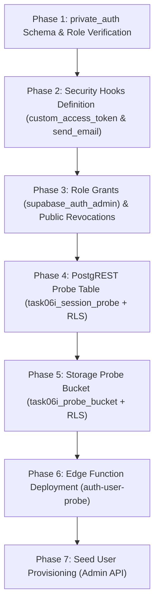

# Task 06I-B1-H2 — Disposable TEMP Testbed Readiness & Controlled Execution Plan

**Task ID:** `06I-B1-H2` (Revision R3)
**Creation Date:** 2026-11-24
**Revision Date:** 2026-11-24 (R3 Closure)
**Author:** Santosh Jangid (`im-tnyx`)
**Reviewer:** `im-tio` (Independent Reviewer)
**Branch:** `docs/task06i-b1-h2-temp-hosted-readiness`
**Base:** `main` at `2d1fe9eebfd0dc18fe213da1c2aff19df29c69c0`
**Reviewed HEAD:** `ff0bd44b1de78b8e93449d6e6057f69140e449a7`
**PR Reference:** [PR #43](https://github.com/im-tnyx/Tio-Workspace/pull/43)
**Cost Ceiling:** $0.00 (Free-Tier Only)  
**Mode:** Local Documentation & Offline Readiness Specification ONLY  
**Hosted LIVE Dispatch:** **NOT AUTHORIZED**  
**Production Real Auth:** **STRICT NO-GO**  
**Decision:** **`BLOCKED_PENDING_ADDITIONAL_PREPARATION`**

---

## 1. Executive Summary & Boundaries

Task **06I-B1-H2** establishes the formal readiness specification, testbed configuration manifest, SQL/fixture deployment plan, transactional email dependency resolution, canonical 18-case matrix reconciliation, and controlled execution runbook for the disposable TEMP Supabase testbed (`wvdabiwbaavfggcmpizd`).

Following the successful completion and squash merge of Task 06I-B1-H1 via PR #37 (commit `cd4ce0ac16953af23b5feb30dc48a102ae6d8f48`), all security test runner hardening, universal token tracking, verified session revocation provenance, and seed identity pre-existence proofs are fully integrated into `main`.

### Strict Project Boundaries
1. **REAL Production Project (`bsfwzvgynwriswapxpsp`):**
   - Organization: `llmbrmxhyirtoqndazpg`
   - Status: Active / Healthy
   - **IMMUTABLE POLICY:** Permanently protected, read-only, and strictly forbidden from test targeting.
2. **TEMP Testbed Target (`wvdabiwbaavfggcmpizd`):**
   - Project Name: `Tio-Tnyx-Auth-Temp` (`ap-south-1`)
   - Organization: `llmbrmxhyirtoqndazpg`
   - Purpose: Dedicated disposable testbed for Auth hook and session behavior verification.
   - Status during H2: **PRESERVED UNTOUCHED**. Zero Management API PATCH calls, zero SQL deployments, zero user provisioning, zero test emails.
3. **Tio-world (`oykupyiitspujzpwwvuj`):**
   - **IMMUTABLE POLICY:** Permanently immune and forbidden via hardcoded immutable guards.

### Cost & Execution Safeguards
- **Cost Ceiling:** Strictly $0.00. No paid addons, compute upgrades, custom domains, or third-party paid subscriptions.
- **Hosted LIVE Dispatch:** Strictly **NOT AUTHORIZED**. Runner defaults unconditionally to `DRY_RUN`.
- **Production Real Auth:** Strictly **NO-GO**.

---

## 2. Task 06I-B1-H1 Closure & Continuity Verification

| Milestone / Metric | Value | Verification Evidence |
|---|---|---|
| **PR #37 Status** | **MERGED** | Squash merge at `cd4ce0ac16953af23b5feb30dc48a102ae6d8f48` |
| **Approved HEAD** | `131589d57b02598ae0e3f07e2e83ad53c70a37da` | Approved by independent reviewer `im-tio` |
| **Review Threads** | **62/62 RESOLVED** | 0 unresolved threads at merge gate |
| **Task 06I Unit Tests** | **161/161 PASS** | `node --test experiments/task06i/*.test.mjs` |
| **PostgreSQL Contract Parity** | **POSTGRES_VERIFIED** (18/18) | `node experiments/task06i/sql-contract-parity.mjs` |
| **Task 06H Local Suite** | **115/115 PASS** | `node --test experiments/task06h/*.test.mjs` |
| **Repository Verification** | **PASS** | `npm run verify` (tokens guard, tsc, eslint, 22 shell tests) |
| **Hosted Verification Executed** | **0/18** | Zero live probes executed during H1 |
| **Remote `main` Baseline** | `2d1fe9eebfd0dc18fe213da1c2aff19df29c69c0` | Includes Expo preview workflow alignment (#42) |
| **Branch Cleanup** | **COMPLETED** | Local and remote `test/task06i-b1-h1-hosted-security-preflight` deleted |

H1 is formally closed as completed offline preparation.

---

## 3. H2-01 — TEMP Testbed Configuration Specification

The disposable testbed (`wvdabiwbaavfggcmpizd`) requires specific Supabase Auth configuration adjustments to disable native bypass paths, enforce short-lived JWTs, and register custom security hooks.

> [!IMPORTANT]
> **No Management API PATCH requests have been sent during Task 06I-B1-H2.**  
> The specification below documents the exact target payload, rationale, expected provider behavior, verification procedure, and snapshot-based rollback contract for future authorized execution.

### Supabase Management API Target Endpoint
- **Method:** `PATCH`
- **URL:** `https://api.supabase.com/v1/projects/wvdabiwbaavfggcmpizd/config/auth`
- **Authentication:** `Authorization: Bearer <supabase_management_api_token>`

### Configuration Manifest

| Configuration Field | Target Value | Current / Documented Default | Security Requirement | Reason for Change | Expected Provider Behavior | Verification Method | Rollback Procedure | Authorization Gate |
|---|---|---|---|---|---|---|---|---|
| `external_email_magic_link_disabled` | `true` | `false` | **BYPASS-01**, **BYPASS-04** | Prevent passwordless login and unverified magic link issuance | `POST /auth/v1/otp` with email returns `422 Unprocessable Entity` (`email_provider_disabled`) | HTTP probe to `POST /auth/v1/otp` yields 422 | Re-apply captured pre-change snapshot value (from `GET /config/auth` snapshot captured prior to modification; do not assume default value) | Owner written approval |
| `disable_signup` | `true` | `false` | **BYPASS-02** | Prevent direct public client registration outside controlled admin flow | `POST /auth/v1/signup` returns `422 Unprocessable Entity` (`signup_disabled`) | HTTP probe to `POST /auth/v1/signup` yields 422 | Re-apply captured pre-change snapshot value | Owner written approval |
| `jwt_exp` | `300` | `3600` | **SESSION-04**, **SESSION-05** | Bounded stateless linger window for PostgREST & Storage upon token revocation | JWT `exp - iat` equals exactly 300 seconds | Decode JWT payload from `POST /auth/v1/token?grant_type=password` and assert `exp - iat === 300` | Re-apply captured pre-change snapshot value | Owner written approval |
| `hook_custom_access_token_enabled` | `true` | `false` | **HOOK-01** to **HOOK-07** | Intercept token issuance and refresh to enforce strict password-only AMR allowlist | GoTrue executes PL/pgSQL function on sign-in and refresh; non-password AMR aborted with 500/42501 | Password sign-in returns JWT with enriched `amr_authenticated: "true"`; OTP returns 500 | Re-apply captured pre-change snapshot value | Owner written approval |
| `hook_custom_access_token_uri` | `"pg-functions://postgres/private_auth/custom_access_token_hook"` | `null` | **HOOK-01** to **HOOK-07** | Target SQL function for custom claims enrichment | GoTrue invokes specified PostgreSQL function with event payload | Assert hook invocation via test token issuance | Re-apply captured pre-change snapshot value | Owner written approval |
| `hook_send_email_enabled` | `true` | `false` | **BYPASS-05** | Intercept outbound native Auth emails and suppress unauthorized recovery/signup | Native email dispatches intercepted; recovery aborted fail-closed | `POST /auth/v1/recover` returns 500 or anti-enumeration without email delivery | Re-apply captured pre-change snapshot value | Owner written approval |
| `hook_send_email_uri` | `"pg-functions://postgres/private_auth/send_email_hook"` | `null` | **BYPASS-05** | Target SQL function for email interception | GoTrue invokes specified PostgreSQL function before dispatching email | Assert email suppression via hook execution logs | Re-apply captured pre-change snapshot value | Owner written approval |
| `external_phone_enabled` | `false` | `false` | **BYPASS-01** | Prevent SMS/phone OTP bypass | Phone endpoints disabled | HTTP probe returns 422 | Re-apply captured pre-change snapshot value | Owner written approval |
| `external_anonymous_users_enabled` | `false` | `false` | **BYPASS-04** | Prevent anonymous session minting | Anonymous auth disabled | `POST /auth/v1/signup` without credentials rejected | Re-apply captured pre-change snapshot value | Owner written approval |
| `mailer_autoconfirm` | `false` | `false` | **BYPASS-02** | Require explicit confirmation; prevent unverified email assumption | Email confirmation required unless seeded via Admin API | Admin API explicitly specifies `email_confirm: true` for seed user | Re-apply captured pre-change snapshot value | Owner written approval |
| `rate_limit_email_sent` | `30` | `30` | **Resource Budget** | Prevent outbound email burst on testbed | Provider rejects bursts exceeding 30/hour | Monitored via Brevo and GoTrue rate limit metrics | Re-apply captured pre-change snapshot value | Owner written approval |

> [!NOTE]
> **Rollback Contract:** Rollback must never rely on assumed defaults (e.g. `jwt_exp: 3600` or `false`). It must strictly restore the exact values recorded in the pre-change snapshot captured via `GET /v1/projects/wvdabiwbaavfggcmpizd/config/auth` immediately prior to any PATCH execution.

---

## 4. H2-02 — SQL & Fixture Deployment Plan

All database fixtures and security hooks are defined in `experiments/task06i/sql/testbed-fixtures.sql`. Deployment to the hosted TEMP testbed must follow a strict, dependency-ordered sequence.

> [!IMPORTANT]
> **Zero SQL has been deployed to the TEMP testbed during Task 06I-B1-H2.**  
> The plan below specifies the installation order, role permissions, RLS boundaries, and rollback commands for future authorized execution.

### Dependency-Ordered Deployment Phases



### Detailed Deployment Specifications

#### Phase 1: Private Schema & Roles
- **Artifact:** `CREATE SCHEMA IF NOT EXISTS private_auth;`
- **Scope:** Isolated private schema invisible to PostgREST/anon.
- **Roles:** Verify presence of `supabase_auth_admin`, `anon`, `authenticated`.
- **Security Impact:** Prevents public API exposure of security hook functions.

#### Phase 2: Security Hook Functions
1. **`private_auth.custom_access_token_hook(event jsonb)`:**
   - **Contract:** Language `plpgsql`, `SECURITY DEFINER`, `SET search_path = ''`.
   - **Logic:** Evaluates `authentication_method` and RFC 8176 `amr` array. Strictly permits only method `'password'`. Injects server-owned claim `claims.amr_authenticated = 'true'`. Fails closed with `SQLSTATE 42501` on non-password or mixed AMR.
2. **`private_auth.send_email_hook(event jsonb)`:**
   - **Contract:** Language `plpgsql`, `SECURITY DEFINER`, `SET search_path = ''`.
   - **Logic:** Enforces unpadded action type validation. Intercepts `recovery`, `signup`, `magiclink`, `invite`, `email_change`, `reauthentication` and fails closed with `SQLSTATE 42501`. Permitted action `'custom_notification'` returns `{}`.

#### Phase 3: Least-Privilege Grants & Revocations
- **Grants:** `GRANT USAGE ON SCHEMA private_auth TO supabase_auth_admin;`  
  `GRANT EXECUTE ON ALL FUNCTIONS IN SCHEMA private_auth TO supabase_auth_admin;`
- **Revocations:** `REVOKE ALL ON SCHEMA private_auth FROM public, anon, authenticated;`  
  `REVOKE ALL ON ALL FUNCTIONS IN SCHEMA private_auth FROM public, anon, authenticated;`
- **Security Impact:** Resolves `PRRT_kwDOVtCmZc66lOOX`. Client roles cannot inspect or execute hook functions directly.

#### Phase 4: PostgREST Probe Table (`SESSION-04`)
- **Table:** `public.task06i_session_probe` (`id uuid PRIMARY KEY`, `user_id uuid NOT NULL`, `run_id text`, `payload text`, `created_at timestamptz`).
- **RLS Policy:** `task06i_session_probe_user_policy` requiring `auth.uid() = user_id`.
- **Grants:** `SELECT, INSERT, UPDATE, DELETE` to `authenticated`; `ALL` to `service_role`.

#### Phase 5: Storage Bucket & Object Fixture (`SESSION-05`)
- **Bucket:** `storage.buckets` insert `('task06i_probe_bucket', 'task06i_probe_bucket', false)`.
- **RLS Policy:** `task06i_probe_storage_policy` on `storage.objects` requiring `bucket_id = 'task06i_probe_bucket' AND owner_id = (auth.uid())::text`.
- **Run-Scoped Storage Object Key Contract (R3-03):**
  - **Key Structure:** `task06i_probe_bucket/<runId>/probe.txt` (replacing the previous fixed path `task06i_probe_bucket/probe.txt`).
  - **Prerequisite Status:** **NOT CURRENTLY IMPLEMENTED IN RUNNER** (`BLOCKED_PENDING_RUN_SCOPED_STORAGE`).
  - **Mandatory 10-Point Contract for Run-Scoped Storage:**
    1. Exact project ref binding (`wvdabiwbaavfggcmpizd`).
    2. Validated unique run ID (`<runId>`).
    3. Exact bucket and run-scoped object key (`task06i_probe_bucket/<runId>/probe.txt`).
    4. Pre-upload collision check via GET / HEAD request.
    5. Strict prohibition of overwrite or upsert against an existing object.
    6. Write-ahead creation obligation committed to inventory before HTTP dispatch.
    7. Successful byte-upload evidence from Storage API response (`POST /storage/v1/object/...`).
    8. Verified object owner and resource identity matching the uploading seed user ID.
    9. Durable ownership record binding object key to run ID.
    10. Exact-path cleanup with affirmative HTTP 404 absence verification.
  - A run-scoped path alone does not prove ownership. If the upload response is lost or ownership cannot be verified affirmatively, the object must be preserved in quarantine with an unresolved creation obligation. An object must never be deleted merely because its path matches the configured fixture path.
- **Mandatory Storage API Provisioning Contract (R6-02):**
  Direct SQL `INSERT INTO storage.objects` is strictly prohibited because it does not upload underlying bytes. The test runner must authenticate as the seed user via password grant and upload actual bytes via Storage API `POST /storage/v1/object/task06i_probe_bucket/<runId>/probe.txt` to establish a genuine 200 OK baseline prior to revocation testing.

#### Phase 6: Edge Function Deployment (`SESSION-06`)
- **Function Name:** `auth-user-probe`
- **Path:** `supabase/functions/auth-user-probe/index.ts`
- **Implementation Contract:** Invokes `supabase.auth.getUser()`. Preserves actual provider error codes (`session_not_found` -> `AuthSessionMissingError`). Does not synthesize false revocation errors on generic 401/invalid token errors (resolves R5-08).
- **Deployment Command:** `supabase functions deploy auth-user-probe --project-ref wvdabiwbaavfggcmpizd`

#### Phase 7: Seed Identity Lifecycle & Ownership Architecture (R3-02)

To resolve the structural contradiction identified in PR #43 review threads (`PRRT_kwDOVtCmZc67d5NC`, `PRRT_kwDOVtCmZc67eGL0`, `PRRT_kwDOVtCmZc67eHgO`), two distinct concepts must be permanently separated:
1. **Seed Role:** The administrative function of an identity used as the subject of authentication probes (`HOOK-01`, `SESSION-01`, `SESSION-02`, etc.).
2. **Resource Ownership:** The origin and lifecycle of the identity—whether it existed prior to the run (`PRE_EXISTING_REFERENCED`) or was created by the run (`RUN_CREATED_VERIFIED`).

##### Verified H1 Runner Invariant & Limitation
In the approved H1 runner (`experiments/task06i/hosted-probe-runner.mjs:5262-5264`):
- Passing `options.seedUserId` unconditionally invokes `protectSeedIdentity(options.seedUserId, ...)`, which marks the identity `PRE_EXISTING_REFERENCED` in `inventory.verifiedSeedUsers` (`:2131-2157`).
- `registerCreatedUser()` explicitly refuses to mark a protected seed as run-created (`:2210-2213`).
- `executeCleanup()` deletes only `createdUsers` (`:3005-3049`) and deliberately preserves protected seed identities.
- Consequently, the current runner cannot provision a seed identity during the run, register it as a seed, and delete it via standard cleanup.

##### Supported Seed Lifecycle Options

| Lifecycle Dimension | Option A: Reusable Pre-Existing Seed (**RECOMMENDED**) | Option B: Per-Run Disposable Seed (Future Enhancement) |
|---|---|---|
| **Strategy Concept** | Dedicated, permanent testbed identity provisioned in advance | Ephemeral test user provisioned afresh for each run |
| **Provisioning Timing** | Separately authorized testbed preparation step (outside probe run) | Initial run initialization phase (Step 7) |
| **Ownership Classification** | Strictly `PRE_EXISTING_REFERENCED` | Strictly `RUN_CREATED_VERIFIED` |
| **Runner Capability** | Fully supported in current H1 runner architecture | **NOT IMPLEMENTED** (`BLOCKED_PENDING_RUN_CREATED_SEED_SUPPORT`) |
| **Credential Management** | Original password restored from secure custody; verified via login; verification session revoked | No restoration required; user deleted at end of run |
| **Deletion Policy** | **NEVER DELETED**; preserved across runs | Deleted via Admin API only after Storage and session cleanup |
| **Runner Requirements** | Pre-flight credentials verification (`isValidPreExistenceProof`) | Dedicated registration path bypassing `protectSeedIdentity` |
| **Recommendation** | **RECOMMENDED FOR INITIAL HOSTED PREPARATION** | Defer until dedicated runner registration is implemented |

*Policy Rule:* Neither lifecycle is authorized without explicit owner approval. For initial hosted testbed preparation, Option A is recommended due to zero runner code changes and robust credential restoration verification.

### Safe Resource Rollback Plan (R3-01 & R3-03)
Unconditional `DROP SCHEMA CASCADE`, full bucket wipe, or blind user deletion is strictly prohibited. The rollback procedure must be targeted, run-scoped, dependency-ordered, and verified:
1. **Session & Mutation Reconciliation:** Await settlement of any in-flight mutations; revoke all active probe sessions and obtain affirmative revocation proof.
2. **Storage Cleanup MUST Precede Auth User Deletion (R3-01):** Supabase rejects Auth user deletion while the user owns objects in Storage (`storage.objects.owner_id`). Therefore, verified run-owned Storage objects (`task06i_probe_bucket/<runId>/probe.txt`) must be deleted via Storage API `DELETE` and verified absent (HTTP 404) **before** attempting Auth user deletion.
3. **Probe Table Rows:** Execute `DELETE FROM public.task06i_session_probe WHERE run_id = '<current_run_id>';`. Verify 0 rows remain for `run_id`.
4. **Auth User Settlement by Lifecycle Option:**
   - **Under Option A (Reusable Seed):** **NEVER DELETE THE SEED USER**. Restore original password via Admin API `PUT /auth/v1/admin/users/:seedUserId` from encrypted operator custody; verify credentials via test login; revoke verification session.
   - **Under Option B (Disposable Seed):** Only after verified Storage object deletion and session revocation, call Admin API `DELETE /auth/v1/admin/users/:userId` strictly using exact verified run-creation ID; assert HTTP 404 absence. (Requires `BLOCKED_PENDING_RUN_CREATED_SEED_SUPPORT`).
   - If Storage deletion fails, ownership is uncertain, or unowned objects remain, **BLOCK user deletion**, quarantine artifacts, and report `INTERRUPTED_RECOVERY_BLOCKED`.
5. **Database Hooks:** If decommissioning the testbed, drop functions explicitly (`DROP FUNCTION IF EXISTS private_auth.custom_access_token_hook(jsonb);`, `DROP FUNCTION IF EXISTS private_auth.send_email_hook(jsonb);`). Drop schema `private_auth` only with `RESTRICT` after verifying zero remaining objects exist (never `CASCADE`).

---

## 5. H2-03 — Brevo & Transactional Email Decision

### Current Operational Evidence
CLI audit and test preflight established:
- **Provider:** Brevo (Sendinblue) Free Tier (300 emails/day ceiling).
- **Status:** `UNAUTHENTICATED_SENDER_DOMAIN_BLOCKED`.
- **Direct SMTP Relay:** Configured but delivery to public inbox providers is rejected due to missing SPF/DKIM authentication records for unverified sender domains.

### Strict Architectural Separation

```
[Native Supabase Auth Events] ──> [Send Email Hook (private_auth.send_email_hook)]
                                      │
                                      ├──> Intercepts recovery/signup/magiclink
                                      └──> FAILS CLOSED (SQLSTATE 42501)
                                           [Zero Outbound Email Dispatched]

[Approved Application OTP Architecture] ──> [Edge Function with Server Secret]
                                                │
                                                └──> Dedicated App Service / Future Provider
                                                     [Separately Gated & Audited]
```

1. **Native Email Suppression (Fail-Closed Gate):**
   - Supabase GoTrue must never be allowed to deliver native recovery or signup emails.
   - The `send_email_hook` intercepts all outbound events and aborts with `SQLSTATE 42501`.
   - Native email delivery remains **100% BLOCKED**.
   - *Note on Evidence:* Zero emails dispatched in H2 reflects local/offline state, not proof of hosted hook behavior. Hosted email suppression will only be verified during an authorized hosted run.
2. **Approved Application OTP Delivery (Future Architecture):**
   - Application-controlled signup and recovery OTP delivery must use a dedicated, server-side Edge Function that enforces rate limits, quarantine ledgers, and audit trails.
   - Native GoTrue SMTP configuration cannot and must not be used to bypass the strict application OTP lifecycle.

### Viable $0 Options Analysis

| Option | Description | Cost | Feasibility | Security Impact | Recommendation |
|---|---|---|---|---|---|
| **Option A: Authenticated Custom Domain** | Add DNS SPF/DKIM records to a verified domain on Brevo | $0 (if domain owned) / Paid (if new domain required) | Blocked without verified domain ownership | Enables transactional delivery; requires SPF/DKIM verification | Defer until domain acquisition is formally approved |
| **Option B: Synthetic Loopback / Local SMTP** | Use local Mailpit adapter for local integration suites | $0 | Fully implemented and verified (Task 06H, 115 tests pass) | Isolated to local loopback (127.0.0.1); zero external delivery | Standard for local testing; cannot verify hosted Brevo relay |
| **Option C: Defer Email-Dependent Hosted Cases** | Keep `BYPASS-05` and email delivery probes gated; assert fail-closed hook suppression | $0 | **IMMEDIATELY FEASIBLE** | Confirms native recovery is blocked fail-closed with `SQLSTATE 42501`; zero external email risk | **RECOMMENDED FOR H2** |

**Decision:** Maintain **Option C**. Zero test emails dispatched, zero domains purchased, zero DNS records modified.

---

## 6. H2-04 — Canonical Hosted Verification Matrix Reconciliation

The 18 preflight security requirements are audited below strictly reconciled against `HOSTED_PROBE_SPECIFICATIONS` in `experiments/task06i/hosted-probe-runner.mjs`.

Three separate evaluation dimensions must be distinguished:
1. **Offline Implementation Status:** Whether runner dispatcher logic and assertion evaluation are fully implemented and verified offline in unit test suites.
2. **Hosted Prerequisite Readiness:** What remote cloud infrastructure, configuration changes, or test fixtures are required on the hosted testbed before a probe can be dispatched.
3. **Actual Provider-Observed Verification:** Whether real HTTP network requests against Supabase Cloud have been executed and observed (currently 0/18).

### Canonical 18-Requirement Audit

| ID | Category | Layer | Target Endpoint | Documented Capability / Evidence Source | Required Hosted Prerequisites | Offline Implementation Status | Hosted Verification Status |
|---|---|---|---|---|---|---|---|
| **BYPASS-01** | Native Bypass | Layer B (Hosted) | `POST /auth/v1/otp` | `GOTRUE_HTTP_422_EMAIL_PROVIDER_DISABLED` | `MANAGEMENT_API_PATCH_EXTERNAL_EMAIL_MAGIC_LINK_DISABLED` | **`IMPLEMENTED_OFFLINE_TESTED`** | `HOSTED_NOT_TESTED` |
| **BYPASS-02** | Native Bypass | Layer B (Hosted) | `POST /auth/v1/signup` | `GOTRUE_HTTP_422_SIGNUP_DISABLED` | `MANAGEMENT_API_PATCH_DISABLE_SIGNUP` | **`IMPLEMENTED_OFFLINE_TESTED`** | `HOSTED_NOT_TESTED` |
| **BYPASS-03** | Native Bypass | Layer B (Hosted) | `POST /auth/v1/verify` | `CUSTOM_ACCESS_TOKEN_HOOK_SQLSTATE_42501` | `VALID_DELIVERED_OTP_CHALLENGE`, `HOOK_CUSTOM_ACCESS_TOKEN_ENABLED` | **`PROVIDER_PRECONDITION_MISSING`** | `HOSTED_NOT_TESTED` |
| **BYPASS-04** | Native Bypass | Layer B (Hosted) | Magic Link / Invite / Anon | `CUSTOM_ACCESS_TOKEN_HOOK_SQLSTATE_42501` | `VALID_MAGIC_LINK_TOKEN`, `HOOK_CUSTOM_ACCESS_TOKEN_ENABLED` | **`PROVIDER_PRECONDITION_MISSING`** | `HOSTED_NOT_TESTED` |
| **BYPASS-05** | Native Bypass | Layer B (Hosted) | `POST /auth/v1/recover` | `SEND_EMAIL_HOOK_SQLSTATE_42501` | `HOOK_SEND_EMAIL_ENABLED` | **`IMPLEMENTED_OFFLINE_TESTED`** | `HOSTED_NOT_TESTED` |
| **HOOK-01** | Token Hook | Layer B (Hosted) | `POST /auth/v1/token?grant_type=password` | `DECODED_JWT_AMR_AUTHENTICATED_CLAIM` | `SEEDED_PASSWORD_USER`, `HOOK_CUSTOM_ACCESS_TOKEN_ENABLED` | **`IMPLEMENTED_OFFLINE_TESTED`** | `HOSTED_NOT_TESTED` |
| **HOOK-02** | Token Hook | Layer B (Hosted) | `POST /auth/v1/token?grant_type=refresh_token` | `DECODED_REFRESHED_JWT_AMR_PRESERVATION` | `ACTIVE_REFRESH_TOKEN_FROM_HOOK_01`, `HOOK_CUSTOM_ACCESS_TOKEN_ENABLED` | **`IMPLEMENTED_OFFLINE_TESTED`** | `HOSTED_NOT_TESTED` |
| **HOOK-03** | Token Hook | Layer B (Hosted) | OTP-Origin Token Denial | `CUSTOM_ACCESS_TOKEN_HOOK_SQLSTATE_42501` | `VALID_DELIVERED_OTP_CHALLENGE`, `HOOK_CUSTOM_ACCESS_TOKEN_ENABLED` | **`PROVIDER_PRECONDITION_MISSING`** | `HOSTED_NOT_TESTED` |
| **HOOK-04** | Token Hook | Layer B (Hosted) | Recovery-Origin Token Denial | `CUSTOM_ACCESS_TOKEN_HOOK_SQLSTATE_42501` | `VALID_DELIVERED_RECOVERY_TOKEN`, `HOOK_CUSTOM_ACCESS_TOKEN_ENABLED` | **`PROVIDER_PRECONDITION_MISSING`** | `HOSTED_NOT_TESTED` |
| **HOOK-05** | Token Hook | Layer A (Offline SQL) | Mixed AMR Rejection | `PLPGSQL_FUNCTION_EXECUTION_42501` | `SQL_FUNCTION_PARITY_TEST` (Cannot mutate server AMR via HTTP client body) | **`BLOCKED_UNSUPPORTED`** | `HOSTED_NOT_TESTED` |
| **HOOK-06** | Token Hook | Layer A (Offline SQL) | Malformed/Missing AMR | `PLPGSQL_FUNCTION_EXECUTION_42501` | `SQL_FUNCTION_PARITY_TEST` (Cannot mutate server AMR via HTTP client body) | **`BLOCKED_UNSUPPORTED`** | `HOSTED_NOT_TESTED` |
| **HOOK-07** | Token Hook | Layer A (Offline SQL) | Exception Handling | `PLPGSQL_TRANSACTION_ABORT_500` | `SQL_FUNCTION_PARITY_TEST` (Cannot inject SQL runtime exception over HTTP) | **`BLOCKED_UNSUPPORTED`** | `HOSTED_NOT_TESTED` |
| **SESSION-01** | Session/Consumer | Layer B (Hosted) | `GET /auth/v1/user` | `REAL_SESSION_ID_CORRELATION` | `ACTIVE_SESSION_FROM_HOOK_01`, `TIO_TEMP_SERVICE_ROLE_KEY` | **`IMPLEMENTED_OFFLINE_TESTED`** | `HOSTED_NOT_TESTED` |
| **SESSION-02** | Session/Consumer | Layer B (Hosted) | `PUT /auth/v1/admin/users/:userId` | `ADMIN_API_PASSWORD_UPDATE_AND_SESSION_REVOCATION` | `ACTIVE_USER_ID_FROM_HOOK_01`, `TIO_TEMP_SERVICE_ROLE_KEY` | **`IMPLEMENTED_OFFLINE_TESTED`** | `HOSTED_NOT_TESTED` |
| **SESSION-03** | Session/Consumer | Layer B (Hosted) | `GET /auth/v1/user (post-reset)` | `GOTRUE_HTTP_403_SESSION_NOT_FOUND` | `PRE_RESET_TOKEN`, `ADMIN_PASSWORD_RESET_COMPLETED` | **`IMPLEMENTED_OFFLINE_TESTED`** | `HOSTED_NOT_TESTED` |
| **SESSION-04** | Session/Consumer | Layer B (Hosted) | `GET /rest/v1/task06i_session_probe` | `POSTGREST_STATELESS_HTTP_200_BEFORE_EXP` | `PRE_RESET_TOKEN_BEFORE_EXPIRY`, `TABLE_FIXTURE_TASK06I_SESSION_PROBE` | **`IMPLEMENTED_OFFLINE_TESTED`** | `HOSTED_NOT_TESTED` |
| **SESSION-05** | Session/Consumer | Layer B (Hosted) | `GET /storage/v1/object/.../probe.txt` | `STORAGE_STATELESS_HTTP_200_BEFORE_EXP` | `PRE_RESET_TOKEN_BEFORE_EXPIRY`, `STORAGE_OBJECT_FIXTURE_PROVISIONED` | **`IMPLEMENTED_OFFLINE_TESTED`** | `HOSTED_NOT_TESTED` |
| **SESSION-06** | Session/Consumer | Layer B (Hosted) | `POST /functions/v1/auth-user-probe` | `EDGE_FUNCTION_AUTH_SESSION_MISSING_ERROR` | `EDGE_FUNCTION_AUTH_USER_PROBE_DEPLOYED`, `PRE_RESET_TOKEN` | **`PROVIDER_PRECONDITION_MISSING`** | `HOSTED_NOT_TESTED` |

### Matrix Summary Counts
- **Total Security Requirements:** 18
- **`IMPLEMENTED_OFFLINE_TESTED`:** **10** (`BYPASS-01`, `BYPASS-02`, `BYPASS-05`, `HOOK-01`, `HOOK-02`, `SESSION-01`, `SESSION-02`, `SESSION-03`, `SESSION-04`, `SESSION-05`)
- **`PROVIDER_PRECONDITION_MISSING`:** **5** (`BYPASS-03`, `BYPASS-04`, `HOOK-03`, `HOOK-04`, `SESSION-06`)
- **`BLOCKED_UNSUPPORTED`:** **3** (`HOOK-05`, `HOOK-06`, `HOOK-07`)
- **`HOSTED_VERIFIED`:** **0** (All 18 are `HOSTED_NOT_TESTED`)

### Execution Scope & Runner Capability Audit (R1-01)
1. **Specific Proposed Executable Probe IDs:**
   The only probes whose dispatcher logic is fully implemented and could be executed once testbed preconditions are satisfied are the 10 `IMPLEMENTED_OFFLINE_TESTED` cases:
   `BYPASS-01`, `BYPASS-02`, `BYPASS-05`, `HOOK-01`, `HOOK-02`, `SESSION-01`, `SESSION-02`, `SESSION-03`, `SESSION-04`, `SESSION-05`.
2. **Runner Subset Execution Capability:** **NOT IMPLEMENTED** (`BLOCKED_PENDING_SUBSET_RUNNER`).
   - In `experiments/task06i/hosted-probe-runner.mjs`, `planProbeExecution` unconditionally maps over all 18 items in `PREFLIGHT_REQUIREMENTS`, and `runHostedProbeRunner` unconditionally iterates through all items in `plan.plannedCases`.
   - The runner currently has **no mechanism** to filter or execute a subset of probes.
   - If executed in LIVE mode today, the runner would attempt to dispatch all 18 cases and abort on the first missing prerequisite (e.g. `BYPASS-03`).
   - **Requirement:** A dedicated code change to support probe filtering (e.g. `options.selectedProbeIds`) must be implemented, locally tested, and reviewed before any subset live execution can ever be authorized.

---

## 7. H2-05 — Controlled Execution & Crash-Recovery Runbook

### Controlled Execution Sequence (Strict Chronological Order)
1. **Owner Authorization & Project Verification:** Confirm written owner authorization token for the specific run ID. Assert `projectRef === 'wvdabiwbaavfggcmpizd'` and assert project is in organization `llmbrmxhyirtoqndazpg`. Deny-by-default on any mismatch.
2. **Recovery Capability Verification:** Confirm durable journaling and recovery mechanisms are active and verified (`BLOCKED_PENDING_DURABLE_RECOVERY`).
3. **Pre-Change Configuration Snapshot:** Execute `GET /v1/projects/wvdabiwbaavfggcmpizd/config/auth` via Management API. Record raw pre-change JSON snapshot into persistent store.
4. **Deploy Database Fixtures:** Apply Phase 1–5 SQL (`private_auth` schema, hook functions, least-privilege role grants, probe table, probe bucket) from `experiments/task06i/sql/testbed-fixtures.sql`. Verify zero errors.
5. **Apply Management API PATCH:** Apply the approved Auth configuration manifest (disabling public signup, disabling magic links, setting JWT exp to 300s, enabling hooks).
6. **Verify Hook Registration:** Verify Management API GET confirms `hook_custom_access_token_enabled: true` and `hook_send_email_enabled: true`.
7. **Seed Identity Preparation & Verification (R3-02):**
   - **Under Option A (Reusable Pre-Existing Seed - RECOMMENDED):** Verify that the pre-provisioned seed user (`tio-test-user-06i@proof.invalid`) exists and credentials are valid before probe dispatch; record in inventory with `PRE_EXISTING_REFERENCED` ownership.
   - **Under Option B (Disposable Run-Created Seed):** Provision a fresh test user via Admin API `POST /auth/v1/admin/users`; record in inventory with `RUN_CREATED_VERIFIED` ownership via a dedicated runner registration path that bypasses `protectSeedIdentity` (requires `BLOCKED_PENDING_RUN_CREATED_SEED_SUPPORT`).
8. **Provision Storage Fixture Object (R3-03):** Using seed user JWT, upload actual bytes to the unique run-scoped key `task06i_probe_bucket/<runId>/probe.txt` via Storage API and establish HTTP 200 GET baseline. (Requires `BLOCKED_PENDING_RUN_SCOPED_STORAGE`). Commit write-ahead creation obligation and verified owner matching seed user ID to inventory.
9. **Execute Authorized Probes:** Execute only authorized probes sequentially with mandatory 100ms throttling (requires subset runner capability).
10. **Immediate Halt on Critical Failure:** If `HOOK-01`, `HOOK-07`, or `SESSION-03` fail, halt immediately and abort remaining probes.
11. **Execute Deterministic Cleanup (Strict Dependency Order) (R3-01):**
    - **A. Reconcile In-Flight Mutations:** Await confirmation or query provider status for any pending password or user mutation obligations.
    - **B. Revoke Active Sessions:** Revoke all tracked probe sessions via GoTrue `signOut`.
    - **C. Storage Cleanup MUST Precede User Deletion (R3-01):** Delete verified run-owned Storage fixture object (`DELETE /storage/v1/object/task06i_probe_bucket/<runId>/probe.txt`) and verify HTTP 404 absence. (Supabase rejects Auth user deletion while the user owns Storage objects; therefore Storage cleanup is a mandatory prerequisite to user deletion).
    - **D. Delete Probe Table Rows:** Execute SQL `DELETE FROM public.task06i_session_probe WHERE run_id = '<runId>';` and verify 0 rows remain.
    - **E. Seed Lifecycle Settlement by Strategy:**
      - **Path A (Run-Created Seed - Option B):** Only after verified Storage object deletion (C) and session revocation (B), call Admin API `DELETE /auth/v1/admin/users/:seedUserId` strictly by exact verified run-creation ID; assert HTTP 404 absence. (Never attempt password restoration on a deleted user).
      - **Path B (Pre-Existing Seed - Option A):** Preserve user identity (never delete), restore original seed password via Admin API `PUT /auth/v1/admin/users/:seedUserId` from encrypted operator custody, verify restored credentials via ephemeral verification session, revoke verification session, and confirm session cleanup.
    - **F. Assert Cleanup Completion:** Assert `untrackedSessionObligations === 0` and `unverifiedUsers === 0`. If Storage cleanup fails or ownership is indeterminate, **BLOCK user deletion**, quarantine artifacts, and report `INTERRUPTED_RECOVERY_BLOCKED`.
12. **Restore Testbed Configuration:** Revert Auth configuration to the exact pre-test snapshot JSON captured in Step 3 via Management API PATCH.
13. **Emit Final Audit Report:** Sanitize all tokens and secrets; generate structured test report with verified evidence.

### Explicit Hard STOP Conditions
The runner will immediately abort execution and trigger cleanup if any of the following occur:
- Target ref does not match `wvdabiwbaavfggcmpizd`.
- Any reference to `bsfwzvgynwriswapxpsp` (REAL) or `oykupyiitspujzpwwvuj` (Tio-world) is detected.
- Management API returns non-200 on pre-flight snapshot.
- Seed identity credentials fail verification.
- An unexpected user identity is observed without affirmative pre-existence proof.
- Outbound transactional email is observed leaving Brevo.
- Post-invalidation session lingering exceeds 300 seconds.
- Session cleanup (`signOut`) fails or returns unhandled error.
- Any network request times out or returns unexpected 5xx gateway errors.

---

### Crash-Recovery & Durable Journal Specification (R1-02)

#### Current Implementation Limitation
- **Automatic Crash Recovery:** **NOT IMPLEMENTED** (`BLOCKED_PENDING_DURABLE_RECOVERY`).
- In `experiments/task06i/hosted-probe-runner.mjs`, `TestRunInventory` retains tracked sessions, access tokens, in-flight operations, and seed credentials purely in volatile JavaScript memory (`Set` and `Map`).
- If the Node.js process crashes, terminates, or loses power, all in-memory references are destroyed.
- Because GoTrue client session invalidation (`signOut`) requires the bearer access token (per R6-01 contract), a crashed process loses the tokens required to invalidate active sessions via the client SDK.

#### Durable Recovery Design Architecture (Future Implementation Prerequisite)
To make recovery deterministic across process restarts, a durable journal specification is required:
1. **Run Journal Binding:** A local write-ahead log file keyed by `runId` and bound strictly to `wvdabiwbaavfggcmpizd`.
2. **Pre-Change Snapshot Storage:** Exact pre-change configuration JSON from `GET /config/auth` saved before any PATCH dispatch.
3. **Verified Seed Identity Journaling:** Seed user ID, email, and pre-test state written to journal before probe execution.
4. **Write-Ahead Resource Ownership:** Before or immediately upon receiving user IDs, session IDs, or storage object paths, they must be committed to the journal.
5. **Mutation Obligation Tracking:** Register password mutation obligation to journal *before* calling `PUT /admin/users/:id`.
6. **Durable State Machine:** Operations transition across explicit states: `PENDING` → `IN_FLIGHT` → `SETTLED` → `REVOCATION_REQUIRED` → `RESTORE_REQUIRED` → `CLEANED`.
7. **Rehydration Engine:** On process startup, a recovery coordinator inspects for unfinalized journals, binds to the testbed, and drives rollback.
8. **Safe Replay & Idempotency:** Cleanup operations must handle already-deleted resources gracefully without throwing errors.
9. **Verified Cleanup Evidence:** Journal is only marked `CLEANED` after affirmative verification queries confirm resource absence.

#### Secret-Handling Safeguards
- **Prohibition of Plaintext Credentials:** Plaintext passwords, service role keys, or JWT access tokens must **never** be written to unencrypted files on disk.
- **Encrypted Local Custody:** If access tokens or seed passwords must survive process crashes, they must be encrypted using operating system credential protection (e.g. Windows DPAPI, macOS Keychain, Linux SecretService, or AES-256-GCM with an ephemeral OS-protected key).
- **Strictly Prohibited Locations:** Secrets must never appear in Git-tracked files, unencrypted JSON, PR comments, CI artifacts, terminal logs, or shared cloud storage.

#### Concrete Manual Recovery Protocol (R2-01 Remediation)

If a test run crashes or is interrupted before automated durable journaling is implemented, an operator must execute this strict ownership-aware manual recovery procedure.

##### Inviolable Safety Invariants & Boundary Guards
1. **Metadata Is Not Proof of Ownership:** `user_metadata.test_run_id` is an untrusted, user-editable client attribute and serves purely as a correlation hint. It is **never** authoritative proof of run creation or ownership.
2. **Strict Prohibition of Blind Bulk Operations:** Never call `DELETE` on users based solely on email matching, returned UID, or metadata query filters without affirmative proof of run creation.
3. **Mutual Exclusivity of Deletion and Restoration:** A user identity cannot be both deleted and password-restored. Seed deletion and password restoration are strictly mutually exclusive execution paths.
4. **Session Revocation vs Stateless JWT Invalidation:** Updating a password in GoTrue revokes stateful rows in `auth.sessions`, causing stateful `/auth/v1/user` checks to fail with HTTP 403 `session_not_found`. However, stateless consumers (PostgREST, Storage) continue to accept unexpired bearer JWTs statelessly until their `exp` timestamp elapses (up to 300 seconds). Deletion or password reset does **not** instantly invalidate distributed bearer tokens.
5. **Pending Mutation Blocker:** If any asynchronous provider mutation (e.g. password update) remains unresolved or in-flight at crash time, manual recovery cannot claim success and must block until provider status is resolved.

##### Branching Manual Recovery Paths

An operator must classify the seed identity into one of three mutually exclusive branches before taking any action:

###### Path A: Verified Run-Created Identity (`RUN_CREATED_VERIFIED`)
*Applicability:* Affirmative write-ahead log evidence or initial provisioning response confirms that this specific user ID was created exclusively by and for this test run.
1. **Reconcile In-Flight Mutations:** Await settlement or query provider status for any pending mutation obligations.
2. **Revoke Tracked Sessions:** If active session access tokens are held in operator memory/custody, issue GoTrue `signOut`.
3. **Delete Verified Run-Owned Storage Objects (R3-01):** Query Storage API for objects owned by this user ID. Establish exact run ownership for each object. Call Storage API `DELETE /storage/v1/object/task06i_probe_bucket/<runId>/probe.txt` (or exact verified run-scoped keys) and verify HTTP 404 absence.
   - *Dependency Gate:* Supabase User Management explicitly rejects deleting an Auth user who owns Storage objects. If Storage deletion fails, object ownership is ambiguous, or any owned object remains, **HALT** user deletion immediately, quarantine the identity, record an unresolved obligation, and fail closed to `INTERRUPTED_RECOVERY_BLOCKED`.
4. **Delete Probe Table Rows:** Execute SQL `DELETE FROM public.task06i_session_probe WHERE run_id = '<runId>';` and assert 0 rows remain.
5. **Delete Run-Created User:** Only after verified Storage object deletion and session revocation, call Admin API `DELETE /auth/v1/admin/users/:userId` strictly using the exact verified user ID.
6. **Verify User Absence:** Query Admin API `GET /auth/v1/admin/users/:userId`, assert HTTP 404 (user does not exist).
7. **Strict Prohibitions:**
   - **DO NOT** attempt user deletion prior to successful, verified Storage object deletion.
   - **DO NOT** attempt password restoration on a deleted user (would result in HTTP 404 error).
   - **DO NOT** treat user deletion as instantaneous invalidation of already-minted stateless JWTs (must observe 300s lingering interval).

###### Path B: Verified Pre-Existing Identity (`PRE_EXISTING_REFERENCED`)
*Applicability:* Affirmative pre-flight inventory proof confirms the seed user existed prior to probe dispatch (e.g. pre-test credential check).
1. **Strict Prohibition of Deletion:** **NEVER** call `DELETE /auth/v1/admin/users/:seedUserId`. Preserving pre-existing user identity and history is mandatory.
2. **Reconcile In-Flight Mutations:** Confirm any pending password mutations have completed or failed.
3. **Delete Verified Run-Owned Storage Objects:** Delete verified run-scoped Storage objects (`task06i_probe_bucket/<runId>/probe.txt`) and verify HTTP 404 absence.
4. **Delete Probe Table Rows:** Execute SQL `DELETE FROM public.task06i_session_probe WHERE run_id = '<runId>';` and assert 0 rows remain.
5. **Restore Seed Password:** Call Admin API `PUT /auth/v1/admin/users/:seedUserId` with the original password retrieved from encrypted operator custody.
6. **Verify Restored Credentials:** Mint a single ephemeral verification session via `POST /auth/v1/token?grant_type=password` using the restored password.
7. **Affirmative Revocation of Verification Session:** Immediately revoke the verification session via `POST /auth/v1/logout` (or GoTrue client `signOut`), and assert HTTP 403 `session_not_found` on subsequent `GET /auth/v1/user`.
8. **Assert Session Count:** Confirm all verification session obligations are cleared.

###### Path C: Indeterminate Identity Ownership (`OWNERSHIP_UNKNOWN` / `CREATION_INDETERMINATE`)
*Applicability:* User ID was observed during probe execution, but neither affirmative run-creation proof nor affirmative pre-existence proof exists in inventory or durable records.
1. **Strict Prohibitions:**
   - **DO NOT** delete the user.
   - **DO NOT** mutate or reset credentials.
   - **DO NOT** alter user metadata.
2. **Revoke Known Sessions:** Revoke any known active sessions via `signOut` if access tokens are held in custody.
3. **Quarantine Identity:** Record the user ID, email, and observed metadata into a quarantine log for manual operator investigation.
4. **Record Unresolved Obligation:** Increment `unverifiedUsers` count.
5. **Fail Recovery Closed:** Mark recovery verdict as **`INTERRUPTED_RECOVERY_BLOCKED`**.

##### Auxiliary Resource Cleanup
1. **Revert Auth Configuration:**
   - Retrieve pre-change snapshot JSON from secret-safe operator custody.
   - Re-apply ONLY approved writable fields via Management API `PATCH /v1/projects/wvdabiwbaavfggcmpizd/config/auth`.
   - Affirmative verification: Fetch `GET /config/auth` post-patch, assert zero semantic diff against pre-change snapshot. If snapshot is missing or diff is non-empty, mark `CONFIG_RESTORE_FAILED`.
2. **Final Recovery Verification:** Assert all auxiliary resources are deleted, configuration diff is empty, `untrackedSessionObligations === 0`, and `unverifiedUsers === 0`.
3. **Verdict:** If any step fails or cannot be verified affirmatively, record status: **`INTERRUPTED_RECOVERY_BLOCKED`**. Never report `INTERRUPTED_RECOVERY_COMPLETED` without affirmative evidence.

---

### Recovery Decision Matrix (12 Distinct Scenarios)

The following decision matrix governs all automated and manual recovery operations across all possible failure, crash, and interruption states:

| # | Scenario & Failure Condition | Required Evidence | Permitted Action | Prohibited Action | Verification Requirement | Residual-Risk Classification |
|---|---|---|---|---|---|---|
| **1** | **Verified Run-Created Seed**<br>Process crashes after creating dedicated seed identity. | Exact user ID in run write-ahead journal or initial provisioning response record matching `runId`. | **Path A:** Revoke known sessions; delete verified run-owned Storage object (`task06i_probe_bucket/<runId>/probe.txt`) first and verify 404; delete table rows; then call `DELETE /admin/users/:userId` with exact verified ID. | Never delete user before Storage cleanup; never attempt password restoration after deletion; never delete by email or metadata filter alone. | Storage GET returns HTTP 404; Admin `GET /admin/users/:userId` returns HTTP 404. | **LOW** (Temporary test user completely eradicated). |
| **2** | **Verified Pre-Existing Seed**<br>Process crashes after mutating pre-existing seed user's password. | Pre-flight inventory verification record or pre-test credential check confirming prior existence. | **Path B:** Preserve user; delete run-owned Storage objects and table rows; call `PUT /admin/users/:seedUserId` with original password from secure custody; test login; revoke verification session. | Never delete pre-existing user; never modify metadata; never leave password in mutated test state. | Test login succeeds with original password; verification session revoked with HTTP 403. | **LOW** (Original user identity and credentials fully restored). |
| **3** | **Unknown Seed Ownership**<br>Process crashes with user ID in scope but creation provenance is missing or ambiguous. | Conflicting, corrupted, or missing inventory records for observed user ID. | **Path C:** Revoke known sessions if tokens held; quarantine user ID in audit log for operator review. | Never delete user; never mutate credentials; never reset password; never alter metadata. | Record `unverifiedUsers > 0`; set recovery status `INTERRUPTED_RECOVERY_BLOCKED`. | **HIGH** (Possible pre-existing or foreign identity; preserved untouched to prevent data loss). |
| **4** | **Unexpectedly Created User**<br>Probe execution (e.g. signup/OTP probe) inadvertently created an Auth user. | Provider response in probe execution log showing user creation with specific user ID. | Delete any run-owned Storage objects first; delete by exact user ID **only** if affirmative run-minting evidence exists; otherwise quarantine via Path C. | Never delete user before Storage cleanup; never delete based on email match alone; never delete based on user-editable metadata alone. | Admin `GET` returns 404 if deleted; or recorded as quarantined obligation. | **MEDIUM** (Orphaned probe artifact requiring affirmative provenance before deletion). |
| **5** | **Lost Session Token**<br>Process crashed while active session existed; JWT access token lost from volatile memory. | Active session ID or user ID known from run journal, but bearer JWT token destroyed. | If pre-existing user, trigger administrative password reset to purge `auth.sessions`; if run-created user, delete user after Storage cleanup. | Never call GoTrue client `signOut` with synthetic, expired, or invalid tokens. | Query `auth.sessions` confirms zero active session rows for target user; observe 300s stateless token expiry window. | **MEDIUM** (Stateless bearer JWT lingers up to 300s before expiring at consumers). |
| **6** | **Unresolved Password Mutation**<br>`PUT /admin/users/:id` was in-flight when process crashed or timed out. | Mutation obligation logged in write-ahead log without provider settlement confirmation. | Query provider admin API to determine current credential state; re-dispatch password restore if pre-existing seed. | Never mark recovery complete while mutation status is indeterminate; never assume mutation failed. | Affirmative login verification with expected password confirms exact credential state. | **HIGH** (Credential state uncertain; could lock out legitimate operator/user). |
| **7** | **Failed Password Restoration**<br>`PUT /admin/users/:seedUserId` returns HTTP 4xx/5xx or network error during recovery. | Error response from Supabase Admin API during password restore attempt. | Retry with exponential backoff (up to 3 attempts); if still failing, escalate immediately to manual operator intervention with root credentials. | Never swallow restore errors; never report recovery success; never delete pre-existing user as workaround. | Password restoration confirmed via successful test login or manual operator confirmation. | **CRITICAL** (Account left in altered or inaccessible state). |
| **8** | **Failed Session Revocation**<br>GoTrue `signOut` or admin session deletion returns error. | HTTP error response or network failure during session revocation call. | Escalate to administrative user password update (which triggers native session purge in GoTrue) or user deletion (if run-created, following Storage cleanup). | Never ignore revocation failure; never decrement untracked session obligations. | Affirmative query to `auth.sessions` confirms session row absence. | **HIGH** (Unrevoked active session remains in database). |
| **9** | **Expired JWT Without Revocation Evidence**<br>Token timestamp shows `exp` elapsed, but no affirmative `signOut` or `auth.sessions` deletion record exists. | Decoded JWT `exp < now`, but zero provider revocation record in run journal. | Inspect `auth.sessions` via Admin API/SQL; if session record still exists, revoke it explicitly; verify refresh token is also revoked. | Never treat expired JWT as equivalent to affirmative server-side session termination (refresh tokens remain valid!). | Affirmative confirmation that both access and refresh token sessions are deleted in provider store. | **MEDIUM** (Refresh token may remain valid indefinitely even if access token expired). |
| **10** | **Missing Pre-Change Configuration Snapshot**<br>Pre-change Auth configuration JSON was not captured or was lost due to unjournaled crash. | No valid pre-flight config JSON found in persistent recovery storage. | Halt automated rollback; inspect known testbed baseline specification (`sql/testbed-fixtures.sql` & H2 config manifest); require explicit operator approval of restored values. | Never guess configuration values; never apply unverified default templates blindly. | Operator review and sign-off on diff against known baseline configuration. | **HIGH** (Testbed configuration may drift from expected baseline). |
| **11** | **Interrupted Cleanup Operation**<br>Process crashes midway through cleanup (e.g. after storage delete, but before session revoke). | Journal shows `CLEANUP_IN_PROGRESS` with partially fulfilled resource obligations. | Re-run recovery coordinator with idempotent operations (handle 404s gracefully for already-deleted resources). | Never abort cleanup permanently; never skip remaining resources due to prior step errors. | All cleanup verification queries confirm resource absence; obligations count reaches 0. | **MEDIUM** (Residual test artifacts remain until second recovery pass succeeds). |
| **12** | **Unknown Storage Object or Table Row Ownership**<br>Storage bucket or probe table contains objects/rows with unconfirmed or missing `run_id`. | Unlabeled objects in probe bucket or rows without matching run metadata. | Quarantine unknown objects/rows; delete strictly when affirmative run ownership evidence AND matching run-scoped path `task06i_probe_bucket/<runId>/probe.txt` exist; delete table rows strictly WHERE `run_id = '<currentRunId>'`. | Never delete by object path alone without affirmative creation record; never execute blind bucket wipe; never execute `DELETE FROM table;` without WHERE clause. | Targeted probe rows/objects deleted; unowned artifacts quarantined and logged for operator audit. | **MEDIUM** (Potential testbed debris or shared fixture collision; protected against collateral deletion). |

---

### Future Implementation Acceptance Matrix (R3-04)

The following 12 offline regression scenarios represent mandatory acceptance criteria for subsequent implementation tasks (e.g. subset runner, durable recovery, run-scoped storage, and run-created seed support).

> [!IMPORTANT]
> These criteria are **future implementation requirements**. Existing green H1 unit tests (161/161) verify H1 baseline contracts; they do not represent proof that these future recovery and ownership capabilities are currently implemented.

| Scenario ID | Test Scenario | Preconditions & Stimulus | Expected Behavior & Invariants | Pass / Verification Criteria |
|---|---|---|---|---|
| **AC-01** | **Run-Created Seed Owns Storage Object** | Seed user provisioned afresh; uploads fixture object to `task06i_probe_bucket/<runId>/probe.txt`. | Inventory binds object key, owner user ID, and run ID in write-ahead log. | Storage metadata confirms object owner matches seed user ID. |
| **AC-02** | **Storage Deletion Precedes Auth User Deletion** | Run-created seed user owns Storage object; cleanup initiated. | Storage object is deleted via API and verified 404 *before* Admin `DELETE /users/:id` is called. | Execution log proves Storage 404 verification timestamp precedes User DELETE dispatch timestamp. |
| **AC-03** | **Storage Deletion Failure Blocks User Deletion** | Storage API returns 500 or network timeout during object deletion attempt. | Runner halts cleanup sequence immediately; user deletion is **not** dispatched; identity quarantined. | Admin user remains untouched; recovery returns `INTERRUPTED_RECOVERY_BLOCKED`. |
| **AC-04** | **Storage Object Collision Detection** | Target run-scoped key `task06i_probe_bucket/<runId>/probe.txt` already exists prior to upload. | Pre-upload check detects collision; upload is rejected; overwrite/upsert is denied. | Runner halts with collision error; existing object is preserved untouched. |
| **AC-05** | **Process Crash Before Storage Upload** | Process terminates after seed creation but before Storage upload dispatch. | Recovery rehydrates journal; finds seed user with 0 owned Storage obligations; deletes seed user safely. | Seed user deleted; zero Storage API delete calls attempted. |
| **AC-06** | **Process Crash After Upload Before Response Persistence** | Bytes uploaded to Storage, but process crashes before write-ahead log records upload confirmation. | Recovery discovers unconfirmed upload; ownership cannot be affirmatively proven; object quarantined. | Object preserved in bucket; recovery fails closed to `INTERRUPTED_RECOVERY_BLOCKED`. |
| **AC-07** | **Unknown Object Ownership Prevents Deletion** | Objects found in bucket with missing, mismatched, or corrupted `runId` metadata. | Cleanup ignores or quarantines unknown objects; only exact run-owned objects are targeted. | Unowned objects remain completely untouched in bucket; zero blind wildcard deletes. |
| **AC-08** | **Reusable Pre-Existing Seed Never Deleted** | Option A configured; pre-existing seed ID provided to runner; cleanup executed. | `executeCleanup` strictly preserves seed user; restores password; verifies via temporary login. | Seed user exists post-cleanup; original credentials functional; verification session revoked. |
| **AC-09** | **Run-Created Seed Not Reclassified as Pre-Existing** | Option B configured; disposable seed created by runner. | Runner registers seed as `RUN_CREATED_VERIFIED`; bypasses `protectSeedIdentity`. | Inventory classifies seed as run-created; cleanup targets seed for deletion post-Storage cleanup. |
| **AC-10** | **Unknown Seed Ownership Blocks Destructive Operations** | Seed user ID observed in execution log without affirmative creation or pre-existence proof. | Path C invoked; user deletion blocked; password mutation blocked; audit record created. | User preserved untouched; recovery returns `INTERRUPTED_RECOVERY_BLOCKED`. |
| **AC-11** | **Pending Password Mutation Prevents Verified Restoration** | `PUT /admin/users/:id` in-flight or hanging at crash time. | Recovery blocks completion until provider mutation status is definitively settled. | No premature completion reported; credential state verified via affirmative test login. |
| **AC-12** | **Recovery Completes Only Upon Comprehensive Verification** | All resources cleaned up; verification queries dispatched. | Recovery verdict `CLEANED` emitted **only** after all 11 cleanup assertions return affirmative proof. | Zero untracked sessions, zero unverified users, 404 on Storage, 404 on created users. |

---

## 8. H2-06 — Local Verification Evidence

The entire test suite was executed locally on branch `docs/task06i-b1-h2-temp-hosted-readiness`:

```powershell
# 1. Task 06I Hosted Probe Runner and Security Suites
node --test experiments/task06i/*.test.mjs
# Result: 161 passed, 0 failed, 0 skipped (duration: ~12.9s)

# 2. PostgreSQL Contract Parity Check
node experiments/task06i/sql-contract-parity.mjs
# Result: Status POSTGRES_VERIFIED (18/18 cases matched on PostgreSQL 17.11)

# 3. Task 06H Isolated Auth Integration Suites
node --test experiments/task06h/*.test.mjs
# Result: 115 passed, 0 failed, 0 skipped (duration: ~116ms)

# 4. Repository Verification Suite
npm run verify
# Result: tokens guard pass, tsc --noEmit pass, eslint max-warnings=0 pass, tests 22 pass

# 5. Git Whitespace and Integrity Check
git diff --check
# Result: Completely clean (0 errors)
```

The approved H1 security test runner (`experiments/task06i/hosted-probe-runner.mjs`) remains completely untouched, ensuring zero regression in existing security contracts.

---

## 9. Immutable Safety Gates & Invariants

| Invariant | Status | Enforcement Mechanism |
|---|---|---|
| **Hosted LIVE Probe Execution** | **NOT AUTHORIZED** | Runner defaults unconditionally to `DRY_RUN`; fails closed without dual-flag authorization |
| **Supabase Cloud PATCH** | **NOT EXECUTED** | Zero Management API calls dispatched during H2 |
| **Hosted SQL Deployment** | **NOT EXECUTED** | Zero SQL migrations or fixtures applied to remote database |
| **Hosted User Provisioning** | **NOT EXECUTED** | Zero test users created in Supabase Auth |
| **Transactional Email Dispatch** | **NOT EXECUTED** | Zero test emails sent; native email suppression verified offline |
| **Production Real Auth** | **STRICT NO-GO** | Pinned GoTrue security failures remain; production Auth gates locked |
| **Cost Ceiling ($0)** | **HONORED** | Zero paid services, zero domain purchases, Free-tier testbed preserved |
| **Project Boundary Protection** | **HONORED** | REAL (`bsfwzvgynwriswapxpsp`) and Tio-world (`oykupyiitspujzpwwvuj`) permanently immune |

---

## 10. Required Owner Authorization Checklist

Before any future Phase 1.2 hosted test execution can occur, the repository owner must explicitly review and approve each of the following decisions:

- [ ] **Approval 1:** Authorization to apply the 11-field Auth configuration manifest to TEMP testbed `wvdabiwbaavfggcmpizd` via Supabase Management API.
- [ ] **Approval 2:** Authorization to deploy `experiments/task06i/sql/testbed-fixtures.sql` to TEMP testbed database.
- [ ] **Approval 3:** Confirmation of Brevo transactional email strategy (Maintain Option C: native suppression fail-closed, defer external delivery).
- [ ] **Approval 4:** Selection of Seed Identity Lifecycle Architecture (Option A: Reusable pre-existing testbed seed [RECOMMENDED], or Option B: Per-run disposable seed requiring runner implementation).
- [ ] **Approval 5:** Approval of the exact 10 feasible probe IDs proposed for execution (`BYPASS-01`, `BYPASS-02`, `BYPASS-05`, `HOOK-01`, `HOOK-02`, `SESSION-01`, `SESSION-02`, `SESSION-03`, `SESSION-04`, `SESSION-05`).
- [ ] **Approval 6:** Formal acknowledgment that runner subset execution capability is currently **NOT IMPLEMENTED** (`BLOCKED_PENDING_SUBSET_RUNNER`) and must be implemented and offline-tested before partial live dispatch.
- [ ] **Approval 7:** Formal acknowledgment that automatic durable crash recovery is currently **NOT IMPLEMENTED** (`BLOCKED_PENDING_DURABLE_RECOVERY`) and that operator manual recovery must strictly follow the ownership-aware protocol (mutually exclusive Path A / Path B / Path C, 12-scenario decision matrix) and cannot proceed on user-editable metadata alone.
- [ ] **Approval 8:** Formal acknowledgment that run-scoped Storage fixture ownership (`task06i_probe_bucket/<runId>/probe.txt`) is currently **NOT IMPLEMENTED** (`BLOCKED_PENDING_RUN_SCOPED_STORAGE`) and must precede Auth user deletion.
- [ ] **Approval 9:** Formal acknowledgment that if Option B (disposable seed) is selected, runner run-created seed support is currently **NOT IMPLEMENTED** (`BLOCKED_PENDING_RUN_CREATED_SEED_SUPPORT`).
- [ ] **Approval 10:** Formal acceptance that `BYPASS-03`, `BYPASS-04`, `HOOK-03`, `HOOK-04`, `SESSION-06` remain `PROVIDER_PRECONDITION_MISSING`, and `HOOK-05`, `HOOK-06`, `HOOK-07` remain `BLOCKED_UNSUPPORTED` at Layer B.

---

## 11. Final Decision & Status

- **H1 Status:** **COMPLETE & MERGED** (PR #37, commit `cd4ce0ac16953af23b5feb30dc48a102ae6d8f48`)
- **H2 Planning Status:** **READY FOR INDEPENDENT REVIEW** (Revision R3)
- **Runner Subset Execution:** **NOT IMPLEMENTED** (`BLOCKED_PENDING_SUBSET_RUNNER`)
- **Durable Crash Recovery:** **NOT IMPLEMENTED** (`BLOCKED_PENDING_DURABLE_RECOVERY`)
- **Run-Scoped Storage Fixture:** **NOT IMPLEMENTED** (`BLOCKED_PENDING_RUN_SCOPED_STORAGE`)
- **Run-Created Seed Support:** **NOT IMPLEMENTED** (`BLOCKED_PENDING_RUN_CREATED_SEED_SUPPORT`)
- **Hosted Verification:** **0/18**
- **Hosted LIVE Dispatch:** **NOT AUTHORIZED**
- **Production Real Auth:** **STRICT NO-GO**
- **Hosted Mutations:** **0**
- **Cost:** **$0.00**

**Decision:** **`BLOCKED_PENDING_ADDITIONAL_PREPARATION`** (Awaiting Owner Review & Authorization)
