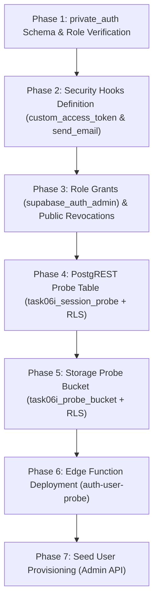

# Task 06I-B1-H2 — Disposable TEMP Testbed Readiness & Controlled Execution Plan

**Task ID:** `06I-B1-H2` (Revision R1)
**Creation Date:** 2026-11-24
**Revision Date:** 2026-11-24 (R1 Closure)
**Author:** Santosh Jangid (`im-tnyx`)
**Reviewer:** `im-tio` (Independent Reviewer)
**Branch:** `docs/task06i-b1-h2-temp-hosted-readiness`
**Base:** `main` at `2d1fe9eebfd0dc18fe213da1c2aff19df29c69c0`
**PR Reference:** [PR #43](https://github.com/im-tnyx/Tio-Workspace/pull/43)
**Cost Ceiling:** $0.00 (Free-Tier Only)  
**Mode:** Local Documentation & Offline Readiness Specification ONLY  
**Hosted LIVE Dispatch:** **NOT AUTHORIZED**  
**Production Real Auth:** **STRICT NO-GO**  
**Decision:** **`BLOCKED_PENDING_ADDITIONAL_PREPARATION`**

---

## 1. Executive Summary & Boundaries

Task **06I-B1-H2** establishes the formal readiness specification, testbed configuration manifest, SQL/fixture deployment plan, transactional email dependency resolution, canonical 18-case matrix reconciliation, and controlled execution runbook for the disposable TEMP Supabase testbed (`wvdabiwbaavfggcmpizd`).

Following the successful completion and squash merge of Task 06I-B1-H1 via PR #37 (commit `cd4ce0ac16953af23b5feb30dc48a102ae6d8f48`), all security test runner hardening, universal token tracking, verified session revocation provenance, and seed identity pre-existence proofs are fully integrated into `main`.

### Strict Project Boundaries
1. **REAL Production Project (`bsfwzvgynwriswapxpsp`):**
   - Organization: `llmbrmxhyirtoqndazpg`
   - Status: Active / Healthy
   - **IMMUTABLE POLICY:** Permanently protected, read-only, and strictly forbidden from test targeting.
2. **TEMP Testbed Target (`wvdabiwbaavfggcmpizd`):**
   - Project Name: `Tio-Tnyx-Auth-Temp` (`ap-south-1`)
   - Organization: `llmbrmxhyirtoqndazpg`
   - Purpose: Dedicated disposable testbed for Auth hook and session behavior verification.
   - Status during H2: **PRESERVED UNTOUCHED**. Zero Management API PATCH calls, zero SQL deployments, zero user provisioning, zero test emails.
3. **Tio-world (`oykupyiitspujzpwwvuj`):**
   - **IMMUTABLE POLICY:** Permanently immune and forbidden via hardcoded immutable guards.

### Cost & Execution Safeguards
- **Cost Ceiling:** Strictly $0.00. No paid addons, compute upgrades, custom domains, or third-party paid subscriptions.
- **Hosted LIVE Dispatch:** Strictly **NOT AUTHORIZED**. Runner defaults unconditionally to `DRY_RUN`.
- **Production Real Auth:** Strictly **NO-GO**.

---

## 2. Task 06I-B1-H1 Closure & Continuity Verification

| Milestone / Metric | Value | Verification Evidence |
|---|---|---|
| **PR #37 Status** | **MERGED** | Squash merge at `cd4ce0ac16953af23b5feb30dc48a102ae6d8f48` |
| **Approved HEAD** | `131589d57b02598ae0e3f07e2e83ad53c70a37da` | Approved by independent reviewer `im-tio` |
| **Review Threads** | **62/62 RESOLVED** | 0 unresolved threads at merge gate |
| **Task 06I Unit Tests** | **161/161 PASS** | `node --test experiments/task06i/*.test.mjs` |
| **PostgreSQL Contract Parity** | **POSTGRES_VERIFIED** (18/18) | `node experiments/task06i/sql-contract-parity.mjs` |
| **Task 06H Local Suite** | **115/115 PASS** | `node --test experiments/task06h/*.test.mjs` |
| **Repository Verification** | **PASS** | `npm run verify` (tokens guard, tsc, eslint, 22 shell tests) |
| **Hosted Verification Executed** | **0/18** | Zero live probes executed during H1 |
| **Remote `main` Baseline** | `2d1fe9eebfd0dc18fe213da1c2aff19df29c69c0` | Includes Expo preview workflow alignment (#42) |
| **Branch Cleanup** | **COMPLETED** | Local and remote `test/task06i-b1-h1-hosted-security-preflight` deleted |

H1 is formally closed as completed offline preparation.

---

## 3. H2-01 — TEMP Testbed Configuration Specification

The disposable testbed (`wvdabiwbaavfggcmpizd`) requires specific Supabase Auth configuration adjustments to disable native bypass paths, enforce short-lived JWTs, and register custom security hooks.

> [!IMPORTANT]
> **No Management API PATCH requests have been sent during Task 06I-B1-H2.**  
> The specification below documents the exact target payload, rationale, expected provider behavior, verification procedure, and snapshot-based rollback contract for future authorized execution.

### Supabase Management API Target Endpoint
- **Method:** `PATCH`
- **URL:** `https://api.supabase.com/v1/projects/wvdabiwbaavfggcmpizd/config/auth`
- **Authentication:** `Authorization: Bearer <supabase_management_api_token>`

### Configuration Manifest

| Configuration Field | Target Value | Current / Documented Default | Security Requirement | Reason for Change | Expected Provider Behavior | Verification Method | Rollback Procedure | Authorization Gate |
|---|---|---|---|---|---|---|---|---|
| `external_email_magic_link_disabled` | `true` | `false` | **BYPASS-01**, **BYPASS-04** | Prevent passwordless login and unverified magic link issuance | `POST /auth/v1/otp` with email returns `422 Unprocessable Entity` (`email_provider_disabled`) | HTTP probe to `POST /auth/v1/otp` yields 422 | Re-apply captured pre-change snapshot value (from `GET /config/auth` snapshot captured prior to modification; do not assume default value) | Owner written approval |
| `disable_signup` | `true` | `false` | **BYPASS-02** | Prevent direct public client registration outside controlled admin flow | `POST /auth/v1/signup` returns `422 Unprocessable Entity` (`signup_disabled`) | HTTP probe to `POST /auth/v1/signup` yields 422 | Re-apply captured pre-change snapshot value | Owner written approval |
| `jwt_exp` | `300` | `3600` | **SESSION-04**, **SESSION-05** | Bounded stateless linger window for PostgREST & Storage upon token revocation | JWT `exp - iat` equals exactly 300 seconds | Decode JWT payload from `POST /auth/v1/token?grant_type=password` and assert `exp - iat === 300` | Re-apply captured pre-change snapshot value | Owner written approval |
| `hook_custom_access_token_enabled` | `true` | `false` | **HOOK-01** to **HOOK-07** | Intercept token issuance and refresh to enforce strict password-only AMR allowlist | GoTrue executes PL/pgSQL function on sign-in and refresh; non-password AMR aborted with 500/42501 | Password sign-in returns JWT with enriched `amr_authenticated: "true"`; OTP returns 500 | Re-apply captured pre-change snapshot value | Owner written approval |
| `hook_custom_access_token_uri` | `"pg-functions://postgres/private_auth/custom_access_token_hook"` | `null` | **HOOK-01** to **HOOK-07** | Target SQL function for custom claims enrichment | GoTrue invokes specified PostgreSQL function with event payload | Assert hook invocation via test token issuance | Re-apply captured pre-change snapshot value | Owner written approval |
| `hook_send_email_enabled` | `true` | `false` | **BYPASS-05** | Intercept outbound native Auth emails and suppress unauthorized recovery/signup | Native email dispatches intercepted; recovery aborted fail-closed | `POST /auth/v1/recover` returns 500 or anti-enumeration without email delivery | Re-apply captured pre-change snapshot value | Owner written approval |
| `hook_send_email_uri` | `"pg-functions://postgres/private_auth/send_email_hook"` | `null` | **BYPASS-05** | Target SQL function for email interception | GoTrue invokes specified PostgreSQL function before dispatching email | Assert email suppression via hook execution logs | Re-apply captured pre-change snapshot value | Owner written approval |
| `external_phone_enabled` | `false` | `false` | **BYPASS-01** | Prevent SMS/phone OTP bypass | Phone endpoints disabled | HTTP probe returns 422 | Re-apply captured pre-change snapshot value | Owner written approval |
| `external_anonymous_users_enabled` | `false` | `false` | **BYPASS-04** | Prevent anonymous session minting | Anonymous auth disabled | `POST /auth/v1/signup` without credentials rejected | Re-apply captured pre-change snapshot value | Owner written approval |
| `mailer_autoconfirm` | `false` | `false` | **BYPASS-02** | Require explicit confirmation; prevent unverified email assumption | Email confirmation required unless seeded via Admin API | Admin API explicitly specifies `email_confirm: true` for seed user | Re-apply captured pre-change snapshot value | Owner written approval |
| `rate_limit_email_sent` | `30` | `30` | **Resource Budget** | Prevent outbound email burst on testbed | Provider rejects bursts exceeding 30/hour | Monitored via Brevo and GoTrue rate limit metrics | Re-apply captured pre-change snapshot value | Owner written approval |

> [!NOTE]
> **Rollback Contract:** Rollback must never rely on assumed defaults (e.g. `jwt_exp: 3600` or `false`). It must strictly restore the exact values recorded in the pre-change snapshot captured via `GET /v1/projects/wvdabiwbaavfggcmpizd/config/auth` immediately prior to any PATCH execution.

---

## 4. H2-02 — SQL & Fixture Deployment Plan

All database fixtures and security hooks are defined in `experiments/task06i/sql/testbed-fixtures.sql`. Deployment to the hosted TEMP testbed must follow a strict, dependency-ordered sequence.

> [!IMPORTANT]
> **Zero SQL has been deployed to the TEMP testbed during Task 06I-B1-H2.**  
> The plan below specifies the installation order, role permissions, RLS boundaries, and rollback commands for future authorized execution.

### Dependency-Ordered Deployment Phases



### Detailed Deployment Specifications

#### Phase 1: Private Schema & Roles
- **Artifact:** `CREATE SCHEMA IF NOT EXISTS private_auth;`
- **Scope:** Isolated private schema invisible to PostgREST/anon.
- **Roles:** Verify presence of `supabase_auth_admin`, `anon`, `authenticated`.
- **Security Impact:** Prevents public API exposure of security hook functions.

#### Phase 2: Security Hook Functions
1. **`private_auth.custom_access_token_hook(event jsonb)`:**
   - **Contract:** Language `plpgsql`, `SECURITY DEFINER`, `SET search_path = ''`.
   - **Logic:** Evaluates `authentication_method` and RFC 8176 `amr` array. Strictly permits only method `'password'`. Injects server-owned claim `claims.amr_authenticated = 'true'`. Fails closed with `SQLSTATE 42501` on non-password or mixed AMR.
2. **`private_auth.send_email_hook(event jsonb)`:**
   - **Contract:** Language `plpgsql`, `SECURITY DEFINER`, `SET search_path = ''`.
   - **Logic:** Enforces unpadded action type validation. Intercepts `recovery`, `signup`, `magiclink`, `invite`, `email_change`, `reauthentication` and fails closed with `SQLSTATE 42501`. Permitted action `'custom_notification'` returns `{}`.

#### Phase 3: Least-Privilege Grants & Revocations
- **Grants:** `GRANT USAGE ON SCHEMA private_auth TO supabase_auth_admin;`  
  `GRANT EXECUTE ON ALL FUNCTIONS IN SCHEMA private_auth TO supabase_auth_admin;`
- **Revocations:** `REVOKE ALL ON SCHEMA private_auth FROM public, anon, authenticated;`  
  `REVOKE ALL ON ALL FUNCTIONS IN SCHEMA private_auth FROM public, anon, authenticated;`
- **Security Impact:** Resolves `PRRT_kwDOVtCmZc66lOOX`. Client roles cannot inspect or execute hook functions directly.

#### Phase 4: PostgREST Probe Table (`SESSION-04`)
- **Table:** `public.task06i_session_probe` (`id uuid PRIMARY KEY`, `user_id uuid NOT NULL`, `run_id text`, `payload text`, `created_at timestamptz`).
- **RLS Policy:** `task06i_session_probe_user_policy` requiring `auth.uid() = user_id`.
- **Grants:** `SELECT, INSERT, UPDATE, DELETE` to `authenticated`; `ALL` to `service_role`.

#### Phase 5: Storage Bucket & Object Fixture (`SESSION-05`)
- **Bucket:** `storage.buckets` insert `('task06i_probe_bucket', 'task06i_probe_bucket', false)`.
- **RLS Policy:** `task06i_probe_storage_policy` on `storage.objects` requiring `bucket_id = 'task06i_probe_bucket' AND owner_id = (auth.uid())::text`.
- **Mandatory Storage API Provisioning Contract (R6-02):**
  Direct SQL `INSERT INTO storage.objects` is strictly prohibited because it does not upload underlying bytes. The test runner must authenticate as the seed user via password grant and upload bytes to `POST /storage/v1/object/task06i_probe_bucket/probe.txt` to establish a genuine 200 OK baseline prior to revocation testing.

#### Phase 6: Edge Function Deployment (`SESSION-06`)
- **Function Name:** `auth-user-probe`
- **Path:** `supabase/functions/auth-user-probe/index.ts`
- **Implementation Contract:** Invokes `supabase.auth.getUser()`. Preserves actual provider error codes (`session_not_found` -> `AuthSessionMissingError`). Does not synthesize false revocation errors on generic 401/invalid token errors (resolves R5-08).
- **Deployment Command:** `supabase functions deploy auth-user-probe --project-ref wvdabiwbaavfggcmpizd`

#### Phase 7: Seed Identity Provisioning
- **Endpoint:** `POST /auth/v1/admin/users` (Admin API via `service_role_key`).
- **Payload:** `{"email": "tio-test-user-06i@proof.invalid", "password": "...", "email_confirm": true, "user_metadata": {"test_run_id": "<runId>"}}`.
- **Tracking:** Recorded into `TestRunInventory.verifiedSeedUsers` with affirmative pre-existence proof (`isValidPreExistenceProof`).

### Safe Resource Rollback Plan
Unconditional `DROP SCHEMA CASCADE`, full bucket deletion, or blind user deletion is strictly prohibited. The rollback procedure must be targeted, run-scoped, and dependency-verified:
1. **Probe Table Rows:** Execute `DELETE FROM public.task06i_session_probe WHERE run_id = '<current_run_id>';`. Table schema `public.task06i_session_probe` is preserved across probe runs unless decommissioning the testbed.
2. **Storage Objects:** Delete only the specific object uploaded for the run: Storage API `DELETE /storage/v1/object/task06i_probe_bucket/probe.txt`. Do not delete the bucket `task06i_probe_bucket` during probe teardown.
3. **Database Hooks:** If decommissioning, drop individual functions with explicit names (`DROP FUNCTION IF EXISTS private_auth.custom_access_token_hook(jsonb);`, `DROP FUNCTION IF EXISTS private_auth.send_email_hook(jsonb);`). Drop schema `private_auth` only after verifying zero remaining objects exist (`RESTRICT`, never `CASCADE`).
4. **Seed Identity:** If the seed identity was verified as pre-existing prior to the run, **never delete it**; restore its original seed password via Admin API. If the user was proven run-created, delete only via Admin API `DELETE /auth/v1/admin/users/:userId` after verifying `user_metadata.test_run_id === runId`.

---

## 5. H2-03 — Brevo & Transactional Email Decision

### Current Operational Evidence
CLI audit and test preflight established:
- **Provider:** Brevo (Sendinblue) Free Tier (300 emails/day ceiling).
- **Status:** `UNAUTHENTICATED_SENDER_DOMAIN_BLOCKED`.
- **Direct SMTP Relay:** Configured but delivery to public inbox providers is rejected due to missing SPF/DKIM authentication records for unverified sender domains.

### Strict Architectural Separation

```
[Native Supabase Auth Events] ──> [Send Email Hook (private_auth.send_email_hook)]
                                      │
                                      ├──> Intercepts recovery/signup/magiclink
                                      └──> FAILS CLOSED (SQLSTATE 42501)
                                           [Zero Outbound Email Dispatched]

[Approved Application OTP Architecture] ──> [Edge Function with Server Secret]
                                                │
                                                └──> Dedicated App Service / Future Provider
                                                     [Separately Gated & Audited]
```

1. **Native Email Suppression (Fail-Closed Gate):**
   - Supabase GoTrue must never be allowed to deliver native recovery or signup emails.
   - The `send_email_hook` intercepts all outbound events and aborts with `SQLSTATE 42501`.
   - Native email delivery remains **100% BLOCKED**.
   - *Note on Evidence:* Zero emails dispatched in H2 reflects local/offline state, not proof of hosted hook behavior. Hosted email suppression will only be verified during an authorized hosted run.
2. **Approved Application OTP Delivery (Future Architecture):**
   - Application-controlled signup and recovery OTP delivery must use a dedicated, server-side Edge Function that enforces rate limits, quarantine ledgers, and audit trails.
   - Native GoTrue SMTP configuration cannot and must not be used to bypass the strict application OTP lifecycle.

### Viable $0 Options Analysis

| Option | Description | Cost | Feasibility | Security Impact | Recommendation |
|---|---|---|---|---|---|
| **Option A: Authenticated Custom Domain** | Add DNS SPF/DKIM records to a verified domain on Brevo | $0 (if domain owned) / Paid (if new domain required) | Blocked without verified domain ownership | Enables transactional delivery; requires SPF/DKIM verification | Defer until domain acquisition is formally approved |
| **Option B: Synthetic Loopback / Local SMTP** | Use local Mailpit adapter for local integration suites | $0 | Fully implemented and verified (Task 06H, 115 tests pass) | Isolated to local loopback (127.0.0.1); zero external delivery | Standard for local testing; cannot verify hosted Brevo relay |
| **Option C: Defer Email-Dependent Hosted Cases** | Keep `BYPASS-05` and email delivery probes gated; assert fail-closed hook suppression | $0 | **IMMEDIATELY FEASIBLE** | Confirms native recovery is blocked fail-closed with `SQLSTATE 42501`; zero external email risk | **RECOMMENDED FOR H2** |

**Decision:** Maintain **Option C**. Zero test emails dispatched, zero domains purchased, zero DNS records modified.

---

## 6. H2-04 — Canonical Hosted Verification Matrix Reconciliation

The 18 preflight security requirements are audited below strictly reconciled against `HOSTED_PROBE_SPECIFICATIONS` in `experiments/task06i/hosted-probe-runner.mjs`.

Three separate evaluation dimensions must be distinguished:
1. **Offline Implementation Status:** Whether runner dispatcher logic and assertion evaluation are fully implemented and verified offline in unit test suites.
2. **Hosted Prerequisite Readiness:** What remote cloud infrastructure, configuration changes, or test fixtures are required on the hosted testbed before a probe can be dispatched.
3. **Actual Provider-Observed Verification:** Whether real HTTP network requests against Supabase Cloud have been executed and observed (currently 0/18).

### Canonical 18-Requirement Audit

| ID | Category | Layer | Target Endpoint | Documented Capability / Evidence Source | Required Hosted Prerequisites | Offline Implementation Status | Hosted Verification Status |
|---|---|---|---|---|---|---|---|
| **BYPASS-01** | Native Bypass | Layer B (Hosted) | `POST /auth/v1/otp` | `GOTRUE_HTTP_422_EMAIL_PROVIDER_DISABLED` | `MANAGEMENT_API_PATCH_EXTERNAL_EMAIL_MAGIC_LINK_DISABLED` | **`IMPLEMENTED_OFFLINE_TESTED`** | `HOSTED_NOT_TESTED` |
| **BYPASS-02** | Native Bypass | Layer B (Hosted) | `POST /auth/v1/signup` | `GOTRUE_HTTP_422_SIGNUP_DISABLED` | `MANAGEMENT_API_PATCH_DISABLE_SIGNUP` | **`IMPLEMENTED_OFFLINE_TESTED`** | `HOSTED_NOT_TESTED` |
| **BYPASS-03** | Native Bypass | Layer B (Hosted) | `POST /auth/v1/verify` | `CUSTOM_ACCESS_TOKEN_HOOK_SQLSTATE_42501` | `VALID_DELIVERED_OTP_CHALLENGE`, `HOOK_CUSTOM_ACCESS_TOKEN_ENABLED` | **`PROVIDER_PRECONDITION_MISSING`** | `HOSTED_NOT_TESTED` |
| **BYPASS-04** | Native Bypass | Layer B (Hosted) | Magic Link / Invite / Anon | `CUSTOM_ACCESS_TOKEN_HOOK_SQLSTATE_42501` | `VALID_MAGIC_LINK_TOKEN`, `HOOK_CUSTOM_ACCESS_TOKEN_ENABLED` | **`PROVIDER_PRECONDITION_MISSING`** | `HOSTED_NOT_TESTED` |
| **BYPASS-05** | Native Bypass | Layer B (Hosted) | `POST /auth/v1/recover` | `SEND_EMAIL_HOOK_SQLSTATE_42501` | `HOOK_SEND_EMAIL_ENABLED` | **`IMPLEMENTED_OFFLINE_TESTED`** | `HOSTED_NOT_TESTED` |
| **HOOK-01** | Token Hook | Layer B (Hosted) | `POST /auth/v1/token?grant_type=password` | `DECODED_JWT_AMR_AUTHENTICATED_CLAIM` | `SEEDED_PASSWORD_USER`, `HOOK_CUSTOM_ACCESS_TOKEN_ENABLED` | **`IMPLEMENTED_OFFLINE_TESTED`** | `HOSTED_NOT_TESTED` |
| **HOOK-02** | Token Hook | Layer B (Hosted) | `POST /auth/v1/token?grant_type=refresh_token` | `DECODED_REFRESHED_JWT_AMR_PRESERVATION` | `ACTIVE_REFRESH_TOKEN_FROM_HOOK_01`, `HOOK_CUSTOM_ACCESS_TOKEN_ENABLED` | **`IMPLEMENTED_OFFLINE_TESTED`** | `HOSTED_NOT_TESTED` |
| **HOOK-03** | Token Hook | Layer B (Hosted) | OTP-Origin Token Denial | `CUSTOM_ACCESS_TOKEN_HOOK_SQLSTATE_42501` | `VALID_DELIVERED_OTP_CHALLENGE`, `HOOK_CUSTOM_ACCESS_TOKEN_ENABLED` | **`PROVIDER_PRECONDITION_MISSING`** | `HOSTED_NOT_TESTED` |
| **HOOK-04** | Token Hook | Layer B (Hosted) | Recovery-Origin Token Denial | `CUSTOM_ACCESS_TOKEN_HOOK_SQLSTATE_42501` | `VALID_DELIVERED_RECOVERY_TOKEN`, `HOOK_CUSTOM_ACCESS_TOKEN_ENABLED` | **`PROVIDER_PRECONDITION_MISSING`** | `HOSTED_NOT_TESTED` |
| **HOOK-05** | Token Hook | Layer A (Offline SQL) | Mixed AMR Rejection | `PLPGSQL_FUNCTION_EXECUTION_42501` | `SQL_FUNCTION_PARITY_TEST` (Cannot mutate server AMR via HTTP client body) | **`BLOCKED_UNSUPPORTED`** | `HOSTED_NOT_TESTED` |
| **HOOK-06** | Token Hook | Layer A (Offline SQL) | Malformed/Missing AMR | `PLPGSQL_FUNCTION_EXECUTION_42501` | `SQL_FUNCTION_PARITY_TEST` (Cannot mutate server AMR via HTTP client body) | **`BLOCKED_UNSUPPORTED`** | `HOSTED_NOT_TESTED` |
| **HOOK-07** | Token Hook | Layer A (Offline SQL) | Exception Handling | `PLPGSQL_TRANSACTION_ABORT_500` | `SQL_FUNCTION_PARITY_TEST` (Cannot inject SQL runtime exception over HTTP) | **`BLOCKED_UNSUPPORTED`** | `HOSTED_NOT_TESTED` |
| **SESSION-01** | Session/Consumer | Layer B (Hosted) | `GET /auth/v1/user` | `REAL_SESSION_ID_CORRELATION` | `ACTIVE_SESSION_FROM_HOOK_01`, `TIO_TEMP_SERVICE_ROLE_KEY` | **`IMPLEMENTED_OFFLINE_TESTED`** | `HOSTED_NOT_TESTED` |
| **SESSION-02** | Session/Consumer | Layer B (Hosted) | `PUT /auth/v1/admin/users/:userId` | `ADMIN_API_PASSWORD_UPDATE_AND_SESSION_REVOCATION` | `ACTIVE_USER_ID_FROM_HOOK_01`, `TIO_TEMP_SERVICE_ROLE_KEY` | **`IMPLEMENTED_OFFLINE_TESTED`** | `HOSTED_NOT_TESTED` |
| **SESSION-03** | Session/Consumer | Layer B (Hosted) | `GET /auth/v1/user (post-reset)` | `GOTRUE_HTTP_403_SESSION_NOT_FOUND` | `PRE_RESET_TOKEN`, `ADMIN_PASSWORD_RESET_COMPLETED` | **`IMPLEMENTED_OFFLINE_TESTED`** | `HOSTED_NOT_TESTED` |
| **SESSION-04** | Session/Consumer | Layer B (Hosted) | `GET /rest/v1/task06i_session_probe` | `POSTGREST_STATELESS_HTTP_200_BEFORE_EXP` | `PRE_RESET_TOKEN_BEFORE_EXPIRY`, `TABLE_FIXTURE_TASK06I_SESSION_PROBE` | **`IMPLEMENTED_OFFLINE_TESTED`** | `HOSTED_NOT_TESTED` |
| **SESSION-05** | Session/Consumer | Layer B (Hosted) | `GET /storage/v1/object/.../probe.txt` | `STORAGE_STATELESS_HTTP_200_BEFORE_EXP` | `PRE_RESET_TOKEN_BEFORE_EXPIRY`, `STORAGE_OBJECT_FIXTURE_PROVISIONED` | **`IMPLEMENTED_OFFLINE_TESTED`** | `HOSTED_NOT_TESTED` |
| **SESSION-06** | Session/Consumer | Layer B (Hosted) | `POST /functions/v1/auth-user-probe` | `EDGE_FUNCTION_AUTH_SESSION_MISSING_ERROR` | `EDGE_FUNCTION_AUTH_USER_PROBE_DEPLOYED`, `PRE_RESET_TOKEN` | **`PROVIDER_PRECONDITION_MISSING`** | `HOSTED_NOT_TESTED` |

### Matrix Summary Counts
- **Total Security Requirements:** 18
- **`IMPLEMENTED_OFFLINE_TESTED`:** **10** (`BYPASS-01`, `BYPASS-02`, `BYPASS-05`, `HOOK-01`, `HOOK-02`, `SESSION-01`, `SESSION-02`, `SESSION-03`, `SESSION-04`, `SESSION-05`)
- **`PROVIDER_PRECONDITION_MISSING`:** **5** (`BYPASS-03`, `BYPASS-04`, `HOOK-03`, `HOOK-04`, `SESSION-06`)
- **`BLOCKED_UNSUPPORTED`:** **3** (`HOOK-05`, `HOOK-06`, `HOOK-07`)
- **`HOSTED_VERIFIED`:** **0** (All 18 are `HOSTED_NOT_TESTED`)

### Execution Scope & Runner Capability Audit (R1-01)
1. **Specific Proposed Executable Probe IDs:**
   The only probes whose dispatcher logic is fully implemented and could be executed once testbed preconditions are satisfied are the 10 `IMPLEMENTED_OFFLINE_TESTED` cases:
   `BYPASS-01`, `BYPASS-02`, `BYPASS-05`, `HOOK-01`, `HOOK-02`, `SESSION-01`, `SESSION-02`, `SESSION-03`, `SESSION-04`, `SESSION-05`.
2. **Runner Subset Execution Capability:** **NOT IMPLEMENTED** (`BLOCKED_PENDING_SUBSET_RUNNER`).
   - In `experiments/task06i/hosted-probe-runner.mjs`, `planProbeExecution` unconditionally maps over all 18 items in `PREFLIGHT_REQUIREMENTS`, and `runHostedProbeRunner` unconditionally iterates through all items in `plan.plannedCases`.
   - The runner currently has **no mechanism** to filter or execute a subset of probes.
   - If executed in LIVE mode today, the runner would attempt to dispatch all 18 cases and abort on the first missing prerequisite (e.g. `BYPASS-03`).
   - **Requirement:** A dedicated code change to support probe filtering (e.g. `options.selectedProbeIds`) must be implemented, locally tested, and reviewed before any subset live execution can ever be authorized.

---

## 7. H2-05 — Controlled Execution & Crash-Recovery Runbook

### Controlled Execution Sequence (Strict Chronological Order)
1. **Owner Authorization & Project Verification:** Confirm written owner authorization token for the specific run ID. Assert `projectRef === 'wvdabiwbaavfggcmpizd'` and assert project is in organization `llmbrmxhyirtoqndazpg`. Deny-by-default on any mismatch.
2. **Recovery Capability Verification:** Confirm durable journaling and recovery mechanisms are active and verified (`BLOCKED_PENDING_DURABLE_RECOVERY`).
3. **Pre-Change Configuration Snapshot:** Execute `GET /v1/projects/wvdabiwbaavfggcmpizd/config/auth` via Management API. Record raw pre-change JSON snapshot into persistent store.
4. **Deploy Database Fixtures:** Apply Phase 1–5 SQL (`private_auth` schema, hook functions, least-privilege role grants, probe table, probe bucket) from `experiments/task06i/sql/testbed-fixtures.sql`. Verify zero errors.
5. **Apply Management API PATCH:** Apply the approved Auth configuration manifest (disabling public signup, disabling magic links, setting JWT exp to 300s, enabling hooks).
6. **Verify Hook Registration:** Verify Management API GET confirms `hook_custom_access_token_enabled: true` and `hook_send_email_enabled: true`.
7. **Provision Seed Identity:** Call Admin API `POST /auth/v1/admin/users` to create dedicated test seed identity. Record seed user ID in inventory with verified pre-existence proof.
8. **Provision Storage Fixture Object:** Using seed user JWT, upload actual bytes to `task06i_probe_bucket/probe.txt` via Storage API and establish HTTP 200 GET baseline.
9. **Execute Authorized Probes:** Execute only authorized probes sequentially with mandatory 100ms throttling (requires subset runner capability).
10. **Immediate Halt on Critical Failure:** If `HOOK-01`, `HOOK-07`, or `SESSION-03` fail, halt immediately and abort remaining probes.
11. **Execute Deterministic Cleanup:**
    - Delete created Storage probe object (`DELETE /storage/v1/object/...`).
    - Revoke all tracked sessions via GoTrue `signOut`.
    - Restore original seed user password via Admin API.
    - Delete test-created probe table rows (`WHERE run_id = '<runId>'`).
    - Assert `untrackedSessionObligations === 0` and `unverifiedUsers === 0`.
12. **Restore Testbed Configuration:** Revert Auth configuration to the exact pre-test snapshot JSON captured in Step 3 via Management API PATCH.
13. **Emit Final Audit Report:** Sanitize all tokens and secrets; generate structured test report with verified evidence.

### Explicit Hard STOP Conditions
The runner will immediately abort execution and trigger cleanup if any of the following occur:
- Target ref does not match `wvdabiwbaavfggcmpizd`.
- Any reference to `bsfwzvgynwriswapxpsp` (REAL) or `oykupyiitspujzpwwvuj` (Tio-world) is detected.
- Management API returns non-200 on pre-flight snapshot.
- Seed identity credentials fail verification.
- An unexpected user identity is observed without affirmative pre-existence proof.
- Outbound transactional email is observed leaving Brevo.
- Post-invalidation session lingering exceeds 300 seconds.
- Session cleanup (`signOut`) fails or returns unhandled error.
- Any network request times out or returns unexpected 5xx gateway errors.

---

### Crash-Recovery & Durable Journal Specification (R1-02)

#### Current Implementation Limitation
- **Automatic Crash Recovery:** **NOT IMPLEMENTED** (`BLOCKED_PENDING_DURABLE_RECOVERY`).
- In `experiments/task06i/hosted-probe-runner.mjs`, `TestRunInventory` retains tracked sessions, access tokens, in-flight operations, and seed credentials purely in volatile JavaScript memory (`Set` and `Map`).
- If the Node.js process crashes, terminates, or loses power, all in-memory references are destroyed.
- Because GoTrue client session invalidation (`signOut`) requires the bearer access token (per R6-01 contract), a crashed process loses the tokens required to invalidate active sessions via the client SDK.

#### Durable Recovery Design Architecture (Future Implementation Prerequisite)
To make recovery deterministic across process restarts, a durable journal specification is required:
1. **Run Journal Binding:** A local write-ahead log file keyed by `runId` and bound strictly to `wvdabiwbaavfggcmpizd`.
2. **Pre-Change Snapshot Storage:** Exact pre-change configuration JSON from `GET /config/auth` saved before any PATCH dispatch.
3. **Verified Seed Identity Journaling:** Seed user ID, email, and pre-test state written to journal before probe execution.
4. **Write-Ahead Resource Ownership:** Before or immediately upon receiving user IDs, session IDs, or storage object paths, they must be committed to the journal.
5. **Mutation Obligation Tracking:** Register password mutation obligation to journal *before* calling `PUT /admin/users/:id`.
6. **Durable State Machine:** Operations transition across explicit states: `PENDING` → `IN_FLIGHT` → `SETTLED` → `REVOCATION_REQUIRED` → `RESTORE_REQUIRED` → `CLEANED`.
7. **Rehydration Engine:** On process startup, a recovery coordinator inspects for unfinalized journals, binds to the testbed, and drives rollback.
8. **Safe Replay & Idempotency:** Cleanup operations must handle already-deleted resources gracefully without throwing errors.
9. **Verified Cleanup Evidence:** Journal is only marked `CLEANED` after affirmative verification queries confirm resource absence.

#### Secret-Handling Safeguards
- **Prohibition of Plaintext Credentials:** Plaintext passwords, service role keys, or JWT access tokens must **never** be written to unencrypted files on disk.
- **Encrypted Local Custody:** If access tokens or seed passwords must survive process crashes, they must be encrypted using operating system credential protection (e.g. Windows DPAPI, macOS Keychain, Linux SecretService, or AES-256-GCM with an ephemeral OS-protected key).
- **Strictly Prohibited Locations:** Secrets must never appear in Git-tracked files, unencrypted JSON, PR comments, CI artifacts, terminal logs, or shared cloud storage.

#### Concrete Manual Recovery Alternative
If a test run crashes before durable journaling is implemented, an operator must execute this concrete manual recovery procedure:
1. **Identify Run-Created Users:** Call Admin API `GET /auth/v1/admin/users` using `service_role_key`. Filter for `user_metadata.test_run_id === '<runId>'`.
2. **Delete Run-Created Users:** Call Admin API `DELETE /auth/v1/admin/users/:userId` for each confirmed run-created user.
3. **Restore Seed User Password & Revoke Sessions:** Call Admin API `PUT /auth/v1/admin/users/:seedUserId` with the original seed password (retrieved from secure operator custody). GoTrue natively invalidates all active sessions in `auth.sessions` upon administrative password update!
4. **Delete Storage Objects:** Call Storage API `DELETE /storage/v1/object/task06i_probe_bucket/probe.txt` using `service_role_key`.
5. **Delete Probe Table Rows:** Execute SQL `DELETE FROM public.task06i_session_probe WHERE run_id = '<runId>';`.
6. **Revert Auth Configuration:** Re-apply the raw JSON pre-change snapshot captured in Step 3 via Management API `PATCH /v1/projects/wvdabiwbaavfggcmpizd/config/auth`.
7. **Verify Absence:** Assert `GET /admin/users` returns 0 run-created users, Storage `probe.txt` returns 404, probe table has 0 rows for `run_id`, and Auth config matches pre-change snapshot.
8. **Verdict:** If any manual recovery step cannot be verified affirmatively, record status: **`INTERRUPTED_RECOVERY_BLOCKED`**. Never report `INTERRUPTED_RECOVERY_COMPLETED` without affirmative evidence.

---

## 8. H2-06 — Local Verification Evidence

The entire test suite was executed locally on branch `docs/task06i-b1-h2-temp-hosted-readiness`:

```powershell
# 1. Task 06I Hosted Probe Runner and Security Suites
node --test experiments/task06i/*.test.mjs
# Result: 161 passed, 0 failed, 0 skipped (duration: ~12.9s)

# 2. PostgreSQL Contract Parity Check
node experiments/task06i/sql-contract-parity.mjs
# Result: Status POSTGRES_VERIFIED (18/18 cases matched on PostgreSQL 17.11)

# 3. Task 06H Isolated Auth Integration Suites
node --test experiments/task06h/*.test.mjs
# Result: 115 passed, 0 failed, 0 skipped (duration: ~116ms)

# 4. Repository Verification Suite
npm run verify
# Result: tokens guard pass, tsc --noEmit pass, eslint max-warnings=0 pass, tests 22 pass

# 5. Git Whitespace and Integrity Check
git diff --check
# Result: Completely clean (0 errors)
```

The approved H1 security test runner (`experiments/task06i/hosted-probe-runner.mjs`) remains completely untouched, ensuring zero regression in existing security contracts.

---

## 9. Immutable Safety Gates & Invariants

| Invariant | Status | Enforcement Mechanism |
|---|---|---|
| **Hosted LIVE Probe Execution** | **NOT AUTHORIZED** | Runner defaults unconditionally to `DRY_RUN`; fails closed without dual-flag authorization |
| **Supabase Cloud PATCH** | **NOT EXECUTED** | Zero Management API calls dispatched during H2 |
| **Hosted SQL Deployment** | **NOT EXECUTED** | Zero SQL migrations or fixtures applied to remote database |
| **Hosted User Provisioning** | **NOT EXECUTED** | Zero test users created in Supabase Auth |
| **Transactional Email Dispatch** | **NOT EXECUTED** | Zero test emails sent; native email suppression verified offline |
| **Production Real Auth** | **STRICT NO-GO** | Pinned GoTrue security failures remain; production Auth gates locked |
| **Cost Ceiling ($0)** | **HONORED** | Zero paid services, zero domain purchases, Free-tier testbed preserved |
| **Project Boundary Protection** | **HONORED** | REAL (`bsfwzvgynwriswapxpsp`) and Tio-world (`oykupyiitspujzpwwvuj`) permanently immune |

---

## 10. Required Owner Authorization Checklist

Before any future Phase 1.2 hosted test execution can occur, the repository owner must explicitly review and approve each of the following decisions:

- [ ] **Approval 1:** Authorization to apply the 11-field Auth configuration manifest to TEMP testbed `wvdabiwbaavfggcmpizd` via Supabase Management API.
- [ ] **Approval 2:** Authorization to deploy `experiments/task06i/sql/testbed-fixtures.sql` to TEMP testbed database.
- [ ] **Approval 3:** Confirmation of Brevo transactional email strategy (Maintain Option C: native suppression fail-closed, defer external delivery).
- [ ] **Approval 4:** Authorization to provision a single temporary test seed identity (`tio-test-user-06i@proof.invalid`) on TEMP testbed.
- [ ] **Approval 5:** Approval of the exact 10 feasible probe IDs proposed for execution (`BYPASS-01`, `BYPASS-02`, `BYPASS-05`, `HOOK-01`, `HOOK-02`, `SESSION-01`, `SESSION-02`, `SESSION-03`, `SESSION-04`, `SESSION-05`).
- [ ] **Approval 6:** Formal acknowledgment that runner subset execution capability is currently **NOT IMPLEMENTED** (`BLOCKED_PENDING_SUBSET_RUNNER`) and must be implemented before partial live dispatch.
- [ ] **Approval 7:** Formal acknowledgment that automatic durable crash recovery is currently **NOT IMPLEMENTED** (`BLOCKED_PENDING_DURABLE_RECOVERY`) and requires either durable journal implementation or operator manual recovery authorization.
- [ ] **Approval 8:** Formal acceptance that `BYPASS-03`, `BYPASS-04`, `HOOK-03`, `HOOK-04`, `SESSION-06` remain `PROVIDER_PRECONDITION_MISSING`, and `HOOK-05`, `HOOK-06`, `HOOK-07` remain `BLOCKED_UNSUPPORTED` at Layer B.

---

## 11. Final Decision & Status

- **H1 Status:** **COMPLETE & MERGED** (PR #37, commit `cd4ce0ac16953af23b5feb30dc48a102ae6d8f48`)
- **H2 Planning Status:** **READY FOR INDEPENDENT REVIEW** (Revision R1)
- **Runner Subset Execution:** **NOT IMPLEMENTED** (`BLOCKED_PENDING_SUBSET_RUNNER`)
- **Durable Crash Recovery:** **NOT IMPLEMENTED** (`BLOCKED_PENDING_DURABLE_RECOVERY`)
- **Hosted Verification:** **0/18**
- **Hosted LIVE Dispatch:** **NOT AUTHORIZED**
- **Production Real Auth:** **STRICT NO-GO**
- **Hosted Mutations:** **0**
- **Cost:** **$0.00**

**Decision:** **`BLOCKED_PENDING_ADDITIONAL_PREPARATION`** (Awaiting Owner Review & Authorization)
