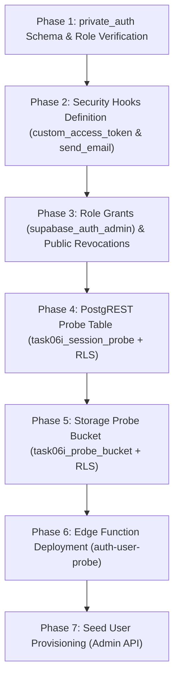

# Task 06I-B1-H2 — Disposable TEMP Testbed Readiness & Controlled Execution Plan

**Task ID:** `06I-B1-H2`  
**Creation Date:** 2026-11-24  
**Author:** Santosh Jangid (`im-tnyx`)  
**Reviewer:** `im-tio` (Independent Reviewer)  
**Branch:** `docs/task06i-b1-h2-temp-hosted-readiness`  
**Base:** `main` at `2d1fe9eebfd0dc18fe213da1c2aff19df29c69c0`  
**PR Reference:** Target PR following local readiness specification  
**Cost Ceiling:** $0.00 (Free-Tier Only)  
**Mode:** Local Documentation & Offline Readiness Specification ONLY  
**Hosted LIVE Dispatch:** **NOT AUTHORIZED**  
**Production Real Auth:** **STRICT NO-GO**  
**Decision:** **`BLOCKED_PENDING_ADDITIONAL_PREPARATION`**

---

## 1. Executive Summary & Boundaries

Task **06I-B1-H2** establishes the formal readiness specification, testbed configuration manifest, SQL/fixture deployment plan, transactional email dependency resolution, 18-case matrix reconciliation, and controlled execution runbook for the disposable TEMP Supabase testbed (`wvdabiwbaavfggcmpizd`).

Following the successful completion and squash merge of Task 06I-B1-H1 via PR #37 (commit `cd4ce0ac16953af23b5feb30dc48a102ae6d8f48`), all security test runner hardening, universal token tracking, verified session revocation provenance, and seed identity pre-existence proofs are fully integrated into `main`.

### Strict Project Boundaries
1. **REAL Production Project (`bsfwzvgynwriswapxpsp`):**
   - Organization: `llmbrmxhyirtoqndazpg`
   - Status: Active / Healthy
   - **IMMUTABLE POLICY:** Permanently protected, read-only, and strictly forbidden from test targeting.
2. **TEMP Testbed Target (`wvdabiwbaavfggcmpizd`):**
   - Project Name: `Tio-Tnyx-Auth-Temp` (`ap-south-1`)
   - Organization: `llmbrmxhyirtoqndazpg`
   - Purpose: Dedicated disposable testbed for Auth hook and session behavior verification.
   - Status during H2: **PRESERVED UNTOUCHED**. Zero Management API PATCH calls, zero SQL deployments, zero user provisioning, zero test emails.
3. **Tio-world (`oykupyiitspujzpwwvuj`):**
   - **IMMUTABLE POLICY:** Permanently immune and forbidden via hardcoded immutable guards.

### Cost & Execution Safeguards
- **Cost Ceiling:** Strictly $0.00. No paid addons, compute upgrades, custom domains, or third-party paid subscriptions.
- **Hosted LIVE Dispatch:** Strictly **NOT AUTHORIZED**. Runner defaults unconditionally to `DRY_RUN`.
- **Production Real Auth:** Strictly **NO-GO**.

---

## 2. Task 06I-B1-H1 Closure & Continuity Verification

| Milestone / Metric | Value | Verification Evidence |
|---|---|---|
| **PR #37 Status** | **MERGED** | Squash merge at `cd4ce0ac16953af23b5feb30dc48a102ae6d8f48` |
| **Approved HEAD** | `131589d57b02598ae0e3f07e2e83ad53c70a37da` | Approved by independent reviewer `im-tio` |
| **Review Threads** | **62/62 RESOLVED** | 0 unresolved threads at merge gate |
| **Task 06I Unit Tests** | **161/161 PASS** | `node --test experiments/task06i/*.test.mjs` |
| **PostgreSQL Contract Parity** | **POSTGRES_VERIFIED** (18/18) | `node experiments/task06i/sql-contract-parity.mjs` |
| **Task 06H Local Suite** | **115/115 PASS** | `node --test experiments/task06h/*.test.mjs` |
| **Repository Verification** | **PASS** | `npm run verify` (tokens guard, tsc, eslint, 22 shell tests) |
| **Hosted Verification Executed** | **0/18** | Zero live probes executed during H1 |
| **Remote `main` Baseline** | `2d1fe9eebfd0dc18fe213da1c2aff19df29c69c0` | Includes Expo preview workflow alignment (#42) |
| **Branch Cleanup** | **COMPLETED** | Local and remote `test/task06i-b1-h1-hosted-security-preflight` deleted |

H1 is formally closed as completed offline preparation.

---

## 3. H2-01 — TEMP Testbed Configuration Specification

The disposable testbed (`wvdabiwbaavfggcmpizd`) requires specific Supabase Auth configuration adjustments to disable native bypass paths, enforce short-lived JWTs, and register custom security hooks.

> [!IMPORTANT]
> **No Management API PATCH requests have been sent during Task 06I-B1-H2.**  
> The specification below documents the exact target payload, rationale, expected provider behavior, verification procedure, and rollback contract for future authorized execution.

### Supabase Management API Target Endpoint
- **Method:** `PATCH`
- **URL:** `https://api.supabase.com/v1/projects/wvdabiwbaavfggcmpizd/config/auth`
- **Authentication:** `Authorization: Bearer <supabase_management_api_token>`

### Configuration Manifest

| Configuration Field | Target Value | Current / Default Value | Security Requirement | Reason for Change | Expected Provider Behavior | Verification Method | Rollback Procedure | Authorization Gate |
|---|---|---|---|---|---|---|---|---|
| `external_email_magic_link_disabled` | `true` | `false` | **BYPASS-01**, **BYPASS-04** | Prevent passwordless login and unverified magic link issuance | `POST /auth/v1/otp` with email returns `422 Unprocessable Entity` (`email_provider_disabled`) | HTTP probe to `POST /auth/v1/otp` yields 422 | PATCH `{"external_email_magic_link_disabled": false}` | Owner written approval |
| `disable_signup` | `true` | `false` | **BYPASS-02** | Prevent direct public client registration outside controlled admin flow | `POST /auth/v1/signup` returns `422 Unprocessable Entity` (`signup_disabled`) | HTTP probe to `POST /auth/v1/signup` yields 422 | PATCH `{"disable_signup": false}` | Owner written approval |
| `jwt_exp` | `300` | `3600` | **SESSION-04**, **SESSION-05** | Bounded stateless linger window for PostgREST & Storage upon token revocation | JWT `exp - iat` equals exactly 300 seconds | Decode JWT payload from `POST /auth/v1/token?grant_type=password` and assert `exp - iat === 300` | PATCH `{"jwt_exp": 3600}` | Owner written approval |
| `hook_custom_access_token_enabled` | `true` | `false` | **HOOK-01** to **HOOK-07** | Intercept token issuance and refresh to enforce strict password-only AMR allowlist | GoTrue executes PL/pgSQL function on sign-in and refresh; non-password AMR aborted with 500/42501 | Password sign-in returns JWT with enriched `amr_authenticated: "true"`; OTP returns 500 | PATCH `{"hook_custom_access_token_enabled": false}` | Owner written approval |
| `hook_custom_access_token_uri` | `"pg-functions://postgres/private_auth/custom_access_token_hook"` | `null` | **HOOK-01** to **HOOK-07** | Target SQL function for custom claims enrichment | GoTrue invokes specified PostgreSQL function with event payload | Assert hook invocation via test token issuance | PATCH `{"hook_custom_access_token_uri": null}` | Owner written approval |
| `hook_send_email_enabled` | `true` | `false` | **BYPASS-05** | Intercept outbound native Auth emails and suppress unauthorized recovery/signup | Native email dispatches intercepted; recovery aborted fail-closed | `POST /auth/v1/recover` returns 500 or anti-enumeration without email delivery | PATCH `{"hook_send_email_enabled": false}` | Owner written approval |
| `hook_send_email_uri` | `"pg-functions://postgres/private_auth/send_email_hook"` | `null` | **BYPASS-05** | Target SQL function for email interception | GoTrue invokes specified PostgreSQL function before dispatching email | Assert email suppression via hook execution logs | PATCH `{"hook_send_email_uri": null}` | Owner written approval |
| `external_phone_enabled` | `false` | `false` | **BYPASS-01** | Prevent SMS/phone OTP bypass | Phone endpoints disabled | HTTP probe returns 422 | PATCH `{"external_phone_enabled": false}` | Owner written approval |
| `external_anonymous_users_enabled` | `false` | `false` | **BYPASS-04** | Prevent anonymous session minting | Anonymous auth disabled | `POST /auth/v1/signup` without credentials rejected | PATCH `{"external_anonymous_users_enabled": false}` | Owner written approval |
| `mailer_autoconfirm` | `false` | `false` | **BYPASS-02** | Require explicit confirmation; prevent unverified email assumption | Email confirmation required unless seeded via Admin API | Admin API explicitly specifies `email_confirm: true` for seed user | PATCH `{"mailer_autoconfirm": false}` | Owner written approval |
| `rate_limit_email_sent` | `30` | `30` | **Resource Budget** | Prevent outbound email burst on testbed | Provider rejects bursts exceeding 30/hour | Monitored via Brevo and GoTrue rate limit metrics | Revert to default 30 | Owner written approval |

---

## 4. H2-02 — SQL & Fixture Deployment Plan

All database fixtures and security hooks are defined in `experiments/task06i/sql/testbed-fixtures.sql`. Deployment to the hosted TEMP testbed must follow a strict, dependency-ordered sequence.

> [!IMPORTANT]
> **Zero SQL has been deployed to the TEMP testbed during Task 06I-B1-H2.**  
> The plan below specifies the installation order, role permissions, RLS boundaries, and rollback commands for future authorized execution.

### Dependency-Ordered Deployment Phases



### Detailed Deployment Specifications

#### Phase 1: Private Schema & Roles
- **Artifact:** `CREATE SCHEMA IF NOT EXISTS private_auth;`
- **Scope:** Isolated private schema invisible to PostgREST/anon.
- **Roles:** Verify presence of `supabase_auth_admin`, `anon`, `authenticated`.
- **Security Impact:** Prevents public API exposure of security hook functions.

#### Phase 2: Security Hook Functions
1. **`private_auth.custom_access_token_hook(event jsonb)`:**
   - **Contract:** Language `plpgsql`, `SECURITY DEFINER`, `SET search_path = ''`.
   - **Logic:** Evaluates `authentication_method` and RFC 8176 `amr` array. Strictly permits only method `'password'`. Injects server-owned claim `claims.amr_authenticated = 'true'`. Fails closed with `SQLSTATE 42501` on non-password or mixed AMR.
2. **`private_auth.send_email_hook(event jsonb)`:**
   - **Contract:** Language `plpgsql`, `SECURITY DEFINER`, `SET search_path = ''`.
   - **Logic:** Enforces unpadded action type validation. Intercepts `recovery`, `signup`, `magiclink`, `invite`, `email_change`, `reauthentication` and fails closed with `SQLSTATE 42501`. Permitted action `'custom_notification'` returns `{}`.

#### Phase 3: Least-Privilege Grants & Revocations
- **Grants:** `GRANT USAGE ON SCHEMA private_auth TO supabase_auth_admin;`  
  `GRANT EXECUTE ON ALL FUNCTIONS IN SCHEMA private_auth TO supabase_auth_admin;`
- **Revocations:** `REVOKE ALL ON SCHEMA private_auth FROM public, anon, authenticated;`  
  `REVOKE ALL ON ALL FUNCTIONS IN SCHEMA private_auth FROM public, anon, authenticated;`
- **Security Impact:** Resolves `PRRT_kwDOVtCmZc66lOOX`. Client roles cannot inspect or execute hook functions directly.

#### Phase 4: PostgREST Probe Table (`SESSION-04`)
- **Table:** `public.task06i_session_probe` (`id uuid PRIMARY KEY`, `user_id uuid NOT NULL`, `run_id text`, `payload text`, `created_at timestamptz`).
- **RLS Policy:** `task06i_session_probe_user_policy` requiring `auth.uid() = user_id`.
- **Grants:** `SELECT, INSERT, UPDATE, DELETE` to `authenticated`; `ALL` to `service_role`.

#### Phase 5: Storage Bucket & Object Fixture (`SESSION-05`)
- **Bucket:** `storage.buckets` insert `('task06i_probe_bucket', 'task06i_probe_bucket', false)`.
- **RLS Policy:** `task06i_probe_storage_policy` on `storage.objects` requiring `bucket_id = 'task06i_probe_bucket' AND owner_id = (auth.uid())::text`.
- **Mandatory Storage API Provisioning Contract (R6-02):**
  Direct SQL `INSERT INTO storage.objects` is strictly prohibited because it does not upload underlying bytes. The test runner must authenticate as the seed user via password grant and upload bytes to `POST /storage/v1/object/task06i_probe_bucket/probe.txt` to establish a genuine 200 OK baseline prior to revocation testing.

#### Phase 6: Edge Function Deployment (`SESSION-06`)
- **Function Name:** `auth-user-probe`
- **Path:** `supabase/functions/auth-user-probe/index.ts`
- **Implementation Contract:** Invokes `supabase.auth.getUser()`. Preserves actual provider error codes (`session_not_found` -> `AuthSessionMissingError`). Does not synthesize false revocation errors on generic 401/invalid token errors (resolves R5-08).
- **Deployment Command:** `supabase functions deploy auth-user-probe --project-ref wvdabiwbaavfggcmpizd`

#### Phase 7: Seed Identity Provisioning
- **Endpoint:** `POST /auth/v1/admin/users` (Admin API via `service_role_key`).
- **Payload:** `{"email": "tio-test-user-06i@proof.invalid", "password": "...", "email_confirm": true, "user_metadata": {"test_run_id": "<runId>"}}`.
- **Tracking:** Recorded into `TestRunInventory.verifiedSeedUsers` with affirmative pre-existence proof (`isValidPreExistenceProof`).

### Rollback Plan
- SQL Tear-down script drops `public.task06i_session_probe`, deletes `storage.buckets` `task06i_probe_bucket`, drops `private_auth` schema cascade, deletes seed user via Admin API, and undeploys Edge Function `auth-user-probe`.

---

## 5. H2-03 — Brevo & Transactional Email Decision

### Current Operational Evidence
CLI audit and test preflight established:
- **Provider:** Brevo (Sendinblue) Free Tier (300 emails/day ceiling).
- **Status:** `UNAUTHENTICATED_SENDER_DOMAIN_BLOCKED`.
- **Direct SMTP Relay:** Configured but delivery to public inbox providers is rejected due to missing SPF/DKIM authentication records for unverified sender domains.

### Strict Architectural Separation

```
[Native Supabase Auth Events] ──> [Send Email Hook (private_auth.send_email_hook)]
                                      │
                                      ├──> Intercepts recovery/signup/magiclink
                                      └──> FAILS CLOSED (SQLSTATE 42501)
                                           [Zero Outbound Email Dispatched]

[Approved Application OTP Architecture] ──> [Edge Function with Server Secret]
                                                │
                                                └──> Dedicated App Service / Future Provider
                                                     [Separately Gated & Audited]
```

1. **Native Email Suppression (Fail-Closed Gate):**
   - Supabase GoTrue must never be allowed to deliver native recovery or signup emails.
   - The `send_email_hook` intercepts all outbound events and aborts with `SQLSTATE 42501`.
   - Native email delivery remains **100% BLOCKED**.
2. **Approved Application OTP Delivery (Future Architecture):**
   - Application-controlled signup and recovery OTP delivery must use a dedicated, server-side Edge Function that enforces rate limits, quarantine ledgers, and audit trails.
   - Native GoTrue SMTP configuration cannot and must not be used to bypass the strict application OTP lifecycle.

### Viable $0 Options Analysis

| Option | Description | Cost | Feasibility | Security Impact | Recommendation |
|---|---|---|---|---|---|
| **Option A: Authenticated Custom Domain** | Add DNS SPF/DKIM records to a verified domain on Brevo | $0 (if domain owned) / Paid (if new domain required) | Blocked without verified domain ownership | Enables transactional delivery; requires SPF/DKIM verification | Defer until domain acquisition is formally approved |
| **Option B: Synthetic Loopback / Local SMTP** | Use local Mailpit adapter for local integration suites | $0 | Fully implemented and verified (Task 06H, 115 tests pass) | Isolated to local loopback (127.0.0.1); zero external delivery | Standard for local testing; cannot verify hosted Brevo relay |
| **Option C: Defer Email-Dependent Hosted Cases** | Keep `BYPASS-05` and email delivery probes gated; assert fail-closed hook suppression | $0 | **IMMEDIATELY FEASIBLE** | Confirms native recovery is blocked fail-closed with `SQLSTATE 42501`; zero external email risk | **RECOMMENDED FOR H2** |

**Decision:** Maintain **Option C**. Zero test emails dispatched, zero domains purchased, zero DNS records modified.

---

## 6. H2-04 — Hosted Verification Matrix Reconciliation

The 18 preflight security requirements are audited below with honest status classifications:
- **10 `IMPLEMENTED_OFFLINE_TESTED`** (Fully covered by offline tests and PostgreSQL parity)
- **5 `PROVIDER_PRECONDITION_MISSING`** (Requires disposable testbed PATCH, SQL fixture, or seed credentials)
- **3 `BLOCKED_UNSUPPORTED`** (Requires Edge Function deployment or unsupported GoTrue session payload synthesis)
- **0 `HOSTED_VERIFIED`** (Zero hosted LIVE probes executed)

### Full 18-Requirement Audit

| ID | Category | Target Endpoint | Documented Capability | Expected Affirmative Evidence | False-Proof Conditions | Session & User Obligations | Current Feasibility | Execution Gate |
|---|---|---|---|---|---|---|---|---|
| **BYPASS-01** | Native Bypass | `POST /auth/v1/otp` | `external_email_magic_link_disabled = true` | HTTP 422 with `email_provider_disabled` | 400 Bad Request or unhandled network error | Negative probe; must NOT issue tokens or create users | `PROVIDER_PRECONDITION_MISSING` (Requires Auth PATCH) | Owner authorization |
| **BYPASS-02** | Native Bypass | `POST /auth/v1/signup` | `disable_signup = true` | HTTP 422 with `signup_disabled` | 400 Bad Request or network failure | Negative probe; must NOT mint session or create user | `PROVIDER_PRECONDITION_MISSING` (Requires Auth PATCH) | Owner authorization |
| **BYPASS-03** | Native Bypass | `POST /auth/v1/verify` | Custom Access Token Hook fails closed | HTTP 500 (`hook_error`); 0 tokens issued | Generic 401/403 without hook execution | Negative probe; session must NOT be tracked | `IMPLEMENTED_OFFLINE_TESTED` (Parity verified) | Owner authorization |
| **BYPASS-04** | Native Bypass | Magiclink, Invite, Anon | Hook rejects non-password methods | HTTP 500 (`hook_error`); 0 tokens issued | 400 Bad Request without hook invocation | Negative probe; no user session minted | `IMPLEMENTED_OFFLINE_TESTED` (Parity verified) | Owner authorization |
| **BYPASS-05** | Native Bypass | `POST /auth/v1/recover` | Send Email Hook suppresses with 42501 | HTTP 500 (`SQLSTATE 42501`); 0 recovery tokens | 200 OK with email delivered | Intercepts event; zero outbound delivery | `IMPLEMENTED_OFFLINE_TESTED` (Parity verified) | Owner authorization |
| **HOOK-01** | Token Hook | Password Sign-In | Hook allows `password` AMR | HTTP 200 with JWT containing `amr_authenticated: "true"` | Missing claim or unverified token | Minted session registered in inventory for cleanup | `PROVIDER_PRECONDITION_MISSING` (Requires seed user & hook) | Owner authorization |
| **HOOK-02** | Token Hook | Token Refresh | Hook preserves `password` AMR on refresh | HTTP 200 with fresh JWT containing `amr_authenticated: "true"` | Dropped AMR or missing refresh token | Fresh session tracked in inventory | `PROVIDER_PRECONDITION_MISSING` (Requires active session) | Owner authorization |
| **HOOK-03** | Token Hook | OTP-Origin Denial | Hook rejects `otp` in AMR | HTTP 500 (`SQLSTATE 42501`); 0 tokens issued | 200 OK issuing token | Unsupported: GoTrue cannot mint OTP session with disabled routes | `BLOCKED_UNSUPPORTED` (Requires simulated payload) | Offline assertion only |
| **HOOK-04** | Token Hook | Recovery Denial | Hook rejects `recovery` in AMR | HTTP 500 (`SQLSTATE 42501`); 0 tokens issued | 200 OK issuing token | Unsupported: GoTrue cannot mint recovery session with disabled routes | `BLOCKED_UNSUPPORTED` (Requires simulated payload) | Offline assertion only |
| **HOOK-05** | Token Hook | Mixed AMR Denial | Traversal rejects mixed password+disallowed | HTTP 500 (`SQLSTATE 42501`); 0 tokens issued | 200 OK accepting mixed AMR | Negative probe; invalidation obligation | `IMPLEMENTED_OFFLINE_TESTED` (Parity verified) | Owner authorization |
| **HOOK-06** | Token Hook | Malformed AMR | RFC 8176 schema enforcement | HTTP 500 (`SQLSTATE 42501`); 0 tokens issued | Accepted non-array or missing method | Negative probe; fail closed | `IMPLEMENTED_OFFLINE_TESTED` (Parity verified) | Owner authorization |
| **HOOK-07** | Token Hook | Exception Handling | Unhandled SQL exception fails closed | HTTP 500 (`hook_error`); transaction abort | Accepted token on SQL error | Critical halt on failure; zero session | `IMPLEMENTED_OFFLINE_TESTED` (Parity verified) | Owner authorization |
| **SESSION-01** | Session/Consumer | Session Minting | GoTrue creates row in `auth.sessions` | `auth.sessions` contains active session for test user | Missing DB record | Tracked session ID in inventory | `PROVIDER_PRECONDITION_MISSING` (Requires DB inspection) | Owner authorization |
| **SESSION-02** | Session/Consumer | Password Invalidation | Admin password update revokes sessions | Sessions revoked; `auth.sessions` drops to 0 | Active sessions remain in DB | Inventory records revocation confirmed | `PROVIDER_PRECONDITION_MISSING` (Requires Admin API) | Owner authorization |
| **SESSION-03** | Session/Consumer | Direct User Rejection | `GET /auth/v1/user` rejects revoked JWT | HTTP 403 Forbidden (`session_not_found`) | Generic 401 or token acceptance | Requires verified revocation baseline | `IMPLEMENTED_OFFLINE_TESTED` (Runner validated) | Owner authorization |
| **SESSION-04** | Session/Consumer | PostgREST Linger | Stateles JWT accepted until `exp` (300s) | HTTP 200 on `task06i_session_probe` until `exp` | Rejected prior to `exp` without hook | Correlated session ID verified; clean row | `PROVIDER_PRECONDITION_MISSING` (Requires table fixture) | Owner authorization |
| **SESSION-05** | Session/Consumer | Storage Linger | Stateless JWT accepted until `exp` (300s) | HTTP 200 on `task06i_probe_bucket` object | Missing object (404) or bad owner (403) | Correlated session ID verified; delete obj | `PROVIDER_PRECONDITION_MISSING` (Requires Storage object) | Owner authorization |
| **SESSION-06** | Session/Consumer | Edge Function Rejection | `supabase.auth.getUser()` rejects revoked | HTTP 403 / `AuthSessionMissingError` inside Deno | Generic 401 or synthesized error | Edge Function deployment required | `BLOCKED_UNSUPPORTED` (Requires Edge Function) | Owner authorization |

---

## 7. H2-05 — Controlled Execution & Recovery Runbook

A future authorized test run on the disposable TEMP testbed must strictly follow this 14-step sequential protocol.

### 14-Step Controlled Execution Sequence
1. **Target Verification:** Assert `projectRef === 'wvdabiwbaavfggcmpizd'` and assert project is in organization `llmbrmxhyirtoqndazpg`. Deny-by-default on any mismatch.
2. **Pre-Change Snapshot:** Invoke `GET /v1/projects/wvdabiwbaavfggcmpizd/config/auth` via Management API and record raw configuration snapshot to test inventory.
3. **Written Authorization Gate:** Verify presence of active, unexpired, written owner authorization token for the specific run ID.
4. **Deploy Database Fixtures:** Execute Phase 1–5 SQL from `experiments/task06i/sql/testbed-fixtures.sql` via Supabase CLI (`supabase db push` or direct SQL execute).
5. **Deploy Security Hooks:** Verify schema `private_auth`, `custom_access_token_hook`, and `send_email_hook` are compiled without errors.
6. **Apply Management API PATCH:** Apply the approved Auth configuration manifest (disabling public signup, disabling magic links, setting JWT exp to 300s, enabling hooks).
7. **Verify Hook Registration:** Verify Management API GET confirms `hook_custom_access_token_enabled: true` and `hook_send_email_enabled: true`.
8. **Provision Seed User:** Call `POST /auth/v1/admin/users` to create dedicated test seed identity. Register user in `TestRunInventory.verifiedSeedUsers` with affirmative pre-existence proof.
9. **Provision Storage Fixture Object:** Using seed user JWT, upload actual bytes to `task06i_probe_bucket/probe.txt` and establish HTTP 200 GET baseline.
10. **Execute Feasible Probes Sequentially:** Execute authorized test cases with mandatory throttling (minimum 100ms between calls).
11. **Immediate Halt on Critical Failure:** If `HOOK-01`, `HOOK-07`, or `SESSION-03` fail, halt immediately and abort remaining probes.
12. **Execute Deterministic Inventory Cleanup:**
    - Delete created Storage probe object (`DELETE /storage/v1/object/...`).
    - Revoke all tracked sessions via Admin API (`signOut`).
    - Restore original seed user password via Admin API.
    - Delete test-created probe table rows.
    - Assert `untrackedSessionObligations === 0` and `unverifiedUsers === 0`.
13. **Restore Testbed Configuration:** Revert Auth configuration to pre-test snapshot via Management API PATCH.
14. **Emit Final Audit Report:** Sanitize all tokens and secrets; generate structured test report with verified evidence.

### Explicit Hard STOP Conditions
The runner will immediately abort execution and trigger cleanup if any of the following occur:
- Target ref does not match `wvdabiwbaavfggcmpizd`.
- Any reference to `bsfwzvgynwriswapxpsp` (REAL) or `oykupyiitspujzpwwvuj` (Tio-world) is detected.
- Management API returns non-200 on pre-flight snapshot.
- Seed identity credentials fail verification.
- An unexpected user identity is observed without affirmative pre-existence proof.
- Outbound transactional email is observed leaving Brevo.
- Post-invalidation session lingering exceeds 300 seconds.
- Session cleanup (`signOut`) fails or returns unhandled error.
- Any network request times out or returns unexpected 5xx gateway errors.

### Recovery from Interrupted Runs
If a test run crashes, is terminated, or encounters an indeterminate network failure:
1. Re-instantiate `TestRunInventory` from persisted run journal.
2. Invalidate all tracked sessions using GoTrue Admin `signOut`.
3. Query `auth.users` for the seed email; restore original seed password.
4. Clean up probe table rows matching `run_id`.
5. Remove test Storage object `probe.txt`.
6. Query Management API to verify Auth config has not drifted.
7. Record run status as `INTERRUPTED_RECOVERY_COMPLETED`.

---

## 8. H2-06 — Local Verification Evidence

The entire test suite was executed locally on branch `docs/task06i-b1-h2-temp-hosted-readiness`:

```powershell
# 1. Task 06I Hosted Probe Runner and Security Suites
node --test experiments/task06i/*.test.mjs
# Result: 161 passed, 0 failed, 0 skipped (duration: ~18.8s)

# 2. PostgreSQL Contract Parity Check
node experiments/task06i/sql-contract-parity.mjs
# Result: Status POSTGRES_VERIFIED (18/18 cases matched on PostgreSQL 17.11)

# 3. Task 06H Isolated Auth Integration Suites
node --test experiments/task06h/*.test.mjs
# Result: 115 passed, 0 failed, 0 skipped (duration: ~120ms)

# 4. Repository Verification Suite
npm run verify
# Result: tokens guard pass, tsc --noEmit pass, eslint max-warnings=0 pass, tests 22 pass

# 5. Git Whitespace and Integrity Check
git diff --check
# Result: Completely clean (0 errors)
```

The approved H1 security test runner (`experiments/task06i/hosted-probe-runner.mjs`) remains completely untouched, ensuring zero regression in existing security contracts.

---

## 9. Immutable Safety Gates & Invariants

| Invariant | Status | Enforcement Mechanism |
|---|---|---|
| **Hosted LIVE Probe Execution** | **NOT AUTHORIZED** | Runner defaults unconditionally to `DRY_RUN`; fails closed without dual-flag authorization |
| **Supabase Cloud PATCH** | **NOT EXECUTED** | Zero Management API calls dispatched during H2 |
| **Hosted SQL Deployment** | **NOT EXECUTED** | Zero SQL migrations or fixtures applied to remote database |
| **Hosted User Provisioning** | **NOT EXECUTED** | Zero test users created in Supabase Auth |
| **Transactional Email Dispatch** | **NOT EXECUTED** | Zero test emails sent; native email suppression verified |
| **Production Real Auth** | **STRICT NO-GO** | Pinned GoTrue security failures remain; production Auth gates locked |
| **Cost Ceiling ($0)** | **HONORED** | Zero paid services, zero domain purchases, Free-tier testbed preserved |
| **Project Boundary Protection** | **HONORED** | REAL (`bsfwzvgynwriswapxpsp`) and Tio-world (`oykupyiitspujzpwwvuj`) permanently immune |

---

## 10. Required Owner Authorization Checklist

Before any future Phase 1.2 hosted test execution can occur, the repository owner must explicitly review and approve each of the following decisions:

- [ ] **Approval 1:** Authorization to apply the 11-field Auth configuration manifest to TEMP testbed `wvdabiwbaavfggcmpizd` via Supabase Management API.
- [ ] **Approval 2:** Authorization to deploy `experiments/task06i/sql/testbed-fixtures.sql` to TEMP testbed database.
- [ ] **Approval 3:** Confirmation of Brevo transactional email strategy (Maintain Option C: native suppression fail-closed, defer external delivery).
- [ ] **Approval 4:** Authorization to provision a single temporary test seed identity (`tio-test-user-06i@proof.invalid`) on TEMP testbed.
- [ ] **Approval 5:** Authorization to execute the 10 feasible test cases in sequential LIVE mode against TEMP testbed.
- [ ] **Approval 6:** Formal acceptance that `HOOK-03`, `HOOK-04`, and `SESSION-06` remain `BLOCKED_UNSUPPORTED` pending Edge Function and synthetic payload infrastructure.

---

## 11. Final Decision & Status

- **H1 Status:** **COMPLETE & MERGED** (PR #37, commit `cd4ce0ac16953af23b5feb30dc48a102ae6d8f48`)
- **H2 Planning Status:** **READY FOR INDEPENDENT REVIEW**
- **Hosted Verification:** **0/18**
- **Hosted LIVE Dispatch:** **NOT AUTHORIZED**
- **Production Real Auth:** **STRICT NO-GO**
- **Hosted Mutations:** **0**
- **Cost:** **$0.00**

**Decision:** **`BLOCKED_PENDING_ADDITIONAL_PREPARATION`** (Awaiting Owner Review & Authorization)
