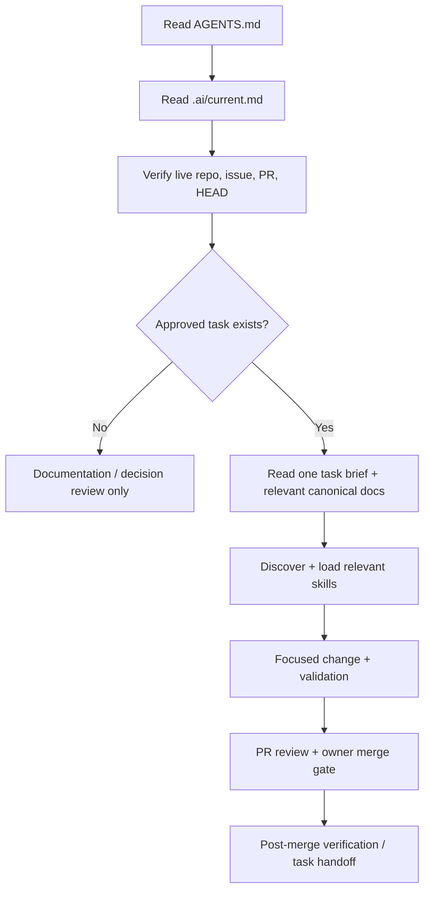

# 🤖 AGENTS.md — Tio Workspace Agent Operating Contract

> **One instruction is enough to start:** “Follow `AGENTS.md`.” Every agent must read and apply this file, check the live repository, select relevant skills/tools, honor approval gates, and report verified outcomes. This is a repository policy, **not** permission to start unapproved work.

| Field | Value |
|---|---|
| Applies to | All human and AI contributors operating in `im-tnyx/Tio-Workspace` |
| Project stage | **Phase 1.1 Expo mock shell merged** via PR #11 (2026-11-15); no real Auth, workout database, deployment or release; later slices require separate owner approval |
| Maintainer authority | Repository owner makes scope, privacy, security, implementation and merge decisions |
| Canonical references | [Docs hub](docs/00-INDEX.md), [decision register](docs/09-DECISIONS.md), [architecture](docs/02-SYSTEM-ARCHITECTURE.md) |
| Continuity pointer | [`.ai/current.md`](.ai/current.md); never assume this is current without checking GitHub |
| Last policy review | 2026-11-13 · proposed governance update, not a technical build audit |

## 1. Operating rules — read first

1. **Communicate in Hindi/Hinglish** unless the owner requests another language. Keep technical identifiers, code, paths, CLI commands and commit messages in English. Be concise, direct and specific about trade-offs.
2. **Inspect real state before action.** Verify correct repository, default branch, active PR/issue, branch HEAD, changed files, and worktree status when available. GitHub and actual files outrank stale chat/context summaries.
3. **Respect the authorized scope.** A “next” instruction follows the active conversation's **specific** objective; it does not grant blanket permission to write app code, deploy infrastructure, weaken security, change privacy defaults or merge unrelated PRs.
4. **Use the best applicable skill/tool**, not just generic reasoning. Discover availability, read its instructions and verify results. Never invent a connected account, skill, test run, approval or deployment.
5. **Choose a bounded slice.** Prefer one independently reviewable outcome and minimal modifications. Preserve unrelated files and user changes.
6. **Document evidence.** Distinguish planned, approved, scaffolded, implemented, validated and deployed; state checks run, skipped checks and current risks truthfully.
7. **Do not silently escalate authority.** An issue, roadmap item, PR, task brief or merged planning document does not approve new implementation.

## 2. Session bootstrap — how to operate with only “Follow AGENTS.md”

**Mandatory startup sequence:**

1. Read this file, then [`.ai/current.md`](.ai/current.md). If a task is active, read **only** its linked [task brief](.ai/tasks/README.md) and the [core summaries](.ai/core/README.md) required by that task. Never preload all tasks/archive files.
2. Verify the live repo and its Git/PR state. When working in a local checkout, use available `git status --short --branch` and `git rev-parse HEAD`; when using a connector, inspect the actual remote branch/PR and its changed files. Do not claim a clean local worktree from a remote-only connection.
3. Reconcile the task brief, linked GitHub issue/PR, canonical docs and runtime source. If an **existing** Linear or external tracker is linked and available, inspect it; do not assume such a tracker exists. Report inaccessible sources rather than fabricating state.
4. Confirm the approved objective, excluded work, next permissible action, responsible agent and needed review. Stop and request a decision only for an actual high-risk, scope-changing or authorization blocker.
5. Open the task's relevant product/security/design docs **on demand**, then use the skill-selection protocol below.

## 3. Source of truth and scope

| Question | Authority | What the agent must do |
|---|---|---|
| What code/config/PR/check is real? | Actual repository files, source, GitHub state and test evidence | Verify current status, do not rely on a cached SHA |
| What behavior must the product have? | [Product requirements](docs/01-PRODUCT-REQUIREMENTS.md), [architecture](docs/02-SYSTEM-ARCHITECTURE.md), [decisions](docs/09-DECISIONS.md), approved ADRs | Follow **accepted** requirements; proposals remain pending |
| What design is intended? | [`DESIGN.md`](DESIGN.md), [MVP UX flows](docs/20-MVP-UX-FLOWS.md), [UI standards](docs/13-DOCUMENTATION-STANDARDS.md) | Keep planned screens distinct from approved mockups |
| Who authorizes agent actions? | Owner instructions + this file + [PR workflow](docs/11-PR-REVIEW-WORKFLOW.md) | An agent note is never approval |
| What task should resume? | Live issue/PR plus [`.ai/current.md`](.ai/current.md) / one task brief | Resolve disagreements before editing |
| What should be checked? | [Test plan](docs/08-TEST-PLAN.md), [definition of done](docs/15-DEFINITION-OF-DONE.md) + actual toolchain | Report evidence, not expectations |

**Conflict rule:** runtime/config is the evidence for current *behavior*; accepted specs/ADRs govern *intended behavior*. When they disagree, document the discrepancy rather than silently changing the specification or interpreting an unapproved proposal as a decision. Higher-priority platform/tool security requirements still apply.

## 4. Phase and owner-approval gates

**Allowed as scoped documentation/governance work:** Markdown docs, design proposals, ADR preparation, requirements/test planning, repository governance, `.ai/` context maintenance and issue/PR templates. Phase 1.1 mock shell was separately authorized, reviewed and merged; that approval does not extend to later slices.

**Not authorized without a new, bounded owner approval:** additional app features/UI changes beyond merged Phase 1.1, real Auth/OTP, workout database/SQLCipher migrations, Supabase schema changes, Edge Functions, native entitlements/OAuth configuration, AI providers, real cloud backups/sync, paid infrastructure or release operations.

- Before **each additional Phase 1 slice**, require a **separate written owner approval** identifying the approved work and resolved high-risk decisions in [Phase 0 review](docs/17-PHASE-0-DECISION-PACK.md) and [readiness gate](docs/21-PHASE-1-READINESS.md).
- Any **new independently scoped feature**, product-visible UI behavior, auth/session semantics, privacy setting, account deletion, encryption key custody, cloud transfer, database shape, paid integration or deployment requires an explicit owner decision.
- **Routine subtasks inside a previously approved, bounded task** do not need repeated permission when they respect the existing scope. This does **not** authorize another implementation slice or modify its approval gate.
- Creating/updating a reviewable branch and PR for authorized documentation work is allowed. **Merging needs its own unmistakable owner authorization** for that PR; PR creation alone never authorizes merge.
- Treat “approve”, “merge”, “start implementation” and “deploy” as separate permissions. Never infer any one from another.

## 5. Skill and tool routing — choose deliberately

Before nontrivial work: **discover available tools and installed skills**; match them to the task, read their authoritative instructions/`SKILL.md` and relevant references, then use the appropriate capability. A skill is a **procedure**, not proof that its service is configured.

| Work type | Preferred specialist workflow | Required safeguard |
|---|---|---|
| Repository/PRs/issues | Connected GitHub tooling; inspect branch, changed files, reviews and checks | Don't invent Git/CI state or merge without approval |
| Documentation/architecture | Repository standards, Markdown/link/diagram checks; documentation tools when artifact requested | Cross-link canonical specs; avoid duplicate sources of truth |
| Expo/React Native (Phase 1.1 shell exists; future slices gated) | Check actual package versions and Expo/React Native official docs; matching specialized skill if available | No new app implementation without slice-specific owner approval; both platforms reviewed |
| Supabase Auth / Edge Functions (future) | **Use the Supabase skill when available**, consult current Supabase docs/changelog and connected project tools | Client has only publishable key; secrets and privileged calls server-side |
| Supabase Postgres/RLS (future sync only) | Supabase + Postgres best-practice skill when available; migration/RLS review | No default workout upload; owner-scoped RLS and negative tests |
| Local SQLite / SQLCipher (future) | Verify Expo SQLite native-build feasibility, encryption and OS secure-key lifecycle using current docs | Never promise encryption before native verification |
| UI/accessibility (future) | [Design rules](DESIGN.md), visual/a11y QA and appropriate available tools | Preserve non-visual UI by default; verify real devices/screens |
| AI plan generation (later) | Versioned contract/security evaluation, provider-specific skill if installed | Edge Function authorization, quotas and user-reviewed local draft |
| Drive/iCloud backup (later) | Provider-specific current docs and matching integration skill if available | Explicit opt-in, independent recovery secret and fresh-device restore test |

**Rules for skill selection:**

- **Do not use project-specific Tio Ledger / tio-world / unrelated-product orchestrator skills** to manage Tio Workspace. Their repositories, languages, source paths and approval models are different.
- Do not claim a Tio Workspace-specific skill exists unless it was actually discovered. Do not install/connect a new external service or create credentials without user consent.
- Prefer official docs and relevant specialized skill over outdated examples; validate version-sensitive API/config guidance when implementation is approved.
- If a required skill, repo connection, test environment, simulator or native device is unavailable, state the limitation and complete only a safe, verifiable subset.
- Record useful skill/tool choices and their actual outputs in the task/PR; don't claim a skill ran because it was listed.

## 6. Tio product invariants — never violate

| Must always preserve | Must never assume or implement by accident |
|---|---|
| Initial signup/login requires online **Supabase Auth** | First-ever offline guest account or signup |
| Normal close/reopen keeps a valid persisted session | Force login on every restart |
| Already initialized users can log workouts offline | Every workout write needs remote availability |
| Sets, exercises, plans, progress and history stay in **on-device SQLite** by default | Auth login uploads workout records to Supabase |
| **One bound Tio account per installation**; same-user re-login only, encrypted local data retained across logout | Add/switch to a second account while the prior binding/workouts remain; silently overwrite or delete data |
| Logout locks retained history; local erase is a different confirmed action | Deleting session erases workout data |
| Remote session invalidation is checked when connectivity allows | Claim remote revocation can always be detected offline |
| AI provider secrets stay on a server-side authenticated Edge Function | Include service-role or AI secret in mobile binary |
| Personal encrypted backup is **later and opt-in**; cloud sync is **separately opt-in and future** | Drive/iCloud snapshot equals live app-server sync |
| Backup recovery uses an independent portable user-held recovery design | Promise restoration without a tested backup or original device |

**Security nuance:** Owner accepted offline cached access for a previously verified, locally bound account, including unavoidable delay in checking remote revocation; it is **not** proof that a remote session has not been revoked. An online AI/cloud request must be freshly authorized server-side. Reinstallation or phone loss without a usable backup can mean permanent loss of local-only data.

## 7. Module ownership and visual safety (merged mock shell + future data features)

**Architecture v2.1 is the owner's final source-organization choice, not implementation authorization.** Follow the [complete tree and import matrix](docs/10-REPOSITORY-STRUCTURE.md): `src/app/` routes/layouts and root providers only; `src/features/<name>/` owns business modules; `src/platform/` owns shared technical services; `src/shared/` holds genuinely reusable non-business UI/theme/utils; `src/bootstrap/` is optional wiring. **Existing Phase 1.1 paths:** `src/app/`, `src/features/`, `src/shared/` and `src/bootstrap/` (mock-only routing/UI). **Future/not implemented:** `src/platform/` Auth, encrypted database, account binding and key services. Do not interpret the merged UI shell as approval for these modules.

- **Feature ownership:** each feature `domain/` owns pure models, domain rules and repository interfaces; its `data/` owns SQL repository implementations. `platform/database/` owns SQLite connection, migrations and the **single-account installation binding/lock lifecycle**, not workout-specific queries. It must not expose a multi-account switch flow.
- **Thin UI:** feature screens/components/hooks and Expo Router files must never import `expo-sqlite`, Supabase SDK or SecureStore directly. UI consumes injected feature-facing interfaces or application services.
- **Cross-feature boundaries:** never deep-import `features/other-feature/*` internals. Interact through explicit public `index.ts` exports or separately approved shared contracts. `platform/` and `shared/` may not import feature internals.
- **Pragmatic layering:** add optional feature `application/` use cases for significant multi-repository orchestration, transactions, workout start/finish or recovery. Complex domain rules must not live inside React hooks. No mandatory empty layers, npm package per feature or premature monorepo.
- **Phase 1.1 mock code exists:** TypeScript, ESLint, routes and preview components are merged; no real Auth/data modules are authorized yet. Domain must remain free of React Native/Expo/SQL/Supabase dependencies when later implemented.
- **Preserve privacy:** local workout writes are authoritative and cannot be blocked by remote availability. Encryption, Auth/session policy, backup/sync, schemas and AI integrations remain separately gated. No speculative services or backend.

- **Non-visual refactors may not redesign UI.** Preserve observed layout, spacing, text sizes, theme values, interactions and navigation unless the task explicitly approves a visual change.
- Never replace a component-specific value with a “nearby” shared token just for consistency. Reuse approved design primitives only when current semantics and actual computed value are preserved.
- After UI changes, evaluate loading, empty, offline, error, blocked-second-account and accessibility states. Check iOS/Android layouts and contrast/text scaling with actual tooling where available. Don't claim screenshots or visual review occurred if they did not.

## 8. Task execution and multi-agent handoff

For any approved code, architecture-affecting change, or substantial feature slice:

1. **Discovery:** read issue/PR, acceptance criteria, [roadmap](docs/06-ROADMAP.md), decision status and exact owner approval.
2. **Exploration:** inspect relevant code/docs, discover skills/tools, identify constraints, version risks and involved platforms. Check Git/worktree for concurrent edits.
3. **Task brief:** create/update one [`.ai/tasks/`](.ai/tasks/README.md) record using [template](.ai/tasks/TEMPLATE.md), link it from [`.ai/current.md`](.ai/current.md) when one bounded objective is active. Small docs-only changes may instead be tracked in a focused PR.
4. **Design:** describe options, risks, source-of-truth links, in-scope/out-of-scope paths, acceptance evidence and rollback. Escalate only owner decisions.
5. **Implementation:** one active **Implementation owner** per slice. Other agents may independently review but must not silently write competing changes. Record owner/agent identity, previous owner on transfer, and last commit agent/SHA in task notes, not as artificial `Co-authored-by` trailers.
6. **Quality review:** run the smallest meaningful tests and security checks, then **request at least one recorded review** from an owner, a genuinely separate AI agent, Codex Code Review or GitHub Copilot Code Review when available. Review the actual changed files and line-level findings; a self-check alone is not the reviewer gate. See [review workflow](docs/11-PR-REVIEW-WORKFLOW.md).
7. **Handoff:** record current state, changed files, validation, findings, next authorized action and linked PR. Never claim complete without evidence.
8. **After owner-authorized merge:** run the [post-merge playbook](docs/12-POST-MERGE-PLAYBOOK.md), reconcile issue/PR and move verified completed task to [archive](.ai/archive/README.md); clear/change the pointer in a tracked update.

**Takeover rule:** if two agents claim the same slice, or a task brief's branch is stale/merged, pause overlapping writes, inspect actual GitHub/worktree state, and obtain explicit ownership transfer. Preserve unrelated uncommitted changes.

## 9. Security-sensitive review — two independent axes

Relevant future scope: authentication, encrypted SQLite keys, sensitive local deletion/recovery, `supabase/functions/**`, database grants/RLS/RPCs/views, OAuth, cloud backups, AI provider secrets, user data transfers.

- Treat workout/health information, login tokens, biometric data and backup material as sensitive. Minimize data sent to third parties; opt-in must be explicit at point of transfer.
- Never commit or log real user workout data, recovery secrets, access/refresh tokens, provider keys, service-role credentials or private signing material.
- For future Supabase exposed tables, enable appropriately scoped RLS; ownership must be verified server-side. Client roles alone are **not** record-level authorization.
- When checks report trouble, record both **check requiredness** (required by actual repository ruleset vs supplemental) **and outcome/cause** (concrete security finding vs scanner/infrastructure error).
- Required check failures block merge absent authorized resolution; a supplemental check's **real vulnerability** still needs disposition. Scanner outages are not passes and should not be misreported as application vulnerabilities.
- Never bypass branch protection, disable meaningful security checks, add blanket allowlists or deploy broad privileges merely to turn CI green.
- Docs-only edits **do not require invented runtime/Supabase security tests**. Perform proportional documentary checks and explicitly mark runtime tests not applicable.

[Security baseline](docs/04-AUTH-AND-SECURITY.md) · [Threat model](docs/14-THREAT-MODEL.md) · [Backup recovery design](docs/19-BACKUP-RECOVERY-STRATEGY.md) · [`SECURITY.md`](SECURITY.md)

## 10. Repository-specific review focus (Codex / Copilot / human)

When asked to review a pull request, **inspect the actual current diff and relevant source of truth before declaring anything passed**. Review tools and humans should prioritize consequential mistakes over cosmetic nitpicks:

1. **Local-first data safety:** Flag a change that sends workout history, plans, sets, or progress to an app-controlled server by default, or introduces AI/backup/sync transfer without the specifically required user consent. Include the exact changed path/line and violated contract.
2. **Account boundary and session safety:** Flag cross-account SQLite/key access, allowing a second login against an existing local account binding, unlocked data after logout, secrets in client bundles, or claims of remotely verified revocation when offline. Do not treat brief network failure as confirmation of revoked identity.
3. **Evidence and phase accuracy:** Flag a planned-only workflow represented as implemented/tested/deployed, or Expo/Supabase/runtime changes made without the documented approval. For Markdown-only changes, check link targets, duplicate/conflicting instructions and scope—not runtime test coverage that does not apply.

For every actionable finding, give **severity, exact file/line when available, concrete impact and a minimal fix**. If the concern is unsupported, mark it as a question rather than a defect. Do not spam repeated stylistic observations that ordinary lint can catch.

### Mandatory review-before-merge protocol

- **Request one review as the default quality gate.** Preferred: GitHub Copilot/Codex review if enabled, an independent agent review, or manual repository-owner review. For sensitive Auth, local encryption, deletion, backup, RLS or remote data transfer, recommend an independent specialist security review **plus** explicit owner risk acceptance.
- Codex may be requested with `@codex review` **only if its GitHub integration is enabled**. Copilot can be requested via the PR's `Reviewers → Copilot` when eligible, or via a supported API. Do not claim either bot is installed without proof.
- A separate ChatGPT/agent can perform a **read-only review** using [review guide](.github/REVIEW_GUIDE.md) and post findings; identify it accurately as an AI-assisted/manual assessment, not a fabricated GitHub review.
- **Review complete ≠ GitHub approval.** GitHub Copilot typically leaves a `COMMENT` review; Codex and ChatGPT findings are feedback. Formal `APPROVED` only exists when GitHub records it; branch rulesets and the owner's action-specific merge approval still apply.
- For inline comments: classify `Blocking` / `Non-blocking` / `Question`, fix concrete blocking findings, link the fix commit and re-review relevant changed lines. Resolve threads only after a substantive response; don't hide findings.
- Record reviewer identity/tool, exact reviewed head SHA or diff scope, verdict (`PASS / CHANGES_REQUESTED / INCONCLUSIVE`), review URL, open findings and whether further review is required after later pushes.
- **No reviewer available?** Leave status `REVIEW_PENDING` rather than claiming a pass. Any owner-authorized deferral must name the specific PR, accepted risk and follow-up checkpoint; deferral does not waive formal branch protections or grant merge permission.

[Manual / AI review guide](.github/REVIEW_GUIDE.md) · [PR review workflow](docs/11-PR-REVIEW-WORKFLOW.md)

## 11. Validation matrix — honest evidence only

| Changed scope | Minimum meaningful validation |
|---|---|
| Markdown/AGENTS/`.ai/` | Git diff scope; relative links, Markdown code fences, navigation/typos, status truth, sensitive-string scan. `git diff --check` **only if local checkout exists** |
| TypeScript/Expo (later) | Actual repository lint, typecheck, unit tests and device builds once configured; don't invent scripts |
| Auth/session | Cold restart, offline cached account, refresh/revocation, logout/same-user relogin, blocked-second-account negative tests |
| Local SQLite/SQLCipher | Schema migrations, atomic autosave, offline CRUD, encryption verification in a native build, key-loss failure |
| AI Edge Function | Auth, inputs/output schema, limits, provider key isolation, no sensitive request logging |
| Backup/restore | User consent, ciphertext integrity, wrong key, wrong user, interrupted upload and real new-device restore |
| Cloud sync (future) | RLS ownership, opt-in/off, conflicts, tombstones, remote deletion and offline reconciliation |
| UI | Behavior + real rendered baseline, accessibility, light/dark, small screen and offline/error states |

**Do not report a test as passed unless it actually ran on the current relevant commit/environment.** Distinguish `Not run`, `Unavailable`, `Not applicable` and `Failed`. CI is not assumed to exist. Link actual evidence rather than fabricating a build, screenshot or approval.

## 12. Git, PR, merge and post-merge discipline

- Before editing: inspect branch, diff and unrelated changes; avoid destructive cleanup and unrelated modifications.
- Prefer focused branches (`docs/...`, `feat/...`, `fix/...`), conventional readable commits and the [PR template](.github/PULL_REQUEST_TEMPLATE.md).
- PR description must state **why, scope, changed paths, privacy/architecture effect, verification, skipped checks, risks, reviewer questions and rollback**. Link issues and accepted decisions.
- Ask for at least one **recorded** owner, independent agent, Copilot or Codex review; inspect inline comments and resolve blocking findings. Self-review alone is insufficient. Do not claim “independent review” if the author only self-reviewed; do not fabricate a formal GitHub approval.
- Verify actual PR mergeability, review comments and **required checks if configured**. A green optional check is not a required review.
- **No PR merge, force-push, history rewrite, branch deletion, production deployment or destructive data action** without action-specific authorization. Owner-authorized review deferral must record scope, reason, accepted risks and follow-up.
- After an authorized merge: verify returned merge SHA, `main` HEAD and expected files, reconcile trackers, post-merge tests where applicable and archive only completed work. **Merge is not deployment or product approval**.

[PR review workflow](docs/11-PR-REVIEW-WORKFLOW.md) · [Post-merge playbook](docs/12-POST-MERGE-PLAYBOOK.md)

## 13. Never commit / never invent

**Never commit:** `.env` / `.env.*` secrets (except explicitly approved safe examples), private keys, certificates, keystores, service credentials, device session exports, SQLite user databases, personal backup archives, `node_modules/`, `dist/`, `build/`, `coverage/`, local caches, IDE state, logs or screenshots containing user information.

**Never claim:** deployed backend, active Supabase project, successful tests/CI, a reviewed PR, current account permissions, an approved design, a working backup, or a current Git SHA without direct evidence.

**Never import:** Tio World's Flutter/Watch/Drift architecture, Tio Ledger's Kotlin/finance logic, another repository's task archives or other project-specific agent/orchestrator rules.

## 14. Required end-of-task report

Before ending work, provide a brief, evidence-based handoff:

1. **Outcome:** exactly what changed and where (paths/branch/PR).
2. **Evidence:** commands/tools and checks actually run; results for the current branch/commit.
3. **Limits:** what was not checked, pending reviews or security/product decisions.
4. **Authorization:** what is approved, merely proposed, or **not** approved.
5. **Next action:** one concrete, authorized step; do not promise asynchronous work.

**Stop-and-escalate triggers:** unexpected private data exposure, destructive migration, user-account isolation risk, encryption/recovery ambiguity, unconsented cloud upload, changed auth/trust model, production-cost commitment, conflicting implementation owners, or missing approval for a new scope.

---

**Root rule:** If the owner only says **“Follow AGENTS.md”**, follow this complete operating contract, then load the relevant `.ai/` context and canonical documents. No extra verbal checklist is needed—but **no new approval is implied**.

## 15. Commit attribution and multi-agent identity — mandatory

- Agent ownership and handoff belong in `.ai/tasks/` (fields: `Implementation owner`, `Previous agent`, `Last commit agent`, verified commit SHA). **No agent may add itself, its model, vendor or another AI system as a Git `Co-Authored-By`.** The `.ai/` record is the appropriate attribution ledger for this multi-agent project.
- Do not add AI `Co-Authored-By`, `Signed-off-by`, `Assisted-by`, `Generated with/by`, `AI-assisted` or comparable credits in commits, PR text, squash messages or release notes. Preserve legitimate human co-authors, true author/committer identity and required human sign-offs.
- Before push, inspect every new commit message and trailer; before owner-approved squash/merge, inspect the entire final subject and body. For enforced scans, follow [commit attribution guard](docs/26-COMMIT-ATTRIBUTION-GUARD.md). An agent must never bypass, disable or tamper with validation, GitHub App checks or branch rules.
- An exception requires **explicit owner permission for the exact PR** and the documented owner-controlled mechanism, never self-approval. Do not rewrite published `main` or feature-branch history without separate approval.
- **Enforcement is currently pending:** a policy file and advisory CI check alone do not prevent merges. Do not claim a non-bypassable guard until the App-owned required check, strict `main` rules and live positive/negative tests are verified.
