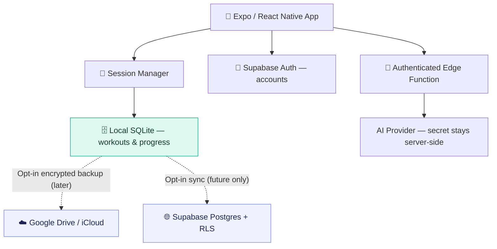
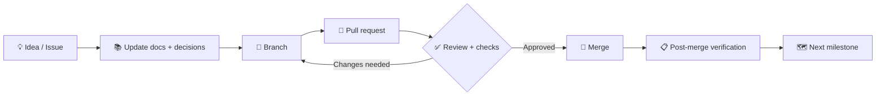

<div align="center">

# 🏋️ Tnyx — Tio Workspace

### Train offline. Own your progress.

**A thoughtfully planned, local-first workout tracker for iOS & Android.**
Your account stays signed in. Your workout history stays on your device.

<br />


**Owner-selected app display name:** **Tnyx** (2026-11-14). The existing repository is still `im-tnyx/Tio-Workspace`; GitHub paths and versioned backup format names are not renamed. Android application ID and iOS bundle ID are owner-selected as `com.tnyx.tio` (registration/ownership unverified); logo/icon remains pending.


**[📖 Documentation](docs/00-INDEX.md)** · **[🤖 AI Context](.ai/README.md)** · **[🧭 Phase 0 Review](docs/17-PHASE-0-DECISION-PACK.md)** · **[🏗 Architecture](docs/02-SYSTEM-ARCHITECTURE.md)** · **[🎨 Design](DESIGN.md)** · **[🗺 Roadmap](docs/06-ROADMAP.md)** · **[🤝 Contribute](CONTRIBUTING.md)**

</div>

---

> [!IMPORTANT]
> **Current state (2026-11-15):** The Expo/React Native **Phase 1.1 mock UI shell** is committed and merged via [PR #11](https://github.com/im-tnyx/Tio-Workspace/pull/11). Welcome/Auth preview, four-tab shell and static checks exist, but **there is no functional Signup/Login/OTP, persisted authenticated session, encrypted workout database, backup/sync, AI endpoint, published mobile release or deployed app backend**. A Supabase project may exist separately; it is not an app Auth/profile integration. Badges distinguish merged UI scaffolding from planned features.

## ✨ The idea

| 🔐 **One login, familiar experience** | 📴 **Offline workouts by default** | ☁️ **Your choice of backup** |
| :--- | :--- | :--- |
| Register or sign in online once. Normal app reopen goes straight to the dashboard while the valid persisted session remains available. | Sets, reps, weights, exercises and history live in **local SQLite**; logging should work offline after initial account setup. | Encrypted Google Drive/iCloud backup is planned as **opt-in**; future app-database synchronization is a separate choice. |
| **Supabase Auth — planned** | **SQLite — planned** | **Drive / iCloud — later phase** |

<details>
<summary><strong>🔍 What “local-first” means (and what it does not)</strong></summary>

- **Account required:** the app uses online authentication to establish identity; everyday workout CRUD should not depend on internet.
- **Session persistence:** closing the app is not logout; remote session revocation and reauthentication still need correct handling.
- **Single-account installation:** one locally bound Tnyx identity at a time. There is no add-account or switch-account feature; a different login is blocked while the prior account's encrypted workouts remain. Logout locks data without erasing it. Any reset must be an explicit, separately confirmed destructive action.
- **Workouts do not automatically go to our server:** signup/login data is online, workout logs are on the device by default.
- **AI is an exception only when requested:** a generated-plan request uses a secure server-side API and sends only the inputs needed to produce the plan.
- **No magical recovery:** uninstalling, resetting or losing a device may erase local-only data. Cloud restore requires a real, completed encrypted backup.
- **No automatic multi-device history:** backup/restore is not live sync; a future cloud-sync switch must be opt-in.

</details>

## 🏗 How it fits together



<div align="center">

**Default path:** Workout → Local SQLite → Dashboard
**Optional paths:** AI plan request · Personal backup · Future cloud sync

</div>

> [!NOTE]
> **Security by design:** Supabase's publishable client key is not a secret. **AI provider keys and Supabase secret/service-role keys must never ship in the mobile app.** AI keys belong in server-side Edge Function secrets; future server tables require owner-scoped RLS.

## 📚 Documentation library

Choose the level you need. All specifications are **proposals** until reviewed and accepted.

| Start here | Deep dive | Delivery & governance |
| :--- | :--- | :--- |
| [🧭 Documentation hub](docs/00-INDEX.md) | [🏗 System architecture](docs/02-SYSTEM-ARCHITECTURE.md) | [🧑‍💻 Contributing guide](CONTRIBUTING.md) |
| [🎯 Product requirements](docs/01-PRODUCT-REQUIREMENTS.md) | [🗄 Local data model](docs/03-LOCAL-DATA-MODEL.md) | [🤖 Agent instructions](AGENTS.md) |
| [🎨 Design system](DESIGN.md) | [🛡 Auth & security](docs/04-AUTH-AND-SECURITY.md) | [🔀 PR → merge workflow](docs/11-PR-REVIEW-WORKFLOW.md) |
| [🗺 Implementation roadmap](docs/06-ROADMAP.md) | [☁️ Backup & sync](docs/05-BACKUP-AND-SYNC.md) | [✅ Post-merge playbook](docs/12-POST-MERGE-PLAYBOOK.md) |
| [🧪 Acceptance tests](docs/08-TEST-PLAN.md) | [🧠 AI/API contracts](docs/07-API-CONTRACTS.md) | [📝 Decisions / ADRs](docs/09-DECISIONS.md) |
| [🧱 Repository structure](docs/10-REPOSITORY-STRUCTURE.md) | [🧯 Threat model](docs/14-THREAT-MODEL.md) | [✍️ Documentation standards](docs/13-DOCUMENTATION-STANDARDS.md) |

## 🧭 Before the next functional implementation slice: owner review

Start with the **[Phase 0 Decision Review Pack](docs/17-PHASE-0-DECISION-PACK.md)**. It links the [offline session state machine](docs/18-OFFLINE-SESSION-STATE-MACHINE.md), [backup recovery strategy](docs/19-BACKUP-RECOVERY-STRATEGY.md), [MVP screen flows](docs/20-MVP-UX-FLOWS.md) and [Phase 1 readiness gate](docs/21-PHASE-1-READINESS.md). Some technology and single-account/MVP policy decisions are now **owner-approved**, while native security verification and other Phase 0 questions remain open. These documents do not authorize additional functional app code beyond the separately approved and merged Phase 1.1 mock shell.

## 🤖 Agent-ready context

Tio Workspace uses a compact [§.ai/§ context system](.ai/README.md), adapted from [Tio Ledger](https://github.com/im-tnyx/Tio-Ledger/tree/main/.ai). [§AGENTS.md§](AGENTS.md) remains the authoritative agent policy; [§.ai/current.md§](.ai/current.md) is the lightweight active-task pointer, [§core/§](.ai/core/README.md) holds read-on-demand summaries, and [§tasks/§](.ai/tasks/README.md) / [§archive/§](.ai/archive/README.md) preserve handoff history. No AI context note grants permission to implement or merge code.

## 🧩 Feature delivery map

| Capability | Scope | State |
| :--- | :--- | :--- |
| Product requirements, architecture, documents | Phase 0 | 🟢 **Documented — review pending** |
| Expo UI shell, mock Auth and static CI | Phase 1.1 | 🟢 **Merged PR #11 — no real Auth/data** |
| Signup, OTP, persistent login | Phase 1.2 | ⚪ **Not started; not authorized** |
| Encrypted local workouts and progress | Phase 1.3–1.6 | ⚪ **Not started; not authorized** |
| AI workout plan generation via Edge Function | Phase 2 | ⚪ **Not started** |
| Encrypted personal cloud backup + restore | Phase 3 | ⚪ **Not started** |
| Optional Supabase cloud sync | Phase 4 | ⚪ **Future only** |

> **Design principle:** Offline-first is an application constraint, not merely a caching option. Screens read and write local data first. Cloud components must be added only behind explicit boundaries and consent.

## 🗂 Current shell architecture

```text
Tio-Workspace/
├─ src/app/                 # Expo Router mock routes and root/tab layouts
├─ src/features/            # Mock feature screens (no workout CRUD)
├─ src/shared/              # Reusable UI, i18n and appearance tokens
├─ src/bootstrap/           # Development-only preview gate and tab registry
├─ tests/                   # Pure shell contract tests
├─ scripts/                 # Design-token checks
├─ .github/workflows/       # PR/push static shell CI
├─ docs/                    # Product/phase/security specifications
├─ .ai/                     # Agent context and archived task records
└─ AGENTS.md                # Owner authorization and safety contract

# Real Auth, secure workout DB, AI, backup and sync are later approved slices.
```

## 🔄 The way we work



See [contribution workflow](CONTRIBUTING.md), [PR review process](docs/11-PR-REVIEW-WORKFLOW.md), [post-merge playbook](docs/12-POST-MERGE-PLAYBOOK.md), and the [definition of done](docs/15-DEFINITION-OF-DONE.md).

## 🛡 Privacy & safety principles

**Local by default · Least privilege · Explicit consent · Encrypted backup · User separation · No embedded server secrets.**

The architecture distinguishes **authentication account data**, **device workout data**, **optional AI input**, **personal-cloud backup files**, and **future optional app-database copies**. See [security policy](SECURITY.md) and [threat model](docs/14-THREAT-MODEL.md).

## 🤝 Collaboration

Want to propose a change? Use the [issue templates](.github/ISSUE_TEMPLATE/) and read [CONTRIBUTING.md](CONTRIBUTING.md). Every pull request should link requirements, state risks, explain validation and avoid claiming unfinished features work. AI coding assistants must follow [AGENTS.md](AGENTS.md).

---

<div align="center">

<sub>Privacy-first design · Phase 1.1 mock UI shell merged · no released app.</sub>

**Tnyx App · Tio Workspace repo · Phase 1.1 mock shell · 15 November 2026**

</div>
