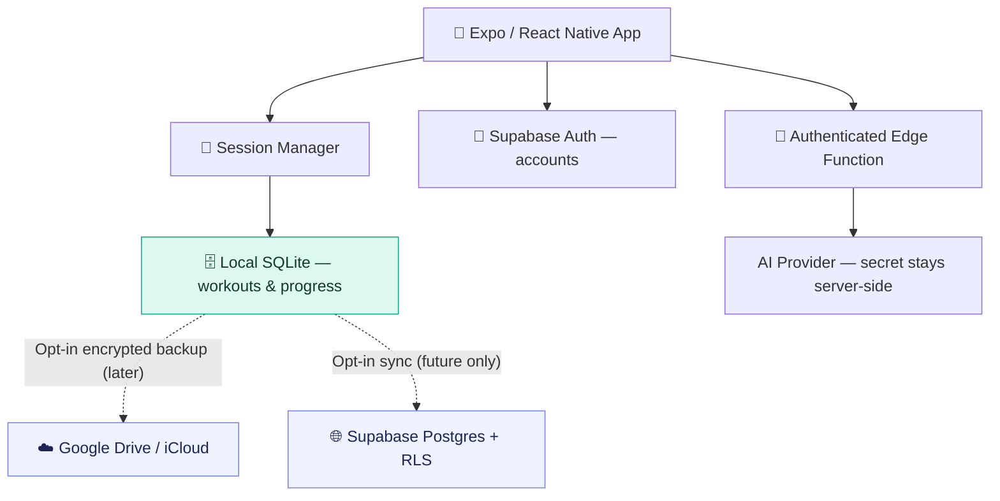
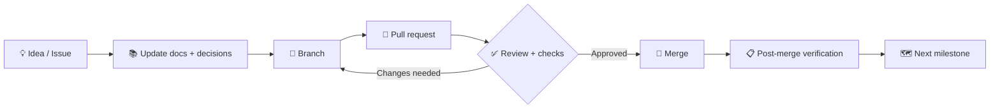

<div align="center">

# 🏋️ TIO WORKSPACE

### Train offline. Own your progress.

**A thoughtfully planned, local-first workout tracker for iOS & Android.**  
Your account stays signed in. Your workout history stays on your device.

<br />


**[📖 Documentation](docs/00-INDEX.md)** · **[🏗 Architecture](docs/02-SYSTEM-ARCHITECTURE.md)** · **[🎨 Design](DESIGN.md)** · **[🗺 Roadmap](docs/06-ROADMAP.md)** · **[🤝 Contribute](CONTRIBUTING.md)**

</div>

---

> [!IMPORTANT]
> **Documentation-first project.** This repository currently specifies a product; it does **not** yet contain a working Expo app, configured Supabase project, cloud backup, AI integration or published release. Badges describe the **planned** stack, not implemented capabilities.

## ✨ The idea

| 🔐 **One login, familiar experience** | 📴 **Offline workouts by default** | ☁️ **Your choice of backup** |
| :--- | :--- | :--- |
| Register or sign in online once. Normal app reopen goes straight to the dashboard while the valid persisted session remains available. | Sets, reps, weights, exercises and history live in **local SQLite**; logging should work offline after initial account setup. | Encrypted Google Drive/iCloud backup is planned as **opt-in**; future app-database synchronization is a separate choice. |
| **Supabase Auth — planned** | **SQLite — planned** | **Drive / iCloud — later phase** |

<details>
<summary><strong>🔍 What “local-first” means (and what it does not)</strong></summary>

- **Account required:** the app uses online authentication to establish identity; everyday workout CRUD should not depend on internet.
- **Session persistence:** closing the app is not logout; remote session revocation and reauthentication still need correct handling.
- **Workouts do not automatically go to our server:** signup/login data is online, workout logs are on the device by default.
- **AI is an exception only when requested:** a generated-plan request uses a secure server-side API and sends only the inputs needed to produce the plan.
- **No magical recovery:** uninstalling, resetting or losing a device may erase local-only data. Cloud restore requires a real, completed encrypted backup.
- **No automatic multi-device history:** backup/restore is not live sync; a future cloud-sync switch must be opt-in.

</details>

## 🏗 How it fits together



<div align="center">

**Default path:** Workout → Local SQLite → Dashboard  
**Optional paths:** AI plan request · Personal backup · Future cloud sync

</div>

> [!NOTE]
> **Security by design:** Supabase's publishable client key is not a secret. **AI provider keys and Supabase secret/service-role keys must never ship in the mobile app.** AI keys belong in server-side Edge Function secrets; future server tables require owner-scoped RLS.

## 📚 Documentation library

Choose the level you need. All specifications are **proposals** until reviewed and accepted.

| Start here | Deep dive | Delivery & governance |
| :--- | :--- | :--- |
| [🧭 Documentation hub](docs/00-INDEX.md) | [🏗 System architecture](docs/02-SYSTEM-ARCHITECTURE.md) | [🧑‍💻 Contributing guide](CONTRIBUTING.md) |
| [🎯 Product requirements](docs/01-PRODUCT-REQUIREMENTS.md) | [🗄 Local data model](docs/03-LOCAL-DATA-MODEL.md) | [🤖 Agent instructions](AGENTS.md) |
| [🎨 Design system](DESIGN.md) | [🛡 Auth & security](docs/04-AUTH-AND-SECURITY.md) | [🔀 PR → merge workflow](docs/11-PR-REVIEW-WORKFLOW.md) |
| [🗺 Implementation roadmap](docs/06-ROADMAP.md) | [☁️ Backup & sync](docs/05-BACKUP-AND-SYNC.md) | [✅ Post-merge playbook](docs/12-POST-MERGE-PLAYBOOK.md) |
| [🧪 Acceptance tests](docs/08-TEST-PLAN.md) | [🧠 AI/API contracts](docs/07-API-CONTRACTS.md) | [📝 Decisions / ADRs](docs/09-DECISIONS.md) |
| [🧱 Repository structure](docs/10-REPOSITORY-STRUCTURE.md) | [🧯 Threat model](docs/14-THREAT-MODEL.md) | [✍️ Documentation standards](docs/13-DOCUMENTATION-STANDARDS.md) |

## 🧩 Feature delivery map

| Capability | Scope | State |
| :--- | :--- | :--- |
| Product requirements, architecture, documents | Phase 0 | 🟢 **Documented — review pending** |
| Signup, persistent login, local workouts | Phase 1 | ⚪ **Not started** |
| AI workout plan generation via Edge Function | Phase 2 | ⚪ **Not started** |
| Encrypted personal cloud backup + restore | Phase 3 | ⚪ **Not started** |
| Optional Supabase cloud sync | Phase 4 | ⚪ **Future only** |

> **Design principle:** Offline-first is an application constraint, not merely a caching option. Screens read and write local data first. Cloud components must be added only behind explicit boundaries and consent.

## 🗂 Planned application architecture

```text
Tio-Workspace/
├─ README.md                # Visual project landing page
├─ DESIGN.md                # UI + documentation visual language
├─ AGENTS.md                # Agent/contributor guardrails
├─ CONTRIBUTING.md          # Branch → PR → review → merge
├─ SECURITY.md              # Secure disclosure and secret handling
├─ docs/                    # Product, system, roadmap, process specs
└─ .github/                 # PR and issue templates

# Later, only after approval:
# src/ · assets/ · supabase/ · tests/
```

## 🔄 The way we work



See [contribution workflow](CONTRIBUTING.md), [PR review process](docs/11-PR-REVIEW-WORKFLOW.md), [post-merge playbook](docs/12-POST-MERGE-PLAYBOOK.md), and the [definition of done](docs/15-DEFINITION-OF-DONE.md).

## 🛡 Privacy & safety principles

**Local by default · Least privilege · Explicit consent · Encrypted backup · User separation · No embedded server secrets.**

The architecture distinguishes **authentication account data**, **device workout data**, **optional AI input**, **personal-cloud backup files**, and **future optional app-database copies**. See [security policy](SECURITY.md) and [threat model](docs/14-THREAT-MODEL.md).

## 🤝 Collaboration

Want to propose a change? Use the [issue templates](.github/ISSUE_TEMPLATE/) and read [CONTRIBUTING.md](CONTRIBUTING.md). Every pull request should link requirements, state risks, explain validation and avoid claiming unfinished features work. AI coding assistants must follow [AGENTS.md](AGENTS.md).

---

<div align="center">

<sub>Built from a privacy-first idea. Designed before implementation.</sub>

**TIO WORKSPACE · Documentation phase · 13 November 2026**

</div>
