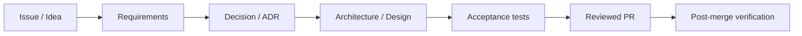

# 📚 Tnyx App · Tio Workspace Documentation
**One map for the product vision, technical boundaries and engineering workflow.**

[🏠 Home](../README.md) · [🎨 Design](../DESIGN.md) · [🤖 Agent rules](../AGENTS.md) · [🧠 AI Context](../.ai/README.md) · [🤝 Contribute](../CONTRIBUTING.md)

> [!IMPORTANT]
> Approved decisions and proposals are labeled separately. **Phase 1.1 Expo mock UI shell exists** on `main` after [PR #11](https://github.com/im-tnyx/Tio-Workspace/pull/11) merged on 2026-11-15; it is not a functional Auth/workout app or published product, and does not imply any production infrastructure.

## 🧭 Choose your path

| **I'm here to…** | **Start with** | **Then read** |
|---|---|---|
| Review what needs approval before coding | [Phase 0 final design + owner approval pack](22-PHASE-0-DESIGN-AND-PHASE-1-APPROVAL.md) | [Phase 1 readiness gate](21-PHASE-1-READINESS.md) |
| Understand the app | [Product requirements](01-PRODUCT-REQUIREMENTS.md) | [Roadmap](06-ROADMAP.md) |
| Review its architecture | [System architecture](02-SYSTEM-ARCHITECTURE.md) | [Local data model](03-LOCAL-DATA-MODEL.md) |
| Check privacy & account design | [Auth & security](04-AUTH-AND-SECURITY.md) | [Threat model](14-THREAT-MODEL.md) |
| Plan cloud/AI work | [Backup & sync](05-BACKUP-AND-SYNC.md) | [API contracts](07-API-CONTRACTS.md) |
| Assess quality | [Acceptance tests](08-TEST-PLAN.md) | [Definition of done](15-DEFINITION-OF-DONE.md) |
| Design a UI or document | [Design system](../DESIGN.md) | [Documentation standards](13-DOCUMENTATION-STANDARDS.md) |
| Make a change | [Contributing](../CONTRIBUTING.md) | [PR review workflow](11-PR-REVIEW-WORKFLOW.md) |
| Work with an AI coding agent | [Agent instructions](../AGENTS.md) | [AI context system](../.ai/README.md) |
| Resume a previously authorized task | [Current context pointer](../.ai/current.md) | [Task handoff template](../.ai/tasks/TEMPLATE.md) |
| Finish a merged change | [Post-merge playbook](12-POST-MERGE-PLAYBOOK.md) | [Changelog](../CHANGELOG.md) |
| Sync local `main` safely after a merge | [Post-merge Git sync guide](../.github/POST-MERGE-SYNC.md) | [Post-merge playbook](12-POST-MERGE-PLAYBOOK.md) |

## 🗃 Detailed document catalog

| # | Document | Role |
|---|---|---|
| 01 | [Product requirements](01-PRODUCT-REQUIREMENTS.md) | Scope, user journeys, non-goals |
| 02 | [System architecture](02-SYSTEM-ARCHITECTURE.md) | Boundaries and local-first flow |
| 03 | [Local data model](03-LOCAL-DATA-MODEL.md) | SQLite structure and migration strategy |
| 04 | [Auth & security](04-AUTH-AND-SECURITY.md) | Sessions, identity, encryption, secrets |
| 05 | [Backup & sync](05-BACKUP-AND-SYNC.md) | Restore, backup and future opt-in sync |
| 06 | [Roadmap](06-ROADMAP.md) | Phase-gated development plan |
| 07 | [API contracts](07-API-CONTRACTS.md) | Proposed AI Edge Function contract |
| 08 | [Test plan](08-TEST-PLAN.md) | Acceptance cases, evidence required |
| 09 | [Decisions](09-DECISIONS.md) | Accepted intentions and open choices |
| 10 | [Repository structure](10-REPOSITORY-STRUCTURE.md) | Paths and module ownership |
| 11 | [PR review workflow](11-PR-REVIEW-WORKFLOW.md) | Before PR → review → merge |
| 12 | [Post-merge playbook](12-POST-MERGE-PLAYBOOK.md) | Verification, release tracking |
| 13 | [Documentation standards](13-DOCUMENTATION-STANDARDS.md) | Consistent visual style + quality |
| 14 | [Threat model](14-THREAT-MODEL.md) | Sensitive assets, threat surfaces |
| 15 | [Definition of done](15-DEFINITION-OF-DONE.md) | Exit criteria for documents and code |
| 16 | [ADR template](16-ADR-TEMPLATE.md) | Reusable architectural decision record |
| 17 | [Phase 0 decision pack](17-PHASE-0-DECISION-PACK.md) | Unapproved owner choices and risk gates |
| 18 | [Offline session state machine](18-OFFLINE-SESSION-STATE-MACHINE.md) | Persistent login, offline access and revocation limitations |
| 19 | [Backup & recovery strategy](19-BACKUP-RECOVERY-STRATEGY.md) | Encryption, fresh-device restore and provider feasibility |
| 20 | [MVP UX flows](20-MVP-UX-FLOWS.md) | Navigation and workout screen states |
| 21 | [Phase 1 readiness](21-PHASE-1-READINESS.md) | Documented go/no-go for future implementation |
| 22 | [Phase 0 design & Phase 1 owner approval](22-PHASE-0-DESIGN-AND-PHASE-1-APPROVAL.md) | Proposed visual freeze, deferred risks and explicit sign-off template |
| 23 | [Input limits, OTP & deferred membership](23-INPUT-LIMITS-OTP-AND-FUTURE-MEMBERSHIP.md) | Proposed numeric caps, approved verified-signup and membership deferment policy |
| 24 | [Phase 1.1 shell implementation guide](24-PHASE-1-1-SHELL.md) | Merged mock shell, PR-head CI/review evidence, remaining native QA and out-of-scope features |
| 25 | [Proposed minimal cloud profile + local onboarding (ADR-019)](25-MINIMAL-CLOUD-PROFILE-AND-LOCAL-ONBOARDING.md) | Fixed Email → OTP → Password; Account Setup has required Username + optional Mobile, then required Name/DOB/Sex, local fitness, a real progress → Done → Continue screen, plus proposed private **`avatar_url` / Storage photo lifecycle** with Name initials fallback (`Tnyx Tio` → `TT`), later Google signup import, server-owned Free Plan and latest Platform/OS/App build snapshot and 7/30-day signup/12-month free-account cleanup **review gates** — pending owner review |
| 26 | [Commit attribution guard](26-COMMIT-ATTRIBUTION-GUARD.md) | Multi-agent `.ai/` identity records, AI co-author prevention, trusted GitHub checks and owner activation gate |
| 27 | [Expo Go live preview from Codespaces](27-EXPO-GO-CODESPACES-LIVE-PREVIEW.md) | Push-triggered sync for the dedicated `tnyx/expo-preview` branch; requires one manually created Codespace and an environment-scoped Actions token secret; no product/Auth/DB changes |

## 🔁 How documents stay reliable

**Ownership:** the repository owner approves changes to privacy defaults, account requirements, encryption key custody and transition out of documentation-only mode.

---

[← README](../README.md) · [Review the roadmap →](06-ROADMAP.md)
