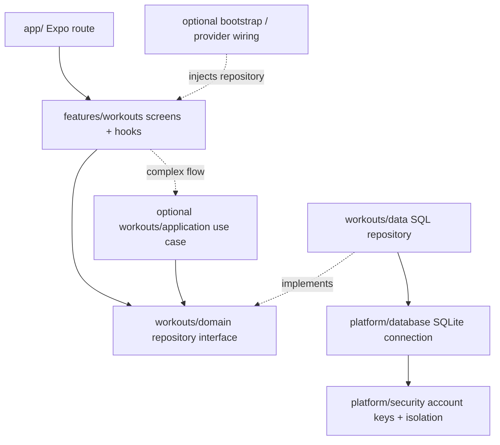

# 🧱 Tio Workspace · Repository Structure v2.1

**Architecture decision:** **Owner-selected on 2026-11-13** — Feature-first Modular Monolith + Lightweight Clean Domain Boundaries + Shared Platform Adapters. This finalizes **source organization**, not Phase 1 implementation.

**Today:** documentation only. None of the proposed `src/` folders, Expo app routes, native SQLite/SQLCipher modules or live Supabase integrations exist.

[← Docs hub](00-INDEX.md) · [🏗 System architecture](02-SYSTEM-ARCHITECTURE.md) · [📝 Decisions](09-DECISIONS.md) · [🤖 Agent rules](../AGENTS.md)

## 1 · Why this structure

One React Native + Expo TypeScript app for iOS and Android. Business capabilities evolve in `features/`; shared technical infrastructure stays in `platform/`; only genuinely reusable non-business code goes into `shared/`. Keep repository interfaces and pure rules separate from SDKs without forcing a full Clean Architecture directory tree into every small feature.

**Chosen structure is a design constraint, not a scaffolding request.** Remaining security/auth/backup decisions in [Phase 0 review](17-PHASE-0-DECISION-PACK.md) and [Phase 1 readiness](21-PHASE-1-READINESS.md) still require explicit approval.

## 2 · Final future tree — not created

```text
Tio-Workspace/
├── src/
│   ├── app/                      # Expo Router routes/layouts + root providers
│   │   ├── _layout.tsx
│   │   ├── (auth)/
│   │   └── (tabs)/
│   ├── features/                 # each major feature owns its internals
│   │   ├── auth/
│   │   ├── home/
│   │   ├── exercises/
│   │   ├── workouts/
│   │   │   ├── screens/         # feature screens
│   │   │   ├── components/      # feature-specific components
│   │   │   ├── hooks/           # presentation orchestration
│   │   │   ├── domain/          # models, rules, repository interfaces
│   │   │   ├── data/            # workout SQL repository implementations
│   │   │   ├── tests/
│   │   │   └── index.ts         # explicit feature public API
│   │   ├── plans/
│   │   ├── progress/
│   │   └── settings/
│   ├── platform/                 # shared technical infrastructure
│   │   ├── database/            # SQLite connection, migrations, single-account binding
│   │   ├── auth/                # Supabase client and Auth adapter
│   │   └── security/            # keys, encryption, account isolation
│   ├── shared/                   # reusable, non-business elements only
│   │   ├── ui/
│   │   ├── theme/
│   │   └── utils/
│   └── bootstrap/                # optional dependency wiring
├── assets/
├── docs/
├── .ai/
└── AGENTS.md
```

`(auth)` and `(tabs)` are route groups, not extra business modules. `src/app/` owns navigation, layouts and root providers only. The tree is illustrative: **no empty placeholders or directories**. Create each directory only when an authorized implementation needs it. `features/workouts/` is an example; every feature need not immediately reproduce all its subfolders.

**Optional complexity layer:** add `features/<name>/application/` or `use-cases/` if multi-step workflow, recovery, several repositories or transaction coordination justify it. Simple feature hooks may call injected repository-facing services; never embed complex domain/business rules permanently in React hooks.

### Dedicated theme tokens and dumb screens (ADR-015 — future implementation only)

The approved source-organization principle remains `src/app/` (navigation/layout), `src/shared/` (reusable non-business UI/theme), `src/features/` (feature presentation/domain/data), `src/platform/` (technical adapters). Within that structure, the **planned canonical token path is `src/shared/theme/tokens/`**, for semantic colors/text, glass tint-opacity-blur, opaque surfaces, borders, shadows, spacing, radius, typography, icons, motion and component aliases. `src/shared/theme/` centrally resolves **default Glass vs Settings-selected Solid** and **System(default)/Light/Dark preference** (resolved centrally) into tokens. `src/shared/ui/` owns one set of TopBar, BottomTabBar, TextField, Button, Card, SheetSurface and other primitives. Plan central typed English catalog and locale-ready formatting in shared presentation/i18n adapter, **not hard-coded screen/business strings**; future Custom/Hindi only after approval. Central app-shell/native orientation policy is **portrait-only** for supported phones, without screen-level rotation handling. These paths are **not created yet**.

**Tab count and presentation ownership:** `src/app/` owns a future single tab registry (stable `key`, `label`, `icon`, valid `route`, order/visibility), and tab-root membership is derived from the **configured registered routes** rather than a fixed list of four. The shared presentation component accepts tab items, selected key, select callback, `layoutVariant` (Standard **now**, Pill **future**) and resolved material/theme. Do not put tab lists or layout branching in feature screens, or expose arbitrary tab-count editing to users now. Test 3/4/5+ configured tabs, narrow widths, large labels/text, accessibility, valid route fallback, safe-area/keyboard and overflow without silent missing tabs. Future extra destinations/variants need explicit owner-approved scope.

**Dumb screen rule:** a screen composes shared components, receives typed view state/props and emits callbacks. It performs **no business logic, async data fetching, auth/session decisions, direct repository/SDK/SQL calls, theme-material calculation or scroll-threshold detection**. Presentation orchestration and effects go in separate feature hooks/controllers; domain/application owns rules and workflows; data/platform own I/O. Optional `application/` layers are justified only by complexity, not created empty. Route shell/shared scroll coordinator decides root/nested TopBar display and tab visibility.

**Chrome policy:** **Glass is default material**, but **Standard is the selected bar layout**: a translucent **full-width, safe-area-aligned bottom bar**, not a floating Pill. App-level **ordered root-tab configuration** initially lists Home/Workout/Library/You; shared `BottomTabBar` renders any approved valid tab list instead of assuming four positions. A separate future `Standard | Pill` layout variant may be owner-approved without changing features, screens or material preferences. Only Settings → Appearance offers persistent **Solid** material; accessibility/no-blur fallback may render opaque surfaces without changing preference. Root compact shared TopBar starts hidden, reveals only after scroll (threshold/hysteresis in shell), hides when returning to top; nested compact/back TopBar appears immediately. Bottom bar hides on every **non-registered nested/modal/full-screen/Auth route**; future configured root additions/removals are handled centrally. Respect safe areas, keyboard, readable contrast, reduced transparency/motion and native platform differences.

## 3 · Dependency and import matrix

| Caller | Allowed | Forbidden |
|---|---|---|
| `app/` | Feature public `index.ts`, shared UI/theme, approved root providers | Business logic, SQL/network queries, deep feature imports |
| `features/*/screens,components,hooks` | Same-feature domain/application via injected contracts; `shared/` | Direct `expo-sqlite`, Supabase SDK or SecureStore imports; other-feature internals |
| `features/*/domain` | Pure TS rules/models/repository interfaces | React/Expo, SDKs, SQL, network, platform implementation |
| `features/*/data` | Same-feature domain ports; `platform/database` or relevant technical adapters | UI/routes; another feature's private internals |
| `features/*/index.ts` | Deliberate stable exports for callers | Export-all of private internals by default |
| `platform/` | Native/external infrastructure SDKs and low-level contracts | Feature UI, feature workflows, domain rules |
| `shared/` | Truly reusable UI/theme/pure utilities | Feature-specific workout logic, feature internal imports |
| `bootstrap/` | Approved dependency composition and wiring | Duplicating product logic or creating premature global services |

**Cross-feature rule:** another feature may consume `features/workouts/index.ts` exports but must not deep-import `features/workouts/data/*`, `hooks/*`, `domain/*` or `components/*`. Prefer explicit public interfaces, and avoid circular feature dependencies. Move a contract into a shared domain home only when real cross-feature reuse is demonstrated and approved.

**Feature UI must not import `expo-sqlite`, SecureStore or Supabase SDK directly.** Feature `domain/` defines repository contracts; feature `data/` implements them. Complex business orchestration belongs in optional `application/`, not in JSX or React hooks.

## 4 · Workout data and identity ownership



- `platform/database/`: owns connection, migrations, open/close and **single bound-account initialization/lock and confirmed reset**. It does not own feature-specific SQL queries.
- `features/workouts/data/`: owns workout SQL and repository implementation, maps domain models, and uses parameterized transactions.
- `platform/auth/`: owns technical Supabase client/adapter; `features/auth/` owns feature-level session behavior, subject to pending offline identity decisions.
- `platform/security/`: owns technical key-access and isolation; **SQLCipher feasibility and key lifecycle are not approved/tested merely by accepting this folder layout**.
- **Workout data stays in local SQLite by default.** Auth does not upload workout records. AI, personal encrypted backup and future cloud sync require separately authorized, opt-in feature slices; no speculative services/packages are created now.

## 5 · Packaging and validation policy

- Start with one Expo app, not one npm package per screen/feature. Do not create `packages/*` or workspaces just to feel modular.
- Extract into a package only with (a) multiple real apps/build targets sharing it, (b) a proven stable API/owner, and (c) a justified build, testing and versioning cost.
- During **approved Phase 1** work, add TypeScript + ESLint checks for forbidden cross-feature deep imports, cycles, domain-to-SDK imports and UI-to-storage/Auth SDK imports. Do not add tools or CI while Phase 0 is documentation-only.
- Validate second-account rejection, same-account re-login, confirmed reset, offline write continuity, schema migration and key-loss failure when runtime exists. Native SQLCipher must be verified with actual native builds. No document counts as a test result.

## 6 · Agent acceptance criteria

- Thin routes; dumb screens only render view state and forward callbacks, while feature hooks/controllers/application/domain own behavior. No business/SDK/theme-scroll decision logic inside screen files.
- Feature domain ports can be tested without Expo/SQL/Supabase.
- Feature data adapters use technical platform services; platform is not business-aware.
- No deep cross-feature imports; public `index.ts` exports only what other features need.
- No direct SQLite, SecureStore or Supabase SDK calls from UI/hooks.
- No new packages, empty folders or premature `application/` layers.
- Current PR contains documentation only; required Codex/owner review precedes merge.

---

**Accepted source-layout decision:** [ADR-009](09-DECISIONS.md) · **No Phase 1 approval:** [Readiness gate](21-PHASE-1-READINESS.md).
