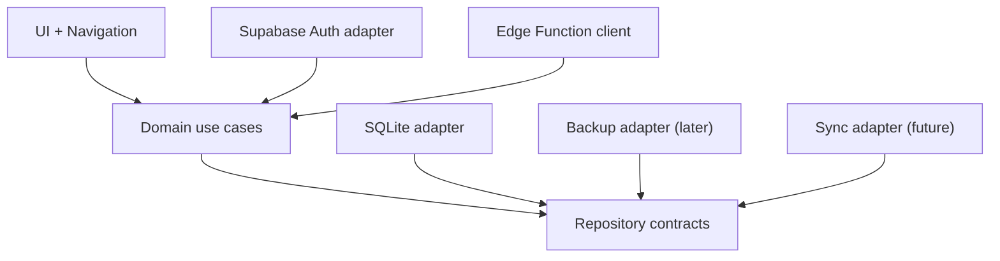

# 🧱 Repository structure & module boundaries

**Status:** Proposed architecture; paths under `src/` and `supabase/` do not yet exist.

[← Docs hub](00-INDEX.md) · [🏠 README](../README.md) · [🏗 System architecture](02-SYSTEM-ARCHITECTURE.md)

## 🗂 Current vs planned

| Today — documentation only | After explicit implementation approval |
|---|---|
| `README.md`, `DESIGN.md`, `AGENTS.md` | `app/` or `src/app/` Expo Router routes |
| `docs/*.md` | `src/features/*` feature screens/use cases |
| `CONTRIBUTING.md`, `SECURITY.md` | `src/domain/*` core types and logic |
| `.github/` issue & PR templates | `src/data/local/*` SQLite and migrations |
| `.ai/` context snapshots, task template and archive rules | `src/security/*` secure local keys and account isolation |
| No app build | `src/data/remote/*` Auth/AI adapters |
| No Supabase deployment | `supabase/functions/*` AI Edge Functions |
| No CI pipeline enabled for builds | `tests/*` acceptance/unit/integration tests |

## 🤖 AI context folder (present today)

The new [`.ai/` context system](../.ai/README.md) mirrors the lightweight organization of Tio Ledger while using **Tio workout-specific** rules. [`current.md`](../.ai/current.md) points at one active task at most; [`core/`](../.ai/core/README.md) is read on demand; [`tasks/`](../.ai/tasks/README.md) records approved objectives; and [`archive/`](../.ai/archive/README.md) keeps completed handoffs. `AGENTS.md` and canonical `docs/` take precedence over transient agent notes.

## 📁 Proposed mobile tree

```text
src/
├── app/                     # navigation and screens (Expo Router)
├── features/
│   ├── auth/                # UI + session use cases
│   ├── workouts/            # create/log/history
│   ├── plans/               # templates/schedule
│   ├── progress/            # charts/PRs
│   ├── settings/            # local-only, privacy, data management
│   └── ai/                  # optional plan draft UI
├── domain/
│   ├── entities/            # Workout, Exercise, Plan, Set
│   ├── repositories/        # WorkoutRepository, PlanRepository
│   └── use-cases/           # validation + business rules
├── data/
│   ├── local/               # account-specific SQLite store, migrations
│   └── remote/              # Supabase Auth, Edge Function clients
├── services/
│   ├── backup/              # later: encrypted archives, provider adapters
│   └── sync/                # future only: opt-in change reconciliation
├── security/                # key/session handling
└── shared/                  # app theme, components, utilities

supabase/
└── functions/
    └── generate-workout-plan/   # after Phase 2 approval
```

## 🧭 Dependency direction



**Rule:** UI never calls workout REST database endpoints directly; SQLite remains authoritative for local features. Domain contracts know nothing about React Native, Expo, Supabase SDKs or cloud APIs.

## 🔑 Ownership

| Concern | Planned owner | Boundary |
|---|---|---|
| Navigation/presentation | `app/`, `shared/ui/` | UI consumes use cases |
| Session/account identity | `features/auth/`, `security/` | Never share cross-account data |
| Workout CRUD | `domain/` + `data/local/` | Writes offline |
| AI network calls | `data/remote/ai/`, `supabase/functions/` | Secret stays server-side |
| Backup/restore | `services/backup/` | Consent + encryption |
| Optional online sync | `services/sync/` | Disabled by default |

## 🔍 Module acceptance

- Dependencies one-way; avoid circular imports.
- Schema migrations and key lifecycle are versioned and tested.
- No account A data appears while account B is active.
- Failed remote calls cannot break local workout writes.
- New external service requires an ADR, privacy review and rollback plan.

---

[← Architecture](02-SYSTEM-ARCHITECTURE.md) · [Testing →](08-TEST-PLAN.md)
