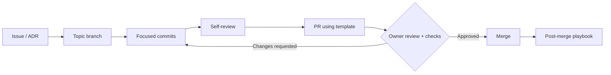

# 🔀 Pull request & review workflow

**Status:** Team process proposal. No required branch protection or CI checks are configured by this document.

[← Docs hub](00-INDEX.md) · [🤝 Contributing](../CONTRIBUTING.md) · [✅ Definition of done](15-DEFINITION-OF-DONE.md)

## 🧭 Delivery path

## 01 · Before opening the PR

- Confirm the phase and issue/decision; docs-only changes until implementation authorization.
- Branch from up-to-date `main` using `docs/...`, `feat/...` or `fix/...`.
- Keep PR focused; explain alternatives and architectural impact.
- Update requirements, ADR, security design and tests as applicable.
- Verify local links, Markdown rendering, Mermaid syntax, examples and changed file list.
- Scan diff for credentials, generated personal data and misleading implementation claims.
- Identify rollout/rollback path for risky approved implementation changes.

## 02 · PR description contract

Use [the repository PR template](../.github/PULL_REQUEST_TEMPLATE.md).

Required sections: **Why**, **What changed**, **Scope/phase**, **Architecture/privacy impact**, **Validation evidence**, **Risks**, **Reviewer checklist**, **Post-merge steps**. Link any related issue/ADR and include design screenshots only if real approved assets exist.

## 03 · Review matrix

| Area | Reviewer asks |
|---|---|
| Scope | Does the change comply with current planning-only gate? |
| Behaviour | Does it preserve local-first, session persistence, account ownership? |
| Security | Any secret, unconsented upload, cross-user read or unsound recovery claim? |
| Documentation | Is visual hierarchy clear and every link working? |
| Data | Are schema and migration assumptions explicitly documented? |
| Testability | Evidence present, or honestly marked not run? |
| Release | Is rollback/recovery safe for impacted users? |

## 04 · Approval and merge gate

1. Required review/owner approval recorded.
2. Resolve blocking review comments.
3. All required configured status checks pass **if they exist**; never claim CI is running when it is not.
4. Branch is current enough to merge safely; conflict resolution reviewed.
5. For privacy, encryption, online-data sharing or account deletion changes, obtain explicit owner approval.
6. Prefer squash merge for cohesive work; document resulting commit/PR and do not rewrite protected history.

> [!IMPORTANT]
> Creating a PR, even a docs-only PR, **does not grant permission to merge or start coding**. A maintainer decision is required.

## 05 · Where evidence lives

- PR discussion: scope, review feedback, sign-off.
- Files: requirements, ADR, architecture, tests and design updates.
- `CHANGELOG.md`: **merged**, user-visible changes only.
- [Post-merge playbook](12-POST-MERGE-PLAYBOOK.md): final checks and traceability.

---

[← Contributor guide](../CONTRIBUTING.md) · [Post-merge →](12-POST-MERGE-PLAYBOOK.md)
