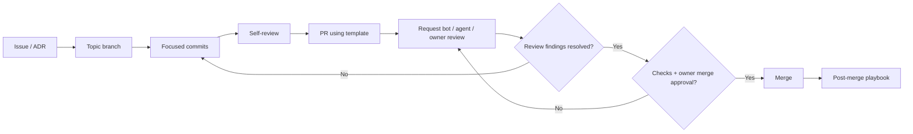

# 🔀 Pull request & review workflow

**Status:** Team process proposal. No required branch protection or CI checks are configured by this document.

[← Docs hub](00-INDEX.md) · [🤝 Contributing](../CONTRIBUTING.md) · [✅ Definition of done](15-DEFINITION-OF-DONE.md)

## 🧭 Delivery path

## 01 · Before opening the PR

- Confirm the phase and issue/decision; docs-only changes until implementation authorization.
- Branch from up-to-date `main` using `docs/...`, `feat/...` or `fix/...`.
- Keep PR focused; explain alternatives and architectural impact.
- Update requirements, ADR, security design and tests as applicable.
- Verify local links, Markdown rendering, Mermaid syntax, examples and changed file list.
- Scan diff for credentials, generated personal data and misleading implementation claims.
- Identify rollout/rollback path for risky approved implementation changes.

## 02 · PR description contract

Use [the repository PR template](../.github/PULL_REQUEST_TEMPLATE.md).

Required sections: **Why**, **What changed**, **Scope/phase**, **Architecture/privacy impact**, **Validation evidence**, **Risks**, **Reviewer checklist**, **Post-merge steps**. Link any related issue/ADR and include design screenshots only if real approved assets exist.

## 03 · Review matrix

| Area | Reviewer asks |
|---|---|
| Scope | Does the change comply with current planning-only gate? |
| Behaviour | Does it preserve local-first, session persistence, account ownership? |
| Security | Any secret, unconsented upload, cross-user read or unsound recovery claim? |
| Documentation | Is visual hierarchy clear and every link working? |
| Data | Are schema and migration assumptions explicitly documented? |
| Testability | Evidence present, or honestly marked not run? |
| Release | Is rollback/recovery safe for impacted users? |

## 04 · Request and record a review

**Default: one recorded review of every PR before merge.** Review provider may be:
- **Cursor Bugbot** — when enabled for `im-tnyx/Tio-Workspace` in Cursor Automations; automatic on PR push, or comment `bugbot run` / `cursor review`. Tuned by `.cursor/config/bugbot.yaml` on the base branch. Leaves inline comments/suggestions; check name typically `Cursor Bugbot`.
- **Cursor Security Reviewer** — when a Security Review automation is configured for this repo; check name typically `Cursor Security Agent: Security Reviewer`. Use Workspace instructions in `.cursor/config/security-reviewer.instructions.md`.
- **GitHub Copilot Code Review** — request under GitHub PR **Reviewers → Copilot** if the account/repository is eligible; automated review can be configured in GitHub Settings. It normally leaves `COMMENT`, not a required formal approval.
- **Codex Code Review** — request `@codex review` in a PR comment only where Codex GitHub Code Review is enabled; `AGENTS.md` supplies focused product rules.
- **Independent AI agent / ChatGPT reviewer** — review the actual current diff and canonical docs **read-only**, then post a clearly labeled AI-assisted review, ideally with inline path/line references and a link to evidence.
- **Repository owner / human reviewer** — review the diff manually through Files changed and record substantive findings or a scoped review sign-off. A PR author cannot self-approve through GitHub.

Use [the review guide](../.github/REVIEW_GUIDE.md) to get actionable, line-specific findings. **Never claim that a bot is installed, a review ran, or a formal approval exists unless GitHub shows it.**

### Review outcome

| State | Meaning | Merge-ready? |
|---|---|---|
| `REVIEW_PENDING` | Requested/unavailable; no completed assessment | No under default quality policy |
| `CHANGES_REQUESTED` | At least one unresolved blocking finding | No |
| `INCONCLUSIVE` | Reviewer couldn't inspect critical scope or evidence | No, or owner-authorized deferral |
| `PASS` | Reviewed current scope, no open blocking findings; result linked | Still requires checks + owner merge authorization |
| `OWNER_DEFERRED_REVIEW` | Owner approved proceeding despite pending review, scope/risk/checkpoint documented | Not automatic merge; branch protection still applies |

**Inline thread protocol:** classify by severity, inspect exact path/line, fix real findings, reply with fix commit and validation, and resolve the thread only when addressed. After material pushes, ask for re-review of newly changed areas; earlier assessment is not automatically evidence of the new head. Informational bot comments are feedback, not GitHub's `APPROVED` state; avoid forcing bot approval when platform doesn't support it.

### Reviewer checklist

- Privacy: no default cloud workout upload, no credentials in client, no cross-account local exposure.
- Session: offline work still functions, revoked status isn't claimed without network verification.
- Architecture: Expo/React Native paths and phase rules are respected; no Flutter or Ledger imports.
- Scope and truth: planned vs shipped status and authorizations accurately represented.
- Validation: exact checks and skipped tests documented; no fake CI/device evidence.

## 05 · Approval and merge gate

1. Record a completed review with reviewer identity, reviewed SHA/scope, verdict and disposition of blocking inline comments; or an explicit owner-authorized deferral with risks and follow-up.
2. Resolve blocking review comments, and request re-review after material fixes. Distinguish bot/AI comments from GitHub formal `APPROVED` reviews.
3. All required configured status checks pass **if they exist**; never claim CI is running when it is not. **Owner-authorized deferral does not bypass required checks**.
4. Branch is current enough to merge safely; conflict resolution reviewed.
5. For privacy, encryption, online-data sharing or account deletion changes, obtain explicit owner approval.
6. Prefer squash merge for cohesive work; document resulting commit/PR and do not rewrite protected history.

> [!IMPORTANT]
> Creating a PR, even a docs-only PR, **does not grant permission to merge or start coding**. A maintainer decision is required.

## 06 · Where evidence lives

- PR discussion: scope, review feedback, sign-off.
- Files: requirements, ADR, architecture, tests and design updates.
- `CHANGELOG.md`: **merged**, user-visible changes only.
- [Post-merge playbook](12-POST-MERGE-PLAYBOOK.md): final checks and traceability.

---

[← Contributor guide](../CONTRIBUTING.md) · [Post-merge →](12-POST-MERGE-PLAYBOOK.md)
