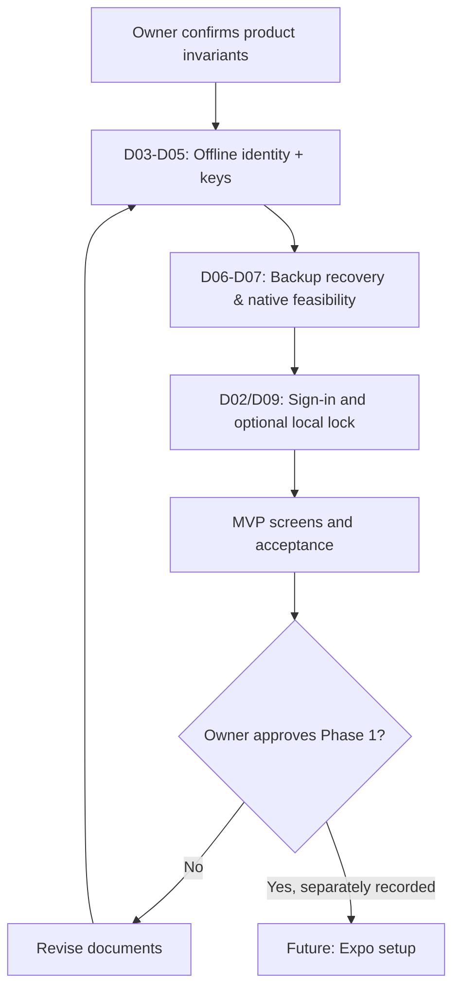

# 🧭 Phase 0 · Decision Review Pack
**Resolve the choices that would otherwise force risky rewrites later.**

[← Docs hub](00-INDEX.md) · [🏠 README](../README.md) · [📋 Tracking issue #2](https://github.com/im-tnyx/Tio-Workspace/issues/2)

> [!IMPORTANT]
> **No new decisions in this document are owner-approved.** Recommendations are starting points for review. The original product intentions in [09-DECISIONS.md](09-DECISIONS.md) remain the constraints. This document neither authorizes Phase 1 nor changes the default local-only privacy policy.

## ✅ Already specified by the owner

| Constraint | Required outcome |
|---|---|
| Account mandatory | Initial signup/sign-in requires online Auth |
| Familiar login | Normal app close/open does not ask for login again |
| Offline workouts | Existing initialized account can log workouts without internet |
| Workout privacy | Device SQLite is default; signup alone does **not** upload diary |
| AI security | Provider credentials are server-side in Edge Function secrets |
| Backup/sync separation | Personal backup is optional; app-database cloud sync is separately opt-in and **future only** |
| Project order | Documentation and approvals precede app code |

## 🚦Decision queue

| Ref | Decision needed | Working recommendation — **not approved** | Risk if undecided | Owner status |
|---|---|---|---|---|
| D01 | Product name/identity | Use **Tio** provisionally; finalize identifiers before builds | Medium | ⬜ Pending |
| D02 | Sign-in options | Email/password MVP; evaluate Google/Apple provider UX later | Medium | ⬜ Pending |
| D03 | Offline session policy | Allow cached verified local identity for offline use with no claim of real-time server validity | **High** | ⬜ Pending |
| D04 | User switching/log out | Separate encrypted per-account data; logout locks and retains existing logs; erase is a separate confirmed action | **High** | ⬜ Pending |
| D05 | Local key lifecycle | Use native SQLCipher build, verify encryption, OS secure key storage, and reinstall behaviour | **High** | ⬜ Pending |
| D06 | Backup recovery | Versioned authenticated encryption with independent, user-recoverable secret | **High** | ⬜ Pending |
| D07 | Personal cloud provider | Android Drive appDataFolder feasibility; iOS iCloud native spike, fallback to encrypted file export | **High** | ⬜ Pending |
| D08 | AI provider + request policy | Select provider after privacy, pricing, output schema and quota review | Medium | ⬜ Pending |
| D09 | PIN/biometric | Offer optional app lock, with explicit recovery/lockout rules | Medium | ⬜ Pending |
| D10 | Workout catalog & licensing | Start with a small curated/manual exercise catalog | Low | ⬜ Pending |
| D11 | Analytics and retention | No workout payload analytics by default; separate crash logs from workout content | Medium | ⬜ Pending |
| D12 | Future sync deletion semantics | Separate disabling sync from deleting cloud copies; revisit in Phase 4 | **High later** | ⬜ Pending |
| D13 | Local ORM and migration tooling | Propose Drizzle ORM + offline-bundled SQLite migrations after SQLCipher unlock, with fail-closed encrypted recovery | **High** | ⬜ Pending |

## 🧱 Architecture trade-offs at a glance

### Authentication: offline local access vs remote revocation

| Option | Benefit | Cost |
|---|---|---|
| Require online check every app start | Fresh server status | Breaks offline workout requirement |
| **Recommended proposal:** cached locally verified identity + server validation when online | Works in gyms without connection | Revoked user can retain cached device-local access until online revalidation |
| Permit completely unauthenticated local guest mode | Maximum offline availability | Violates required signup |

Read the exact [session state machine](18-OFFLINE-SESSION-STATE-MACHINE.md). The owner must explicitly accept the offline revocation trade-off or choose additional local device authentication.

### Local database keys

A key protected only by device secure storage is useful for **local** database security; it must not be the sole key for **cross-device** cloud backup restoration. See [recovery strategy](19-BACKUP-RECOVERY-STRATEGY.md).

### Backup vs sync

| Operation | User controls | Destination | Conflict handling |
|---|---|---|---|
| Local workout save | Default | Device | SQLite transaction |
| Personal backup | Explicit opt-in | User's Drive/iCloud or exported file | Snapshot/restore with confirmation |
| App cloud sync | Separate future opt-in | App-managed Postgres | Two-way edits, tombstones, merge policy |

**Never** label personal backup a real-time synchronization feature.

## 🧩 Review order (to avoid wasted work)

## 📋 Required owner sign-off

- [ ] Approve/adjust the D01–D13 recommendations above; record reasons and privacy consequences (D13 does not waive D04–D06).
- [ ] Confirm account switching, logout, account deletion and local erase semantics.
- [ ] Accept or reject offline access after undetectable server revocation.
- [ ] Approve recovery UX for encrypted backup **before** promising restore.
- [ ] Approve [MVP screen/interaction proposal](20-MVP-UX-FLOWS.md).
- [ ] Validate on-device build feasibility for SQLCipher and iCloud before freezing plans.
- [ ] Authorize Phase 1 **in a separate written approval**, never by merging a docs PR.

## 🔗 Primary technical references (recheck on implementation day)

- [Supabase React Native Auth quickstart](https://supabase.com/docs/guides/auth/quickstarts/react-native)
- [Expo SQLite / SQLCipher](https://docs.expo.dev/versions/latest/sdk/sqlite/)
- [Expo SecureStore / platform persistence](https://docs.expo.dev/versions/latest/sdk/securestore/)
- [Google Drive app data folder](https://developers.google.com/workspace/drive/api/guides/appdata)
- [Apple iCloud capabilities](https://developer.apple.com/documentation/xcode/configuring-icloud-services/)
- [Supabase Function secrets](https://supabase.com/docs/guides/functions/secrets)

---

[← Decision register](09-DECISIONS.md) · [Session flow →](18-OFFLINE-SESSION-STATE-MACHINE.md) · [Phase 1 gate →](21-PHASE-1-READINESS.md)
