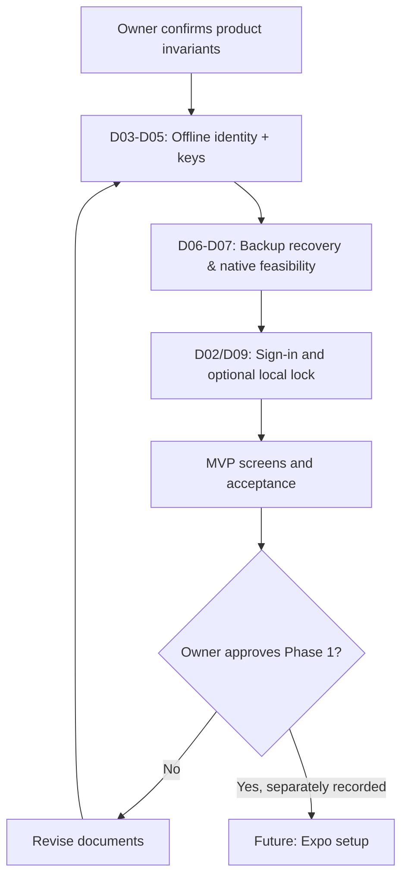

# 🧭 Phase 0 · Decision Review Pack
**Resolve the choices that would otherwise force risky rewrites later.**

[← Docs hub](00-INDEX.md) · [🏠 README](../README.md) · [📋 Tracking issue #2](https://github.com/im-tnyx/Tio-Workspace/issues/2)

> [!IMPORTANT]
> **ADR-010/011/012 owner decisions (2026-11-14):** D13 tooling plus D02–D06 core policies and D10 small exercise/MVP scope were accepted; **D04 explicitly forbids account switching/add-account**. D01, D07–D09, D11–D12 details and native/security implementations remain pending. The original product intentions in [09-DECISIONS.md](09-DECISIONS.md) remain the constraints. This document neither authorizes Phase 1 nor changes the default local-only privacy policy.

## ✅ Already specified by the owner

| Constraint | Required outcome |
|---|---|
| Account mandatory | Initial signup/sign-in requires online Auth |
| Familiar login | Normal app close/open does not ask for login again |
| Offline workouts | Existing initialized account can log workouts without internet |
| Workout privacy | Device SQLite is default; signup alone does **not** upload diary |
| AI security | Provider credentials are server-side in Edge Function secrets |
| Backup/sync separation | Backup **OFF by default**; encrypted archives **only in user's Drive/iCloud/exported file**, not Supabase Postgres/Storage. Tio app-server data sync is separately opt-in and **future only** |
| Project order | Documentation and approvals precede app code |

## 🚦Decision queue

| Ref | Decision needed | Working recommendation / selection | Risk if undecided | Owner status |
|---|---|---|---|---|
| D01 | Product name/identity | Use **Tio** provisionally; finalize identifiers before builds | Medium | ⬜ Pending |
| D02 | Sign-in options | Supabase **email/password MVP**; Google/Apple optional later | Medium | ✅ Policy approved (ADR-011) |
| D03 | Offline session policy | Previously verified bound identity may log workouts offline; remote revocation is unknown until online | **High** | ✅ Trade-off accepted (ADR-011) |
| D04 | **No account switching** / logout | **One locally bound account per installation**; no second login while bound; logout locks retained history, separately confirmed erase/reset required | **High** | ✅ Policy approved (ADR-011) |
| D05 | Local key lifecycle | Per-bound-user SQLCipher key in protected OS storage, fail closed; native build/reinstall validation outstanding | **High** | ✅ Principle approved; verification pending (ADR-011) |
| D06 | Backup recovery | Future encrypted backup **OFF by default**, optional manual / best-effort scheduled copies, **user-held portable recovery secret**; cleared/reinstalled app has empty local diary until optional same-user restore | **High** | ✅ UX/policy approved (ADR-011/012); crypto/provider tests pending |
| D07 | Personal cloud provider | **Owner-selected UI pattern:** familiar Settings → Backup, last success/progress/failure, storage guidance, best-effort frequency and future attachment controls; Drive/iCloud feasibility and export fallback not approved as working capabilities | **High** | ⬜ Implementation/provider pending (ADR-012 UX only) |
| D08 | AI provider + request policy | Select provider after privacy, pricing, output schema and quota review | Medium | ⬜ Pending |
| D09 | PIN/biometric | Offer optional app lock, with explicit recovery/lockout rules | Medium | ⬜ Pending |
| D10 | Workout catalog & licensing | MVP includes small curated/manual exercise entry; third-party licensing needs review | Low | ✅ MVP scope approved; licensing pending (ADR-011) |
| D11 | Analytics and retention | No workout payload analytics by default; separate crash logs from workout content | Medium | ⬜ Pending |
| D12 | Future sync deletion semantics | Separate disabling sync from deleting cloud copies; revisit in Phase 4 | **High later** | ⬜ Pending |
| D13 | Local ORM and migration tooling | **Selected:** Expo SQLite + Drizzle ORM/Drizzle Kit + native SQLCipher; offline-bundled migrations. Unlock, key and recovery implementation require validation | **High** | ✅ Approved — stack only (ADR-010, 2026-11-14) |

## 🧱 Architecture trade-offs at a glance

### Authentication: offline local access vs remote revocation

| Option | Benefit | Cost |
|---|---|---|
| Require online check every app start | Fresh server status | Breaks offline workout requirement |
| **Recommended proposal:** cached locally verified identity + server validation when online | Works in gyms without connection | Revoked user can retain cached device-local access until online revalidation |
| Permit completely unauthenticated local guest mode | Maximum offline availability | Violates required signup |

Read the exact [session state machine](18-OFFLINE-SESSION-STATE-MACHINE.md). The owner **accepted** delayed remote revocation detection for local offline workouts on 2026-11-14 (ADR-011); any later optional PIN/biometrics still requires recovery/lockout UX review.

### Local database keys

A key protected only by device secure storage is useful for **local** database security; it must not be the sole key for **cross-device** cloud backup restoration. See [recovery strategy](19-BACKUP-RECOVERY-STRATEGY.md).

### Backup vs sync

| Operation | User controls | Destination | Conflict handling |
|---|---|---|---|
| Local workout save | Default | Device | SQLite transaction |
| Personal backup | Explicit opt-in, OFF by default | **Only user-selected Drive/iCloud or encrypted exported file — never Supabase** | Encrypted snapshot/restore with confirmation |
| App cloud sync | Separate future opt-in; **not authorized now** | Future server-managed Supabase Postgres + RLS (not backup storage) | Two-way edits, tombstones, merge policy; sync is **not historical backup** |

**Never** label personal backup a real-time synchronization feature, or future sync a guaranteed historical backup. A future sync-enabled user need not turn on personal Drive/iCloud backup; cloud-sync deletions may propagate. Local SQLite remains the authoritative first choice until any separately approved sync is explicitly enabled.

## 🧩 Review order (to avoid wasted work)

## 📋 Required owner sign-off

- [x] Record owner-selected **D02–D06 policy, D10 MVP scope and D13 tooling** in ADR-010/011; selection does not certify implementation security.
- [ ] Resolve **D01, D07–D09, D11–D12** remaining scope/provider/UX/privacy details and native validation before relevant phases.
- [x] Confirm **no account switching**, same-account re-login after logout, and separate confirmed erase/reset; server account deletion details remain a separate future UX.
- [x] Accept offline local access despite unverifiable remote revocation until reconnection; online functions still require server authorization.
- [x] Approve portable user-held recovery **principle** and **optional-backup OFF default + clear-data empty/restore UX** (ADR-012).
- [ ] Finalize recovery-code UX, cryptography, native Drive/iCloud integration and real fresh-device restore testing **before** promising recovery.
- [x] Approve [MVP functional screens/flows](20-MVP-UX-FLOWS.md) for Home, Plans, Exercise Library, Workouts, History, Progress, Settings and Auth.
- [ ] Finalize branding, visual hierarchy and detailed destructive/reset copy.
- [ ] Validate on-device build feasibility for SQLCipher and iCloud before freezing plans.
- [ ] Authorize Phase 1 **in a separate written approval**, never by merging a docs PR.

## 🔗 Primary technical references (recheck on implementation day)

- [Supabase React Native Auth quickstart](https://supabase.com/docs/guides/auth/quickstarts/react-native)
- [Expo SQLite / SQLCipher](https://docs.expo.dev/versions/latest/sdk/sqlite/)
- [Expo SecureStore / platform persistence](https://docs.expo.dev/versions/latest/sdk/securestore/)
- [Google Drive app data folder](https://developers.google.com/workspace/drive/api/guides/appdata)
- [Apple iCloud capabilities](https://developer.apple.com/documentation/xcode/configuring-icloud-services/)
- [Supabase Function secrets](https://supabase.com/docs/guides/functions/secrets)

---

[← Decision register](09-DECISIONS.md) · [Session flow →](18-OFFLINE-SESSION-STATE-MACHINE.md) · [Phase 1 gate →](21-PHASE-1-READINESS.md)
