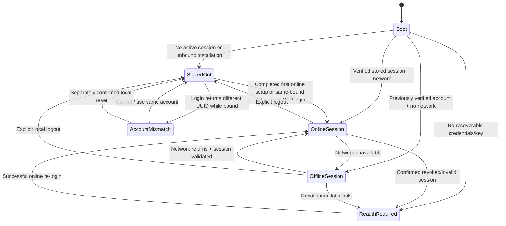

# 🔐 Offline Session & Account Lifecycle
**One login, persistent experience, honest offline security boundaries.**

[← Docs hub](00-INDEX.md) · [🧭 Decision pack](17-PHASE-0-DECISION-PACK.md) · [🛡 Security](04-AUTH-AND-SECURITY.md)

> [!IMPORTANT]
> A cached session is **not** proof that the remote account remains valid today. Offline local workout access and authorization to call an online Edge Function are **different operations**.

## 01 · UX contract

After a user has successfully registered or signed in online, closing/killing/reopening the app should ordinarily reopen the dashboard **without a login form**. When the network is unavailable, the previously initialized user's local workouts should still open. This is the **owner-selected** offline policy (ADR-011), subject to protected credentials and the sole account binding. A remote revocation cannot be proven or detected without connectivity.

The app must never offer first-ever offline registration, an add-account/switch-account feature, or another user's access to the locally bound diary.

## 02 · Owner-selected state behavior (not implemented)

**Security refinement:** An OTP-verified but password/profile/local-setup-incomplete Auth session is **not** eligible for `OnlineSession` or `OfflineSession` Home access. Resume its [trusted lifecycle stage](27-OTP-FIRST-AUTH-LIFECYCLE.md) online. If online token refresh fails from network timeout, do **not** treat timeout as confirmed revocation. Distinguish genuine invalid credentials from mere loss of connectivity.

## 03 · State table

| State | Dashboard? | Local workout writes? | AI/cloud calls? |
|---|---|---|---|
| `Boot` / locked | No; splash/loading only | No | No |
| `SignedOut` | No | No | No |
| `OnlineSession` | Yes | Yes | Authenticated/consented operations only |
| `OfflineSession` (cached account) | Yes after local unlock | Yes | No until remote auth can be validated |
| `ReauthRequired` | No normal dashboard; show recovery/login | No by default; preserve encrypted file | No |
| `AccountMismatch` (blocked) | No; explain that the device is bound to another account | No | No |

**Accepted risk / remaining UX:** Offline use for a previously verified bound user is allowed even if remote revocation cannot be checked. **No arbitrary offline expiry** or mandatory PIN should be invented. Optional app lock, recovery and timeout UX can be separately reviewed.

## 04 · Startup sequence & trust checks

1. On app start, read installation metadata and protected session/identity storage; do not show last user's dashboard before identity/DB gate completes.
2. Verify that the sole locally bound account identifier corresponds to a prior **successful online sign-in** (immutable Supabase UUID, never email). Preserve this protected binding across logout.
3. Unlock only that user's encrypted SQLite database with an account-specific key.
4. If online, validate/refresh server session as applicable; server calls always use valid authenticated credentials.
5. If offline and locally eligible, enter `OfflineSession`, show a quiet offline indicator, allow all basic workout CRUD.
6. If server **confirms** session invalid/revoked, move to `ReauthRequired`; do not erase local history. Decide whether any read-only local recovery view should exist only after security review.
7. If local DB key cannot be recovered, do not open an unencrypted replacement under the same identity or falsely display zero history. Offer documented backup recovery options.

## 05 · Logout, blocked second account and deletion

| User action | Session | Local database | Backup/server data |
|---|---|---|---|
| Close app | Persist, subject to policy | Retain account-specific data | Unchanged |
| Logout | Clear/revoke applicable auth credentials, close DB and clear in-memory keys | **Retained, locked** | Unchanged; show explicit distinction |
| Attempt different account login | **Reject** different Supabase UUID while installation is bound | Keep existing encrypted DB/key and binding untouched; no switch UI | No transfer |
| Explicit erase/reset installation | Clear bound identity only after separate destructive confirmation and loss warning | Delete local ciphertext/key only by the approved explicit workflow; next online setup may bind a fresh identity | Does not automatically delete personal backups or server account; restore requires matching identity and an earlier successful encrypted backup |
| Delete workout records only (optional future separate control) | Requires confirmation | Erase workout records **without** releasing the installation binding or reusing its key for another user | Does not silently remove backup/cloud copies |
| Delete account (future flow) | Requires recent online reauth and server-side confirmation | Explicit data-deletion choice and recovery warning | Must separately handle third-party backup and any future sync copies |

Never use a plain email string to select the database or allow one account to reference another user's encryption key.

## 06 · Tokens and keys — do not conflate

- `Supabase publishable key`: okay in mobile app configuration; **not** an authorization credential by itself.
- `User access/refresh tokens`: session credentials; use a verified storage strategy appropriate for platform limits and lifecycle.
- `Local SQLCipher key`: one key for the single bound account; protected via OS key storage and retained through logout for same-account re-login.
- `Backup recovery secret`: different, portable and user-recoverable so a new phone can decrypt the exported file.
- `AI provider secret`: only in server-side Edge Function secrets.

Expo Auth tutorials demonstrate different persistence adapters. Treat the exact production adapter, storage size limits and offline token refresh behaviour as **implementation acceptance tasks**, not as solved by documentation.

## 07 · Test matrix

| ID | Scenario | Expected outcome |
|---|---|---|
| S-01 | Online sign-up → kill app → reopen online | Home opens without asking to sign in |
| S-02 | Online sign-up → airplane mode → reopen | Correct user's local data opens |
| S-03 | Offline edit → kill app → reopen | Committed sets/weights still present |
| S-04 | Network timeout refreshing tokens | No false “revoked” conclusion, local work continues |
| S-05 | Server confirms revoked token after reconnect | Online functions stop and reauth is required |
| S-06 | Logout while online/offline | Login screen; no exposed workout content |
| S-07 | A logs out then B attempts login on A-bound installation | Reject B; no new DB/binding and no read of A records |
| S-08 | Same account login again | Existing local history preserved |
| S-09 | Reinstall/clear app data without backup | Explicit recovery explanation; do not promise history |
| S-10 | Cannot unlock encrypted DB | Safe error, no plaintext fallback, no overwrite |
| S-11 | User explicitly erases local data and resets installation | Warn history may be permanently lost; clear binding/key/data only after confirmed completion; next setup requires online auth and optional same-user backup restore |
| S-12 | OS clear-data/reinstall + old account re-login | If local DB missing, show fresh empty history or explicit matching encrypted backup restore; Auth login alone cannot recreate workouts |

## 08 · Owner decisions required

- [x] Offline cached access and delayed revocation trade-off accepted (ADR-011).
- [x] No account switching; logout retains encrypted binding, explicit erase/reset separate.
- [ ] Implement and validate secure key lifetime, erase atomicity, account-mismatch error states and recovery warnings.
- [ ] Review optional future app lock, reauth-required screen details and recovery copy.

---

[← Review pack](17-PHASE-0-DECISION-PACK.md) · [Data model](03-LOCAL-DATA-MODEL.md) · [Phase 1 gate →](21-PHASE-1-READINESS.md)
