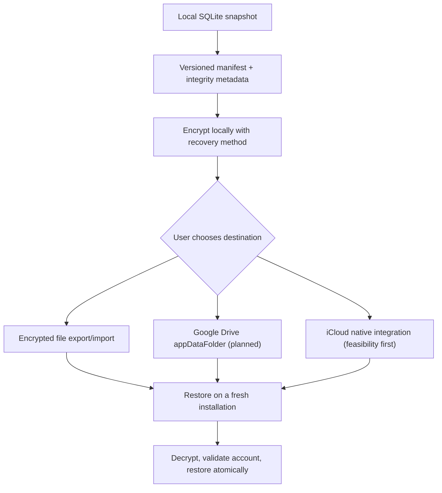

<div align="center">

# ☁️ Personal Backup & Recovery Strategy
**Recoverable encryption without accidental cloud synchronization.**


[← Docs hub](00-INDEX.md) · [🧭 Decision pack](17-PHASE-0-DECISION-PACK.md) · [☁️ Backup spec](05-BACKUP-AND-SYNC.md)

</div>

> [!WARNING]
> This specifies a **future, user-opt-in-only** feature. A completed backup archive must be encrypted on device and stored only in the user's selected Google Drive/iCloud or a manually exported file, **not Supabase Postgres/Storage**. No Google Drive, iCloud, native entitlement, key-derivation implementation or recovery flow has been integrated or tested. It is not safe to promise user data survives uninstall until full fresh-device restore testing succeeds.

## 01 · Three distinct keys/copies

| Component | Purpose | Recovery properties |
|---|---|---|
| SQLCipher key | Encrypt on-device SQLite | May be device-bound; never assume it can be moved to a new phone |
| Backup encryption key | Authenticated-encrypt portable archive | Must be recoverable **independently** of the original device |
| Supabase auth session | Confirm account identity and protect online operations | Does **not** decrypt backup by itself |

**Owner-approved principle (ADR-011):** a separate **portable user-held recovery secret** must protect future encrypted personal backups. **Unapproved implementation proposal:** derive or wrap a backup data-encryption key using a high-entropy recovery code or adequately strong passphrase, with a vetted memory-hard password KDF and random salt, encrypted using a well-reviewed authenticated encryption implementation. The full cryptographic format needs an independent security review before launch. Do not invent cryptography or store the only recovery secret in the cloud archive.

## 02 · Minimum viable backup order



**Sequencing recommendation:** prove a manual encrypted export/import **before** promising Google Drive/iCloud automation. This separates cryptographic correctness from provider-specific OAuth and native integration.

## 03 · Google Drive plan

- Consider private `appDataFolder` with least-privilege `drive.appdata` authorization; confirm OAuth platform account selection and app identity before implementation.
- Backups in `appDataFolder` are **hidden from the normal Drive UI**, are not Android OS device backups and may be deleted by the user. Provide a clear in-app list and delete/restore controls.
- Handle revoked consent, wrong Google account, quota exceeded, interrupted upload, missing archive, duplicate backups and app reinstallation.
- Never report “Backup completed” until encrypted upload finishes and provider confirms durable file metadata; maintain last-success time separately from attempted time.

## 04 · iCloud reality check

- “iCloud backup” might mean iCloud Documents, CloudKit or Apple's OS-level app backup; they have different capabilities and deletion/restore semantics.
- Native iCloud support can require entitlements, an Apple Developer account, configured containers and native build integration. **Expo Go alone is not a deployment proof.**
- Prototype actual cross-device upload, file discovery, permission errors and deletion on real iOS hardware before committing to automatic backup.
- If native integration is too costly/fragile for an early milestone, provide **encrypted export/import via Files/share sheet** as an honest fallback.

## 05 · File format contract (draft, not final crypto)

```text
tio-backup-v1
  manifest.json: format_version, app_schema_version, owner_user_id,
                 exported_at_utc, cipher_suite_id, kdf_id, kdf_parameters,
                 salt, nonce, payload_length
  payload.enc:   authenticated encrypted snapshot
```

- The manifest must be authenticated (e.g., as associated data), not merely stored alongside ciphertext.
- Do not place private exercise/workout content in unencrypted metadata.
- For a database export, generate a **transactionally consistent** snapshot rather than copying an open DB file unsafely.
- Import should be atomic, with a local safety checkpoint and a non-destructive validation preview.
- Refuse unrecognized future versions by default; support documented migration paths rather than silently dropping fields.

### OS backup is not a Personal Backup archive

App Backup OFF does not control all OS device/iCloud backup and device-transfer paths. The future native policy must check Android legacy/cloud/D2D exclusions and iOS backup-exclusion flags for SQLite and sidecars; see [the detailed OS backup gate](05-BACKUP-AND-SYNC.md). A transferred device-bound key is not a portable decryption method, and an accidental OS-restored database is not a verified user-consented archive. Device validation remains pending.

### Recovery when local mode and provider settings are lost

OS clear-data/reinstall or a fresh phone may erase the remembered backup preference. After **same-account online identity verification**, offer a voluntary **Find existing encrypted backup** action regardless of a missing/unknown local mode. The user picks and authorizes Google Drive/iCloud (or selects an encrypted exported file); list provider-accessible archives, authenticate the archive and owner UUID, then require the portable recovery secret and explicit Restore confirmation. Discovery neither uploads workouts nor enables backup/sync. Wrong provider, unavailable appDataFolder/iCloud integration, revoked permission or deleted archive must produce an honest no-result/error state rather than fabricated Supabase Auth recovery.

## 06 · Restore UX

**Owner-selected behavior (2026-11-14; ADR-012/013):** Local Only is default. **Personal Backup** to user's Drive/iCloud is optional and encrypted, and never simultaneously enabled with future Supabase Sync. After clear-data/reinstall/phone change, same-account online login in Personal Backup mode may offer explicit **Restore Backup** if a completed matching archive and portable recovery secret are available; skipping it or no usable archive means empty history. **Only in a future, previously enabled and authorized Supabase Sync mode**, available server workout rows can **automatically rehydrate** the new local encrypted database after login, **without** Backup Restore. With **Local Only**, Auth login alone never reconstructs workouts. A prior Supabase Auth identity may still exist: “fresh” means empty local workouts, not a new Auth account. Do not promise auto-download until future sync is implemented and tested.

**Backup settings reference:** a familiar, dedicated Settings → Backup page with last successful backup, **Back up now**, Off/Daily/Weekly/Monthly automatic backup (best effort), progress, failure/retry, storage management and recovery guidance. Cloud encryption is always required, even if a reference screenshot shows it off. Photo/video include switches are relevant **only if separately approved user attachments exist**, not as new Phase 1 features. Provider capability and exact background cadence require native validation. See [backup screen contract](05-BACKUP-AND-SYNC.md).

**Platform wipe nuance:** Android app-data removal commonly deletes sandbox data, but iOS Keychain entries can outlive uninstall. Detect a fresh installation independently from Keychain remnants; a missing/unknown SQLite file or install marker must not be interpreted as a successfully restored workout history. Fail closed on inconsistent binding/key/file states.

### Restore steps

1. On new device: successfully sign in to Tio online and confirm account identity.
2. Select user-owned backup destination and file/version.
3. Enter recovery passphrase/code or use an explicitly approved recovery flow.
4. Validate authenticated integrity, compatible schema, source account ID, record totals and size limits.
5. Show confirmation: **Replace local history** (default for v1), with clear warning and a safety snapshot.
6. Import into a temporary/staging database; validate integrity; atomically switch current account's store only on success.
7. Confirm new workouts/history are queryable before showing “Restored”; on failure keep existing local store intact.

**Account mismatch / one-account installation:** never import a backup from another UUID into the bound installation, and never change the binding as part of restore. Fresh-install Restore Backup requires Personal Backup mode and the same verified Supabase user; future server sync hydration likewise requires verified account authorization. Neither is an account-switch/transfer UX. Changing cloud mode needs explicit handling of prior remote data, not implicit deletion.

## 07 · Failure and recovery matrix

| Failure | Expected safe result |
|---|---|
| Wrong recovery code | No restore; no data overwritten |
| Modified or truncated archive | Authentication fails; preserve current DB |
| Missing/revoked cloud permission | Continue local mode; user can retry connection |
| Backup deletion from provider | Warn no remote copy; don't imply restore is available |
| Phone lost, no backup | Local-only history may be unrecoverable |
| Upload interrupted | No success badge; retain previous verified snapshot |
| Wrong signed-in Tio account | Stop restore and explain account mismatch |
| New device without local SQLCipher key | Restore is a **future test target**, possible only with a completed compatible encrypted backup and independent recovery secret; not yet a proven capability |

## 08 · Owner decisions required

- [x] Independent user-held portable recovery **principle** selected.
- [ ] Choose the precise code/passphrase UX, cryptographic KDF/format and loss warnings after security review.
- [x] User can select no backup; **manual backup on demand** and optional future scheduled backups chosen as UX policy. Native schedule feasibility and exact cadence still require testing.
- [ ] Decide cross-platform encrypted file export delivery order after feasibility tests; do not claim it is implemented.
- [ ] Should Android default to appDataFolder and iOS start with Files export fallback?
- [ ] Retention/rotation, file deletion, last successful backup metadata and key-loss warnings.

## External documentation

[Google Drive appDataFolder](https://developers.google.com/workspace/drive/api/guides/appdata) · [Apple iCloud capability setup](https://developer.apple.com/documentation/xcode/configuring-icloud-services/) · [Expo SecureStore](https://docs.expo.dev/versions/latest/sdk/securestore/)

---

[← Backup spec](05-BACKUP-AND-SYNC.md) · [Decision pack](17-PHASE-0-DECISION-PACK.md) · [Phase 1 gate →](21-PHASE-1-READINESS.md)
