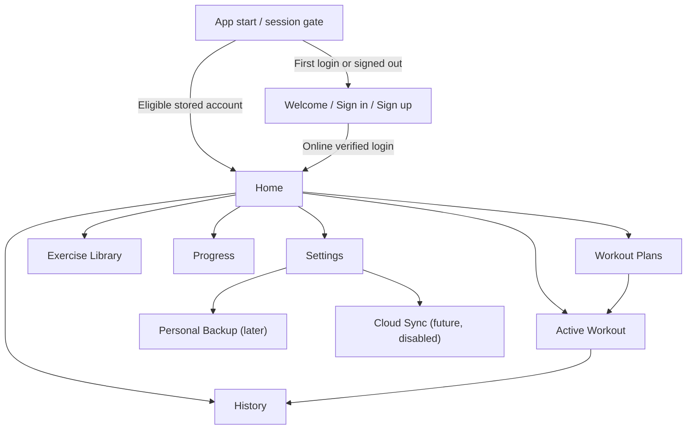

# 📱 MVP Screens & User Flows
**Design the offline workout experience before building screens.**

[← Docs hub](00-INDEX.md) · [🎨 Design system](../DESIGN.md) · [🎯 Requirements](01-PRODUCT-REQUIREMENTS.md)

> [!NOTE]
> This is a **text-first UX specification**. No Figma file, final icon, screenshot or running prototype exists. Visual tokens in [DESIGN.md](../DESIGN.md) are proposals, not implemented components.

## 01 · Proposed navigation

**Navigation recommendation:** Home, Plans, History, Progress and Settings as the main areas. Exercise library opens from planning/workout editing; workout session is a focused full-screen flow.

## 02 · Screen contract

| Screen | Primary CTA | Offline | Empty/error state |
|---|---|---|---|
| Session gate | Resume existing authenticated user | Yes if account is initialized and locally eligible | Need login / reauth / unavailable key |
| Auth | Create account / Sign in | No for first-time login | Network error, invalid credentials, email verification |
| Home | Start / Resume Workout | Yes | “Create your first plan” / “Start a free workout” |
| Exercise Library | Add exercise | Yes, local list | No results; add custom exercise |
| Plan Editor | Save workout plan | Yes | Missing required exercise fields |
| Active Workout | Log/complete sets | Yes | Autosave/transaction failure and resume |
| History | Open past session | Yes | No logged sessions |
| Progress | View PRs / volume | Yes | Insufficient data, unit selection |
| Settings | View account and storage | Mostly | Explicit offline labels for network actions |
| Personal Backup (later) | Backup / Restore | Needs connection for remote provider | Last good backup, missing permission |
| AI Draft (later) | Generate then approve | No | AI unavailable; preserve local session |
| Cloud Sync (future) | Explicit opt-in | Not part of MVP | Show “Not available yet”, never fake an active switch |

## 03 · Happy path — first user

1. Welcome → sign up online → any required email confirmation → verified identity bound to a local account store.
2. Home offers “Start workout” and “Create plan”.
3. User starts a session, picks exercise, logs repetitions/weight and marks sets complete.
4. App commits changes to local SQLite transactionally. A clear “Saved on this device” indicator appears.
5. User finishes session; History and Progress update from local records.
6. Closing and reopening the app normally returns to Home, not sign-in.

## 04 · Happy path — no internet at the gym

1. User opens app in airplane mode, previously initialized account is eligible for offline access.
2. Home, Plans, Active Workout, History and Progress work.
3. Login creation, AI plan generation, cloud backup and future sync are unavailable or clearly deferred.
4. UI **does not** queue or upload workout data to the application server unless a future explicit sync setting permits it.
5. Restoring network does not interrupt an active set editor.

## 05 · Critical interactions

| Interaction | Proposed copy | Accessibility/feedback |
|---|---|---|
| First saved set | “Saved on this device” | Short, non-blocking success feedback |
| Offline | “Offline · Workouts still work” | Icon + text, not only colored dot |
| Logout | “You'll be signed out. Your local workouts stay on this device.” | Explicit confirmation |
| Local delete | “Delete workouts from this device?” | Separate destructive flow, never hidden behind logout |
| No backup | “Without backup, uninstalling or losing your phone may lose your workout history.” | Visible in backup screen |
| AI draft | “Review and edit before saving” | Never auto-apply generated routines |
| Reauth | “Sign in again to confirm your account.” | Do not claim the account was deleted because internet is unavailable |

## 06 · Component and state requirements

- Touch-friendly weight and reps controls with unit indicators and number input validation.
- Strong contrast and text resizing; target iOS/Android hit-area guidance.
- Workout autosave shows *local* persistence status, not “Synced”.
- Confirmation for irreversible delete; allow editing an unfinished session after restart.
- Each screen covers `loading`, `empty`, `offline`, `error`, and account-safety states.
- No screen should accidentally show the previous user's cached data during identity switching.

## 07 · Design acceptance checklist

- [ ] Final home screen hierarchy selected.
- [ ] Auth and session-gate screen transitions reviewed with [session specification](18-OFFLINE-SESSION-STATE-MACHINE.md).
- [ ] Workout set editor tested for one-handed operation and large text.
- [ ] Logout/delete/recovery copy approved.
- [ ] Android and iOS navigation behaviours documented.
- [ ] All cloud states explicitly distinguish default local-only from later opt-in features.

---

[← Design](../DESIGN.md) · [Session flow →](18-OFFLINE-SESSION-STATE-MACHINE.md) · [Phase 1 readiness →](21-PHASE-1-READINESS.md)
