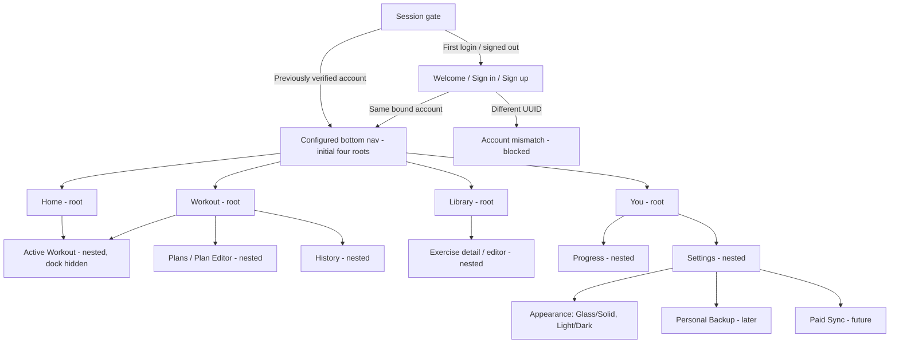

# 📱 MVP Screens & User Flows
**Design the offline workout experience before building screens.**

[← Docs hub](00-INDEX.md) · [🎨 Design system](../DESIGN.md) · [🎯 Requirements](01-PRODUCT-REQUIREMENTS.md)

> [!NOTE]
> The **functional MVP screen scope** (Auth, Home, Exercises, Plans, Workouts, History, Progress, Settings) is owner-selected (ADR-011), with **no account switching**. This is a text-first UX specification. No Figma file, final icon, screenshot or running prototype exists. Visual tokens in [DESIGN.md](../DESIGN.md) are proposals, not implemented components.

## 01 · Owner-selected root navigation (ADR-015)

**Initial configured root tabs:** **Home, Workout, Library, You** (four for this MVP). This is a **Standard full-width bottom navigation bar now**, not a floating Pill or modal sheet. Its **material is default iPhone-inspired translucent Glass**, so **Standard + Glass** has background showing through; Solid is the separate Settings preference. A **Pill layout is a later presentation option, not included or user-selectable now**. The shared bar must consume an ordered **tab registry/config** so future owner-selected fewer/more/reordered roots work without hardcoded screen logic. The current Standard bar persists while scrolling configured root screens and hides on Active Workout, Plan Editor, History, Progress, exercise details, Settings, Backup and all non-tab/Auth/nested/full-screen routes. **Root compact TopBar is hidden at scroll top and appears only after scrolling**; nested routes show shared compact/back TopBar immediately. Workout links plans/history/session, Library has exercise lookup, You links Progress/Settings and Home start/resume.

### Shared shell and theme choices (owner-selected)

- Settings → Appearance: **Glass is the default**, **Solid only via this Settings control**, and Light/Dark independent. All four combinations required; initial Light/Dark choice still pending. Technical/reduced-transparency fallback may render Solid without changing saved Glass. No cloud upload/account change.
- One **TopBar** takes the reference's rounded/translucent grouped style without copied branding or unapproved search/notifications. On root tab screens the compact TopBar is **hidden initially**, revealing **after scrolling** via centrally owned threshold/reduced-motion-friendly transition and hiding when back at top. On nested screens it is **visible immediately** with back affordance.
- One **BottomTabBar** draws the current **Standard safe-area-aligned, full-width bar**, with default background-translucent **Glass** or Settings-selected **Solid** material at any root scroll position. Its destinations come from the future **app-owned ordered tab config** (initial Home/Workout/Library/You, changeable later), not a four-slot constant; optional floating **Pill** is a later layout variant. All shared fields, buttons, cards, sheets, switches/selects and text use `src/shared/theme/tokens/` in light/dark.
- Future `src/shared/theme/tokens/` supplies tokens, `src/shared/ui/` supplies shared primitives, `src/app/` owns routes/tab visibility and shared scroll TopBar coordinator; features compose them. **Every screen stays dumb** (view state/props and callbacks only), with async/state orchestration in feature hooks/controllers, business rules in domain/application and SDK/I/O in data/platform. See [module architecture](10-REPOSITORY-STRUCTURE.md). **Future paths only**.
- Glass uses readable tinted translucent/blurred surfaces with borders; Solid uses opaque equivalents. Validate iOS/Android text contrast, keyboard/safe areas, 44pt/48dp touch targets, dynamic type and reduce-transparency/high-contrast fallback after implementation. If blur unavailable, render Solid fallback without changing saved preference.

**Config-driven tab contract (owner-selected architecture, not an active management screen):** future app shell supplies ordered root-tab descriptors with stable keys, accessible icon/label, valid destination and root/nested visibility. `BottomTabBar` accepts descriptors and a layout variant; Standard is the initial product selection, Pill reserved for later approval. No per-screen tab list, duplicated navigation logic, implicit extra tabs or user-facing tab editor in MVP. A count change may require new real destination screens and a separate reviewed product decision. Use responsive item distribution, safe-area and keyboard handling; verify 3/4/5+ tab fixtures and larger font sizes without clipped or unreachable tabs.

**Tnyx and Hindi-ready typography (ADR-016):** All new user-facing copy uses **Tnyx** as app name. Settings → Appearance → Typography has **Default OS/system** and **Custom app font**, both Devanagari-capable with script fallback. Shared tokens control buttons, nav labels, forms and sheets; future localized messages use separate translation resources, not font changes or hardcoded strings in dumb screens. Test `UX-11` with Hindi matras/conjuncts, mixed English/Hindi, large text, caret and accessible layouts after implementation. Exact licensed font and language rollout are pending.

**Selected UI direction (ADR-016):** Black/White/Gray is Tnyx's **neutral default with no mandatory colored accent**. Neutral navigation selection, progress, CTA and focus must be readable. A **future** Settings → Accent Color picker may let the user choose named colors (Teal `#00BFBF` is just one candidate), but is NOT part of initial MVP. Appearance Light/Dark and Glass/Solid are separate axes; semantic danger/error colors remain. Screenshot is visual reference only, not a UI clone. See [DESIGN](../DESIGN.md), [UX-12/13](08-TEST-PLAN.md).

**Application ID:** `com.tnyx.tio` selected for Android and iOS, subject to ownership/registration verification. Visible name is Tnyx; repo and versioned archive IDs remain unchanged.

## 02 · Screen contract

| Screen | Primary CTA | Offline | Empty/error state |
|---|---|---|---|
| Session gate | Resume existing authenticated user | Yes if account is initialized and locally eligible | Need login / reauth / unavailable key |
| Auth | **Online email/password Signup → Email OTP verify**; existing same-bound Sign in | No for new signup/verification | Pending/wrong/expired OTP, resend 429/cooldown, no guest, account mismatch denied, network error; unverified cannot open Home/workout DB |
| Home | Start / Resume Workout | Yes | “Create your first plan” / “Start a free workout” |
| Workout (root) | Start/resume, plans and history links | Yes | Empty plans, in-progress resume |
| Exercise Library (Library root) | Browse/search **curated exercises only** in current MVP | Yes, offline curated list | Empty results, choose exercise; **no custom-create screen until future membership, max 50/member** |
| You (root) | Account, Progress and Settings links | Mostly | Bound identity / offline state |
| Plan Editor | Save workout plan | Yes | Missing required exercise fields |
| Active Workout | Log/complete sets | Yes | Autosave/transaction failure and resume |
| History | Open past session | Yes | No logged sessions |
| Progress | View PRs / volume | Yes | Insufficient data, unit selection |
| Settings (nested) | Glass/Solid + Light/Dark, **Typography Default/Custom**, bound account, logout and separate erase/reset | Mostly | Hindi/Devanagari-capable persistent typography independent of appearance, no account switch, irreversible reset warning |
| Personal Backup (later) | Optional Back up now / Restore / settings | Needs network for remote upload/download; manual encrypted file workflow depends on platform | OFF by default; last success/progress/failure/quota/recovery states |
| AI Draft (later) | Generate then approve | No | AI unavailable; preserve local session |
| Supabase Sync (future paid membership) | Full-workout-data premium alternative to Personal Backup | Not part of MVP | **Disabled/unavailable now**; when built, Settings offers one choice: Local Only / Personal Backup / Supabase Sync, never both ON |

## 03 · Happy path — first user

1. Welcome → sign up online with email + password → **enter emailed OTP** and verify it server-side → confirm same-user immutable UUID → bind/unlock encrypted local store → Home. Until confirmed, only Auth/OTP screens, no guest workouts.
2. Home offers “Start workout” and “Create plan”.
3. User starts a session, picks exercise, logs repetitions/weight and marks sets complete.
4. App commits changes to local SQLite transactionally. A clear “Saved on this device” indicator appears.
5. User finishes session; History and Progress update from local records.
6. Closing and reopening the app normally returns to Home, not sign-in.

## 04 · Happy path — no internet at the gym

1. User opens app in airplane mode, previously initialized account is eligible for offline access.
2. Home, Plans, Active Workout, History and Progress work.
3. Login creation, AI plan generation, cloud backup and future sync are unavailable or clearly deferred.
4. UI **does not** queue or upload workout data to the application server unless a future explicit sync setting permits it.
5. Restoring network does not interrupt an active set editor.

## 05 · Critical interactions

| Interaction | Proposed copy | Accessibility/feedback |
|---|---|---|
| First saved set | “Saved on this device” | Short, non-blocking success feedback |
| Offline | “Offline · Workouts still work” | Icon + text, not only colored dot |
| Logout | “You'll be signed out. Your local workouts stay on this device and remain tied to this account.” | Explicit confirmation |
| Local erase/reset | “Erase this device's workouts and unlink this account? Without a backup, they cannot be recovered.” | Separate destructive confirmation; never hidden behind logout |
| No backup | “Backup is off. Clearing app data, uninstalling, or losing this phone can permanently remove your workout history.” | Visible in backup settings and before destructive reset |
| Restore available after fresh login (Personal Backup) | “An encrypted backup is available. Restore it?” — **Restore / Skip** | Ask only after verifying an accessible same-account archive and portable recovery secret; Skip keeps empty/local data unchanged and does not enable uploads. Restore requires final overwrite confirmation. |
| Missing backup settings on fresh install | “No workouts on this device.” + optional “Find existing encrypted backup” | Not an automatic restore prompt; user picks provider, verifies matching archive and may Restore or Skip without enabling Backup/Sync. |
| Future Sync after fresh login | “Downloading your workouts…” | Only if previously opted-in Sync is server-authorized and records are available; hydrate automatically after same-account login. **Never show the Backup Restore prompt/button during Sync hydration**; show truthful offline/error/empty states. |
| Cloud mode change (future) | “Choose one cloud option. Previous cloud copies may still exist.” | Never allow simultaneous Backup + Sync; disclose old copies, obtain consent and verify deletion/handling before asserting exclusive storage |
| Backup failed | “Backup failed. Your workouts are still saved on this device.” | Show reason, Retry and storage guidance; retain last successful backup date |
| AI draft | “Review and edit before saving” | Never auto-apply generated routines |
| Reauth | “Sign in again with the account already linked to this device.” | Do not claim the account was deleted because internet is unavailable |
| Different account login | “This device is linked to another Tnyx account. Sign in with that account; changing accounts is not supported.” | Block before data access; no automatic reset |

**Owner-selected security/limit UX (ADR-017):** required email/password signup OTP and no-guest access; target 6 digits/10-minute expiry/60-second resend/5 sends-hour/5 incorrect attempts/15-minute cooldown, requiring real provider/server verification; **CAPTCHA not in MVP**. Password 8–64, optional username 3–16 graphemes, program/routine creation max 50/30 (no minimum **creation count**; **saved program/routine names 3–25 graphemes**), sets 1–8. Free Library uses curated exercises; **custom exercise creation reserved for later paid members (max 50)**, with no current paywall or add-custom action. Previously verified same-account offline use retained. See [limits](23-INPUT-LIMITS-OTP-AND-FUTURE-MEMBERSHIP.md).

## 05A · Future paid Sync membership gate

Supabase Sync and any paid membership/paywall are **deferred until after the core workout MVP is complete**. No membership screen or purchase controls in the initial app; later approved Settings must clearly label Sync **Membership required**, not default. Membership purchase alone must not enable upload: a separate informed Sync opt-in is needed to transfer the **complete supported workout dataset**. Basic local workouts and Personal Backup are not gated behind this subscription. Pricing, payments, cancellation and server retention UX need separate authorization and testing.

## 05B · Future backup UI states (WhatsApp-inspired)

The owner-provided iOS/Android screenshots inform **information hierarchy only**, not an instruction to reproduce WhatsApp. Future Settings → Backup needs a visible **Off/default**, provider setup, **Back up now**, last **successful** backup date/size, optional schedule picker **Off/Daily/Weekly/Monthly**, current **Uploading** byte/percentage indicators when measurable, **Failed** reason/Retry/Manage storage, and a user-held encrypted recovery method. Encrypt every backup; no “E2E Off” switch. **Include photos/videos** is shown only if an approved attachment feature exists; it is **not** a workout MVP feature. OS-based automatic timing and iCloud/Drive availability are unverified.

**Clear data distinction:** Normal restart and logout do **not** wipe the diary. Clear storage/reinstall/reset may remove SQLite. After same-account online login, future **Supabase Sync** (if previously opted in, implemented and still authorized) downloads available server data automatically **without Restore Backup UI**; otherwise start with empty local history and optionally offer **Find existing encrypted backup** when settings were lost. A verified Personal Backup archive is **never restored automatically**: present **Restore / Skip**; Skip/cancel makes no changes, and Restore needs explicit overwrite confirmation. Supabase Auth alone has no workout copy. Local Only remains default, and Backup + Sync cannot both be active.

## 06 · Component and state requirements

- Touch-friendly weight and reps controls with unit indicators and number input validation.
- Strong contrast and text resizing; target iOS/Android hit-area guidance.
- Workout autosave shows *local* persistence status, not “Synced”.
- Confirmation for irreversible delete; allow editing an unfinished session after restart.
- Each screen covers `loading`, `empty`, `offline`, `error`, and account-safety states.
- Never expose cached workout data when a different account attempts login; **no identity-switching flow exists**.

**Owner-selected shell (ADR-015):** **initial** four tab roots Home / Workout / Library / You in a **Standard full-width layout with default Glass translucency**, future tab count/order via config and Pill layout deferred; root compact TopBar **scroll-revealed only**, nested TopBar immediately visible; Settings-only Solid option, independent Light/Dark; centralized theme tokens and dumb screens. Existing MVP features remain nested. See the [approval pack](22-PHASE-0-DESIGN-AND-PHASE-1-APPROVAL.md) and P0 UX-01–05/08–11 versus later P1 UX-06, P2 UX-07; final palette/QA/screenshot sign-off remains pending.

## 07 · Design acceptance checklist

- [ ] Final home screen hierarchy selected.
- [x] Functional MVP screens and single-account auth/session-gate transitions selected (ADR-011; [session specification](18-OFFLINE-SESSION-STATE-MACHINE.md)); visual design/real-device tests pending.
- [ ] Workout set editor tested for one-handed operation and large text.
- [ ] Exact logout/erase/recovery wording and accessibility behavior reviewed in a design acceptance pass; policy selected.
- [x] Intended iOS/Android configured-root-only Standard Glass bar, initial four destinations, future tab-count/layout extensibility, nested hide and shared TopBar variants recorded (ADR-015); not tested in native builds.
- [ ] iOS/Android Glass/Solid × Light/Dark, contrast and fallback validated on actual devices.
- [ ] All cloud states explicitly distinguish default local-only from later opt-in features.

---

[← Design](../DESIGN.md) · [Session flow →](18-OFFLINE-SESSION-STATE-MACHINE.md) · [Phase 1 readiness →](21-PHASE-1-READINESS.md)
