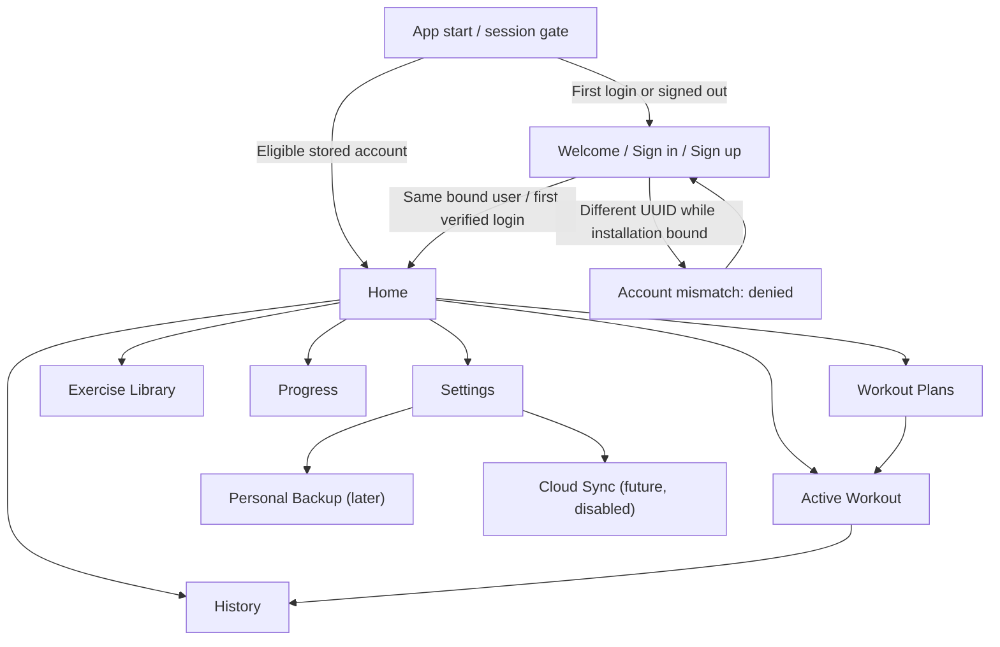

# 📱 MVP Screens & User Flows
**Design the offline workout experience before building screens.**

[← Docs hub](00-INDEX.md) · [🎨 Design system](../DESIGN.md) · [🎯 Requirements](01-PRODUCT-REQUIREMENTS.md)

> [!NOTE]
> The **functional MVP screen scope** (Auth, Home, Exercises, Plans, Workouts, History, Progress, Settings) is owner-selected (ADR-011), with **no account switching**. This is a text-first UX specification. No Figma file, final icon, screenshot or running prototype exists. Visual tokens in [DESIGN.md](../DESIGN.md) are proposals, not implemented components.

## 01 · Proposed navigation

**Navigation recommendation:** Home, Plans, History, Progress and Settings as the main areas. Exercise library opens from planning/workout editing; workout session is a focused full-screen flow.

## 02 · Screen contract

| Screen | Primary CTA | Offline | Empty/error state |
|---|---|---|---|
| Session gate | Resume existing authenticated user | Yes if account is initialized and locally eligible | Need login / reauth / unavailable key |
| Auth | First signup / same-bound-user Sign in | No for first-time login | Network error, invalid credentials, different-account denied, email verification |
| Home | Start / Resume Workout | Yes | “Create your first plan” / “Start a free workout” |
| Exercise Library | Add exercise | Yes, local list | No results; add custom exercise |
| Plan Editor | Save workout plan | Yes | Missing required exercise fields |
| Active Workout | Log/complete sets | Yes | Autosave/transaction failure and resume |
| History | Open past session | Yes | No logged sessions |
| Progress | View PRs / volume | Yes | Insufficient data, unit selection |
| Settings | View the sole bound account, logout and separate erase/reset | Mostly | Explicit offline labels, no add-account/switch UI, irreversible reset warning |
| Personal Backup (later) | Optional Back up now / Restore / settings | Needs network for remote upload/download; manual encrypted file workflow depends on platform | OFF by default; last success/progress/failure/quota/recovery states |
| AI Draft (later) | Generate then approve | No | AI unavailable; preserve local session |
| Supabase Sync (future paid membership) | Full-workout-data premium alternative to Personal Backup | Not part of MVP | **Disabled/unavailable now**; when built, Settings offers one choice: Local Only / Personal Backup / Supabase Sync, never both ON |

## 03 · Happy path — first user

1. Welcome → sign up online → any required email confirmation → verified identity bound to a local account store.
2. Home offers “Start workout” and “Create plan”.
3. User starts a session, picks exercise, logs repetitions/weight and marks sets complete.
4. App commits changes to local SQLite transactionally. A clear “Saved on this device” indicator appears.
5. User finishes session; History and Progress update from local records.
6. Closing and reopening the app normally returns to Home, not sign-in.

## 04 · Happy path — no internet at the gym

1. User opens app in airplane mode, previously initialized account is eligible for offline access.
2. Home, Plans, Active Workout, History and Progress work.
3. Login creation, AI plan generation, cloud backup and future sync are unavailable or clearly deferred.
4. UI **does not** queue or upload workout data to the application server unless a future explicit sync setting permits it.
5. Restoring network does not interrupt an active set editor.

## 05 · Critical interactions

| Interaction | Proposed copy | Accessibility/feedback |
|---|---|---|
| First saved set | “Saved on this device” | Short, non-blocking success feedback |
| Offline | “Offline · Workouts still work” | Icon + text, not only colored dot |
| Logout | “You'll be signed out. Your local workouts stay on this device and remain tied to this account.” | Explicit confirmation |
| Local erase/reset | “Erase this device's workouts and unlink this account? Without a backup, they cannot be recovered.” | Separate destructive confirmation; never hidden behind logout |
| No backup | “Backup is off. Clearing app data, uninstalling, or losing this phone can permanently remove your workout history.” | Visible in backup settings and before destructive reset |
| Restore available after fresh login (Personal Backup) | “An encrypted backup is available. Restore it?” — **Restore / Skip** | Ask only after verifying an accessible same-account archive and portable recovery secret; Skip keeps empty/local data unchanged and does not enable uploads. Restore requires final overwrite confirmation. |
| Missing backup settings on fresh install | “No workouts on this device.” + optional “Find existing encrypted backup” | Not an automatic restore prompt; user picks provider, verifies matching archive and may Restore or Skip without enabling Backup/Sync. |
| Future Sync after fresh login | “Downloading your workouts…” | Only if previously opted-in Sync is server-authorized and records are available; hydrate automatically after same-account login. **Never show the Backup Restore prompt/button during Sync hydration**; show truthful offline/error/empty states. |
| Cloud mode change (future) | “Choose one cloud option. Previous cloud copies may still exist.” | Never allow simultaneous Backup + Sync; disclose old copies, obtain consent and verify deletion/handling before asserting exclusive storage |
| Backup failed | “Backup failed. Your workouts are still saved on this device.” | Show reason, Retry and storage guidance; retain last successful backup date |
| AI draft | “Review and edit before saving” | Never auto-apply generated routines |
| Reauth | “Sign in again with the account already linked to this device.” | Do not claim the account was deleted because internet is unavailable |
| Different account login | “This device is linked to another Tio account. Sign in with that account; changing accounts is not supported.” | Block before data access; no automatic reset |

## 05A · Future paid Sync membership gate

Supabase Sync will be unavailable in the initial MVP. Later Settings must clearly label it **Membership required**, not default. Membership purchase alone must not enable upload: a separate informed Sync opt-in is needed to transfer the **complete supported workout dataset**. Basic local workouts and Personal Backup are not gated behind this subscription. Pricing, payments, cancellation and server retention UX need separate authorization and testing.

## 05B · Future backup UI states (WhatsApp-inspired)

The owner-provided iOS/Android screenshots inform **information hierarchy only**, not an instruction to reproduce WhatsApp. Future Settings → Backup needs a visible **Off/default**, provider setup, **Back up now**, last **successful** backup date/size, optional schedule picker **Off/Daily/Weekly/Monthly**, current **Uploading** byte/percentage indicators when measurable, **Failed** reason/Retry/Manage storage, and a user-held encrypted recovery method. Encrypt every backup; no “E2E Off” switch. **Include photos/videos** is shown only if an approved attachment feature exists; it is **not** a workout MVP feature. OS-based automatic timing and iCloud/Drive availability are unverified.

**Clear data distinction:** Normal restart and logout do **not** wipe the diary. Clear storage/reinstall/reset may remove SQLite. After same-account online login, future **Supabase Sync** (if previously opted in, implemented and still authorized) downloads available server data automatically **without Restore Backup UI**; otherwise start with empty local history and optionally offer **Find existing encrypted backup** when settings were lost. A verified Personal Backup archive is **never restored automatically**: present **Restore / Skip**; Skip/cancel makes no changes, and Restore needs explicit overwrite confirmation. Supabase Auth alone has no workout copy. Local Only remains default, and Backup + Sync cannot both be active.

## 06 · Component and state requirements

- Touch-friendly weight and reps controls with unit indicators and number input validation.
- Strong contrast and text resizing; target iOS/Android hit-area guidance.
- Workout autosave shows *local* persistence status, not “Synced”.
- Confirmation for irreversible delete; allow editing an unfinished session after restart.
- Each screen covers `loading`, `empty`, `offline`, `error`, and account-safety states.
- Never expose cached workout data when a different account attempts login; **no identity-switching flow exists**.

## 07 · Design acceptance checklist

- [ ] Final home screen hierarchy selected.
- [x] Functional MVP screens and single-account auth/session-gate transitions selected (ADR-011; [session specification](18-OFFLINE-SESSION-STATE-MACHINE.md)); visual design/real-device tests pending.
- [ ] Workout set editor tested for one-handed operation and large text.
- [ ] Exact logout/erase/recovery wording and accessibility behavior reviewed in a design acceptance pass; policy selected.
- [ ] Android and iOS navigation behaviours documented.
- [ ] All cloud states explicitly distinguish default local-only from later opt-in features.

---

[← Design](../DESIGN.md) · [Session flow →](18-OFFLINE-SESSION-STATE-MACHINE.md) · [Phase 1 readiness →](21-PHASE-1-READINESS.md)
