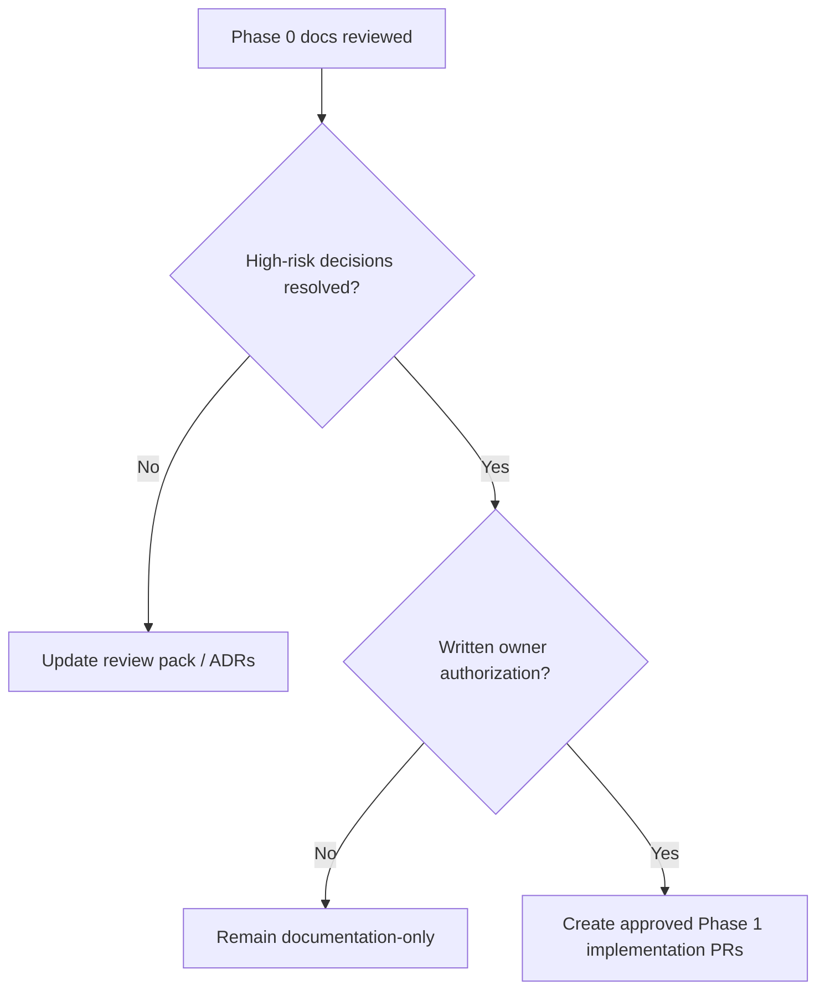

# 🚦 Phase 1 · Implementation Readiness Gate
**A written approval checklist for starting Expo development later.**

[← Docs hub](00-INDEX.md) · [🧭 Decision pack](17-PHASE-0-DECISION-PACK.md) · [🗺 Roadmap](06-ROADMAP.md)

> [!IMPORTANT]
> **This is a readiness checklist, not an implementation task.** Completing/merging this document does not authorize writing application code, generating secrets or deploying Supabase.

## 01 · Prerequisite decisions

| Gate | What must be true | Current |
|---|---|---|
| Product | Branding, MVP scope and screens signed off | ⬜ Pending |
| Session | Persistent online login + offline account-policy edge cases approved | ⬜ Pending |
| Data isolation | Account-specific SQLite/key lifecycle and logout/erase semantics approved | ⬜ Pending |
| Native build | SQLCipher build/validation strategy accepted (Expo Go limitations understood) | ⬜ Pending |
| Privacy | Workouts stay local; cloud upload disabled by default | ✅ Requirement recorded, **not tested** |
| Secrets | AI provider secrets server-side; publishable keys understood | ✅ Requirement recorded, **not tested** |
| Backup | Later-phase recovery principles agreed, no false restore promises | ⬜ Pending |
| Tests | Platform and acceptance test plan agreed | ⬜ Pending |
| Owner authorization | Explicit written approval for Phase 1 implementation | ⬜ Pending |

## 02 · Proposed Phase 1 slices **after** approval

| Slice | Deliverable | Exit evidence |
|---|---|---|
| 1.1 | Expo TypeScript app shell, routing/theme, basic CI | Physical device starts shell, test command documented |
| 1.2 | Auth sign-up/sign-in/forgot password; secure persistence adapter | Correct persistent login and offline session flows |
| 1.3 | Encrypted account-local SQLite + migration manager | `PRAGMA cipher_version` verified in native build; account-switch tests |
| 1.4 | Exercise library and plan editor | Local creation/edit/restart works without network |
| 1.5 | Workout sets/session logging | Atomic autosave and crash/restart recovery |
| 1.6 | History/progress, logout, local erase UX | Correct account isolation, privacy and offline tests |
| 1.7 | Release candidate validation | Android/iPhone device acceptance evidence and documented limitations |

Do **not** pull AI, Drive/iCloud backup or Postgres sync into Phase 1 by implication. They have their own later gated phases.

## 03 · Validation matrix

- [ ] `AUTH-01/02/03/04/05/06/07/08`: account setup, reopen, offline access, switch user and revoked session flows.
- [ ] `DATA-01/02/03/04`: local persistence, crash recovery, deletion and migrations.
- [ ] `SEC-01/02`: no production secrets in mobile binary and verified SQLCipher.
- [ ] Real Android + iPhone developer/release build tests recorded.
- [ ] Measured navigation, local query and autosave performance with representative workouts.
- [ ] Clear backup-loss warning for people who use local-only mode.
- [ ] No runtime app logs contain raw workout values or auth credentials.

## 04 · Change approval record

| Field | Required value |
|---|---|
| Approver | Repository owner |
| Date | ISO date |
| Scope | Exact approved Phase 1 work and explicit exclusions |
| Chosen options | References to [decision register](09-DECISIONS.md) / issue #2 |
| Security exceptions | Explicitly listed and accepted, or “none” |
| Review evidence | Linked PR or issue comment recording approval |

**Current approval:** None recorded in this document.

## 05 · Go/no-go

---

[← Owner review pack](17-PHASE-0-DECISION-PACK.md) · [Test plan](08-TEST-PLAN.md) · [Definition of done](15-DEFINITION-OF-DONE.md)
