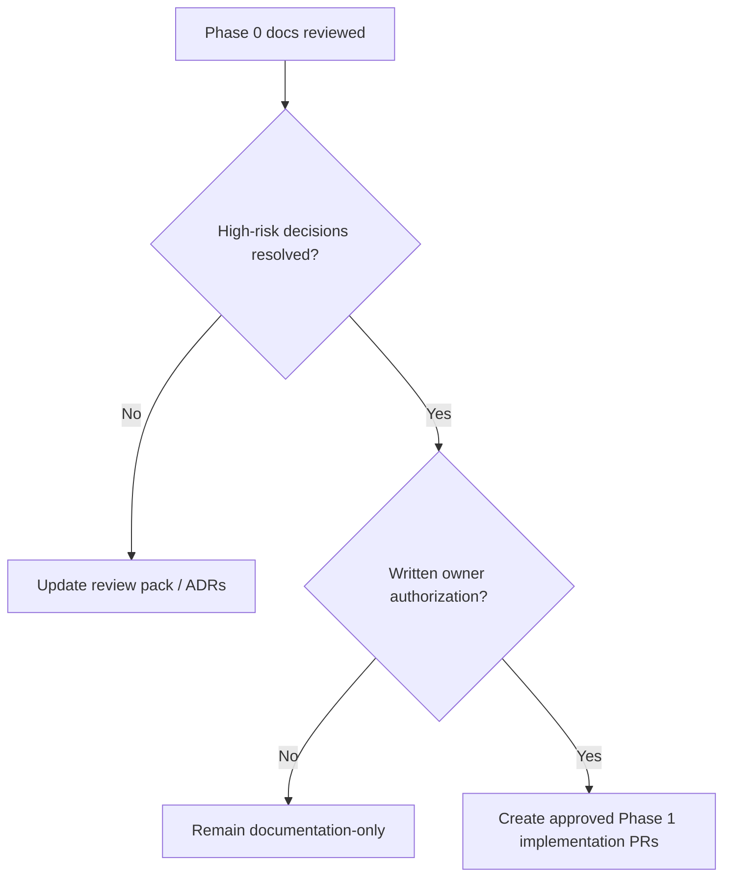

# 🚦 Phase 1 · Implementation Readiness Gate
**A written approval checklist for starting Expo development later.**

[← Docs hub](00-INDEX.md) · [🧭 Decision pack](17-PHASE-0-DECISION-PACK.md) · [🗺 Roadmap](06-ROADMAP.md)

> [!IMPORTANT]
> **This is a readiness checklist, not an implementation task.** Completing/merging this document does not authorize writing application code, generating secrets or deploying Supabase.

## 01 · Prerequisite decisions

| Gate | What must be true | Current |
|---|---|---|
| Product | **MVP functional screens/scope selected** (ADR-011); final brand/visual hierarchy/accessibility sign-off | ⬜ Detailed design pending |
| Session | **Email/password + cached offline access policy selected** (ADR-011); test offline revocation, reauth and errors | ⬜ Runtime evidence pending |
| Data isolation | **One account/installation, no switching, logout retains data; separate reset** selected; native key/erase lifecycle and tests still required | ⬜ Technical validation pending |
| Native build | SQLCipher build/validation strategy accepted (Expo Go limitations understood) | ⬜ Pending |
| Migrations | **ADR-010 tooling selected**; compatible native versions/bundling, account-specific journal, safe migration and recovery still require validation/sign-off | ⬜ Technical gate pending |
| Privacy | Workouts stay local; cloud upload disabled by default | ✅ Requirement recorded, **not tested** |
| Secrets | AI provider secrets server-side; publishable keys understood | ✅ Requirement recorded, **not tested** |
| Backup | **ADR-012 optional backup OFF by default** and cleared-data empty/restore UX selected; portable secret required. Providers, encryption implementation, auto timing and restore proofs deferred to later phase | ✅ UX policy recorded; future tests pending |
| Tests | Owner-selected MVP and single-account acceptance scenarios defined; native/device execution and exact release thresholds still required | ⬜ Runtime evidence pending |
| Owner authorization | Explicit written approval for Phase 1 implementation | ⬜ Pending |

## 02 · Proposed Phase 1 slices **after** approval

| Slice | Deliverable | Exit evidence |
|---|---|---|
| 1.1 | Expo TypeScript app shell, routing/theme, basic CI | Physical device starts shell, test command documented |
| 1.2 | Auth sign-up/sign-in/forgot password; secure persistence adapter | Correct persistent login and offline session flows |
| 1.3 | Single-bound-account encrypted SQLite + **owner-selected Drizzle migration tooling** (after Phase 1 authorization) | `PRAGMA cipher_version` native verification, offline migration, failure recovery and blocked-second-account tests |
| 1.4 | Exercise library and plan editor | Local creation/edit/restart works without network |
| 1.5 | Workout sets/session logging | Atomic autosave and crash/restart recovery |
| 1.6 | History/progress, logout, local erase UX | Correct account isolation, privacy and offline tests |
| 1.7 | Release candidate validation | Android/iPhone device acceptance evidence and documented limitations |

Do **not** pull AI, Drive/iCloud backup or Postgres sync into Phase 1 by implication. They have their own later gated phases.

## 03 · Validation matrix

- [ ] `AUTH-01/02/03/04/05/06/07/08/09`: signup, reopening, offline access, denied second account, same-user re-login, revoked session and explicit reset.
- [ ] `DATA-01/02/03/04/05/06/07`: persistence, crash recovery, deletion, offline upgrades, interrupted migrations and account isolation.
- [ ] `SEC-01/02/03`: no production secrets in mobile binary; verified SQLCipher and fail-closed key/cipher failure.
- [ ] Real Android + iPhone developer/release build tests recorded.
- [ ] Measured navigation, local query and autosave performance with representative workouts.
- [ ] Clear backup-loss warning for local-only mode: OS clear data/reinstall/erase may remove workouts; login alone does not restore them. Future opt-in backup/restore tested in its own phase.
- [ ] No runtime app logs contain raw workout values or auth credentials.

## 04 · Change approval record

| Field | Required value |
|---|---|
| Approver | Repository owner |
| Date | ISO date |
| Scope | Exact approved Phase 1 work and explicit exclusions |
| Chosen options | References to [decision register](09-DECISIONS.md) / issue #2 |
| Security exceptions | Explicitly listed and accepted, or “none” |
| Review evidence | Linked PR or issue comment recording approval |

**Owner future-business choice (ADR-014):** Full supported workout-data Supabase Sync is a later **opt-in paid membership** feature, not in Phase 1. Membership does not by itself authorize workout uploads; local logging and optional Personal Backup remain available without paid Sync. Billing/entitlement/security/retention remain pending.

**Current Phase 1 authorization:** None recorded in this document. **Phase 0 owner decisions:** ADR-010 selected the database stack; ADR-011 selected email/password, single-account/no-switch policy, offline access risk, retained logout data and MVP functional scope; ADR-012 selected future optional backup defaults and fresh-login recovery UX (2026-11-14). Neither approves code, native key/erase implementation, migration execution or deployment.

## 05 · Go/no-go

---

[← Owner review pack](17-PHASE-0-DECISION-PACK.md) · [Test plan](08-TEST-PLAN.md) · [Definition of done](15-DEFINITION-OF-DONE.md)
