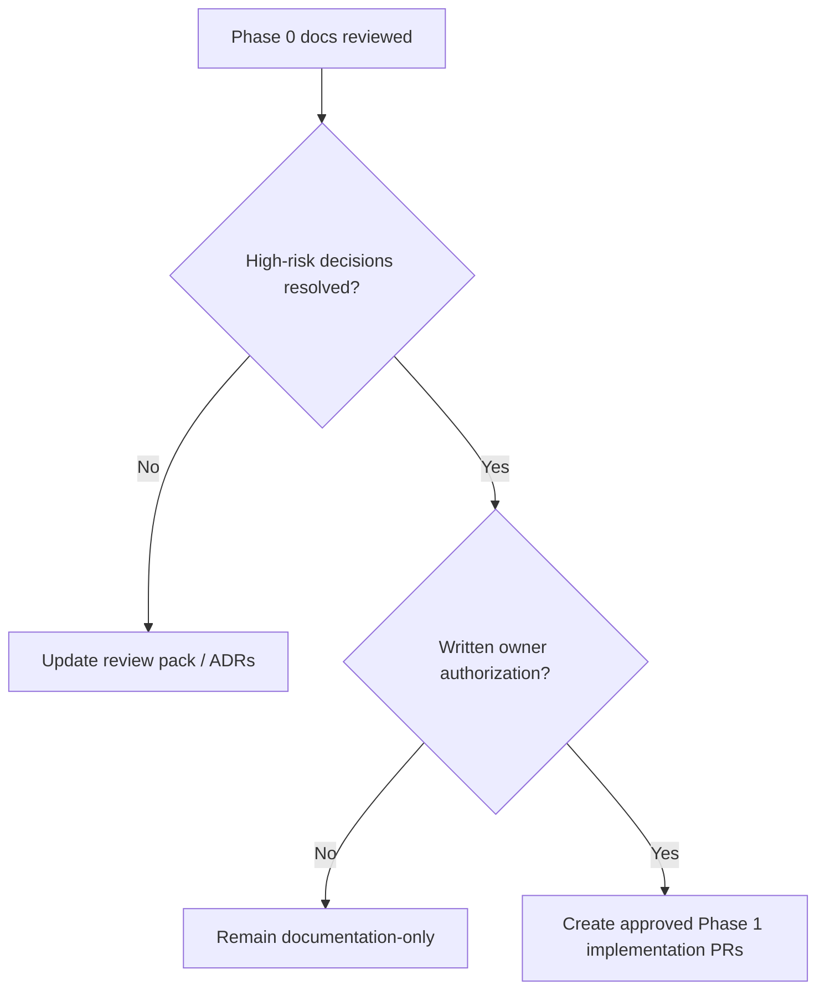

# 🚦 Phase 1 · Implementation Readiness Gate
**A written approval checklist for starting Expo development later.**

[← Docs hub](00-INDEX.md) · [🧭 Decision pack](17-PHASE-0-DECISION-PACK.md) · [🗺 Roadmap](06-ROADMAP.md)

> [!IMPORTANT]
> **This is a readiness checklist, not an implementation task.** Completing/merging this document does not authorize writing application code, generating secrets or deploying Supabase.

**Owner-facing approval draft:** use the [Phase 0 design and Phase 1 sign-off pack](22-PHASE-0-DESIGN-AND-PHASE-1-APPROVAL.md) for the owner-selected initially four-tab **config-driven Standard layout**, future Pill option and Glass/Solid × Light/Dark shared shell (ADR-015), exact remaining decisions and narrower **Phase 1.1 shell-only** scope. No owner has approved that scope by merely requesting this document; the matrix below remains pending where marked.

**Gate distinction:** approval to *start a bounded Phase 1.1 shell* requires accepted design/implementation limits and written owner authorization. Runtime SQLCipher, Drizzle and OS-backup tests are **later native implementation/release exit gates**, not tests falsely claimed before any native build exists. They must pass before enabling protected local workout storage or releasing the MVP.

## 01 · Prerequisite decisions

| Gate | What must be true | Current |
|---|---|---|
| Product | **MVP functional screens/scope selected** (ADR-011); final brand/visual hierarchy/accessibility sign-off | ⬜ Detailed design pending |
| Session | **Email/password + cached offline access policy selected** (ADR-011); test offline revocation, reauth and errors | ⬜ Runtime evidence pending |
| Data isolation | **One account/installation, no switching, logout retains data; separate reset** selected; native key/erase lifecycle and tests still required | ⬜ Technical validation pending |
| Native build | SQLCipher build/validation strategy accepted (Expo Go limitations understood) | ⬜ Pending |
| Migrations | **ADR-010 tooling selected**; compatible native versions/bundling, account-specific journal, safe migration and recovery still require validation/sign-off | ⬜ Technical gate pending |
| Privacy | Workouts stay local; cloud upload disabled by default | ✅ Requirement recorded, **not tested** |
| Secrets | AI provider secrets server-side; publishable keys understood | ✅ Requirement recorded, **not tested** |
| OS-managed backup privacy | Android legacy/12+ cloud/device-transfer and iOS native exclusions, plus stale-key fail-closed recovery | ⬜ Native validation pending (`SEC-04/05`) |
| Backup | **ADR-012 optional backup OFF by default** and cleared-data empty/restore UX selected; portable secret required. Providers, encryption implementation, auto timing and restore proofs deferred to later phase | ✅ UX policy recorded; future tests pending |
| Tests | Owner-selected MVP and single-account acceptance scenarios defined; native/device execution and exact release thresholds still required | ⬜ Runtime evidence pending |
| Owner authorization | Explicit written approval for Phase 1 implementation | ⬜ Pending |

## 02 · Proposed Phase 1 slices **after** approval

| Slice | Deliverable | Exit evidence |
|---|---|---|
| 1.1 | Expo TypeScript app shell, routing/theme, basic CI | Physical device starts shell, test command documented |
| 1.2 | Auth sign-up/sign-in/forgot password; secure persistence adapter | Correct persistent login and offline session flows |
| 1.3 | Single-bound-account encrypted SQLite + **owner-selected Drizzle migration tooling** (after Phase 1 authorization) | `PRAGMA cipher_version` native verification, offline migration, failure recovery and blocked-second-account tests |
| 1.4 | Exercise library and plan editor | Local creation/edit/restart works without network |
| 1.5 | Workout sets/session logging | Atomic autosave and crash/restart recovery |
| 1.6 | History/progress, logout, local erase UX | Correct account isolation, privacy and offline tests |
| 1.7 | Release candidate validation | Android/iPhone device acceptance evidence and documented limitations |

Do **not** pull AI, Drive/iCloud backup or Postgres sync into Phase 1 by implication. They have their own later gated phases.

## 03 · Validation matrix

- [ ] `AUTH-01/02/03/04/05/06/07/08/09`: signup, reopening, offline access, denied second account, same-user re-login, revoked session and explicit reset.
- [ ] `DATA-01/02/03/04/05/06/07`: persistence, crash recovery, deletion, offline upgrades, interrupted migrations and account isolation.
- [ ] `SEC-01/02/03`: no production secrets in mobile binary; verified SQLCipher and fail-closed key/cipher failure.
- [ ] `SEC-04/05`: validate Local Only Android/iOS OS-managed backup/device-transfer exclusions and stale-key recovery on real native builds.
- [ ] Future Personal Backup phase `BKP-15/16`: voluntary discovery after erased local settings, matching encrypted archive restore and safe provider-not-found errors.

- [ ] Real Android + iPhone developer/release build tests recorded.
- [ ] Measured navigation, local query and autosave performance with representative workouts.
- [ ] Clear backup-loss warning for local-only mode: OS clear data/reinstall/erase may remove workouts; login alone does not restore them. Future opt-in backup/restore tested in its own phase.
- [ ] No runtime app logs contain raw workout values or auth credentials.

### Review-ready acceptance for the proposed design baseline (not yet executed)

- [ ] Phase 1 **P0 UX-01–05 and UX-08–10** documented in [test plan](08-TEST-PLAN.md), including **Standard translucent Glass bar** on configured roots (initial four), future variable-count architecture, root scroll-revealed/nested immediate TopBar, Settings-only Solid, four material/appearance combinations, central `src/shared/theme/tokens/` and dumb-screen boundaries; **Pill is future only**. Native accessibility evidence required after implementation; **UX-06 P1 Backup and UX-07 P2 Sync** remain later phase gates.
- [x] Owner selected **four initial root tabs in a Standard bottom bar with default Glass material**, config-driven future tab counts/order and optional future Pill layout; root scroll-revealed TopBar, nested back TopBar, Settings-only Solid, Light/Dark and dumb token-driven screens (ADR-015; design policy only).
- [ ] Confirm violet/mint colors, typography, **initial Light/Dark preference**, scroll threshold/animation and final visual QA (Glass material default is already selected; see [approval pack](22-PHASE-0-DESIGN-AND-PHASE-1-APPROVAL.md)).
- [ ] Owner documents application identifiers and whether logo/app icon remain provisional; no fake design-signoff claims.
- [ ] Scope exclusions for the initial **Phase 1.1 shell** are explicit: no auth connection, SQLCipher workout store, AI, backups, paid Sync, billing or release.
- [ ] Later native security and portability gates remain pending until real Android/iOS builds produce evidence.

## 04 · Change approval record

| Field | Required value |
|---|---|
| Approver | Repository owner |
| Date | ISO date |
| Scope | Exact approved Phase 1 work and explicit exclusions |
| Chosen options | References to [decision register](09-DECISIONS.md) / issue #2 |
| Security exceptions | Explicitly listed and accepted, or “none” |
| Review evidence | Linked PR or issue comment recording approval |

**Owner future-business choice (ADR-014):** Full supported workout-data Supabase Sync is a later **opt-in paid membership** feature, not in Phase 1. Membership does not by itself authorize workout uploads; local logging and optional Personal Backup remain available without paid Sync. Billing/entitlement/security/retention remain pending.

**Current Phase 1 authorization:** None recorded in this document. **Phase 0 owner decisions:** ADR-010 selected the database stack; ADR-011 selected email/password, single-account/no-switch policy, offline access risk, retained logout data and MVP functional scope; ADR-012 selected future optional personal backup and manual restore UX; ADR-013 selected exclusive cloud modes and future auto-hydration for previously enabled authorized Sync; ADR-014 selected optional paid membership **plus independent consent** for future full-workout server Sync (2026-11-14). These approve policy only, **not** code, billing, native key/erase, migration, backend or deployment.

## 05 · Go/no-go

---

[← Owner review pack](17-PHASE-0-DECISION-PACK.md) · [Test plan](08-TEST-PLAN.md) · [Definition of done](15-DEFINITION-OF-DONE.md)
