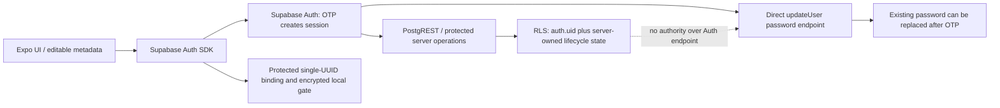

# OTP-first Auth lifecycle — Phase 1.2 design contract

**Status:** Owner-selected UX and proposed security architecture, 2026-11-16. **BLOCKED for production implementation** on direct Auth password mutation, hosted email delivery and unproven abuse controls. No table, policy, Auth setting or app flow is deployed by this document.

[← Auth security](04-AUTH-AND-SECURITY.md) · [ADR-017](23-INPUT-LIMITS-OTP-AND-FUTURE-MEMBERSHIP.md) · [Proposed ADR-019](25-MINIMAL-CLOUD-PROFILE-AND-LOCAL-ONBOARDING.md) · [Tests](08-TEST-PLAN.md)

## Evidence and fixed behavior

The isolated Task 02 PoC used Supabase CLI 2.121.0, supabase-js 2.119.0 and Mailpit: 15/16 core checks passed. `signInWithOtp` delivered a six-digit token; `verifyOtp` returned a session; `updateUser({ password })` set a password; password sign-in succeeded; invalid, replayed and 605-second-old codes failed with a 600-second setting. A disposable RLS fixture blocked protected rows until server-owned activation. **The failed check matters:** OTP sign-in to an already password-enabled account followed by direct `updateUser({ password })` replaced its password. Five invalid OTP attempts did not block the valid code. This is local evidence only; no hosted or device test ran. Task 01 and Task 02A were feasibility/readiness work, not Auth implementation approval.

Owner-selected routes:

- **New account:** Email → six-digit OTP → Password → Account Setup (Username required, Mobile optional) → Name → DOB → Sex → Units → Height → Current Weight → Activity Level → Goal → Final Setup → Home.
- **Existing activated account:** Email → six-digit OTP → direct login → Home. Never show Set Password or call `updateUser({ password })` on this normal path. Keep the same Supabase UUID and the single installation binding.
- **Incomplete account:** Email → OTP → resume the first unfinished authorized stage. Never reset a password because onboarding is incomplete.
- **Normal reopen:** a valid persisted same-user session does not require another OTP. Previously authorized locally bound users may use encrypted local workouts offline under [ADR-011](18-OFFLINE-SESSION-STATE-MACHINE.md); an online server request still needs fresh server authorization.

## Proposed server-authoritative states

The state is keyed by immutable `auth.users.id` in a **private, non-client-writable lifecycle record** or equivalent trusted server-owned state. The exact schema, transaction boundary and profile privacy policy need separate approval. `auth.users.encrypted_password` presence/length and `user_metadata` are **not** completion evidence; the PoC found a 60-character hash even for OTP-only accounts. A client-supplied stage, email, JWT `user_metadata` or local navigation flag cannot advance state.

| State | Trusted evidence | Permitted operations | Denied |
|---|---|---|---|
| `UNVERIFIED` | No successful server OTP verification | Request/resend OTP subject to provider limits | Protected cloud rows, local binding/Home |
| `EMAIL_VERIFIED_PASSWORD_PENDING` | Verified Auth UUID and trusted initial-enrollment record | Initial password enrollment **only through a separately verified controlled mechanism**; safe resume | Protected cloud rows, local binding/Home, arbitrary profile activation |
| `PASSWORD_COMPLETE_PROFILE_PENDING` | Trusted server acknowledgement of first password enrollment | Save/resume approved private required profile fields | Protected workout/activated cloud resources, local Home |
| `PROFILE_COMPLETE_LOCAL_PENDING` | Required private profile atomically validated and server activation eligibility recorded | Bind same UUID, complete encrypted local onboarding, resume first missing local step | Other UUID's local data; final Home until local completion |
| `ACTIVE` | Server-owned activation eligibility plus durable same-UUID local completion | Own authorized cloud profile and locally bound Home; OTP or persisted-session login | Other users' resources; silent password replacement in the normal OTP login flow |
| `LOCKED` / `ACCOUNT_MISMATCH` | Logout, confirmed invalid session, missing protected key or different UUID | Same-account reauth/recovery | Local workout unlock, rebind, erase-on-error |

`PROFILE_COMPLETE_LOCAL_PENDING` is protected from abandoned-signup deletion once server activation eligibility permits local binding, even if local onboarding is unfinished. An offline client cannot newly establish that eligibility. `ACTIVE` combines a server-side authorization gate with a device-local completion marker; server access never trusts the device marker. Cloud profile fields, avatar/storage, device snapshot and server-owned `FREE` entitlement remain **ADR-019 proposals**, not approved schema or live data.

```mermaid
stateDiagram-v2
    [*] --> UNVERIFIED: new email
    UNVERIFIED --> EMAIL_VERIFIED_PASSWORD_PENDING: verifyOtp / same UUID
    EMAIL_VERIFIED_PASSWORD_PENDING --> PASSWORD_COMPLETE_PROFILE_PENDING: trusted initial enrollment acknowledged
    PASSWORD_COMPLETE_PROFILE_PENDING --> PROFILE_COMPLETE_LOCAL_PENDING: required private profile validated
    PROFILE_COMPLETE_LOCAL_PENDING --> ACTIVE: same-UUID encrypted local setup durably complete
    ACTIVE --> ACTIVE: OTP login or valid persisted session; password unchanged
    EMAIL_VERIFIED_PASSWORD_PENDING --> EMAIL_VERIFIED_PASSWORD_PENDING: interrupted resume
    PASSWORD_COMPLETE_PROFILE_PENDING --> PASSWORD_COMPLETE_PROFILE_PENDING: interrupted resume
    PROFILE_COMPLETE_LOCAL_PENDING --> PROFILE_COMPLETE_LOCAL_PENDING: interrupted resume
    ACTIVE --> LOCKED: logout / confirmed reauth required
    LOCKED --> ACTIVE: same-UUID online reauth; local gate passes
    LOCKED --> ACCOUNT_MISMATCH: different UUID on bound installation
    ACCOUNT_MISMATCH --> LOCKED: discard other session; retain ciphertext
```

Transitions must be monotonic, keyed by UUID, idempotent under retries and written with server time; retries read the latest trusted state and never duplicate profile/measurements. A failed or ambiguous write leaves the earlier state and protected resources closed. If a cloud state read fails during first setup, fail closed. After prior activation, a temporary network failure alone cannot prove revocation or erase local eligibility.

## Trust boundaries and direct password mutation blocker

`verifyOtp` creates a real Auth session **before** password/profile completion. Treat it as identity proof, not full Tio activation. Every protected cloud table/function/storage policy must enforce both `auth.uid()` ownership and the relevant current server-owned lifecycle state; no broad `TO authenticated`-only read. A stale JWT claim must not upgrade access: query trusted server state for sensitive operations or use a separately proven freshness mechanism; revocation cannot be claimed during offline use. Client gets only a publishable key, never a service-role/secret key. Local workout data remains encrypted on device and is never uploaded by this contract.

**Unresolved:** RLS cannot intercept Supabase Auth's direct `updateUser({ password })`. The local PoC proved a recently OTP-authenticated existing user could replace a password. Hiding Set Password avoids an accidental app call but is **not server-side prevention**. A trusted server can distinguish *first enrollment* from *later change* using its own monotonic enrollment marker, but writing that marker after a client `updateUser` call is not atomic proof that a direct call was the first one. Do not claim an `auth.users` hash, user metadata, app route, or this proposed record blocks direct mutation.

Before production, the owner must choose and security-test one explicit policy: **(A)** accept that email ownership via OTP can change an existing password through Supabase Auth, while normal OTP login never invokes that operation and Forgot/Reset Password is explicit; or **(B)** require Auth-level prevention of direct replacement, which needs a provider-supported policy/hook or controlled password-enrollment path proven to cover direct Auth calls. Current documented hooks do not establish such coverage. Requiring the current password might protect later changes but could obstruct first enrollment; compatibility is unverified. If (B) cannot be proven, keep Auth implementation blocked rather than imply the UI is a security control. [Supabase `updateUser`](https://supabase.com/docs/reference/javascript/auth-updateuser) · [password security](https://supabase.com/docs/guides/auth/password-security) · [Auth hooks](https://supabase.com/docs/guides/auth/auth-hooks).

## Errors, abuse, recovery and hosting

| Event | Safe behavior / evidence boundary |
|---|---|
| Invalid, expired or replayed OTP | Reject; retain locked stage; generic accessible error; never log code. Local rejection was proven. |
| Resend or HTTP 429 | Honor actual server retry timing; UI countdown is explanatory only. Local immediate resend failed and request after 61 seconds passed. |
| 5 sends/email/hour; 5 failures/challenge; 15-minute cooldown | **Targets, not proven controls.** Local valid OTP still worked after five wrong codes. Need approved server-enforced design and negative tests without a client-only counter. |
| Existing email | Send OTP with non-enumerating response, verify UUID, read trusted stage. Active → login without password update; pending → resume only the missing stage. Never create a second account or bind another UUID. |
| Password recovery | Separate Forgot/Reset Password intent and UX; no implicit reset during OTP login. Test provider reset/re-auth behavior and account isolation before enabling. |
| Interrupted signup / app restart | Restore protected session where valid; re-read trusted server stage and resume idempotently. No first-time offline activation. A valid persisted active session skips OTP. |
| Email/provider error | Generic, non-enumerating and actionable retry where safe; do not claim an email was sent or unlock on timeout. |

No custom domain, Brevo SMTP, Google OAuth, paid Supabase upgrade or provider-setting change is approved. Supabase's built-in email provider is currently restricted to authorized project-team addresses and 2 messages/project/hour; it cannot establish public signup or the 5/email/hour target. Mailpit evidence cannot prove hosted Free-tier template/delivery behavior. Hosted template, delivery, quotas, rate enforcement and native Android/iOS persistence remain **BLOCKED/UNVERIFIED**. [Default SMTP](https://supabase.com/docs/guides/auth/auth-smtp) · [rate limits](https://supabase.com/docs/guides/auth/rate-limits) · [passwordless flow](https://supabase.com/docs/guides/auth/auth-email-passwordless).

## Next bounded implementation gate

After an explicit owner choice on direct password mutation and separate approval of private profile/schema, hosted email transport, rate enforcement and secure device session storage, start with a **small server-owned lifecycle and authorization slice**: one trusted stage transition, one own-row RLS policy, and negative tests for OTP-only, forged metadata, stale token, wrong UUID and retry. No workout upload, avatar, device snapshot, billing, cleanup job or production migration is authorized by this design PR. Keep status `BLOCKED` until the chosen password policy and hosted delivery can be demonstrated.
