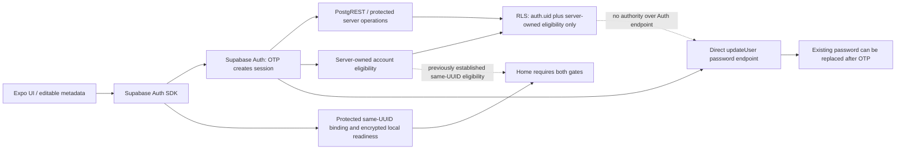

# Unified Auth and OTP-first signup lifecycle — Phase 1.2 design contract

**Status:** Owner-selected unified Auth UX (2026-11-17) and proposed security architecture. **BLOCKED for production implementation** on direct Auth password mutation, hosted email delivery and unproven abuse controls. No table, policy, Auth setting or app flow is deployed by this document.

[← Auth security](04-AUTH-AND-SECURITY.md) · [ADR-017](23-INPUT-LIMITS-OTP-AND-FUTURE-MEMBERSHIP.md) · [Proposed ADR-019](25-MINIMAL-CLOUD-PROFILE-AND-LOCAL-ONBOARDING.md) · [Tests](08-TEST-PLAN.md)

## Evidence and fixed behavior

The isolated Task 02 PoC used Supabase CLI 2.121.0, supabase-js 2.119.0 and Mailpit: 15/16 core checks passed. `signInWithOtp` delivered a six-digit token; `verifyOtp` returned a session; `updateUser({ password })` set a password; password sign-in succeeded; invalid, replayed and 605-second-old codes failed with a 600-second setting. A disposable RLS fixture blocked protected rows until server-owned activation. **The failed check matters:** OTP sign-in to an already password-enabled account followed by direct `updateUser({ password })` replaced its password. Five invalid OTP attempts did not block the valid code. This is local evidence only; no hosted or device test ran. Task 01 and Task 02A were feasibility/readiness work, not Auth implementation approval.

Owner-selected routes:

The existing Expo preview already uses one shared presentation with mode-specific content and two lightweight routes. Preserve its current Sign Up/Sign In headings and helper text, typography, spacing, Email/Password fields, keyboard/focus timing, Header/Back, persistent footer/Continue, accessibility and small-screen behavior. **Sign Up** initially shows Email only, then Continue opens OTP; Password appears only after successful verification. **Sign In** initially shows Email only; Continue reveals Password while retaining Email and keyboard behavior. The selected route/mode controls this transition; no unauthenticated account-existence lookup or automatic mode switch is permitted. **Forgot Password** retains its preview behavior and text, separate from normal Sign In. This is approved UX policy, not authorization to modify TS/TSX or a claim of working Auth.

- **New account:** Email → six-digit OTP → Password → Account Setup (Username required, Mobile optional) → Name → DOB → Sex → Units → Height → Current Weight → Activity Level → Goal → Final Setup → Home.
- **Existing server-eligible account:** Email → Password → `signInWithPassword` → trusted server eligibility → protected same-UUID device-local readiness → Home. The Email field remains visible when Password appears after Continue. Normal Sign In sends no OTP and never calls `updateUser({ password })`. On a fresh installation, resume local setup or a separately verified matching restore. Keep the same Supabase UUID and the single installation binding.
- **Password not yet set:** A provisional Supabase Auth row/session is not a completed Tio account. On return, require Email → a fresh OTP → Password; do not restore a password-pending screen from a persisted session. If server cleanup already removed the provisional UUID, registration starts with a new UUID. Never apply this short cleanup rule to an existing password-complete account.
- **Password-complete incomplete account:** Email → Password authentication (or valid persisted same-user session) → resume the first unfinished trusted cloud-profile or device-local stage. Never reset a password or restart completed onboarding because setup is incomplete.
- **Normal reopen after password completion:** a valid persisted same-user session bypasses unnecessary Sign In. Previously authorized locally bound users may use encrypted local workouts offline under [ADR-011](18-OFFLINE-SESSION-STATE-MACHINE.md); an online server request still needs fresh server authorization.

## Two independent eligibility gates

**Server account eligibility** is keyed by immutable `auth.users.id` in a private, non-client-writable lifecycle record or equivalent trusted server-owned state. Only independently verified server facts may advance it: OTP verification, trusted initial password-enrollment acknowledgement and validated required cloud profile. The exact schema, transaction boundary and profile privacy policy need separate approval. `auth.users.encrypted_password` presence/length and `user_metadata` are **not** completion evidence; the PoC found a 60-character hash even for OTP-only accounts. A client-supplied stage, email, JWT `user_metadata`, `local_complete` or navigation flag cannot advance server eligibility.

**Device-local Home readiness** is separate: a protected binding to that same UUID, durable encrypted local setup and a locally protected completion marker. It is verified by the device gate and cannot be asserted by an Auth session or cloud profile alone. The server cannot independently verify this local marker, so it must never promote the server lifecycle or grant cloud access through RLS. Home requires both prior server eligibility for the same UUID and device-local readiness under the session/offline policy. A fresh installation with a server-eligible account but no bound local database resumes local setup or a separately verified matching restore; it must not open Home or claim restored workouts.

| State | Trusted evidence | Permitted operations | Denied |
|---|---|---|---|
| `UNVERIFIED` | No successful server OTP verification | Request/resend OTP subject to provider limits | Protected cloud rows, local binding/Home |
| `EMAIL_VERIFIED_PASSWORD_PENDING` | Provisional verified Auth UUID and trusted initial-enrollment record; no completed Tio account | Initial password enrollment **only through a separately verified controlled mechanism** within the owner-selected cleanup window; on return require fresh Email + OTP | Protected cloud rows, local binding/Home, arbitrary profile activation or persisted-session-only resume |
| `PASSWORD_COMPLETE_PROFILE_PENDING` | Trusted server acknowledgement of first password enrollment | Save/resume approved private required profile fields | Protected workout/activated cloud resources, local Home |
| `SERVER_ELIGIBLE` | Required private profile validated and server-owned activation protection durably recorded | Own authorized cloud profile; attempt same-UUID local binding/setup | Other users' cloud resources; Home without local readiness; silent password replacement in normal Sign In |

`SERVER_ELIGIBLE` is protected from abandoned-signup deletion even if local onboarding is unfinished. An offline client cannot newly establish server eligibility. Cloud RLS uses `auth.uid()` and current server-owned eligibility/ownership only; it neither reads nor trusts device-local completion. Cloud profile fields, avatar/storage, device snapshot and server-owned `FREE` entitlement remain **ADR-019 proposals**, not approved schema or live data.

| Device-local state | Protected evidence | Home result |
|---|---|---|
| `LOCAL_UNBOUND` | No protected binding/database for the server UUID, including a fresh installation | Deny; begin authorized local setup or separately verified matching restore |
| `LOCAL_SETUP_PENDING` | Protected same-UUID binding exists; required encrypted local onboarding is incomplete | Deny; resume first missing local step |
| `LOCAL_READY` | Same-UUID binding, required encrypted local data and durable protected completion marker verified together | Permit only with server eligibility previously established and current session/offline policy satisfied |
| `LOCAL_LOCKED` / `ACCOUNT_MISMATCH` | Logout, confirmed invalid session, missing key or another UUID | Deny; retain ciphertext, require same-account recovery |

```mermaid
stateDiagram-v2
    [*] --> UNVERIFIED: new email
    UNVERIFIED --> EMAIL_VERIFIED_PASSWORD_PENDING: verifyOtp / same UUID
    EMAIL_VERIFIED_PASSWORD_PENDING --> PASSWORD_COMPLETE_PROFILE_PENDING: trusted initial enrollment acknowledged
    PASSWORD_COMPLETE_PROFILE_PENDING --> SERVER_ELIGIBLE: required cloud profile validated / server protection recorded
    SERVER_ELIGIBLE --> SERVER_ELIGIBLE: password login or valid persisted session; password unchanged
    EMAIL_VERIFIED_PASSWORD_PENDING --> EMAIL_VERIFIED_PASSWORD_PENDING: return before cleanup / fresh Email + OTP verification
    EMAIL_VERIFIED_PASSWORD_PENDING --> [*]: 15-minute target / provisional-row cleanup
    PASSWORD_COMPLETE_PROFILE_PENDING --> PASSWORD_COMPLETE_PROFILE_PENDING: interrupted resume
    SERVER_ELIGIBLE --> SERVER_ELIGIBLE: local setup or interrupted resume does not change server state
```

```mermaid
stateDiagram-v2
    [*] --> LOCAL_UNBOUND: fresh installation
    LOCAL_UNBOUND --> LOCAL_SETUP_PENDING: server eligibility established / bind same UUID
    LOCAL_SETUP_PENDING --> LOCAL_READY: verified durable encrypted local completion
    LOCAL_READY --> LOCAL_LOCKED: logout / confirmed reauth required
    LOCAL_LOCKED --> LOCAL_READY: same-UUID session and protected local gate pass
    LOCAL_LOCKED --> ACCOUNT_MISMATCH: different UUID attempts login
    ACCOUNT_MISMATCH --> LOCAL_LOCKED: discard other session; retain ciphertext
```

Server transitions must be monotonic, keyed by UUID, idempotent under retries and written with server time; retries read the latest trusted server state. Device-local completion must be durable and protected under the same UUID, with idempotent retries that never duplicate local measurements. A failed or ambiguous write leaves the earlier state and protected resources closed. If a cloud state read fails during first setup, fail closed. After prior server eligibility and local readiness, a temporary network failure alone cannot prove revocation or erase local eligibility.

**Owner-selected provisional-row cleanup target (design only):** For a new unverified email, delete a provisional Auth row 15 minutes after the **latest issued** 10-minute OTP expires if no successful verification or password enrollment occurred. For a verified OTP with no initial password enrollment, delete the provisional row 15 minutes after verification. The app does not preserve a password-pending resume stage; a returning user enters Email and obtains a new OTP. Supabase may create `auth.users` at `signInWithOtp`, so “no completed Tio account” is a product/lifecycle distinction, not a claim that no Auth row exists. Server-only cleanup must recheck the exact UUID and trusted enrollment/activation markers immediately before deletion, reject ambiguous or racing writes, and never target an existing password-complete, server-eligible or locally bound user. The target is not a promise of exact deletion time; scheduling, provider configuration and secure deletion remain unimplemented and require separate authorization. See [ADR-019 cleanup proposal](25-MINIMAL-CLOUD-PROFILE-AND-LOCAL-ONBOARDING.md).

## Trust boundaries and direct password mutation blocker

`verifyOtp` creates a real Auth session **before** password/profile completion. Treat it as identity proof, not full Tio activation. Every protected cloud table/function/storage policy must enforce both `auth.uid()` ownership and the relevant current server-owned eligibility; no broad `TO authenticated`-only read. A forged `local_complete` request, metadata value or client flag must change neither server eligibility nor cloud authorization. A stale JWT claim must not upgrade access: query trusted server state for sensitive operations or use a separately proven freshness mechanism; revocation cannot be claimed during offline use. Client gets only a publishable key, never a service-role/secret key. Local workout data remains encrypted on device and is never uploaded by this contract.

**Unresolved:** RLS cannot intercept Supabase Auth's direct `updateUser({ password })`. The local PoC proved a recently OTP-authenticated existing user could replace a password. Using password Sign In avoids an accidental app call but is **not server-side prevention**. A trusted server can distinguish *first enrollment* from *later change* using its own monotonic enrollment marker, but writing that marker after a client `updateUser` call is not atomic proof that a direct call was the first one. Do not claim an `auth.users` hash, user metadata, app route, or this proposed record blocks direct mutation.

Before production, the owner must choose and security-test one explicit policy: **(A)** accept that email ownership via OTP can change an existing password through Supabase Auth, while normal password Sign In never invokes that operation and Forgot/Reset Password is explicit; or **(B)** require Auth-level prevention of direct replacement, which needs a provider-supported policy/hook or controlled password-enrollment path proven to cover direct Auth calls. Current documented hooks do not establish such coverage. Requiring the current password might protect later changes but could obstruct first enrollment; compatibility is unverified. If (B) cannot be proven, keep Auth implementation blocked rather than imply the UI is a security control. [Supabase `updateUser`](https://supabase.com/docs/reference/javascript/auth-updateuser) · [password security](https://supabase.com/docs/guides/auth/password-security) · [Auth hooks](https://supabase.com/docs/guides/auth/auth-hooks).

## Errors, abuse, recovery and hosting

| Event | Safe behavior / evidence boundary |
|---|---|
| Invalid, expired or replayed OTP | Reject; retain locked stage; generic accessible error; never log code. Local rejection was proven. |
| Resend or HTTP 429 | Honor actual server retry timing; UI countdown is explanatory only. Local immediate resend failed and request after 61 seconds passed. |
| 5 sends/email/hour; 5 failures/challenge; 15-minute cooldown | **Targets, not proven controls.** Local valid OTP still worked after five wrong codes. Need approved server-enforced design and negative tests without a client-only counter. |
| Existing email entered on Sign Up | Return a generic non-enumerating response and offer explicit Sign In or Forgot Password. Do not use a public existence lookup, automatically switch modes, enroll/replace that account's password, create a duplicate active account or bind another UUID. The safe provider/server mechanism remains unverified; block implementation until demonstrated. |
| Password recovery | Separate Email → recovery verification → New Password → Sign In flow, preserving existing preview text/behavior. A recovery-authenticated session may permit direct Auth password update; test provider reset/re-auth behavior and same-UUID isolation before enabling. |
| Interrupted signup / app restart | Before initial password enrollment, clear/ignore any provisional local session for product navigation and require a fresh Email + OTP; an Auth session may still exist server-side until cleanup, so RLS must deny protected resources. After password enrollment, re-read trusted stage and resume cloud/local setup idempotently. A valid persisted active session skips OTP. |
| Email/provider error | Generic, non-enumerating and actionable retry where safe; do not claim an email was sent or unlock on timeout. |

No custom domain, Brevo SMTP, Google OAuth, paid Supabase upgrade or provider-setting change is approved. Supabase's built-in email provider is currently restricted to authorized project-team addresses and 2 messages/project/hour; it cannot establish public signup or the 5/email/hour target. Mailpit evidence cannot prove hosted Free-tier template/delivery behavior. Hosted template, delivery, quotas, rate enforcement and native Android/iOS persistence remain **BLOCKED/UNVERIFIED**. [Default SMTP](https://supabase.com/docs/guides/auth/auth-smtp) · [rate limits](https://supabase.com/docs/guides/auth/rate-limits) · [passwordless flow](https://supabase.com/docs/guides/auth/auth-email-passwordless).

## Next bounded implementation gate

After an explicit owner choice on direct password mutation and separate approval of private profile/schema, hosted email transport, rate enforcement and secure device session storage, start with a **small server-owned lifecycle and authorization slice**: one trusted stage transition, one own-row RLS policy, and negative tests for OTP-only, forged metadata, stale token, wrong UUID and retry. No workout upload, avatar, device snapshot, billing, cleanup job or production migration is authorized by this design PR. Keep status `BLOCKED` until the chosen password policy and hosted delivery can be demonstrated.
